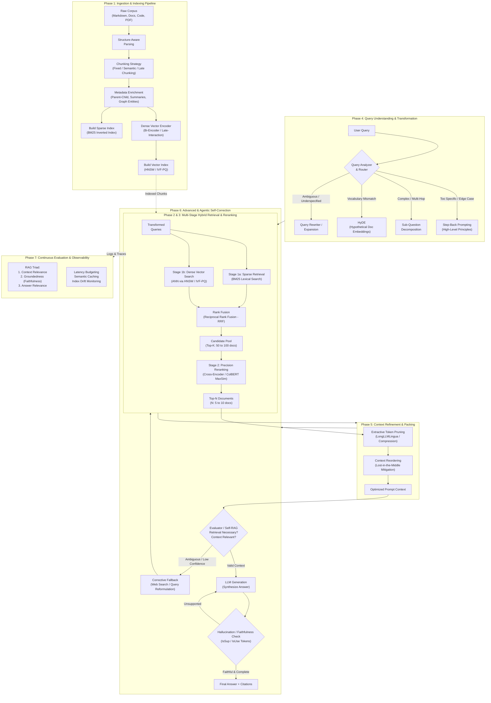

# The First-Principles RAG Study Guide
## From Transformers & Vector Primitives to Production Agentic Systems

> **Target Audience**: Machine Learning Engineers, Applied Scientists, and Senior Data Scientists who know Python, transformers, attention mechanisms, and embeddings at a working level, but want to understand **why** every RAG design choice exists, not just **what** it is.
>
> **Core Tenet**: Every concept must answer: *"What specific failure mode forced someone to invent this?"*

---

## 1. Executive Pipeline Architecture

Modern Retrieval-Augmented Generation is not a simple `retrieve -> stuff -> generate` loop. Production RAG is a multi-tier, closed-loop distributed system designed to bridge the fundamental gap between **parametric memory** (weights inside a static LLM) and **non-parametric memory** (dynamic, domain-specific, verifiable external corpora).



---

## 2. The Running Corpus & Queries

To guarantee complete continuity across every phase of this guide, we use **one concrete running corpus** of 6 distinct documents spanning enterprise product manuals, system architecture specs, theoretical research excerpts, source code, and production incident postmortems.

### 2.1 The Running Corpus ($\mathcal{D} = \{D_1, D_2, D_3, D_4, D_5, D_6\}$)

#### **Document $D_1$: OmniFlow Engine Architecture & Storage Tier**
```markdown
# OmniFlow Architecture Specification: Storage & Memory Hierarchy
OmniFlow is a distributed streaming vector database engine. The storage subsystem 
is decoupled into two primary tiers:
1. Hot Memory Tier: In-memory HNSW index structures built per active partition for 
   sub-millisecond approximate nearest neighbor search.
2. Cold Persistent Tier: Immutable Parquet-backed columnar files residing in object storage, 
   indexed via sparse lexical inverted indices and inverted file postings lists (IVF).
During data ingestion, OmniFlow buffers vector writes in a memory-mapped write-ahead 
log (WAL). Partitions flush to persistent object storage once their uncompressed memory 
footprint exceeds 4 GiB or when the flush timer reaches 300 seconds. OmniFlow partitions 
maintain isolated concurrency locks: readers acquire shared read leases, while compactions 
require exclusive table-level locks.
```

#### **Document $D_2$: OmniFlow Rate Limits, Quota Policies & Tier Upgrades**
```markdown
# OmniFlow API Rate Limiting and Quota Enforcement
All external API access to the OmniFlow distributed gateway is rate-limited via a 
distributed token-bucket algorithm keyed on tenant API credentials:
- Developer Tier: 100 requests per minute (RPM), bursting up to 150 RPM; 10 MB/sec payload bandwidth.
- Production Tier: 2,500 requests per minute (RPM), bursting up to 3,500 RPM; 100 MB/sec payload bandwidth.
- Enterprise Tier: 20,000 requests per minute (RPM), bursting up to 30,000 RPM; 1 GB/sec payload bandwidth.
When a client exceeds its token allowance, the gateway rejects the request with HTTP status code 429 
(Too Many Requests), returning a JSON error payload containing:
  {"error": "rate_limited", "retry_after_ms": 350, "quota_tier": "Developer"}
Tenants can initiate an instantaneous quota tier upgrade via the administrative API endpoint:
  POST /api/v1/tenant/upgrade?target_tier=Production
Upgrades take effect globally across all edge routing nodes within 15 seconds without cluster restarts.
```

#### **Document $D_3$: OmniFlow Python SDK: Streaming Client Configuration**
```markdown
# OmniFlow Python SDK Developer Manual: Client Lifecycle
The `OmniFlowClient` class encapsulates connection pooling, automatic token renewal, 
and resilient network fault tolerance for high-throughput batch ingest.
Key configuration parameters:
- `connection_pool_size`: Default is 32 HTTP/2 concurrent multiplexed sessions.
- `max_retries`: Maximum number of retry attempts for retryable HTTP status codes (default: 5).
- `retry_codes`: Tuple of HTTP error codes subject to exponential retry logic. 
  Defaults to (429, 502, 503, 504).
- `backoff_factor`: Multiplier for truncated exponential backoff delay calculation:
  sleep_time = min(backoff_factor * (2 ** (attempt - 1)) + jitter, max_backoff_seconds).
- `enable_adaptive_batching`: Dynamically resizes client-side micro-batches based on 
  observed round-trip latency (RTT) and downstream 429 response frequency.
```

#### **Document $D_4$: Research Excerpt: Late-Interaction & Dense-Sparse Alignment**
```markdown
# Dense-Sparse Alignment in Neural Information Retrieval: The ColBERT Paradigm
Traditional bi-encoder architectures map entire query and document sequences into isolated 
single-vector dense embeddings, creating an informational bottleneck that degrades retrieval 
precision on fine-grained lexical entities. Conversely, cross-encoders preserve all token-level 
interactions via all-to-all quadratic attention, yet exhibit an inference complexity of O(N * L^2), 
rendering top-K retrieval computationally intractable over massive corpora.
The ColBERT architecture introduces token-level late interaction: queries and documents are independently 
encoded into sequences of contextualized embeddings. Relevance score computation is formulated as:
  Score(Q, D) = \sum_{i \in Q} \max_{j \in D} (E_{q, i} \cdot E_{d, j})
This MaxSim operator allows pre-computing and indexing document token vectors offline, pruning candidate 
sets via inverted token centroids while retaining fine-grained cross-token matching semantics.
```

#### **Document $D_5$: Source Code: `omniflow/client.py`**
```python
import time
import random
from typing import Dict, Any, Optional
import requests

class OmniFlowClient:
    """Production client for OmniFlow streaming ingestion and query APIs."""
    def __init__(self, api_key: str, base_url: str, backoff_factor: float = 0.5, max_retries: int = 5):
        self.api_key = api_key
        self.base_url = base_url.rstrip("/")
        self.backoff_factor = backoff_factor
        self.max_retries = max_retries
        self.session = requests.Session()
        self.session.headers.update({"Authorization": f"Bearer {api_key}"})

    def ingest_vectors(self, collection: str, payload: Dict[str, Any]) -> Dict[str, Any]:
        """Ingests a vector micro-batch with exponential backoff on HTTP 429 rate limit."""
        url = f"{self.base_url}/api/v1/collections/{collection}/ingest"
        for attempt in range(1, self.max_retries + 1):
            response = self.session.post(url, json=payload)
            if response.status_code == 200:
                return response.json()
            elif response.status_code == 429:
                retry_after_ms = response.json().get("retry_after_ms", 250)
                jitter = random.uniform(0.01, 0.1)
                sleep_time = (retry_after_ms / 1000.0) + (self.backoff_factor * (2 ** (attempt - 1))) + jitter
                time.sleep(sleep_time)
            else:
                response.raise_for_status()
        raise TimeoutError(f"Exceeded max retries ({self.max_retries}) due to persistent rate limiting.")
```

#### **Document $D_6$: Incident Postmortem: OOM in HNSW Graph Construction**
```markdown
# Incident Postmortem: Incident 4092 — Worker OOM During Large Batch Ingestion
Date: 2024-03-14 | Severity: P1 | Root Cause: Memory Exhaustion in HNSW Graph Construction

Summary:
During a high-throughput vector backfill of 10,000,000 embeddings (dimension d=1536), multiple 
OmniFlow ingestion workers experienced Linux Out-Of-Memory (OOM) killer terminations on 64 GB RAM instances.

Root Cause Analysis:
1. Ingestion workers were provisioned with 64 GB RAM. Raw uncompressed vectors alone consumed:
   10,000,000 * 1536 * 4 bytes = 61.44 GB.
2. The ingestion collection was configured with HNSW parameters M=64 and efConstruction=200. At the base 
   layer (Layer 0), each vector node maintains up to 2 * M = 128 outgoing neighbor IDs using uint32 (4 bytes each):
   10,000,000 * 128 * 4 bytes = 5.12 GB.
3. Raw vectors plus Layer-0 graph edges alone totaled 61.44 GB + 5.12 GB = 66.56 GB, exceeding the 64 GB worker 
   memory ceiling before accounting for upper-layer edges, OS overhead, or active process buffers.
4. Compounding the memory pressure: ingestion workers slowed down under heavy allocation load, causing client requests to time out. Clients retried, rapidly exhausting the API gateway token bucket which returned HTTP 429 rate limits. Subsequent client retries created a thundering herd where each retried batch initiated a new, duplicate partial partition graph in worker RAM before uncompacted graphs could be reclaimed.

Resolution:
Reduced M to 16 (dropping Layer-0 edge overhead to 1.28 GB). However, because raw vectors alone (61.44 GB) plus M=16 edges and metadata still consume 62.84 GB—leaving under 1.2 GB of headroom on a 64 GB instance—the team sharded the collection across workers (e.g., 2 × 5M vectors ≈ 31 GB each) and/or evaluated storing compressed vectors in the graph (HNSW+PQ/SQ or DiskANN-style on-disk graph), while adding gateway token-bucket rate limiting and exponential backoff to prevent duplicate partition allocations.
```

---

### 2.2 The Running Queries & Baseline Failure Modes

We evaluate all retrieval and generation techniques against three specific query archetypes:

| Query ID | Query Text | Query Archetype | Why Baseline / Naive RAG Fails |
| :--- | :--- | :--- | :--- |
| **$Q_1$** | `"retry_after_ms max_backoff_seconds OmniFlowClient"` | **Identifier-Heavy Search** | **Dense Bi-Encoders Fail**: Subword tokenization fragments rare identifiers (e.g., `retry_after_ms` $\to$ `retry`, `_after`, `_ms`; `OmniFlowClient` $\to$ `Omni`, `Flow`, `Client`), and single-vector pooling dilutes them across smooth latent dimensions. Dense retrieval returns generic client connection text rather than the exact source code in $D_5$ and configuration in $D_3$. |
| **$Q_2$** | `"Why did our servers crash while building the search index for a big data import?"` | **Conceptual / Vocabulary Mismatch** | **Sparse BM25 Fails**: Content words in $Q_2$ are: `servers`, `crash`, `building`, `search`, `index`, `big`, `data`, `import`. <br/>• In $D_1$: `search` (1), `index` (1), `data` (1) appear.<br/>• In $D_5$: `import` (4) appears.<br/>• In $D_6$: **zero** content words appear ($D_6$ uses `workers`, `OOM killer terminations`, `construction`, `HNSW`, `backfill`).<br/>Consequently, BM25 scores $D_1$ highest (Lucene: 5.25 / Robertson: 4.43) and ranks $D_1$ substantially above $D_6$ (score 0.00 on content words), completely missing the incident postmortem! |
| **$Q_3$** | `"How do enterprise quota tier upgrades interact with client retry configuration to resolve ingestion batch failures?"` | **Multi-Hop / Compositional Reasoning** | **Single-Step Retrieval Fails**: No single document contains the complete answer. Answering requires reasoning across $D_2$ (tier upgrades to Production/Enterprise), $D_3$ / $D_5$ (client retry logic on 429), and $D_6$ (thundering herd failure during backfills).<br/>*(Note: $D_3$ lists retry codes as `(429, 502, 503, 504)`, but $D_5$ only implements retries for status code `429`—an intentional cross-document inconsistency that multi-hop retrieval must reconcile).* |

---

## 3. Study Guide Roadmap: Phase-by-Phase


### Detailed File Plan

1. **`01-ingestion.md` (Ingestion & Document Processing)**
   - Fixed-length token vs character chunking; chunk overlap mechanics and mathematical tuning ($C = \lceil \frac{L-O}{S-O} \rceil$, redundancy ratio $\rho$).
   - Syntax-aware hierarchical chunking for Markdown and AST parsing for Python code ($D_5$).
   - Semantic chunking via embedding gradient distance thresholding ($\tau = \mu_d + k \sigma_d$, sample std `ddof=1`).
   - Late chunking: full-context long-context encoder (e.g., `jina-embeddings-v3`) with mean-pooling per boundary slice ($h_i = \sum_j A_{ij} (x_j W_V)$).
   - Metadata enrichment: Small-to-Big / Parent-Child retrieval and document summary indexing (RAPTOR / LlamaIndex).
   - *Failure Demo on Corpus*: How naive 512-token chunking splits the `for attempt in range` loop away from `retry_after_ms` in $D_5$.

2. **`02-retrieval-primitives.md` (Retrieval Primitives & Vector Search)**
   - Lexical Search: Inverted index construction (union of postings lists), term frequency saturation ($k_1$), document length normalization ($b$), and smoothed IDF in BM25.
   - Dense Embeddings: Dual-encoder architecture, contrastive learning (InfoNCE loss), Contriever unsupervised random cropping, pooling mechanisms (BGE `[CLS]` vs E5/SBERT mean), and asymmetric task prefixes.
   - Similarity Metrics: Mathematical equivalence between Cosine, Dot Product, and Euclidean distance under $L_2$ normalization; MIPS-to-$L_2$ transform ($q' = [q, 0]$).
   - Vector Indexing (ANN):
     - IVF-PQ: Inverted file Voronoi clustering, residual quantization math, product quantization sub-vectors, 8-byte IDs in posting lists, and memory compression ratios.
     - HNSW: Small-world skip-list mechanics, probability distribution over layers, greedy routing, Layer-0 degree $2M$, `uint32` neighbor IDs, and memory formula $N \cdot [4d + 2M \cdot 4 + \text{small overhead}]$.
   - *Failure Demo on Corpus*: Hand-calculating BM25 on $Q_2$ (showing BM25 ranks $D_1$ at 5.25 while $D_6$ scores 0.00), and calculating HNSW memory exhaustion on $D_6$ (66.56 GB exceeding 64 GB worker RAM).

3. **`03-hybrid-and-reranking.md` (Hybrid Search & Re-ranking)**
   - Why dense vector search and sparse BM25 fail symmetrically on complementary query distributions.
   - Score normalization hazards (min-max and z-score instability across varying query intents).
   - Reciprocal Rank Fusion (RRF): mathematical derivation, why rank-based methods resist score scale disparity, and the empirical origin of $k \approx 60$.
   - The Two-Stage Paradigm: Coarse high-recall retrieval ($K=100$) followed by fine high-precision reranking ($N=5$).
   - Bi-Encoders vs Cross-Encoders: Computational complexity $O(M + N)$ vs $O(M \times N)$ and representation capacity.
   - ColBERT & Late Interaction: Token-level embeddings, pre-computed document token indexes, and the MaxSim operator.
   - *Worked Example*: Hand-computing RRF across sparse and dense ranks for $Q_1$, proving how hybrid retrieval rescues $D_5$ and $D_2$ from the bottom of dense search into the top candidate tier behind $D_3$.

4. **`04-query-transformations.md` (Query Understanding & Transformation)**
   - Query Rewriting: Eliminating conversational ambiguity, reference resolution, and intent expansion.
   - Hypothetical Document Embeddings (HyDE): Generating zero-shot pseudo-documents to map queries into document embedding space; catastrophic drift failure modes.
   - Sub-Question Decomposition: Breaking complex multi-hop queries ($Q_3$) into directed acyclic dependency graphs.
   - Step-Back Prompting: Generating high-level foundational queries to retrieve core principles before retrieving fine-grained technical specifications.
   - *Worked Example*: Tracing the transformation of multi-hop query $Q_3$ into sub-queries targeting $D_2$, $D_3$, and $D_6$.

5. **`05-context-refinement.md` (Post-Retrieval Context Refinement)**
   - The "Lost in the Middle" phenomenon (Liu et al.): Attention degradation in long-context models and U-shaped recall curves.
   - Context Reordering: Edge-packing highest-scoring documents at prompt boundaries (head and tail).
   - Context Compression & Token Pruning: Extractive token pruning (LongLLMLingua) and perplexity-based information density filtering.
   - Synthesis Strategies: Context stuffing vs Map-Reduce vs Refine vs Accumulate (latency, cost, and information loss trade-offs).

6. **`06-advanced-agentic-rag.md` (Advanced, Dynamic & Agentic RAG)**
   - Self-RAG: Fine-tuned reflection tokens (`[Retrieve]`, `[IsRel]`, `[IsSup]`, `[IsUse]`) for autonomous control loops.
   - Corrective RAG (CRAG): Lightweight retrieval evaluator assigning confidence bands (Correct / Ambiguous / Incorrect) with adaptive web fallback.
   - GraphRAG: Extracting knowledge graphs (entities, relations, claims), Leiden community clustering, and hierarchical multi-level summarization for global corpus understanding.
   - Agentic Orchestration: State-machine workflows (LangGraph / Workflows), multi-turn tool-calling loops, and convergence stopping criteria.

7. **`07-evaluation-production.md` (Evaluation, Observability & Production Engineering)**
   - The RAG Triad: Context Relevance, Groundedness (Faithfulness), and Answer Relevance; pinpointing retrieval vs synthesis failures.
   - Evaluation Frameworks: Ragas, TruLens, ARES, and mitigating LLM-as-a-judge position bias, verbosity bias, and self-enhancement bias.
   - Synthetic Test-Set Generation: Evol-Instruct applied to retrieval test suites.
   - Production Infrastructure:
     - Pre-filtering vs Post-filtering (and the graph disconnect problem in filtered HNSW).
     - Semantic Caching (GPTCache) and false-hit threshold calibration ($\tau_{\text{cache}} \ge 0.96$, illustrative).
     - Embedding drift, vector index lifecycle, and rolling re-indexing.
     - Production Latency Budget: Breakdown of millisecond budgets per pipeline stage.

8. **`99-interview-cheatsheet.md` (Master Interview Cheatsheet)**
   - 30-Second "Elevator Pitch" explanations for every architectural choice.
   - The Top 5 Trick Questions and Counter-Intuitive Truths per phase.
   - Rapid-fire decision tree: "When to use X vs Y".
