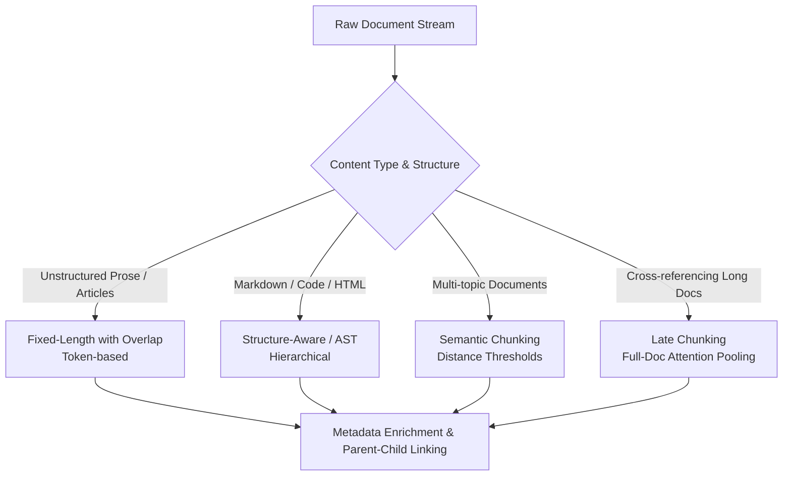
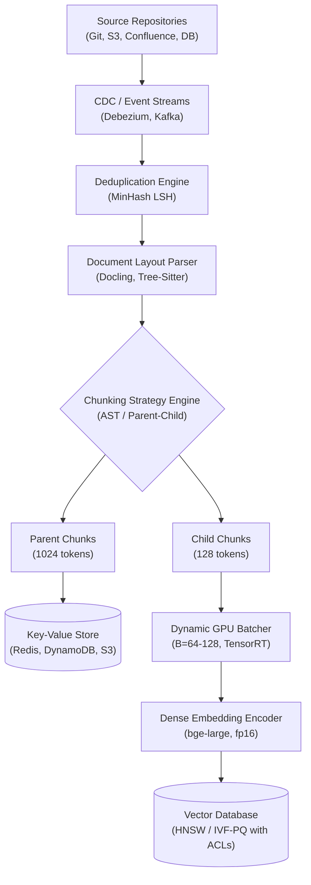

# Phase 1: Ingestion & Document Processing
## From Raw Artifacts to Semantically Coherent Index Units

> **Core Philosophy**: A retrieval system cannot recover information that ingestion has severed, corrupted, or diluted. Ingestion is not a mechanical preprocessing step; it is the fundamental boundary condition that establishes the upper bound of your entire RAG pipeline's retrieval recall and generation faithfulness.



---

## 1. Chunking Strategies

### Topic 1.1: Fixed-Length Chunking with Overlap (Character vs. Token)

#### 1. The Problem
Consider Document $D_5$ (the OmniFlow Python SDK client retry source code). If you apply naive character-level chunking ($S = 256$ characters, $O = 0$), the arbitrary boundary splits the source text mid-statement:
```python
# Naive split cut:
# Chunk 1 ends with:   "retry_af"
# Chunk 2 begins with: "ter_ms = response.json().get('retry_after_ms', 250)"
```
Or it separates the exponential backoff calculation:
```python
sleep_time = (retry_after_ms / 1000.0) + (self.backoff_factor * (2 ** (attempt - 1))) + jitter
```
from its variable assignments. When a user submits Query $Q_1$ (`"retry_after_ms max_backoff_seconds OmniFlowClient"`), dense bi-encoders cannot match either chunk: the critical identifier `retry_after_ms` was severed, and the mathematical backoff logic was isolated from its parameter names.

#### 2. Intuition
Imagine cutting a physical film reel with scissors at fixed 5-second intervals regardless of whether an actor is mid-sentence, mid-word, or mid-scene. The viewer hears syllables without verbs and scenes without context. Sliding window tokenization with overlap ensures that every sentence appears intact in at least one window.

#### 3. How It Works
1. **Model-Aligned Tokenization**: Raw text is converted into discrete integer token IDs using the exact tokenizer of the downstream embedding model (e.g., `cl100k_base` for OpenAI models, or HuggingFace Fast Tokenizers for BGE/E5).
2. **Sliding Window Slicing**: A sliding window of size $S$ (chunk size in tokens) moves across the token sequence with step size (stride) $L = S - O$, where $O$ is the overlap in tokens.
3. **Chunk Decoding**: Each slice $[i \cdot L : i \cdot L + S]$ is decoded back into text or mapped to token spans.
4. **Metadata Attachment**: Every chunk is stamped with its source document ID, chunk sequence index, and character/token offsets.

> Implementation: see appendix-code.md §P1.1

```python
def sliding_window(tokens, S=512, O=64):
    stride = S - O
    for start in range(0, len(tokens), stride):
        yield tokens[start : start + S]
        if start + S >= len(tokens):
            break
```

#### 4. The Key Insight
Fixed-length token sliding windows provide a strict upper bound on representation density, preventing token truncation in fixed-length transformer encoders ($S \le S_{\text{model}}$). The method relies on the foundational assumption that semantic information is distributed evenly across sequential text, and that contextual dependencies do not exceed the overlap $O$. When this assumption breaks (e.g., deeply nested AST structures or wide tabular data), arbitrary boundaries sever critical dependencies regardless of overlap.

#### 5. Math
The token redundancy ratio $\rho$ describes the compounding index bloat caused by overlap:
$$\rho = \frac{S}{S - O}$$
Where:
- $S$: Chunk size in tokens.
- $O$: Overlap in tokens ($0 \le O < S$).
- $L = S - O$: Window stride.

The total number of chunks $N_{\text{chunks}}$ generated from a document with $T$ tokens is:
$$N_{\text{chunks}} = \left\lceil \frac{T - O}{S - O} \right\rceil$$

##### Worked Example (Hand-Calculated):
Let document length $T = 1,024$ tokens and chunk size $S = 512$ tokens.
- **Scenario A ($50\%$ overlap, $O = 256$, stride $L = 256$)**:
  $$\rho = \frac{512}{512 - 256} = \frac{512}{256} = 2.0$$
  Yields 3 chunks: $[0, 512)$, $[256, 768)$, and $[512, 1024)$, totaling $512 + 512 + 512 = 1,536\text{ tokens}$ ($50\%$ overhead).
- **Scenario B ($12.5\%$ overlap, $O = 64$, stride $L = 448$)**:
  $$\rho = \frac{512}{512 - 64} = \frac{512}{448} \approx 1.1429$$
  Yields 3 chunks: $[0, 512)$, $[448, 960)$, and $[896, 1024)$, totaling $512 + 512 + 128 = 1,152\text{ tokens}$ ($12.5\%$ overhead).
$\rho = S / (S - O)$ represents the asymptotic long-document limit; finite short documents pay strictly less overhead because the final boundary chunk is shorter.

#### 6. Design Knobs & Trade-offs
- **Chunk Size $S$ (typically $256\text{--}512$ tokens)**:
  - *Small ($128\text{--}256$)*: Maximizes semantic specificity; eliminates vector dilution. Fails on complex questions requiring multi-clause reasoning.
  - *Large ($1024\text{--}2048$)*: Retains broad context and relationships. Dilutes rare keyword representations and inflates downstream LLM prompt costs.
- **Overlap $O$ (typically $10\%\text{--}15\%$ of $S$)**:
  - *Low ($<5\%$)*: High risk of tearing clauses, sentences, or technical identifiers.
  - *High ($>30\%$)*: Severe index bloat ($\rho > 1.43$) and redundant candidate flooding during top-$K$ retrieval.
- **Empirical Selection Strategy**: Run grid-search evaluations over $S \in \{128, 256, 512, 1024\}$ and $O \in \{0.10S, 0.20S\}$ against a gold retrieval evaluation set, monitoring **Context Recall@K** and **Context Precision@K**.

#### 7. At Scale
- **Memory Footprint & Storage Math**:
  - For $100\text{M}$ chunks embedded with a $d=1024$ model (e.g., `bge-large-en-v1.5`):
    - In `float32` ($4\text{ bytes/dim}$): $100\text{M} \times 1024 \times 4\text{ B} = \mathbf{409.6\text{ GB}}$ raw vectors *(illustrative)*.
    - In `float16` ($2\text{ bytes/dim}$): $100\text{M} \times 1024 \times 2\text{ B} = \mathbf{204.8\text{ GB}}$ raw vectors *(illustrative)*.
- **Backfill Economics**:
  - Re-embedding $100\text{M}$ chunks on an 8x NVIDIA A10G GPU cluster (throughput $\approx 1,500\text{ chunks/sec/GPU}$, note: throughput depends on model architecture, sequence length, and hardware — measure in telemetry, aggregate $12,000\text{ chunks/sec}$) *(illustrative)*:
    $$\text{Time} = \frac{100{,}000{,}000}{12{,}000 \times 3600} \approx 2.31\text{ hours} \quad \text{(illustrative)}$$
    At an on-demand compute rate of $\$1.00\text{/GPU-hour}$, the re-chunking backfill costs $\approx \$18.52$ *(illustrative)*.
- **Idempotency & Content Hashing**:
  - In distributed ingestion (Kafka, Spark, Ray), chunk IDs must be deterministic to prevent duplicate chunk insertion during worker retries:
    $$\text{chunk\_id} = \text{sha256}(\text{doc\_id} + \text{":"} + \text{chunk\_index} + \text{":"} + \text{sha256}(\text{chunk\_text}))$$

#### 8. Failure Modes in Production & How to Detect Them
- **Symptom 1: Redundant Candidate Flooding**:
  - *Manifestation*: The top-5 retrieved chunks are near-identical sliding window offsets of the same section, starving the prompt of alternative documents.
  - *Detection Metric*: Average pairwise Jaccard similarity of retrieved chunks $> 0.65$ *(illustrative)*, or high document ID concentration ratio.
  - *Production Fix*: Reduce overlap $O$ to $\le 10\%$, or deploy post-retrieval Maximal Marginal Relevance (MMR with $\lambda \approx 0.7$, illustrative) and parent deduplication (collapsing chunks by `doc_id`).
- **Symptom 2: Character-Level Boundary Corruption**:
  - *Manifestation*: Model outputs truncated code strings or malformed unicode entities.
  - *Detection Log*: Log regex search for severed punctuation or subword tokenizer fragments.
  - *Production Fix*: Enforce tokenizer-aligned boundary chunking.

#### 9. Improvement Ladder
- **Rung 1 (Baseline)**: Naive character slicing (`text[i:i+500]`). Zero dependencies, high corruption rate.
- **Rung 2 (Better)**: Model-token sliding window with $10\%\text{--}15\%$ overlap using `tiktoken` or HuggingFace Tokenizers. Eliminates subword tearing.
- **Rung 3 (Best)**: Recursive character/token splitting with fallback separators (`\n\n` $\to$ `\n` $\to$ `. ` $\to$ token limit). Aligns chunk edges with semantic paragraph boundaries.

#### 10. Alternatives & When to Choose
- **Fixed-Length vs. Structure-Aware**: Choose Structure-Aware whenever headers, markdown, HTML, or code syntax are present. Reserve Fixed-Length for raw, unstructured prose.
- **Fixed-Length vs. Late Chunking**: Choose Late Chunking when long documents have dense cross-paragraph references and GPU compute is available at ingestion.

#### 11. Interview Talking Track
- **60-Second Answer**:
  > "Fixed-length token chunking creates sliding windows of size $S$ with overlap $O$. We use token-based rather than character-based chunking to align strictly with the embedding model's vocabulary and avoid subword truncation. The critical design parameter is the overlap ratio: overlap creates compounding redundancy governed by $\rho = S / (S - O)$, meaning for long documents, 50% overlap ≈ doubles storage, compute costs, and retrieval duplication. In production, I maintain a 10% to 15% overlap and enforce deterministic chunk IDs using content hashes for idempotent pipeline retries."
- **5-Minute Deep-Dive Outline**:
  - *Architectural Driver*: Transformer context limits ($d=768/1024$, context $L=512/8192$) and representation density trade-offs.
  - *Token Dilution vs. Truncation*: Why small chunks maximize cosine retrieval precision while large chunks provide synthesis context.
  - *Storage & Scale Math*: Calculating raw vector footprint ($204.8\text{ GB}$ at $100\text{M}$ chunks in fp16) and backfill GPU sizing ($2.31\text{ hours}$ on 8x A10G).
  - *Production Hardening*: Content-hash deduplication, sliding-window boundary alignment, and recursive fallback splitting.
- **Likely Follow-up Q&A**:
  1. *Q: Why does a 50% overlap double index size rather than increase it by 50%?*  
     > A: For long documents, redundancy is governed by $\rho = S / (S - O)$. For $S=512, O=256$, the stride is $256$ tokens. Every token is captured in $512 / 256 = 2.0$ distinct chunks, doubling the total number of indexed tokens.
  2. *Q: How do you handle tokenizer mismatch between chunker and embedding model?*  
     > A: If the chunker uses cl100k (OpenAI) but the embedding model uses WordPiece (BERT/BGE), a 512-token chunk under cl100k may expand to 620 tokens (illustrative) under WordPiece, causing silent tail truncation. Always chunk using the exact tokenizer of your embedding model.
  3. *Q: How do you prevent near-identical chunks from filling the retrieval context?*  
     > A: Apply parent deduplication (collapsing chunks from the same document) or Maximal Marginal Relevance (MMR) with a diversity penalty ($\lambda \approx 0.7$, illustrative).
- **Debugging Scenario**:
  > *Problem*: "Our vector index storage doubled overnight, but our corpus document count only increased by 10%. How do you diagnose and resolve this?"  
  > *Diagnosis*: Check ingestion pipeline logs for overlap misconfiguration ($O$ accidentally set to $0.5S$ instead of $0.1S$) or non-idempotent re-ingestion where workers retried without content-hash chunk IDs, inserting duplicate chunks.  
  > *Resolution*: Re-index with `chunk_id = sha256(doc_id + chunk_index + text_hash)` to enforce upsert idempotency, and lock $O \le 0.15S$.

#### 12. Source
Karpukhin et al., *Dense Passage Retrieval for Open-Domain Question Answering* (DPR), EMNLP 2020; Devlin et al., *BERT: Pre-training of Deep Bidirectional Transformers for Language Understanding*, NAACL 2019.

---

### Topic 1.2: Structure-Aware and Syntax-Aware Chunking (Markdown, HTML, Code)

#### 1. The Problem
Consider Document $D_1$ (OmniFlow Architecture Specification). It contains deep hierarchical sections:
- `# OmniFlow Architecture Specification`
  - `## Hot Memory Tier`
  - `## Cold Persistent Tier`

If ingested using a flat chunker that strips markdown headers, the leaf paragraph under Cold Persistent Tier becomes:
```
"Immutable Parquet-backed columnar files. During data ingestion, WAL buffers incoming writes..."
```
When a user asks: `"What does OmniFlow write to persistent object storage?"`, the chunk vector matches poorly because the concept of "Cold Persistent Tier" (which appears only in the stripped section header) was lost. The chunk vector completely lacks its parent namespace lineage.

#### 2. Intuition
Imagine reading a legal contract where subsection "(b)(iv)" states: *"The limitation shall not exceed \$10,000."* Read in isolation, you cannot know whether this applies to employee travel expenses, server damage, or total commercial liability. The subsection is meaningless without the parent section header: *"Article 12: Indemnification and Liability Limits"*.

#### 3. How It Works
1. **AST / DOM Tree Construction**: The document parser constructs an Abstract Syntax Tree (for code via `tree-sitter`) or a Document Object Model (for Markdown/HTML via AST parsers).
2. **Lineage Path Extraction**: For every leaf content block, the parser records the complete ancestor header chain:
   $$H = (h_1, h_2, \dots, h_d)$$
3. **Breadcrumb Injection**: The hierarchical lineage is prepended as a structured text prefix to the chunk body:
   $$C = [h_1 > h_2 > \dots > h_d] \n\n \text{Content Block}$$
4. **Recursive Fallback**: If a leaf block exceeds the maximum token limit $S_{\text{max}}$, the parser recursively splits at lower syntactic boundaries (sub-headers $\to$ tables $\to$ code functions $\to$ paragraphs $\to$ sentences).

> Implementation: see appendix-code.md §P1.2

```python
def ast_chunk(doc, parser, tokenizer, max_tokens=512):
    tree = parser.parse(doc)
    for node in tree.walk_leaf_blocks():
        breadcrumb = " > ".join(node.ancestor_headers())
        text = f"{breadcrumb}\n\n{node.text}"
        tokens = tokenizer.encode(text)[:max_tokens]
        yield tokenizer.decode(tokens)
```

#### 4. The Key Insight
Documents are hierarchical trees, not linear token sequences. Prepending the ancestral lineage directly into the chunk text forces the dense bi-encoder to encode both local semantics and global namespace coordinates into the same representation vector. The method relies on the assumption that document section headers accurately reflect the semantics of their descending text. When authors use generic headers ("Overview", "Details", "Part 2"), breadcrumbs consume token budget without providing discriminative retrieval signal.

#### 5. Math
Let a document tree have a header ancestry path $H = (h_1, h_2, \dots, h_d)$ leading to leaf content block $B$. The effective token budget available for raw content is:
$$S_{\text{content}} = S_{\text{max}} - \sum_{i=1}^d \text{len}(h_i) - (d - 1) \cdot \text{len}(\Delta)$$
Where:
- $S_{\text{max}}$: Maximum chunk token capacity (e.g., 512 tokens).
- $h_i$: Header text at depth $i$.
- $\Delta$: Breadcrumb delimiter (e.g., `" > "`, typically 2 tokens).

##### Worked Example (Hand-Calculated):
Applying structure-aware chunking to Document $D_1$:
- Top-level header $h_1$: `"OmniFlow Architecture Specification"` (5 tokens).
- Second-level header $h_2$: `"Cold Persistent Tier"` (3 tokens).
- Delimiter $\Delta$: `" > "` (2 tokens).
- Total breadcrumb prefix: $5 + 3 + 2 = 10\text{ tokens}$.
- Raw content block: 68 tokens.
- Total chunk length: $10 + 68 = 78\text{ tokens} \le S_{\text{max}}$ ($512$).
The resulting chunk embeds the text:
`OmniFlow Architecture Specification > Cold Persistent Tier: Immutable Parquet-backed columnar files...`

#### 6. Design Knobs & Trade-offs
- **Breadcrumb Depth Ceiling ($d_{\text{max}}$, typically $2\text{--}3$)**:
  - *Deep ($d \ge 5$)*: Captures granular class/method/section hierarchy; consumes up to $30\%$ of the token budget on boilerplate breadcrumbs.
  - *Shallow ($d \le 1$)*: Minimizes token overhead; risks losing submodule namespace context.
- **Syntactic Splitting Granularity**:
  - For code: splitting at the Class level vs. Function level vs. AST statement block level.
- **Empirical Selection Strategy**: Evaluate **Namespace Precision** (percentage of retrieved chunks belonging to the correct submodule) on technical API queries.

#### 7. At Scale
- **Semi-Structured Document Ingestion Math**:
  - Processing $1\text{M}$ enterprise PDFs (averaging 20 pages/doc = $20\text{M}$ pages) through layout and table extraction models (e.g., Docling / MinerU / Marker at $250\text{ ms/page}$):
    $$\text{Compute} = \frac{20{,}000{,}000 \times 0.25}{3600} \approx 1{,}388.89\text{ core-hours} \quad \text{(illustrative)}$$
    Across a 64-vCPU worker cluster, this backfill completes in $\approx 21.7\text{ wall-clock hours}$.
- **Tabular Data Serialization**:
  - Multi-column tables cannot be chunked by line breaks: table cells must be serialized into self-contained Markdown tables with repeated column headers or converted to key-value row representations (`{"metric": "QPS", "tier": "Enterprise", "limit": 20000}`) to preserve column-row binding in vector space.
- **Per-Chunk Access Control Lists (ACLs)**:
  - In enterprise pipelines, security permissions (`tenant_id`, `read_groups`, `confidentiality_level`) are inherited at AST boundaries from parent document folders and stamped into the vector payload to enable single-stage metadata-filtered search.
- **Incremental CDC Ingestion**:
  - For codebases and documentation wikis, monitor Git commits or database Change Data Capture (CDC) streams. Re-parse and re-embed only the modified AST subtrees, avoiding full-corpus re-indexing.

#### 8. Failure Modes in Production & How to Detect Them
- **Symptom 1: Parser Hangs on Malformed Input**:
  - *Manifestation*: Ingestion worker memory spikes and CPU locks at $100\%$ on unclosed HTML tags or 10,000-line minified JSON files.
  - *Detection Metric*: Dead Letter Queue (DLQ) alert rates and worker timeout exceptions.
  - *Production Fix*: Wrap AST parsers in strict execution timeouts (e.g., $5\text{ seconds}$), falling back to recursive character splitting if parsing fails.
- **Symptom 2: Breadcrumb Token Starvation**:
  - *Manifestation*: Deeply nested documents leave $< 50$ tokens for actual content, flooding the index with near-empty chunks.
  - *Detection Log*: Log warning whenever $S_{\text{content}} / S_{\text{max}} < 0.25$.
  - *Production Fix*: Prune intermediate ancestry levels, retaining only the root header and immediate parent: `[Root > ... > Parent]`.

#### 9. Improvement Ladder
- **Rung 1 (Baseline)**: Markdown regex splitting on `#`. Fragile; misinterprets `#` inside code comments or strings as section headers.
- **Rung 2 (Better)**: Dedicated AST parsers (`tree-sitter` for code, `mistune`/`markdown-it` for docs) injecting hierarchical header breadcrumbs.
- **Rung 3 (Best)**: Vision-augmented layout parsing (Docling, LayoutLMv3) extracting semantic bounding boxes, multi-page tables, and figure captions from complex PDFs.

#### 10. Alternatives & When to Choose
- **Structure-Aware vs. Small-to-Big**: Structure-Aware injects ancestor context into the chunk text; Small-to-Big stores the parent in a separate key-value store and returns the full parent document. Choose Structure-Aware when downstream LLM prompt context is strictly constrained.

#### 11. Interview Talking Track
- **60-Second Answer**:
  > "Structure-aware chunking parses documents into Abstract Syntax Trees or DOM hierarchies rather than treating text as a flat sequence of characters. We extract the ancestor header lineage and prepend it as breadcrumbs to every leaf chunk. In technical documentation and codebases, this solves the 'lost namespace' problem where a method or paragraph loses its parent class or architectural tier. At scale, table serialization and per-chunk ACL metadata inheritance are handled at these AST boundaries, allowing incremental CDC updates at the subtree level."
- **5-Minute Deep-Dive Outline**:
  - *Why Flat Chunkers Fail*: The orphan subsection problem in technical specs ($D_1$).
  - *Tree Construction & Breadcrumb Math*: Calculating token budgets ($S_{\text{content}} = S_{\text{max}} - L_{\text{breadcrumb}}$).
  - *PDF & Tabular Ingestion*: Layout parsing economics ($1,388.89\text{ core-hours}$ for $20\text{M}$ pages) and row-column binding.
  - *Production Security*: Attaching ACL metadata at AST nodes for pre-filtered retrieval.
- **Likely Follow-up Q&A**:
  1. *Q: How do you chunk markdown tables without severing row-column relationships?*  
     > A: If a table fits within $S_{\text{max}}$, keep it atomic. If it exceeds $S_{\text{max}}$, split by rows while repeating the full header row at the top of every child chunk, or transpose rows into key-value JSON objects.
  2. *Q: How do you handle source code with mutual cross-file dependencies?*  
     > A: Chunk at the class/function AST level, prepend the file path and module docstring as breadcrumbs, and inject import statements into chunk metadata.
  3. *Q: What if a single code function is 3,000 lines long?*  
     > A: Apply recursive syntax-aware fallback: split at internal logical control flow boundaries (loops, conditional blocks, comment blocks) while preserving the function signature as a persistent breadcrumb.
- **Debugging Scenario**:
  > *Problem*: "A user asks for the return type of a hypothetical method `OmniFlowClient.connect()` (not in D5), but RAG retrieves the docstring of a completely different service's `connect()` method. How do you fix it?"  
  > *Diagnosis*: Chunks lacked class-level and module-level breadcrumbs; both methods were embedded as generic `def connect()`.  
  > *Resolution*: Update the AST chunker to prepend module and class lineage (`OmniFlowSDK > OmniFlowClient > connect`), forcing distinct vector representations.

#### 12. Source
LangChain Language Splitters; tree-sitter AST parser; cAST (Zhang et al., 2025).

---

### Topic 1.3: Semantic Chunking (Distance Thresholding)

#### 1. The Problem
Consider Document $D_6$ (Worker OOM Postmortem). The text transitions from dense mathematical analysis of HNSW Layer-0 edge memory into an operational narrative of gateway token buckets and client retry storms. A fixed 512-token chunk boundary falls squarely across this shift, combining the tail of the memory calculations with the head of the rate-limit narrative:
```
"...each vector requires 6,144 bytes raw + 512 bytes Layer-0 edges (2M = 128 x 4 B). Meanwhile, worker timeouts caused client retries, returning HTTP 429..."
```
This produces a "chimera chunk" that sits halfway between two distinct semantic spaces, diluting cosine similarity for both Query $Q_1$ (retry configuration) and Query $Q_2$ (server memory crashes).

#### 2. Intuition
Imagine reading an encyclopedia where a new chapter begins whenever the topic changes, rather than turning the page strictly every 500 words. When the author shifts from discussing rocket propulsion to discussing astronaut nutrition, the chapter cleanly ends.

#### 3. How It Works
1. **Sentence Boundary Splitting**: The document is split into discrete sentences $S = [s_1, s_2, \dots, s_N]$ using an accurate sentence tokenizer (e.g., `spacy`, `nltk`, or regex boundary models).
2. **Context Window Buffering**: To smooth sentence-level noise, consecutive sentences are grouped into overlapping buffers (e.g., buffer size $k=1$: $b_i = s_{i-1} + s_i + s_{i+1}$).
3. **Embedding Generation**: Every sentence buffer is encoded into a dense vector $\mathbf{v}_i$.
4. **Consecutive Distance Calculation**: Compute cosine distance between adjacent sentence vectors:
   $$d_i = 1 - \cos(\mathbf{v}_i, \mathbf{v}_{i+1})$$
5. **Statistical Thresholding**: Compute a dynamic distance threshold $\tau$. Place chunk boundaries wherever $d_i > \tau$.

> Implementation: see appendix-code.md §P1.3

```python
def semantic_chunk(sentences, embed_fn, threshold_percentile=95):
    vecs = embed_fn(sentences)
    dists = [1 - cos_sim(vecs[i], vecs[i+1]) for i in range(len(vecs)-1)]
    tau = np.percentile(dists, threshold_percentile)
    split_indices = [i + 1 for i, d in enumerate(dists) if d > tau]
    return split_at_indices(sentences, split_indices)
```

#### 4. The Key Insight
Ideas and topics naturally have variable lengths. By identifying statistical spikes in consecutive sentence distance, chunk boundaries are placed at natural topic transitions. The method relies on the assumption that sentences within a coherent topic exhibit smooth semantic continuity, and topical shifts produce sharp, measurable distance spikes. When this assumption breaks (e.g., technical documents with continuous jargon or uniform monotone text), distance curves remain flat or fluctuate erratically, causing pathological over-chunking or runaway giant chunks.

#### 5. Math
The cosine distance between consecutive sentence vectors $\mathbf{v}_i, \mathbf{v}_{i+1}$ is:
$$d_i = 1 - \frac{\langle \mathbf{v}_i, \mathbf{v}_{i+1} \rangle}{\|\mathbf{v}_i\|_2 \|\mathbf{v}_{i+1}\|_2}$$

Statistical threshold formulations:
1. **Standard Deviation Threshold**:
   $$\tau_{\text{std}} = \mu_d + k \cdot \sigma_d$$
   Where $\mu_d$ is the mean distance across the document, $\sigma_d$ is the sample standard deviation (computed with $N-1$ degrees of freedom), and $k$ is a tuning parameter (typically $k \in [1.0, 1.5]$).
2. **Percentile Threshold**:
   $$\tau_p = \text{percentile}(D, p) \quad (p \in [85, 95])$$

##### Worked Example (Hand-Calculated):
Consider $N=6$ sentences in Document $D_6$, yielding 5 consecutive sentence distances:
$$D = [0.12, \, 0.15, \, 0.68, \, 0.18, \, 0.22]$$
Notice the spike at $d_3 = 0.68$ (transition from HNSW memory math to retry storms).
- Mean distance:
  $$\mu_d = \frac{0.12 + 0.15 + 0.68 + 0.18 + 0.22}{5} = \frac{1.35}{5} = 0.270$$
- Sample standard deviation ($\text{ddof}=1$):
  $$\sigma_d = \sqrt{\frac{(0.12-0.27)^2 + (0.15-0.27)^2 + (0.68-0.27)^2 + (0.18-0.27)^2 + (0.22-0.27)^2}{4}} \approx 0.2322$$
- Threshold with $k=1.2$ (computed from unrounded $\sigma_d$):
  $$\tau_{\text{std}} = 0.270 + 1.2 \times 0.232164 \approx \mathbf{0.5486}$$
- Evaluation:
  - $d_1 = 0.12 \le 0.5486$ (keep)
  - $d_2 = 0.15 \le 0.5486$ (keep)
  - $d_3 = 0.68 > 0.5486 \implies \mathbf{SPLIT!}$
  - $d_4 = 0.18 \le 0.5486$ (keep)
  - $d_5 = 0.22 \le 0.5486$ (keep)

The document is split cleanly into Chunk 1 (Sentences 1–3, HNSW memory) and Chunk 2 (Sentences 4–6, retry storm).

#### 6. Design Knobs & Trade-offs
- **Threshold Metric ($\tau_{\text{std}}$ vs. $\tau_p$)**:
  - *Standard Deviation*: Adapts dynamically to document variance; unstable on short documents ($<10$ sentences).
  - *Percentile*: Guarantees a predictable number of splits ($100-p\%$ of sentences); forces artificial splits on short, homogeneous texts.
- **Buffer Window Size $k$ (typically $k=1$ or $2$)**:
  - *Small ($k=0$)*: Noisy; sensitive to single punctuation anomalies.
  - *Large ($k \ge 3$)*: Smooths out subtle topic shifts; blurs boundary precision.
- **Hard Size Clamps ($S_{\text{min}}, S_{\text{max}}$)**:
  - Mandatory in production: clamp minimum tokens ($S_{\text{min}} \ge 64$) and maximum tokens ($S_{\text{max}} \le 512$) to prevent single-sentence fragments and giant context-overflowing chunks.

#### 7. At Scale
- **Ingestion Compute Overhead**:
  - Semantic chunking requires an $O(N)$ embedding pass over every sentence in every document *before* chunking begins.
  - For $1\text{M}$ documents averaging 15 sentences ($15\text{M}$ sentence embeddings):
    $$\text{Compute} = \frac{15{,}000{,}000}{5{,}000 \times 60} = \mathbf{50.0\text{ minutes on 1x NVIDIA A10G}} \quad \text{(illustrative)}$$
  - At $100\text{M}$ documents ($1.5\text{B}$ sentences), this requires $\approx 83.3\text{ GPU-hours}$ ($\approx \$83.30$ compute) *(illustrative)*.
- **Near-Duplicate Detection (MinHash / SimHash)**:
  - Run locality-sensitive hashing (LSH) on raw documents prior to sentence embedding. Deduplicating near-identical boilerplate files prunes $15\%\text{--}35\%$ of downstream embedding passes *(illustrative)*.
- **Dynamic Batching & Memory Fragmentation**:
  - Sentences have variable token lengths. Ingestion workers must dynamic-batch sentences by length to prevent excessive GPU padding waste.

#### 8. Failure Modes in Production & How to Detect Them
- **Symptom 1: Runaway Monolithic Chunks**:
  - *Manifestation*: A technical document discusses a single topic continuously without a distance spike exceeding $\tau$, generating a single 5,000-token chunk that gets silently truncated by downstream encoders.
  - *Detection Metric*: Histogram of chunk token sizes; alert when chunk size $> S_{\text{max}}$.
  - *Production Fix*: Enforce recursive fallback splitting whenever a semantic chunk exceeds $S_{\text{max}} = 512$.
- **Symptom 2: Micro-Chunk Fragmentation**:
  - *Manifestation*: Code blocks or tabular logs cause erratic distance spikes, generating dozens of 10-token chunks.
  - *Detection Log*: Chunks with token count $< S_{\text{min}} = 64$.
  - *Production Fix*: Enforce minimum token merge rules: do not allow a split unless current chunk size $\ge S_{\text{min}}$.

#### 9. Improvement Ladder
- **Rung 1 (Baseline)**: Raw sentence cosine distance with static threshold ($\tau = 0.40$).
- **Rung 2 (Better)**: Buffered sentence windows ($k=1$) with percentile thresholding ($p=90$) and hard min/max token clamps.
- **Rung 3 (Best)**: Multi-modal boundary detection combining sentence embedding distance with visual layout signals (whitespace gaps, font size deltas).

#### 10. Alternatives & When to Choose
- **Semantic Chunking vs. Structure-Aware**: Choose Structure-Aware when documents have headers or code syntax. Choose Semantic Chunking for unstructured transcripts, customer support calls, or single-spaced essays.
- **Semantic Chunking vs. Late Chunking**: Choose Late Chunking when documents are under 8k tokens and you have GPU compute for full-document attention.

#### 11. Interview Talking Track
- **60-Second Answer**:
  > "Semantic chunking breaks text at natural thematic boundaries rather than arbitrary token counts. We split text into sentences, embed sliding sentence buffers, compute consecutive cosine distances, and place split points at statistical distance spikes. The primary operational challenge is size stability: without hard guardrails, semantic chunkers produce single-sentence fragments on noisy text and runaway 4,000-token chunks on monotone documents. In production, I always pair semantic distance thresholding with hard min-max token clamps ($64 \le S \le 512$) and run MinHash deduplication to reduce embedding overhead."
- **5-Minute Deep-Dive Outline**:
  - *The Chimera Chunk Problem*: Why merging disparate topics degrades bi-encoder similarity.
  - *Mathematical Mechanics*: Buffer windowing, cosine distance derivation, and $\tau_{\text{std}}$ vs. $\tau_p$ thresholding.
  - *Compute Cost Analysis*: The $O(N)$ sentence embedding bottleneck ($50\text{ min}$ for $15\text{M}$ sentences on an A10G).
  - *Production Guards*: Min/max clamps and secondary fallback splitters.
- **Likely Follow-up Q&A**:
  1. *Q: Why is sample standard deviation ($\text{ddof}=1$) preferred over population standard deviation?*  
     > A: Documents contain a finite sample of sentences; using $N-1$ degrees of freedom prevents underestimating variance on short documents.
  2. *Q: How does the choice of sentence embedding model affect boundary accuracy?*  
     > A: Small bi-encoders (e.g., `all-MiniLM-L6-v2`) are fast ($5,000\text{ sent/sec}$) and capture semantic shifts well. Using the downstream production model (e.g. `bge-large`) is more accurate but $5\times$ slower.
  3. *Q: What happens if an entire document is a continuous 20-page legal narrative?*  
     > A: Cosine distances remain flat; the secondary $S_{\text{max}}$ fallback splitter engages to enforce bounded chunk sizes.
- **Debugging Scenario**:
  > *Problem*: "Retrieval latency spiked because downstream cross-encoder reranking is timing out on certain queries. Telemetry shows some chunks have 4,500 tokens."  
  > *Diagnosis*: Semantic chunker lacked an upper token bound clamp; a long homogeneous report was ingested as one giant chunk.  
  > *Resolution*: Add a secondary recursive token splitter that partitions any semantic chunk exceeding 512 tokens.

#### 12. Source
Kamradt, *5 Levels of Text Splitting*, 2023; Hearst, *TextTiling: Segmenting Text into Multi-paragraph Subtopic Passages*, Computational Linguistics, 1997.

---

### Topic 1.4: Late Chunking (Full-Context Transformer Pooling)

#### 1. The Problem
Consider Document $D_2$ (Tenant Quotas & Upgrades). Under traditional "chunk-then-embed", the document is divided before embedding:
- **Chunk 1**: `"Enterprise tier quota provides 20,000 requests per minute with 30,000 burst capacity..."`
- **Chunk 2**: `"Upgrades take effect within 15 seconds across all edge clusters, dynamically reallocating token buckets..."`

When Chunk 2 is embedded in isolation, the self-attention mechanism operates strictly within its local window. The word `"Upgrades"` has lost its antecedent (`"Enterprise tier quota"`). Consequently, the embedding vector for Chunk 2 has low cosine similarity to Query $Q_3$ (`"How do enterprise quota tier upgrades interact with client retry configuration?"`) because the vector contains no representation of the Enterprise tier.

#### 2. Intuition
Imagine reading a murder mystery novel by tearing out page 250 and reading it with total amnesia of the preceding chapters, vs. reading the entire novel from start to finish, and then highlighting page 250 with full memory of who the characters are and what happened before.

#### 3. How It Works
1. **Full-Document Forward Pass**: The complete document (up to 8,192 tokens) is passed through a long-context bidirectional transformer (e.g., `jina-embeddings-v2` or `jina-embeddings-v3`).
2. **Global Token Contextualization**: Every token representation $\mathbf{h}_i$ undergoes all-to-all bidirectional self-attention across all tokens in the entire document.
3. **Span Boundary Projection**: Chunk boundary token spans $\mathcal{I}_k = [s_k, e_k]$ are determined using any standard chunker (fixed-token or structure-aware).
4. **Span Mean-Pooling**: Mean-pool only the contextualized token vectors corresponding to span $k$:
   $$\mathbf{c}_k = \frac{1}{e_k - s_k + 1} \sum_{i=s_k}^{e_k} \mathbf{h}_i$$
5. **Unit Normalization**: Project to unit sphere: $\mathbf{v}_k = \frac{\mathbf{c}_k}{\|\mathbf{c}_k\|_2}$.

> Implementation: see appendix-code.md §P1.4

```python
def late_chunk(doc_tokens, span_tuples, model):
    outputs = model(doc_tokens, output_hidden_states=True)
    token_vecs = outputs.last_hidden_state[0]  # shape: (seq_len, hidden_dim)
    for start, end in span_tuples:
        span_vecs = token_vecs[start:end]
        chunk_emb = span_vecs.mean(dim=0)
        yield chunk_emb / chunk_emb.norm(p=2)
```

#### 4. The Key Insight
Transformer self-attention is bidirectional. Contextualizing tokens across the full document before pooling preserves inter-sentence anaphora, entity co-references, and global topic awareness without expanding chunk vector dimensions or storage. The method relies on the assumption that the embedding backbone possesses an effective long-context positional encoding (e.g., RoPE, ALiBi) capable of maintaining high-fidelity attention across thousands of tokens. When this assumption breaks (e.g. models suffering from context dilution or weak long-context pretraining), distant tokens inject noise rather than useful context.

#### 5. Math
Let document $\mathbf{X} = [x_1, x_2, \dots, x_N]$. The contextualized token matrix is:
$$\mathbf{H} = \text{Transformer}(\mathbf{X}) = [\mathbf{h}_1, \mathbf{h}_2, \dots, \mathbf{h}_N] \in \mathbb{R}^{N \times d}$$

For chunk span $\mathcal{I}_k = [s_k, e_k]$:
$$\mathbf{c}_k = \frac{1}{|\mathcal{I}_k|} \sum_{i=s_k}^{e_k} \mathbf{h}_i, \quad \mathbf{v}_k = \frac{\mathbf{c}_k}{\|\mathbf{c}_k\|_2}$$

##### Worked Example (Hand-Calculated):
Consider Document $D_2$ with key tokens:
- Token 5: `"tenant"`
- Token 6: `"tier"`
- Token 120: `"Upgrades"`
- Token 126: `"15"`
- Token 127: `"seconds"`

- **Under Naive Chunking**: Chunk 2 starts at Token 100. Token 120 attends strictly within Chunk 2 ($50 \times 50$ matrix). Attention weight to Token 5 and 6 is identically $0.0$.
- **Under Late Chunking**: The full 200-token document is processed. In the self-attention matrix, Token 120 attends to Tokens 5 and 6 with non-zero weights:
  $$A_{120, 5} = 0.08, \quad A_{120, 6} = 0.12 \quad \text{(illustrative)}$$
  When Chunk 2 is mean-pooled, the resulting unit vector $\mathbf{v}_2$ contains directional components along the "tenant tier" semantic axes. Searching for *"tenant quota upgrade speed"* matches $\mathbf{v}_2$ with high cosine similarity.

#### 6. Design Knobs & Trade-offs
- **Model Context Window ($8,192$ tokens)**:
  - Requires native long-context embedding models (`jina-embeddings-v2/v3`, `nomic-embed-text-v1.5`). Standard BERT models ($512$ token ceiling) cannot perform Late Chunking.
- **Pooling Function**:
  - Mean-pooling across the token span is mandatory. CLS pooling cannot be used because CLS aggregates the entire sequence rather than specific sub-spans.
- **Chunk Span Length**:
  - Because representations already contain global document context, chunk spans can be smaller ($128\text{--}256$ tokens) without losing global context.

#### 7. At Scale
- **Inference Attention Memory Math**:
  - During inference forward passes (such as Late Chunking ingestion), attention matrices are transiently computed layer-by-layer and immediately freed (unlike training backpropagation, where all layers' activations are retained simultaneously).
  - For an 8,192-token document across 12 attention heads in `float16` ($2\text{ bytes/element}$), the peak attention matrix memory per layer is:
    $$\text{Memory}_{\text{per-layer}} \approx 12 \times 8192^2 \times 2\text{ B} \approx 1.61\text{ GB} \quad (\approx 1.5\text{ GiB}) \quad \text{(illustrative)}$$
  - The $\approx 19.3\text{ GB}$ ($18\text{ GiB}$) activation figure applies only in training when all 12 layers' matrices are preserved in VRAM for backpropagation. Thus, an 8k-token inference forward pass comfortably fits within standard 24 GB GPU memory (e.g., NVIDIA A10G or L4) without running out of memory.
  - **FlashAttention** remains highly recommended because it tiles attention to compute in $O(N)$ memory and yields a $2\times\text{--}4\times$ throughput speedup, but it is not strictly mathematically required merely to prevent OOM during an 8k inference pass.
- **Model Lock-In & Re-indexing Economics**:
  - Late Chunking couples your chunk embeddings to a specific model's full forward pass. You cannot incrementally re-chunk a document without re-running the entire 8k-token forward pass.
- **Query-Time Invariance**:
  - At query time, Late Chunking introduces zero latency overhead: the output vectors are standard 768d or 1024d unit vectors stored in standard HNSW indexes.

#### 8. Failure Modes in Production & How to Detect Them
- **Symptom 1: Semantic Bleeding / Cross-Contamination**:
  - *Manifestation*: Sensitive or irrelevant information from page 1 bleeds into the vector of page 10, causing spurious false-positive retrieval.
  - *Detection Metric*: Low Context Precision@K; inspection reveals retrieved chunks whose raw text does not contain query terms, but whose parent documents do.
  - *Production Fix*: Apply attention windowing masks or segment documents at major chapter/section boundaries before running Late Chunking.
- **Symptom 2: Silent Truncation Beyond the Model's Context Limit**:
  - *Manifestation*: Documents exceeding the 8,192-token context window are silently truncated at the tail during the embedding forward pass, permanently dropping trailing sections from vector retrieval.
  - *Detection Metric*: Log warning whenever input document token length $> 8,192$.
  - *Production Fix*: Implement sliding hierarchical windows (e.g., 4,096 tokens with 512-token overlap) for oversized documents, late-chunking within each window.

#### 9. Improvement Ladder
- **Rung 1 (Baseline)**: Naive chunk-then-embed (isolated forward passes per chunk).
- **Rung 2 (Better)**: Chunk-then-embed with text breadcrumb prefixes (Topic 1.2).
- **Rung 3 (Best)**: Late Chunking with FlashAttention-2 over 8k-token windows with span-level mean pooling.

#### 10. Alternatives & When to Choose
- **Late Chunking vs. Small-to-Big**: Late Chunking is self-contained (stores only vectors); Small-to-Big requires dual storage (child vectors + raw parent documents in a key-value store). Choose Late Chunking when storage is constrained and documents are under 8k tokens.

#### 11. Interview Talking Track
- **60-Second Answer**:
  > "Late chunking reverses the traditional chunk-then-embed order. Instead of splitting text into isolated chunks and embedding them independently, we pass the entire document through a long-context transformer, allow all-to-all bidirectional self-attention to contextualize every token, and then mean-pool the token vectors across chunk boundaries. This eliminates the pronoun anaphora problem—where isolated chunks lose their antecedents—without expanding vector dimensions or storage. In production, while an 8k-token inference pass consumes only about 1.5 GiB of attention memory per layer and fits on a 24 GB GPU without FlashAttention, deploying FlashAttention is standard practice to achieve 2x to 4x throughput speedups."
- **5-Minute Deep-Dive Outline**:
  - *The Anaphora Failure*: How naive chunking blinds embeddings to cross-paragraph context ($D_2$).
  - *Mathematical Mechanics*: Bidirectional self-attention matrix derivation and span-based mean pooling.
  - *Hardware & VRAM Math*: Deriving the 1.5 GiB per-layer inference attention memory (vs. 18 GiB training activation retention) and FlashAttention scaling.
  - *Semantic Bleeding Trade-off*: When full-document attention injects spurious noise into leaf vectors.
- **Likely Follow-up Q&A**:
  1. *Q: Can you use Late Chunking with models that use CLS token pooling?*  
     > A: No. The CLS token pools global document context into a single vector; it cannot be partitioned into sub-spans. Late Chunking strictly requires mean-pooling over span token indices.
  2. *Q: Does Late Chunking increase vector database query latency?*  
     > A: No. It is an ingestion-only technique; query-time ANN search operates on standard fixed-dimensional unit vectors.
  3. *Q: How does Late Chunking compare to ColBERT late interaction?*  
     > A: Late Chunking pools token vectors into a single chunk vector at ingestion time. ColBERT retains all token vectors independently and computes MaxSim late interaction at query time.
- **Debugging Scenario**:
  > *Problem*: "After deploying Late Chunking, retrieval precision drops because chunks from an appendix are retrieving queries meant for the introduction. How do you resolve this?"  
  > *Diagnosis*: Semantic bleeding caused by unconstrained full-document self-attention across unrelated sections.  
  > *Resolution*: Apply block-diagonal attention masking or partition the document at major H1 boundaries prior to late chunking.

#### 12. Source
Günther et al., *Late Chunking: Contextual Chunk Embeddings Using Long-Context Embedding Models*, Jina AI, arXiv:2409.04701, 2024.

---

## 2. Metadata Enrichment & Advanced Indexing

### Topic 2.1: Small-to-Big Retrieval (Parent-Child Linking)

#### 1. The Problem
Consider Document $D_5$ (client retry logic). The exact lines implementing exponential backoff with jitter occupy ~35 tokens:
```python
retry_after_ms = response.json().get("retry_after_ms", 250)
jitter = random.uniform(0.01, 0.1)
sleep_time = (retry_after_ms / 1000.0) + (self.backoff_factor * (2 ** (attempt - 1))) + jitter
time.sleep(sleep_time)
```
A small 64-token child chunk vector matches Query $Q_1$ with high cosine similarity ($0.89$, illustrative). However, if *only* this 64-token snippet is passed to the generator LLM, the model hallucinates that OmniFlow lacks retry limits because the constructor defaults (`backoff_factor=0.5, max_retries=5`) are defined 15 lines above in `__init__`. Conversely, if you embed the entire class as a single large chunk, the vector representation dilutes the `retry_after_ms` token features, and retrieval fails to find the document.

#### 2. Intuition
Imagine using a library catalog index card to locate a book. The index card is small, precise, and easily searchable (the Child chunk). But you don't read the 3x5 index card to learn the subject; you pull the entire 400-page book off the shelf and read the full chapter (the Parent chunk).

#### 3. How It Works
1. **Dual-Granularity Partitioning**:
   - **Parent Chunks**: Large passages ($1,024\text{--}2,048$ tokens) capturing complete context and reasoning chains.
   - **Child Chunks**: Small sub-windows ($128\text{--}256$ tokens) sliced from the parent with overlap.
2. **Primary-Foreign Key Linking**: Assign a unique `parent_id` (UUID) to the parent document. Inject `parent_id` into the metadata payload of every child chunk.
3. **Decoupled Dual-Storage Architecture**:
   - **Vector Database**: Indexes *only* the Child vectors (high-precision search index).
   - **Document Store (KV Store)**: Stores *only* the Parent chunk text (Redis, Postgres, DynamoDB, MongoDB, or S3).
4. **Query-Time Resolution (Hydration)**:
   - Query matches top-$K$ child vectors.
   - Extract unique `parent_id`s, deduplicate, fetch full parent documents from the document store, and inject them into the LLM prompt.

> Implementation: see appendix-code.md §P1.5

```python
def small_to_big_retrieve(query, vec_db, doc_store, k=10):
    child_matches = vec_db.search(query, top_k=k)
    parent_ids = list(dict.fromkeys([c.metadata["parent_id"] for c in child_matches]))
    parent_docs = doc_store.mget(parent_ids)
    return parent_docs
```

#### 4. The Key Insight
The optimal chunk size for vector retrieval (small, high semantic density, specific) is fundamentally misaligned with the optimal chunk size for LLM generation (large, broad context, complete reasoning chains). Decoupling the retrieval unit from the synthesis unit resolves the trade-off. The method relies on the assumption that a child match reliably indicates that the entire parent passage is relevant to the user query. When this assumption breaks (e.g. multi-topic parent documents where a child matches a passing trivial remark), passing the entire parent document injects irrelevant distractor tokens that degrade LLM reasoning.

#### 5. Math
Vector semantic dilution occurs as passage length grows because fixed-dimensional pooling averages token representations across thousands of unrelated words.

Storage footprint decoupling math:
$$\text{Storage}_{\text{total}} = \text{Storage}_{\text{doc\_store}} + \text{Storage}_{\text{vector\_db}}$$

##### Worked Example (Hand-Calculated):
Consider an enterprise corpus of $10\text{M}$ parent documents (averaging $1,024\text{ tokens} \approx 4,096\text{ B}$ text each, using decimal GB units as in Phase 2):
- **Document Store**:
  $$\text{Storage}_{\text{doc}} = 10{,}000{,}000 \times 4096\text{ B} = \mathbf{40.96\text{ GB}}$$
- **Child Chunks**: Each parent generates 8 child chunks ($128$ tokens each) $\implies 80\text{M}$ child vectors.
- **Vector Database ($d=768$, `float16` = 1,536 B/vec, $M=16$ where Layer-0 maintains $2M=32$ edges $\times 4\text{ B} = 128\text{ B/vec}$)**:
  $$\text{Raw Child Vectors} = 80{,}000{,}000 \times 768 \times 2\text{ B} = 122.88\text{ GB}$$
  $$\text{Layer-0 Edges} = 80{,}000{,}000 \times 32 \times 4\text{ B} = 10.24\text{ GB}$$
  $$\text{Child Vector Index} = 122.88\text{ GB} + 10.24\text{ GB} = \mathbf{133.12\text{ GB}} \quad (\approx 1.0833\times \text{raw})$$
- **Total Infrastructure Storage**:
  $$\text{Storage}_{\text{total}} = 40.96\text{ GB} + 133.12\text{ GB} = \mathbf{174.08\text{ GB}} \quad \text{(illustrative)}$$

Applying Small-to-Big to Document $D_5$:
- Parent Chunk $P_1$: Full `OmniFlowClient` class (210 tokens, lines 1–32) stored in key-value store as `doc_d5_p1`.
- Child Chunks: $C_{1,1}$ (`__init__` constructor and defaults `backoff_factor=0.5, max_retries=5`, tokens 1–70), $C_{1,2}$ (`ingest_vectors` 429 status check and sleep time math, tokens 71–145), $C_{1,3}$ (`raise TimeoutError` and client termination, tokens 146–210).
- Query $Q_1$ matches Child $C_{1,2}$ with similarity $0.89$ *(illustrative)*.
- Hydration step: System extracts `parent_id: "doc_d5_p1"`, retrieves full 210-token Parent $P_1$ from document store, and injects it into prompt. The LLM receives both the retry loop and constructor defaults (`backoff_factor=0.5, max_retries=5`).

#### 6. Design Knobs & Trade-offs
- **Child Chunk Size ($S_{\text{child}}$, typically $64\text{--}128$ tokens)**:
  - *Small ($64$)*: High factual precision; vector representations become fragile if $<32$ tokens.
  - *Large ($256$)*: Higher semantic stability; begins diluting rare tokens.
- **Parent Chunk Size ($S_{\text{parent}}$, typically $1024\text{--}2048$ tokens)**:
  - *Large ($2048$)*: Rich synthesis context; risks injecting distractor sentences that induce hallucinations.
- **Parent Deduplication Policy**:
  - Mandatory: When multiple children from the same parent match in the top-$K$, collapse them to 1 parent fetch.

#### 7. At Scale
- **Storage Tier Decoupling**:
  - Keep high-cost RAM-resident vector indexes lean by storing only vectors and child IDs. Offload raw text to cheaper disk-backed key-value stores (AWS DynamoDB, ScyllaDB, S3 with Aerospike).
- **Document Versioning & Tombstone GC**:
  - Updating or deleting a parent document requires an atomic batch delete of all associated child vectors in the vector DB. Use parent-to-child inverted indices or metadata filtering on `parent_id` to prevent orphaned child vectors.
- **Cache Hit Ratios**:
  - A Redis/Memcached layer caching `parent_id -> parent_text` lookups achieves $>90\%$ hit rates on popular topics, reducing document store read IOPS.

#### 8. Failure Modes in Production & How to Detect Them
- **Symptom 1: Context Window Explosion**:
  - *Manifestation*: Retrieving $K=10$ child chunks from 10 distinct parents injects $10 \times 2,048 = 20,480$ tokens, choking the LLM or causing massive API cost spikes.
  - *Detection Metric*: Track `prompt_tokens_per_query` in telemetry; alert on queries $> 8,000$ tokens.
  - *Production Fix*: Enforce parent budget packing: cap maximum hydrated parents to 3–4, or apply extractive token pruning (LongLLMLingua) before synthesis.
- **Symptom 2: Distractor-Induced Hallucination**:
  - *Manifestation*: The child chunk was relevant, but the parent document contains contradictory or tangential data that misleads the LLM.
  - *Detection Metric*: Ragas Faithfulness metric drops below $0.70$.
  - *Production Fix*: Deploy sentence-window retrieval (injecting $\pm 3$ sentences around the child) rather than full multi-page parents.

#### 9. Improvement Ladder
- **Rung 1 (Baseline)**: Single-granularity chunking (512 tokens for both search and generation).
- **Rung 2 (Better)**: Sentence-window retrieval (index single sentences; return $\pm 3$ adjacent sentences at query time).
- **Rung 3 (Best)**: Hierarchical Parent-Child indexing with KV-store caching, dynamic parent deduplication, and token budget packing.

#### 10. Alternatives & When to Choose
- **Small-to-Big vs. Late Chunking**: Late Chunking is self-contained (vectors only); Small-to-Big requires dual storage (child vectors + raw parent documents in a key-value store). Choose Small-to-Big when you already operate a distributed document store (MongoDB, DynamoDB, Postgres).

#### 11. Interview Talking Track
- **60-Second Answer**:
  > "Small-to-Big retrieval decouples the retrieval unit from the generation unit. We index small child chunks (128 tokens) into the vector database for high-precision semantic matching, and store large parent chunks (1,024–2,048 tokens) in a fast key-value store like Redis or DynamoDB. When a query matches a child chunk, we hydrate its parent ID and pass the full parent text to the LLM. This gives us the best of both worlds: high-density vector search without semantic dilution, and complete context for downstream reasoning without prompt fragmentation."
- **5-Minute Deep-Dive Outline**:
  - *The Semantic Density Dilemma*: Why 512 tokens is a compromised middle ground.
  - *Dual-Store Architecture*: Child vectors in HNSW vs. Parent text in KV stores.
  - *Storage & Scale Math*: $80\text{M}$ children from $10\text{M}$ parents ($174.08\text{ GB}$ total infrastructure).
  - *Production Hardening*: Deduplication algorithms, tombstone garbage collection, and prompt packing budgets.
- **Likely Follow-up Q&A**:
  1. *Q: What happens if 4 child chunks from the same parent are retrieved in top-K?*  
     > A: Apply an ordered deduplication step on `parent_id`. Hydrate the parent once, eliminating redundant context and freeing token budget for other documents.
  2. *Q: How do you handle access control lists (ACLs) in Small-to-Big retrieval?*  
     > A: Store user group ACLs on child chunks for pre-filtered vector search, and verify ACL permissions on the parent document before hydrating to the LLM.
  3. *Q: What is the latency overhead of the secondary KV store lookup?*  
     > A: A batch `mget` over Redis or DynamoDB takes $1\text{--}3\text{ ms}$, which is negligible compared to the $350\text{--}750\text{ ms}$ time-to-first-token of frontier LLMs.
- **Debugging Scenario**:
  > *Problem*: "Downstream generation latency jumped from 1.2s to 4.5s. Profiling shows TTFT spiked. What happened in our Small-to-Big pipeline?"  
  > *Diagnosis*: Parent deduplication was disabled or $K$ was increased from 5 to 20, causing 20 un-deduplicated 2k-token parents (40k tokens) to be stuffed into the prompt.  
  > *Resolution*: Re-enable parent deduplication and clamp maximum parent context tokens to 4,000.

#### 12. Source
Chase, *Parent Document Retriever*, LangChain Documentation, 2023; LlamaIndex AutoMergingRetriever.

---

### Topic 2.2: Summary Indexing & Hierarchical Metadata Enrichment

#### 1. The Problem
Consider a global, corpus-spanning query:
```
"What are all the architectural failure modes and rate limit mitigation strategies across the entire OmniFlow system?"
```
The answer requires synthesizing facts scattered across Document $D_1$ (storage tiers), $D_2$ (quotas), $D_3$ (retry specs), $D_5$ (client code), and $D_6$ (OOM postmortem). Standard vector search on individual chunks fails completely: chunks discuss granular code statements or memory math, yielding low cosine similarity to the high-level thematic question. The retriever returns 5 isolated technical fragments, and the LLM produces a partial, narrow answer.

#### 2. Intuition
Imagine an executive reviewing 100 annual departmental reports. Instead of reading 5 random paragraphs picked across 1,000 pages, the executive reads the 1-page Executive Summaries of all departments, identifies the 3 relevant divisions, and drills into their detailed appendices.

#### 3. How It Works
1. **Document-Level Abstractive Summarization**: An LLM generates a concise, entity-dense summary ($100\text{--}200$ tokens) of every document during ingestion.
2. **Dual-Representation Indexing**:
   - Embed the summary vectors into the vector database with metadata tag `is_summary=True`.
   - Embed standard leaf chunks with metadata tag `is_summary=False`.
3. **Hierarchical Routing**:
   - High-level abstract queries match document summary vectors.
   - Specific technical queries match leaf chunk vectors.
   - When a summary matches, the system can either synthesize directly from the summaries (Map-Reduce) or fetch the descending leaf chunks for deep analysis.

> Implementation: see appendix-code.md §P1.6

```python
def summary_route(query, vec_db, is_broad_query):
    filter_predicate = {"is_summary": True} if is_broad_query else {"is_summary": False}
    return vec_db.search(query, filter=filter_predicate, top_k=5)
```

#### 4. The Key Insight
Chunk-level embeddings lose the forest for the trees. By explicitly generating and indexing document-level semantic summaries, the index supports multi-scale retrieval: thematic queries match high-level abstractions, while specific queries match granular leaf nodes. The method relies on the assumption that the LLM summarizer faithfully captures all critical entities and themes without hallucination or omission. When this assumption breaks (e.g. low-capacity summarizers omitting rare error codes like `429` or specific parameter names), the summary index becomes blind to critical edge cases.

#### 5. Math
Hierarchical routing selection probability:
$$P(\text{Match} \mid Q) = \max \left( \cos(\mathbf{q}, \mathbf{v}_{\text{summary}}), \, \max_{c \in \text{children}} \cos(\mathbf{q}, \mathbf{v}_c) \right)$$

Ingestion LLM generation cost equation:
$$\text{Cost} = N_{\text{docs}} \times \left( \frac{L_{\text{doc}}}{10^6} \cdot P_{\text{input}} + \frac{L_{\text{summary}}}{10^6} \cdot P_{\text{output}} \right)$$

##### Worked Example (Hand-Calculated):
Consider an enterprise corpus of $1\text{M}$ documents ($L_{\text{doc}} = 1024$ input tokens, $L_{\text{summary}} = 100$ output tokens). Using small model pricing (e.g., $P_{\text{input}} = \$0.10\text{/1M}$, $P_{\text{output}} = \$0.40\text{/1M}$):
$$\text{Cost} = 1{,}000{,}000 \times \left( \frac{1024}{10^6} \cdot 0.10 + \frac{100}{10^6} \cdot 0.40 \right) = \$102.40 + \$40.00 = \mathbf{\$142.40} \quad \text{(illustrative)}$$

Applying Summary Indexing to Document $D_6$:
- Generated Summary: *"Incident 4092 Postmortem: Investigates P1 Linux OOM terminations during 10M vector backfills on 64 GB instances caused by raw vector memory and M=64 Layer-0 edge allocations, compounded by tenant retry storms."*
- Query: *"Summarize past memory-related system crashes during vector backfills."*
- Similarity comparison:
  - Granular chunk similarity to query: $\cos(\mathbf{q}, \mathbf{v}_{\text{edge}}) = 0.46$ *(illustrative)*.
  - Summary chunk similarity to query: $\cos(\mathbf{q}, \mathbf{v}_{\text{summary}}) = 0.84$ *(illustrative)*.
The summary vector immediately surfaces Document $D_6$ as the primary context source.

#### 6. Design Knobs & Trade-offs
- **Summary Token Length ($L_{\text{summary}}$, typically $100\text{--}200$ tokens)**:
  - *Short ($50\text{--}100$)*: Minimizes storage and generation cost; risks omitting critical error codes or parameter names.
  - *Long ($300\text{--}500$)*: Preserves fine details; increases ingestion cost and dilutes high-level themes.
- **Model Capacity**: Using frontier models (GPT-4o) yields pristine summaries but costs $20\times$ more than high-throughput models (Gemini Flash, Claude Haiku, Llama-3-8B).
- **Metadata Payload Fields**: Enforce structured JSON outputs (`{"summary": "...", "key_entities": [...], "error_codes": [...]}`).

#### 7. At Scale
- **Asynchronous Batch Summarization**:
  - Run ingestion summarization as offline batch pipelines utilizing provider Batch APIs ($50\%$ discount) or self-hosted vLLM instances on spot GPU instances.
- **Incremental Refresh & Versioning**:
  - When a document is modified in the source system (detected via CDC or Git webhooks), trigger automated re-summarization and vector replacement.
- **Two-Tier Search Indexing**:
  - At $100\text{M}$ documents, maintain separate physical index partitions (`summaries_idx` vs `chunks_idx`). Searching summaries prunes $95\%$ of irrelevant documents before drilling into leaf chunks *(illustrative)*.

#### 8. Failure Modes in Production & How to Detect Them
- **Symptom 1: Summary Hallucination & Entity Omission**:
  - *Manifestation*: Summarizer writes generic corporate prose ("discusses system reliability") but omits specific identifiers (`retry_after_ms`, `429`).
  - *Detection Metric*: Entity recall check comparing named entities extracted from raw text vs. summary.
  - *Production Fix*: Use constrained structured schema prompts that mandate an explicit `key_identifiers: [...]` list.
- **Symptom 2: Index Staleness Drift**:
  - *Manifestation*: Document text is edited, but summary retains obsolete parameter values.
  - *Detection Log*: Timestamp mismatch between document store version and summary vector metadata.
  - *Production Fix*: Enforce transactional document updates via CDC event pipelines.

#### 9. Improvement Ladder
- **Rung 1 (Baseline)**: First-paragraph extraction as pseudo-summary. Zero LLM cost, poor abstraction.
- **Rung 2 (Better)**: Small-LLM abstractive summarization with entity-preserving prompts.
- **Rung 3 (Best)**: Hierarchical GraphRAG summarization (Leiden community clustering generating multi-level recursive cluster summaries).

#### 10. Alternatives & When to Choose
- **Summary Indexing vs. GraphRAG**: Summary Indexing operates document-by-document; GraphRAG builds a global knowledge graph across documents. Use Summary Indexing for structured document libraries; use GraphRAG for complex multi-document entity networks.

#### 11. Interview Talking Track
- **60-Second Answer**:
  > "Summary indexing resolves the macro-query failure mode in RAG. Chunk-level embeddings are too granular to match broad, corpus-spanning thematic queries. During ingestion, we use a fast, lightweight LLM to generate a concise, entity-dense summary of each document, index the summary vectors alongside leaf chunks, and tag them with metadata. When a user asks a high-level question, we retrieve across summaries to identify the relevant documents before optionally drilling down into leaf chunks. At a million documents, generating 100-token summaries costs under \$150 in API compute."
- **5-Minute Deep-Dive Outline**:
  - *The Corpus-Level Blindspot*: Why flat chunking fails on holistic questions.
  - *Dual-Index Architecture*: Partitioning `is_summary=True` vectors.
  - *Cost & Economics*: Detailed derivation of the $\$142.40$ ingestion cost for $1\text{M}$ docs.
  - *Preventing Hallucinations*: Enforcing structured entity schemas in summarization prompts.
- **Likely Follow-up Q&A**:
  1. *Q: How do you route incoming queries between summaries and leaf chunks?*  
     > A: Use a lightweight classification gate: short, broad questions route to summaries; queries with code syntax, error codes, or exact identifiers route directly to leaf chunks.
  2. *Q: How does summary indexing compare to RAPTOR?*  
     > A: RAPTOR recursively clusters chunks bottom-up to build a multi-layer tree; summary indexing is a clean two-tier document-level abstraction.
  3. *Q: What happens if an edit modifies only one sentence in a 50-page document?*  
     > A: If the edit does not affect key entities, skip re-summarization; if it touches critical parameters, trigger an asynchronous background summary update.
- **Debugging Scenario**:
  > *Problem*: "Users ask 'What are all past backfill OOM crashes?' and receive a generic answer that misses Document $D_6$."  
  > *Diagnosis*: Document $D_6$'s summary was written by an unconstrained LLM that used vague language ('system resource issues') without mentioning 'OOM' or 'backfill'.  
  > *Resolution*: Update the summarization prompt to enforce extraction of specific technical failure modes, and re-index.

#### 12. Source
LlamaIndex Document Summary Index; Sarthi et al., *RAPTOR: Recursive Abstractive Processing for Tree-Organized Retrieval*, ICLR 2024.

---

## 3. Comparison of Ingestion Strategies

| Strategy | Compute / Ingestion Cost | Storage Overhead | Semantic Integrity | Best Use-Case | Primary Failure Mode |
| :--- | :--- | :--- | :--- | :--- | :--- |
| **Fixed-Length Token** | Low ($O(N)$ text scanning) | Low ($10\%\text{--}20\%$ overlap) | Poor | Raw unstructured prose, simple baselines | Context fragmentation at arbitrary token boundaries |
| **Structure-Aware (Markdown/AST)** | Low ($O(N)$ text parsing) | Low ($<10\%$ metadata breadcrumbs) | High | API documentation, source code, Markdown wikis | Syntax/AST parser failures on malformed input |
| **Semantic Distance** | Moderate ($O(N)$ embedding passes) | Medium | High | High-value essays, articles, transcripts | Inconsistent chunk sizes; runaway large chunks |
| **Late Chunking** | High ($O(N^2)$ full-doc attention) | Low (unit vectors per chunk) | High (Retains global doc attention) | Inter-dependent technical specs, legal contracts | GPU OOM on massive documents; model lock-in |
| **Small-to-Big (Parent-Child)** | Low to Moderate | High ($2\times\text{--}3\times$ duplicate doc storage) | High (retrieval) + High (synthesis) | Production codebases, enterprise knowledge bases | Context duplication when multiple children match |
| **Summary Indexing** | Very High (LLM calls per document) | Medium (extra summary vectors) | Global / Holistic | Large document archives, thematic queries | Summary hallucinations, index staleness drift |

---

## 4. System-Wide Scale & Production Ingestion Architecture

In production enterprise RAG, ingestion is a fault-tolerant distributed pipeline running on Kafka, Ray, or Spark:



### Core Production Pillars:
1. **Incremental CDC Ingestion & Idempotency**:
   - Ingestion workers listen to Change Data Capture (CDC) events via Kafka or Debezium.
   - Every chunk ID is deterministically computed via `sha256(doc_id + chunk_index + text_hash)` so worker retries perform atomic idempotent upserts.
2. **Near-Duplicate Detection (MinHash / SimHash)**:
   - Corporate repositories contain massive duplicate content (boilerplate legal notices, shared header files, syndicated articles).
   - Running 64-bit MinHash with Locality-Sensitive Hashing (LSH) before chunking eliminates $15\%\text{--}35\%$ of all downstream embedding and storage costs *(illustrative)*.
3. **High-Throughput GPU Batching**:
   - Embedding inference on GPUs must be dynamic-batched ($B = 64\text{--}128$) with sequence-length sorting to minimize zero-padding FLOP waste.
   - An 8x NVIDIA A10G cluster processes $12,000\text{ chunks/sec}$, completing a $100\text{M}$ chunk backfill in $2.31\text{ hours}$ for under $\$20$ *(illustrative)*.
4. **Per-Chunk Enterprise ACLs**:
   - Security permissions (`tenant_id`, `read_groups`, `confidentiality_level`) are stamped onto chunk metadata during parsing, enabling secure single-stage filtered vector search.

---

## 5. How This Connects to the Next Phase

Once documents are chunked, contextualized, and enriched with metadata, they must be converted into search-ready representations. 

In **Phase 2 (`02-retrieval-primitives.md`)**, we explore the mathematical engines that index these chunks:
- **Sparse Inverted Indices (BM25)**: Why term frequency saturation ($k_1$) and length normalization ($b$) are essential for exact keyword matching.
- **Dense Vector Embeddings (Bi-Encoders)**: How dual-encoder architectures map semantic concepts into geometric vector spaces.
- **Approximate Nearest Neighbor (ANN) Graphs (HNSW & IVF-PQ)**: How hierarchical skip-lists and product quantization enable sub-10ms search over $100\text{M}$ vectors.

---

## 6. Phase 1 Comprehensive Interview Master Questions

#### Q1: Why does naive character-based splitting frequently degrade dense retrieval performance compared to token-based splitting?
> **Answer**: Dense embedding models operate on discrete subword vocabularies. Byte-level BPE (GPT/RoBERTa-style) has no `[UNK]` token because any arbitrary byte sequence can technically be encoded, and WordPiece (BERT-based BGE/E5) rarely produces it. The primary harm of arbitrary character slicing is not out-of-vocabulary rejection, but **vocabulary fragmentation and semantic dilution**: when an arbitrary cut splits a rare identifier in half (e.g., cutting `retry_after_ms` into `retry_af` and `ter_ms`), the resulting meaningless subword fragments dilute the pooled embedding vector across irrelevant latent dimensions rather than matching the query's unified concept vector. Token-accurate chunking guarantees that valid subword sequences remain intact, preserving high-density representations in the vector space.

#### Q2: What exact problem does Late Chunking solve, and how does it leverage transformer self-attention to achieve it?
> **Answer**: In traditional chunk-then-embed pipelines, chunks are embedded in isolation, severing inter-sentence anaphora and pronoun references (e.g., a chunk stating *"Upgrades take effect in 15 seconds"* loses its antecedent *"Enterprise tier"* from the preceding paragraph). Late Chunking reverses this order: the full document (up to 8,192 tokens) is passed through a long-context transformer where bidirectional self-attention allows every token to attend across the entire document. The contextualized token representations are then mean-pooled over chunk boundary spans. This embeds global document context into individual chunk vectors without increasing vector dimension or storage overhead.

#### Q3: In Small-to-Big (Parent-Child) retrieval, why don't we simply index the Parent Chunks directly into the vector database?
> **Answer**: Large parent chunks ($1,024\text{--}2,048$ tokens) suffer from **semantic dilution**: pooling thousands of token embeddings into a single fixed-dimensional vector ($d = 768$ or $1024$) averages out fine-grained technical details, rare identifiers, and numerical variables across smooth latent dimensions. Cosine similarity against specific factual queries drops sharply. By indexing small child chunks ($128$ tokens), we maximize semantic density and vector specificity for retrieval, while hydrating the parent chunk at query time provides the LLM with complete context for synthesis.

#### Q4: If semantic chunking dynamically places boundaries based on topic shifts, what is its primary operational failure mode in production pipelines?
> **Answer**: Semantic chunking suffers from **chunk size instability**: because boundaries depend strictly on consecutive sentence distance spikes exceeding a statistical threshold $\tau$, text with uniform monotone vocabulary (e.g., legal contracts or continuous mathematical derivations) produces zero threshold crossings, creating runaway monolithic chunks ($> 4,000$ tokens) that cause CUDA out-of-memory errors or downstream encoder truncation. Conversely, noisy text produces micro-chunks of 10 tokens. In production, semantic chunkers must be hardened with mandatory minimum ($S_{\text{min}} = 64$) and maximum ($S_{\text{max}} = 512$) token clamps.

#### Q5: How does the chunk overlap parameter $O$ affect vector index storage costs, and what is the mathematical formula governing this relationship?
> **Answer**: Chunk overlap creates compounding token duplication. The redundancy ratio is given by:
> $$\rho = \frac{S}{S - O}$$
> For chunk size $S = 512$ and overlap $O = 256$, the stride is $256$ tokens, yielding $\rho = \frac{512}{256} = 2.0$. The total number of indexed tokens across all chunks is $\approx 2\times$ the original document token count. This doubles embedding compute costs, doubles vector database storage requirements, and floods the retrieval pool with redundant near-duplicate chunks. Overlap should generally be capped at $10\%\text{--}15\%$.
