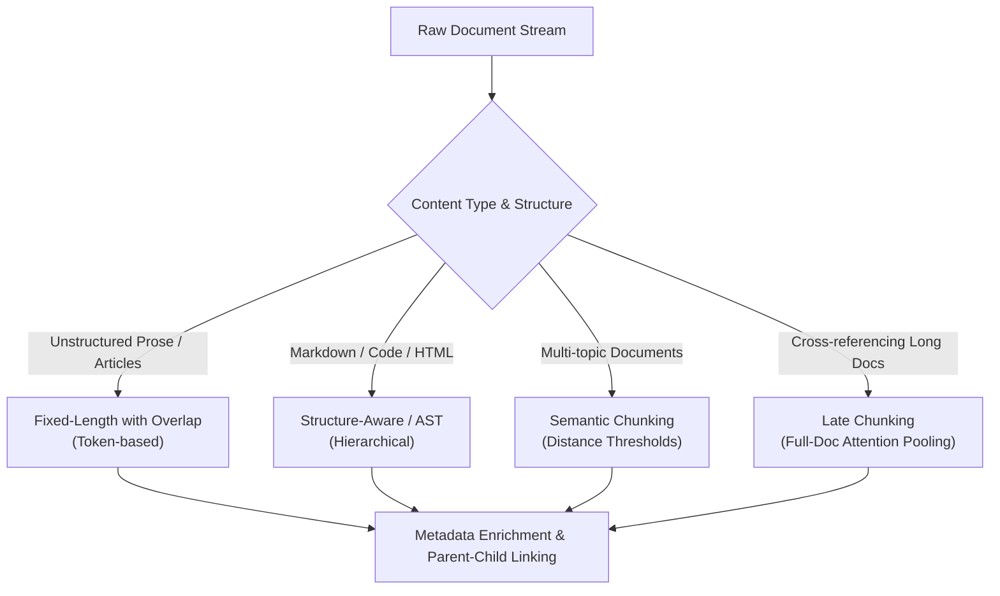
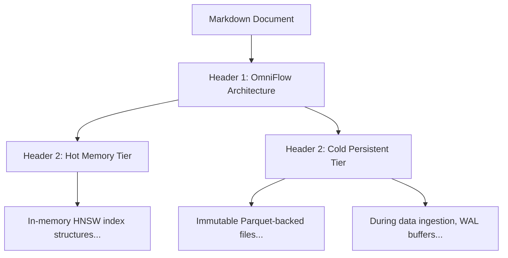
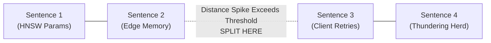
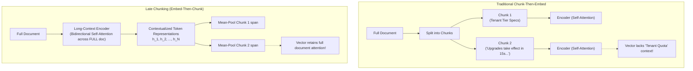
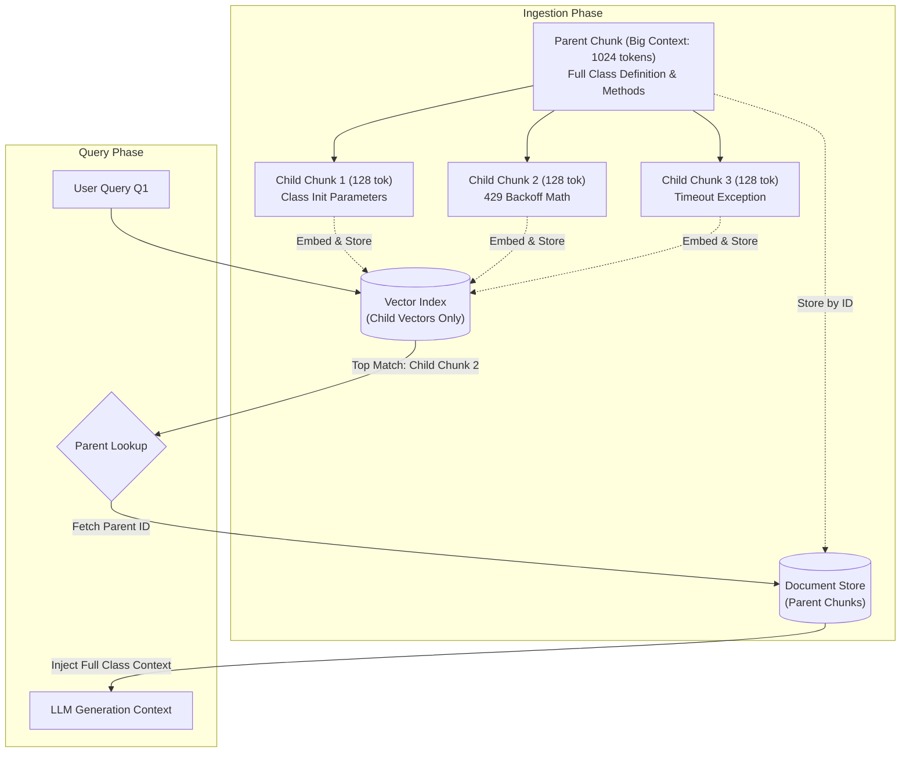
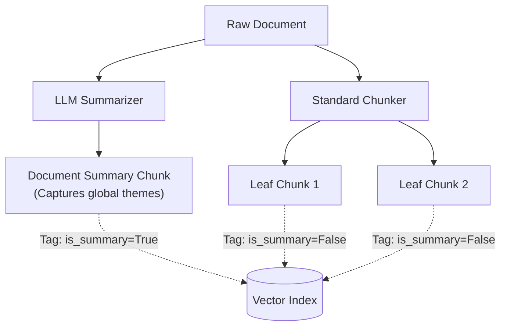

# Phase 1: Ingestion & Document Processing
## From Raw Artifacts to Semantically Coherent Index Units

> **Core Philosophy**: A vector database or search index cannot retrieve what was never properly preserved. Ingestion is not an administrative preprocessing step—it dictates the upper bound of your retrieval precision and recall. Every chunking decision is an irrevocable choice about the granularity of information your system can resolve.

---

## 1. Chunking Strategies

The fundamental dilemma of chunking is the **Granularity Trade-off**:
- **Large chunks** ($\ge 1024$ tokens) preserve global document context and complete thoughts, but their dense vector representations suffer from information dilution (the averaging out of specific facts and rare entities across hundreds of tokens).
- **Small chunks** ($\le 128$ tokens) produce sharp, highly focused dense embeddings that match narrow keyword or factual queries, but they strip away the surrounding context required for an LLM to generate a faithful answer.



---

### Topic 1.1: Fixed-Length Chunking with Overlap (Character vs. Token)

#### 1. The Problem
Without chunking, feeding raw multi-page documents directly into embedding models fails because transformer encoders have hard maximum sequence limits (e.g., 512 tokens for standard BERT-derived encoders; 8192 tokens for modern models). 

On our running corpus, consider Document $D_5$ (`omniflow/client.py`). If we perform naive character-based splitting with chunk size 200 and zero overlap:
```python
# Naive split cut:
...
retry_after_ms = response.json().get("retry_after_ms", 250)
jitter = random.uniform(0.01, 0.1)
sleep_time = (retry_after_ms / 1000.0) + (self.bac
--- CHUNK BOUNDARY ---
koff_factor * (2 ** (attempt - 1))) + jitter
time.sleep(sleep_time)
...
```
The identifier `self.backoff_factor` is split into `self.bac` and `koff_factor`. Both chunks now contain corrupted syntax that will never match Query $Q_1$ (`"retry_after_ms max_backoff_seconds OmniFlowClient"`). Furthermore, character-based splitting counts unicode characters, not BPE/WordPiece tokens; a 500-character chunk of English prose is roughly 100–125 tokens, but a 500-character chunk of JSON or code can be 250+ tokens due to punctuation tokenization.

#### 2. Intuition
Think of reading a book through a sliding viewing window. If the window jumps forward by exactly its width with zero overlap, any sentence printed across the page break is cut in half. By overlapping the window, every boundary sentence appears whole in at least one view.

#### 3. Mechanics
1. Convert raw text into discrete tokens using the target embedding model's actual tokenizer (e.g., `tiktoken` for OpenAI, HuggingFace `AutoTokenizer` for open models). Never split on raw characters.
2. Define chunk length $S$ (in tokens) and overlap $O$ (in tokens), where $O < S$.
3. Compute stride $\Delta = S - O$.
4. Slide the window: Chunk $k$ spans token indices $[k \cdot \Delta, \, k \cdot \Delta + S)$.
5. Decode tokens back to text strings before indexing.

#### 4. Math
Given a document of total token length $L$, chunk size $S$, and overlap $O$:
The total number of generated chunks $C$ is:
$$C = \left\lceil \frac{L - O}{S - O} \right\rceil = \left\lceil \frac{L - O}{\Delta} \right\rceil$$

Where:
- $L$: Total number of tokens in the document.
- $S$: Target chunk size in tokens. Governed by the embedding model's optimal semantic capacity (typically 256 to 512 tokens).
- $O$: Overlap in tokens. Typically set to $10\% \text{ to } 20\%$ of $S$.
- $\Delta = S - O$: Stride (step size between successive chunk starts).

The **Storage Redundancy Ratio** $\rho$, which quantifies the inflation in vector storage and embedding computation cost, is:
$$\rho = \frac{C \cdot S}{L} \approx \frac{S}{S - O} = \frac{1}{1 - \frac{O}{S}}$$

*Why this term exists*: If $O=0$, $\rho = 1$ (no duplicated tokens). If $O = 0.2 S$ (20% overlap), $\rho = 1.25$, meaning you store and embed $25\%$ more tokens to safeguard boundary context.

#### 5. Worked Example
Let Document $D_3$ have $L = 120$ tokens. We set chunk size $S = 50$ tokens with overlap $O = 10$ tokens (20% overlap).
- Stride $\Delta = S - O = 50 - 10 = 40$ tokens.
- Number of chunks:
  $$C = \left\lceil \frac{120 - 10}{40} \right\rceil = \left\lceil \frac{110}{40} \right\rceil = \lceil 2.75 \rceil = 3 \text{ chunks}$$
- Chunk boundaries:
  - Chunk 0: tokens $[0, 50)$ (50 tokens)
  - Chunk 1: tokens $[40, 90)$ (50 tokens)
  - Chunk 2: tokens $[80, 120)$ (40 tokens)
- Total tokens indexed across all chunks: $50 + 50 + 40 = 140$ tokens.
- Redundancy ratio: $\rho = \frac{140}{120} \approx 1.167$ ($16.7\%$ token overhead).

#### 6. Code Sketch
```python
from typing import List
import tiktoken

def fixed_token_chunking(text: str, chunk_size: int = 512, overlap: int = 64) -> List[str]:
    """Token-accurate sliding window chunker.
    Note: 'cl100k_base' is used here as a clean stand-in; in production, always replace
    it with the exact tokenizer paired with your downstream embedding or language model.
    """
    enc = tiktoken.get_encoding("cl100k_base")
    tokens = enc.encode(text)
    stride = chunk_size - overlap
    chunks = []
    for start in range(0, len(tokens), stride):
        chunk_tokens = tokens[start : start + chunk_size]
        chunks.append(enc.decode(chunk_tokens))
        if start + chunk_size >= len(tokens):
            break
    return chunks
```

#### 7. Failure Modes & Trade-offs
- **Semantic Blindness**: Fixed windowing cuts sentences in mid-thought if tokens align poorly.
- **Overlap Knobs**:
  - *Too high* ($O > 30\%$): Inflates vector database index size and causes redundant chunks in Top-K retrieval, crowding out diverse context.
  - *Too low* ($O < 5\%$): Fails to prevent context tearing at boundary edges.
- *Default starting point*: $S = 512$ tokens, $O = 50 \text{ tokens } (\approx 10\%)$ (illustrative). Driven by bi-encoder token limits and typical paragraph lengths.

#### 8. When to Use It
Use as a baseline fallback for homogeneous, unstructured prose where documents lack headers, markup, or syntactic hierarchy.

#### 9. Source
Standard information retrieval practice formalized in early dense retrieval systems; popularized by Karpukhin et al., *Dense Passage Retrieval for Open-Domain QA* (DPR), 2020.

---

### Topic 1.2: Structure-Aware and Syntax-Aware Chunking (Markdown, HTML, Code)

#### 1. The Problem
On Document $D_1$ (OmniFlow Architecture), fixed chunking slices across sections without preserving the document header `# Storage & Memory Hierarchy`. A chunk containing:
```markdown
During data ingestion, OmniFlow buffers vector writes in a memory-mapped write-ahead 
log (WAL). Partitions flush to persistent object storage once their uncompressed...
```
completely loses the fact that this describes the *Cold Persistent Tier* of *OmniFlow*. When a user asks: *"What does OmniFlow write to persistent object storage?"*, an isolated chunk lacking the section title suffers low retrieval relevance because the keyword `OmniFlow` or `Cold Tier` is absent from the chunk body.

In code ($D_5$), fixed-token chunking cuts functions off from their class scope, imports, and type definitions, breaking syntax and destroying AST relationships.

#### 2. Intuition
A document is not an amorphous stream of words; it is an outline. Structure-aware chunking treats documents like a tree. A child node (e.g., a subsection or code method) always inherits the lineage (headings or class definitions) of its parent nodes.

#### 3. Mechanics
1. **Parser selection**:
   - For Markdown: Parse headers (`#`, `##`, `###`) into a Document Object Model (DOM) tree.
   - For Code: Parse source into an Abstract Syntax Tree (AST) using parsers like `tree-sitter`.
2. **Breadcrumb injection**: Prepend parent header paths to each leaf node's text (e.g., `[Doc > Section > Subsection]`).
3. **Recursive split**: Split at the highest semantic boundary first (e.g., `\n# `). If a section exceeds the token budget, recurse to sub-headers (`\n## `), then paragraphs (`\n\n`), then sentences (`. `).



#### 4. Math
Let a document tree have a path of headers $H = (h_1, h_2, \dots, h_d)$ leading to content block $B$.
The enriched chunk text $C$ is constructed as:
$$C = \left( \bigoplus_{i=1}^d h_i \right) \oplus B$$
where $\oplus$ represents string concatenation with a delimiter (e.g., `" > "`).
The effective token budget for the content block is reduced to:
$$S_{\text{content}} = S_{\text{max}} - \sum_{i=1}^d \text{len}(h_i) - \text{len}(\text{delimiters})$$
This guarantees that structural breadcrumbs never cause the chunk to exceed the embedding model context window $S_{\text{max}}$.

#### 5. Worked Example
Applying structure-aware chunking to Document $D_1$:
- Top-level header: `OmniFlow Architecture Specification` ($h_1$, 5 tokens)
- Second-level header: `Cold Persistent Tier` ($h_2$, 3 tokens)
- Delimiter: ` " > " ` (2 tokens)
- Total breadcrumb: 10 tokens.
- Content block: 68 tokens.
- Resulting chunk prepends: `OmniFlow Architecture Specification > Cold Persistent Tier: Immutable Parquet-backed columnar files residing in object storage...`
- The resulting vector now firmly registers both the system name (`OmniFlow`) and the storage layer (`Cold Persistent Tier`), drastically improving retrieval match scores.

#### 6. Code Sketch
```python
from langchain_text_splitters import MarkdownHeaderTextSplitter

markdown_document = """# OmniFlow Architecture
## Hot Memory Tier
In-memory HNSW index structures built per active partition.
## Cold Persistent Tier
Immutable Parquet-backed columnar files in object storage."""

headers_to_split_on = [
    ("#", "Header_1"),
    ("##", "Header_2"),
]
markdown_splitter = MarkdownHeaderTextSplitter(headers_to_split_on=headers_to_split_on)
splits = markdown_splitter.split_text(markdown_document)
# Each split contains page_content plus metadata={'Header_1': '...', 'Header_2': '...'}
```

#### 7. Failure Modes & Trade-offs
- **Header Bloat**: Deeply nested documents (e.g., Level 6 headers) consume precious token budget with repetitive breadcrumb metadata.
- **Malformed Markdown**: In real-world data, authors frequently misuse header tags for styling (e.g., using `###` as bold text), creating erratic splits.
- **AST Parsing Overhead**: Parsing code via `tree-sitter` requires language-specific grammars and is slower than regex token splitting.

#### 8. When to Use It
Always use structure-aware chunking when processing technical documentation, API specs, Markdown repos, HTML knowledge bases, or source code.

#### 9. Source
LangChain Language Text Splitters (2022–2023) and `tree-sitter` AST parsing; formal syntax-directed retrieval analysis in cAST: Enhancing Code Retrieval-Augmented Generation with Structural Chunking via Abstract Syntax Tree (Zhang et al., 2025).

---

### Topic 1.3: Semantic Chunking (Distance Thresholding)

#### 1. The Problem
Documents often transition between distinct concepts without explicit structural markers like headers. Consider Document $D_6$ (Incident Postmortem). The text flows from:
- System configuration parameters ($M=64$, $efConstruction=200$)
- Graph edge memory allocations
- Worker instance memory ceilings (64 GB)
- Workers slowing under load, client timeouts, gateway 429 rate limits, and client retry storms
- Final architectural remediation steps

A rigid fixed-size chunker groups the tail of the memory math with the start of the client retry storm. An embedding created over this hybrid chunk represents neither topic cleanly.

#### 2. Intuition
Imagine reading an essay. You intuitively know when the author shifts to a new idea because the topic "feels" different. Semantic chunking mimics this: it calculates the semantic similarity between adjacent sentences. When the distance between sentence $i$ and sentence $i+1$ spikes above a threshold, a "semantic cliff" has been detected, and a chunk boundary is placed there.



#### 3. Mechanics
1. **Sentence tokenization**: Split the raw document into distinct sentences $(s_1, s_2, \dots, s_n)$ using an NLP boundary detector (e.g., Spacy, NLTK).
2. **Buffer sliding**: Optionally join adjacent sentences into small sliding windows (e.g., 3 sentences) to smooth out single-sentence noise.
3. **Embedding**: Generate a dense vector for each sentence or window: $e_i = \text{Encoder}(s_i)$.
4. **Distance computation**: Compute the cosine distance between consecutive embeddings:
   $$d_i = 1 - \cos(e_i, e_{i+1})$$
5. **Thresholding**: Calculate a dynamic cutoff threshold $\tau$ over the sequence of distances $(d_1, \dots, d_{n-1})$.
6. **Boundary placement**: If $d_i > \tau$, place a chunk boundary between $s_i$ and $s_{i+1}$.

#### 4. Math
Let the cosine distance between consecutive sentence embeddings be:
$$d_i = 1 - \frac{e_i \cdot e_{i+1}}{\|e_i\|_2 \|e_{i+1}\|_2}, \quad i \in \{1, \dots, n-1\}$$

Compute the sample mean $\mu_d$ and sample standard deviation $\sigma_d$ (using Bessel's correction with $n-2$ degrees of freedom for the $n-1$ distances):
$$\mu_d = \frac{1}{n-1} \sum_{i=1}^{n-1} d_i, \qquad \sigma_d = \sqrt{\frac{1}{n-2} \sum_{i=1}^{n-1} (d_i - \mu_d)^2}$$

The split threshold $\tau$ is defined as:
$$\tau = \mu_d + k \cdot \sigma_d$$
Where:
- $k$: Tuning hyperparameter (typically $k \in [0.5, 1.5]$).
  - If $k = 0$, any distance above the mean triggers a split (fine-grained, small chunks).
  - If $k = 1.0$, a split occurs only when the thematic shift is at least one sample standard deviation above average (coarse-grained, larger chunks).
- Alternatively, percentile thresholding can be used: $\tau = P_{90}(\mathbf{d})$ (split at the top 10% highest semantic distances).

#### 5. Worked Example
Suppose we have 4 sentences from Document $D_6$:
- $s_1$: "The ingestion collection was configured with HNSW hyperparameters M=64 and efConstruction=200."
- $s_2$: "In HNSW, each vector node maintains bidirectional graph edges across multiple layers."
- $s_3$: "Client timeouts caused retries that exhausted the gateway token bucket, emitting 429 errors."
- $s_4$: "Subsequent retries caused duplicate partial partition graphs concurrently."

Embedding these sentences with a bi-encoder gives pairwise cosine distances:
- $d_1 = 1 - \cos(e_1, e_2) = 0.12$ (both discuss HNSW graph internal topology)
- $d_2 = 1 - \cos(e_2, e_3) = 0.78$ (topic abruptly jumps from graph edges to HTTP network retries)
- $d_3 = 1 - \cos(e_3, e_4) = 0.15$ (both discuss client retry storms)

Let's compute the statistics:
- Distances $\mathbf{d} = [0.12, 0.78, 0.15]$ ($M = n-1 = 3$ distances)
- $\mu_d = \frac{0.12 + 0.78 + 0.15}{3} = \frac{1.05}{3} = 0.35$
- Sample variance (dividing by $M - 1 = 2$):
  $$\sigma_d^2 = \frac{(0.12-0.35)^2 + (0.78-0.35)^2 + (0.15-0.35)^2}{3 - 1} = \frac{(-0.23)^2 + (0.43)^2 + (-0.20)^2}{2} = \frac{0.0529 + 0.1849 + 0.0400}{2} = 0.1389$$
- $\sigma_d = \sqrt{0.1389} \approx 0.3727$

Set $k = 1.0$:
$$\tau = \mu_d + 1.0 \cdot \sigma_d = 0.35 + 0.3727 = 0.7227$$

Evaluate boundaries:
- $d_1 = 0.12 < 0.7227 \implies$ Do not split ($s_1$ and $s_2$ stay together).
- $d_2 = 0.78 > 0.7227 \implies$ **SPLIT!** (Chunk 1 ends at $s_2$; Chunk 2 starts at $s_3$).
- $d_3 = 0.15 < 0.7227 \implies$ Do not split ($s_3$ and $s_4$ stay together).

Result: Clean, coherent semantic boundaries formed purely through vector distance thresholding.

#### 6. Code Sketch
```python
import numpy as np
from sentence_transformers import SentenceTransformer

model = SentenceTransformer("all-MiniLM-L6-v2")
sentences = [
    "OmniFlow uses HNSW with M=64.",
    "Each vector maintains bidirectional graph edges.",
    "Client timeouts caused retries that exhausted the gateway token bucket, emitting 429 errors.",
    "Subsequent retries caused duplicate partial partition graphs concurrently."
]

embeddings = model.encode(sentences, normalize_embeddings=True)
# Cosine distance for normalized vectors: d = 1 - dot_product
distances = [1.0 - np.dot(embeddings[i], embeddings[i+1]) for i in range(len(embeddings)-1)]

# ddof=1 ensures sample standard deviation matches math (dividing by N-1)
threshold = np.mean(distances) + 1.0 * np.std(distances, ddof=1)
chunks, current_chunk = [], [sentences[0]]

for i, dist in enumerate(distances):
    if dist > threshold:
        chunks.append(" ".join(current_chunk))
        current_chunk = [sentences[i+1]]
    else:
        current_chunk.append(sentences[i+1])
chunks.append(" ".join(current_chunk))
```

#### 7. Failure Modes & Trade-offs
- **High Ingestion Latency & Cost**: Requires encoding every single sentence individually *before* indexing. For a 10M-token corpus, this demands millions of encoder passes.
- **Runaway Chunk Sizes**: If a long document maintains a consistent theme throughout, distances may never cross $\tau$, generating a single massive chunk that overflows the context limit. Safety caps ($S_{\text{max}}$) are mandatory.
- **Short Sentence Distortion**: Short sentences (e.g., "See Figure 1.") produce unstable embeddings that trigger spurious splits.

#### 8. When to Use It
Use for high-value, unstructured narrative corpora (e.g., research papers, multi-topic meeting transcripts, legal briefs) where semantic coherence takes precedence over ingestion speed.

#### 9. Source
Introduced independently in community practice (Greg Kamradt, *5 Levels of Text Splitting*, 2023) based on text tiling principles from Hearst, *TextTiling: Segmenting Text into Multi-paragraph Subtopic Passages*, Computational Linguistics, 1997.

---

### Topic 1.4: Late Chunking (Full-Context Transformer Pooling)

#### 1. The Problem
Consider this sentence from Document $D_2$:
> *"Upgrades take effect globally across all edge routing nodes within 15 seconds without cluster restarts."*

If chunked *before* embedding (traditional naive chunking), this sentence forms an isolated chunk. When encoded by an embedding model:
- The token `"Upgrades"` has no contextual antecedents. The model cannot know whether it refers to software kernel upgrades, hardware replacements, or quota tier increases.
- As a result, searching for *"How fast does a tenant tier upgrade propagate in OmniFlow?"* produces a weak similarity score because the chunk's vector lacks the tenant context defined earlier in the document.

The root cause: **Traditional chunking forces an information loss boundary before the embedding model's self-attention can operate.**



#### 2. Intuition
In traditional chunking, you tear a photograph into strips, scan each strip individually, and try to understand the whole picture from one strip. 
In Late Chunking, you look at the entire photograph first, understand the full scene, and only then cut it into focused strips. Each strip now carries the visual meaning of the whole image.

#### 3. Mechanics
1. **Pass the entire document** into an embedding-trained long-context transformer encoder (e.g., `jina-embeddings-v2` or `jina-embeddings-v3`, with sequence length up to 8192 tokens). *Note: The encoder must be explicitly trained for dense retrieval representations; a raw, un-finetuned masked LM like base ModernBERT lacks the contrastive embedding geometry required for retrieval.*
2. **Do not pool** at the document level. Instead, extract the full sequence of contextualized token embeddings from the final layer:
   $$\mathbf{H} = [h_1, h_2, \dots, h_N] \in \mathbb{R}^{N \times d}$$
   Because bidirectional self-attention operated across all $N$ tokens, token $h_j$ in the last sentence contains cross-attention activations referencing tokens from the first sentence!
3. **Define chunk spans**: Determine token boundary intervals using exact character-to-token offset mappings (`offset_mapping`), excluding special formatting tokens (`[CLS]`, `[SEP]`).
4. **Targeted pooling**: For chunk $k$ spanning token slice $I_k$, compute its chunk vector by mean-pooling the contextualized token vectors within its span:
   $$v_k = \frac{1}{|I_k|} \sum_{i \in I_k} h_i$$
5. Normalize $v_k$ to unit length ($L_2$) and insert into the vector index.

#### 4. Math
Let the input document sequence of $N$ tokens have layer input representations $(x_1, \dots, x_N)$.
The transformer layer computes all-to-all attention:
$$A_{i, j} = \frac{\exp\left( \frac{q_i k_j^T}{\sqrt{d_k}} \right)}{\sum_{m=1}^N \exp\left( \frac{q_i k_m^T}{\sqrt{d_k}} \right)}$$
The resulting hidden representation $h_i \in \mathbb{R}^d$ for token $i$ is conditioned on all tokens $j \in \{1, \dots, N\}$ via:
$$h_i = \sum_{j=1}^N A_{ij} (x_j W_V)$$
where $W_V$ is the value projection weight matrix.

For chunk $k$ spanning token slice $I_k$, the Late Chunking vector representation $v_k$ is:
$$v_k = \frac{1}{|I_k|} \sum_{i \in I_k} h_i$$

Unit normalization:
$$\hat{v}_k = \frac{v_k}{\|v_k\|_2}$$

*Why this changes retrieval*: In naive chunking, attention is strictly localized: $A_{i, j} = 0$ for all $j \notin I_k$. In Late Chunking, $A_{i, j} \ne 0$ for all $j \in \{1, \dots, N\}$, allowing global context to penetrate local chunk embeddings without increasing chunk length!

#### 5. Worked Example
Consider Document $D_2$:
- Token 5: `"tenant"`
- Token 6: `"tier"`
- Token 120: `"Upgrades"`
- Token 126: `"15"`
- Token 127: `"seconds"`

- **Under Naive Chunking**: Chunk 2 begins at Token 100. The self-attention matrix for Token 120 has size $50 \times 50$. The token `"Upgrades"` has attention weight $0.0$ to `"tenant"` and `"tier"` because they do not exist in Chunk 2's context window.
- **Under Late Chunking**: The full document of 200 tokens is processed. Token 120 attends to Token 5 and 6 with non-zero attention weights $A_{120, 5} = 0.08$ and $A_{120, 6} = 0.12$ (illustrative). When the tokens of Chunk 2 are mean-pooled, the resulting vector $\hat{v}_2$ contains directional components along the "tenant tier" semantic axes. Searching for *"tenant quota upgrade speed"* matches $\hat{v}_2$ with high cosine similarity.

#### 6. Code Sketch
```python
import torch
from transformers import AutoModel, AutoTokenizer

tokenizer = AutoTokenizer.from_pretrained("jinaai/jina-embeddings-v3", trust_remote_code=True)
model = AutoModel.from_pretrained("jinaai/jina-embeddings-v3", trust_remote_code=True)

text = "OmniFlow API Rate Limiting... Upgrades take effect in 15 seconds."
char_spans = [(0, 29), (30, 65)]  # Exact character slices for chunks

inputs = tokenizer(text, return_tensors="pt", return_offsets_mapping=True)
offsets = inputs.pop("offset_mapping").squeeze(0)  # Shape: (seq_len, 2)

with torch.no_grad():
    # Pass task="retrieval.passage" for task-adapted jina-embeddings-v3 representations
    outputs = model(**inputs, task="retrieval.passage")
    token_embeddings = outputs.last_hidden_state.squeeze(0)

chunk_embeddings = []
for start_char, end_char in char_spans:
    # Exclude special tokens (where offset is (0, 0)) and match character span
    mask = (offsets[:, 0] >= start_char) & (offsets[:, 1] <= end_char) & (offsets[:, 1] > offsets[:, 0])
    span_vec = token_embeddings[mask].mean(dim=0)
    chunk_embeddings.append(torch.nn.functional.normalize(span_vec, p=2, dim=0))
```

#### 7. Failure Modes & Trade-offs
- **GPU Memory vs. Quadratic Compute**: Ingestion requires passing the full document into the encoder. While memory optimizations like FlashAttention reduce peak activation memory from $O(N^2)$ to $O(N)$ by tiling attention, the theoretical compute complexity remains quadratic $O(N^2)$ FLOPs.
- **Information Bleed**: If a document contains contradictory sections (e.g., "Deprecated Feature X" followed by "Modern Feature X"), attention can bleed obsolete terms into the modern feature's chunk embedding.
- **Model Requirement**: Requires an encoder explicitly trained with long contexts (8k+ tokens) that outputs high-quality unpooled token states (e.g., `jina-embeddings-v2` / `v3`).

#### 8. When to Use It
Use when indexing structured technical documentation, legal contracts, or financial reports where pronoun resolution and cross-paragraph definitions are prevalent, and you have GPU compute for ingestion.

#### 9. Source
Günther et al. (Jina AI), *Late Chunking: Contextual Chunk Embeddings Using Long-Context Embedding Models*, arXiv:2409.04701, 2024.

---

## 2. Metadata Enrichment & Advanced Indexing

### Topic 2.1: Small-to-Big Retrieval (Parent-Child Linking)

#### 1. The Problem
An unavoidable conflict in dense retrieval:
- **Small chunks** are mathematically superior for vector search: an embedding representing 64 tokens is dense, focused, and free of irrelevant noise.
- **Small chunks are catastrophic for LLM generation**: feeding only 64 tokens to an LLM robs it of the broader context needed to synthesize a coherent answer.

On Document $D_5$ (`client.py`), if we embed a 50-token chunk containing only the retry sleep line:
```python
sleep_time = (retry_after_ms / 1000.0) + (self.backoff_factor * (2 ** (attempt - 1))) + jitter
time.sleep(sleep_time)
```
This chunk precisely matches Query $Q_1$ (`"retry_after_ms max_backoff_seconds OmniFlowClient"`). However, when this chunk is provided to the generation LLM, the LLM cannot answer: *"What is the default max retries and backoff factor in OmniFlowClient?"*, because `max_retries` and `__init__` were located 15 lines earlier and were omitted from this chunk!

#### 2. Intuition
Think of a digital microscope. You use a small, high-magnification reticle (Child Chunk) to spot the exact target coordinate, but once located, you zoom out to wide-angle view (Parent Chunk) so you can understand the surrounding landscape.



#### 3. Mechanics
1. **Document segmentation**: Split raw documents into large **Parent Chunks** ($512 \text{ to } 2048$ tokens).
2. **Sub-chunking**: Split each Parent Chunk into multiple non-overlapping or slightly overlapping **Child Chunks** ($64 \text{ to } 128$ tokens).
3. **Metadata assignment**: Store the parent's unique identifier (`parent_id`) in the metadata of every child chunk.
4. **Vector indexing**: Embed and index **only the Child Chunks** in the vector database.
5. **Document Store**: Store the Parent Chunks in a fast key-value store (e.g., Redis, SQLite, MongoDB, or PostgreSQL) keyed by `parent_id`.
6. **Retrieval**: At query time, vector search retrieves Top-K Child Chunks.
7. **Hydration (Swapping)**: Extract the `parent_id` from each retrieved child, deduplicate IDs, and fetch the full Parent Chunks from the document store to pass to the LLM.

#### 4. The Semantic Dilution Intuition
Dense bi-encoders map an entire passage into a single fixed-dimension vector (e.g., 768 or 1536 floats).
When passage length expands from 128 to 1024 tokens:
- Distinct numerical constants, isolated code variables, and specific parameter flags are diluted by the predominant theme of the overall text.
- The resulting vector embedding shifts toward the passage's broad topic rather than its granular facts.
- By indexing small Child Chunks ($S_C \approx 128$ tokens), the vector representation remains concentrated on specific factual statements, maximizing retrieval specificity, while the generation LLM receives the full Parent Chunk ($S_P \approx 1024$ tokens) for grounded synthesis.

#### 5. Worked Example
Applying Small-to-Big to Document $D_5$:
- **Parent Chunk $P_1$**: The entire `OmniFlowClient` class (210 tokens, lines 1–32). Stored in Redis with key `doc_d5_p1`.
- **Child Chunks**:
  - $C_{1, 1}$: `__init__` constructor and session headers (tokens 1–70). Metadata: `{"parent_id": "doc_d5_p1"}`.
  - $C_{1, 2}$: `ingest_vectors` 429 status check and sleep time math (tokens 71–145). Metadata: `{"parent_id": "doc_d5_p1"}`.
  - $C_{1, 3}$: `raise TimeoutError` and client termination (tokens 146–210). Metadata: `{"parent_id": "doc_d5_p1"}`.
- Query $Q_1$ arrives: Vector search matches Child $C_{1, 2}$ with similarity $0.89$ (illustrative).
- Hydration step: System reads `parent_id: "doc_d5_p1"`, retrieves the full 210-token Parent $P_1$ from Redis, and feeds it to the LLM.
- The LLM now has both the retry loop and the initial configuration defaults (`backoff_factor=0.5`, `max_retries=5`), answering the user query factually and completely.

#### 6. Code Sketch
```python
import uuid
from typing import Dict, List, Tuple

class SmallToBigRetriever:
    def __init__(self):
        self.doc_store: Dict[str, str] = {}  # Key-Value store for Parents
        self.child_index: List[Tuple[str, str]] = []  # (child_text, parent_id)

    def index(self, parent_text: str, child_texts: List[str]):
        parent_id = str(uuid.uuid4())
        self.doc_store[parent_id] = parent_text
        for child in child_texts:
            self.child_index.append((child, parent_id))

    def resolve_context(self, retrieved_child_matches: List[str]) -> List[str]:
        """Resolves retrieved child chunks to unique parent documents."""
        matched_parent_ids = set()
        for child, parent_id in self.child_index:
            if child in retrieved_child_matches:
                matched_parent_ids.add(parent_id)
        return [self.doc_store[pid] for pid in matched_parent_ids]
```

#### 7. Failure Modes & Trade-offs
- **Context Duplication**: If multiple retrieved child chunks belong to the *same* parent, deduplication is mandatory; otherwise, the LLM prompt is flooded with identical parent text.
- **Prompt Flooding**: If top-K retrieves 10 children belonging to 10 *different* parents, expanding each to 1024 tokens injects 10,240 tokens into the LLM context, which may exceed cost and latency limits.
- **Storage Overhead**: Requires maintaining two separate storage systems: a high-speed vector index for children and a document store for parents.

#### 8. When to Use It
Default architecture for production RAG systems processing dense technical documentation, contracts, code, and books where retrieval specificity and generative completeness are both required.

#### 9. Source
LangChain `ParentDocumentRetriever` (2023) and LlamaIndex `AutoMergingRetriever` / Node Parsing patterns.

---

### Topic 2.2: Summary Indexing & Hierarchical Metadata Enrichment

#### 1. The Problem
Consider high-level exploratory queries such as:
> *"What are the primary operational failure modes and architectural limitations of the OmniFlow engine?"*

This query describes the entire corpus at a macroscopic level. 
If we query a standard vector index, vector similarity calculates the distance between the query and granular chunks. The query will retrieve isolated snippets—perhaps a piece of Document $D_6$ or a piece of $D_2$—missing the holistic architectural picture. Granular chunking prevents the system from answering overarching thematic questions.

#### 2. Intuition
A book library doesn't just index every individual sentence; it publishes an index card and table of contents for each book. Summary indexing creates a hierarchy: query the high-level summaries first to locate the relevant document, then drill down into that document's specific chunks.



#### 3. Mechanics
1. **Document Ingestion**: Take each document in the corpus.
2. **Asynchronous Summary Generation**: Prompt a fast, cost-effective LLM (e.g., Gemini Flash or Claude Haiku) to generate a concise summary (100–200 words) capturing:
   - Core purpose of the document
   - Key entities and technologies mentioned
   - Scope of problems solved
3. **Keyword & Metadata Extraction**: Extract structured metadata:
   - Target audience, creation date, document version, tenant tier.
4. **Dual Indexing**:
   - Embed and index the summary chunks in a dedicated summary index (or tag with `is_summary: True`).
   - Embed and index the detailed leaf chunks with parent metadata referencing the document summary.
5. **Two-Tier Query Routing**:
   - Broad/thematic queries route to the summary index.
   - Specific/factual queries route directly to the leaf chunk index.

#### 4. Math
Let corpus $\mathcal{D} = \{D_1, \dots, D_M\}$ be divided into $C$ leaf chunks and $M$ summaries where $M \ll C$.
*(Informational Intuition Heuristic)*: For a broad, thematic or exploratory query $Q$, the intuitive mutual information between the query and a granular leaf chunk $c_j$ is diluted compared to a document-level summary (treated as an intuitive conceptual heuristic, not a formal mathematical identity or theorem):
$$I(Q; c_j) \ll I(Q; \text{Summary}(D_i)) \quad \text{for } c_j \in D_i$$
By scoring the query against summary vector $\mathbf{s}_i = \text{Encoder}(\text{Summary}(D_i))$, the cosine similarity matches thematic overlap:
$$\text{Sim}(Q, D_i) = \cos(\mathbf{q}, \mathbf{s}_i)$$
Once top candidate documents $\mathcal{D}^*$ are identified, the search space for leaf chunks is pruned:
$$\mathcal{C}_{\text{search}} = \bigcup_{D_i \in \mathcal{D}^*} \{c \in D_i\} \quad \text{where } |\mathcal{C}_{\text{search}}| \ll C$$

#### 5. Worked Example
Applying Summary Indexing to Document $D_6$:
- Generated Summary: *"Incident 4092 Postmortem: Investigates P1 Linux OOM terminations during 10M vector backfills on 64 GB instances caused by raw vector memory and M=64 Layer-0 edge allocations, compounded by tenant retry storms."*
- Query: *"Summarize past memory-related system crashes during vector backfills."*
- Compare similarity:
  - Granular chunk similarity to query: $\cos(\mathbf{q}, \mathbf{v}_{\text{edge}}) = 0.46$ (illustrative)
  - Summary chunk similarity to query: $\cos(\mathbf{q}, \mathbf{v}_{\text{summary}}) = 0.84$ (illustrative)
- The summary vector immediately surfaces Document $D_6$ as the primary context source.

#### 6. Code Sketch
```python
from typing import Dict, Any

def enrich_chunk_metadata(chunk_text: str, doc_metadata: Dict[str, Any], summary: str) -> Dict[str, Any]:
    """Appends structural and summary lineage directly into chunk payload."""
    return {
        "text": chunk_text,
        "metadata": {
            "source_doc_id": doc_metadata.get("id"),
            "section": doc_metadata.get("current_section"),
            "tenant_tier": doc_metadata.get("tier", "all"),
            "doc_summary": summary,
            "char_length": len(chunk_text),
            "is_code": "def " in chunk_text or "class " in chunk_text
        }
    }
```

#### 7. Failure Modes & Trade-offs
- **Ingestion Cost Overhead**: Generating summaries for millions of ingested documents incurs significant LLM API token costs and processing latency during index creation.
- **Summary Hallucinations**: If the summarization prompt misses a critical constraint or introduces a subtle factual error, downstream retrieval routing inherits that error.
- **Synchronization Drift**: If underlying leaf chunks are updated or deleted, document summaries must be regenerated to prevent stale context.

#### 8. When to Use It
Crucial for enterprise knowledge bases, multi-repository codebases, and customer support ticket archives where users alternate between broad architectural queries and needle-in-a-haystack lookups.

#### 9. Source
LlamaIndex Document Summary Index patterns and RAPTOR (*Recursive Abstractive Processing for Tree-Organized Retrieval*, Sarthi et al., 2024).

---

## 3. Comparison of Ingestion Strategies

| Strategy | Compute / Ingestion Cost | Storage Overhead | Semantic Integrity | Best Use-Case | Primary Failure Mode |
| :--- | :--- | :--- | :--- | :--- | :--- |
| **Fixed-Length Token** | Low ($O(N)$ text scanning) | Low ($10\%\text{--}20\%$ overlap) | Poor | Raw unstructured prose, simple baselines | Context fragmentation at arbitrary token boundaries |
| **Structure-Aware (Markdown/AST)** | Low ($O(N)$ text parsing) | Low ($<10\%$ metadata breadcrumbs) | High | API documentation, source code, Markdown wikis | Syntax/AST parser failures on malformed input |
| **Semantic Distance** | Moderate ($O(N)$ embedding passes) | Medium | High | High-value essays, articles, transcripts | Inconsistent chunk sizes; runaway large chunks |
| **Late Chunking** | High ($O(N^2)$ full-doc attention) | Low (unit vectors per chunk) | High (Retains global doc attention) | Inter-dependent technical specs, legal contracts | GPU OOM on massive documents; model lock-in |
| **Small-to-Big (Parent-Child)** | Low to Moderate | High ($2\times\text{--}3\times$ duplicate doc storage) | High (retrieval) + High (synthesis) | Production codebases, enterprise knowledge bases | Context duplication when multiple children match |
| **Summary Indexing** | Very High (LLM calls per document) | Medium (extra summary vectors) | Global / Holistic | Large document archives, thematic queries | Summary hallucinations, index staleness drift |

> [!NOTE]
> **Heuristics vs. Principles**:
> - The standard chunk size of **512 tokens** is an empirical starting point driven by BERT-derived encoder context limits, not an immutable law of nature. If your downstream LLM has a 128k context window and your queries require multi-paragraph reasoning, test 1024- or 2048-token chunks.
> - The **10%–20% overlap** rule-of-thumb exists to balance sentence boundary safety against storage redundancy ($\rho \le 1.25$). If your documents feature unusually long compound sentences, increase overlap accordingly.

---

## 4. How This Connects to the Next Phase

Once your raw documents are properly chunked, contextualized, and enriched with metadata, they must be converted into search-ready representations. 

In **Phase 2 (`02-retrieval-primitives.md`)**, we explore the mathematical engines that index these chunks:
- **Sparse Inverted Indices (BM25)**: Why term frequency saturation ($k_1$) and length normalization ($b$) are essential for exact keyword matching.
- **Dense Vector Embeddings**: How bi-encoders and unsupervised contrastive models (Contriever) map semantic concepts into continuous vector spaces.
- **Approximate Nearest Neighbor (ANN) Indexing**: How algorithms like **IVF-PQ** and **HNSW** allow searching across billions of chunk vectors in single-digit milliseconds without exhaustive linear scans.

---

## 5. Phase 1 Interview Questions & Answers

#### Q1: Why does naive character-based splitting frequently degrade dense retrieval performance compared to token-based splitting?
> **Answer**: Tokenizers do not map 1:1 to characters. Words, code symbols, and punctuation are converted into subword tokens (e.g., BPE or WordPiece). Naive character splitting can cut a multi-byte unicode character or split a critical alphanumeric identifier (e.g., splitting `OmniFlowClient` into `OmniFlow` and `Client`), corrupting tokenization. Furthermore, character splitting cannot guarantee that a chunk fits within an embedding model's hard maximum token sequence length (e.g., 512 tokens), risking silent truncation of the tail end of the chunk.

#### Q2: What exact problem does Late Chunking solve, and how does it leverage transformer self-attention to achieve it?
> **Answer**: Traditional chunking cuts text before embedding, preventing tokens in one chunk from attending to tokens in another. Consequently, chunks containing pronouns, references, or context defined earlier in the document lose their semantic meaning. Late Chunking solves this by feeding the *entire document* into a long-context transformer encoder first. Bidirectional self-attention ($A_{ij}$) operates across all tokens in the document, conditioning every token representation on its global context via $h_i = \sum_j A_{ij}(x_j W_V)$. Only after the transformer outputs contextualized token embeddings are they mean-pooled across designated chunk boundaries.

#### Q3: In Small-to-Big (Parent-Child) retrieval, why don't we simply index the Parent Chunks directly into the vector database?
> **Answer**: Dense embedding models compress an entire passage into a single vector of fixed dimensionality (e.g., 768 or 1536). As the passage length grows (e.g., to 1024 or 2048 tokens), specific facts, numbers, and technical terms are diluted across the dominant semantic themes of the overall text. By indexing small Child Chunks (e.g., 128 tokens), the embedding remains sharply focused on specific facts and entity relationships, maximizing retrieval precision. The Parent Chunk is swapped in post-retrieval to provide the LLM with sufficient surrounding context for grounded answer generation.

#### Q4: If semantic chunking dynamically places boundaries based on topic shifts, what is its primary operational failure mode in production pipelines?
> **Answer**: Semantic chunking suffers from unpredictable, uncontrolled chunk sizes. If a document maintains a uniform semantic topic across 5,000 words (such as a single technical specification or legal clause), the cosine distance between consecutive sentences may never cross the distance threshold $\tau$. This produces an oversized chunk that exceeds the embedding model's context window or overflows downstream LLM prompt allocations. Production implementations must enforce hard maximum token ceilings ($S_{\text{max}}$) that trigger forced splits regardless of semantic distance.

#### Q5: How does the chunk overlap parameter $O$ affect vector index storage costs, and what is the mathematical formula governing this relationship?
> **Answer**: Chunk overlap creates redundant token storage across adjacent chunks. The storage redundancy ratio is given by $\rho \approx \frac{S}{S - O} = \frac{1}{1 - \frac{O}{S}}$, where $S$ is chunk size and $O$ is overlap. For example, setting overlap to 20% of the chunk size ($O/S = 0.2$) yields $\rho = 1.25$, meaning vector storage, memory footprint, and embedding generation costs increase by exactly 25%. Overlap must be carefully tuned (typically 10%–20%) to prevent context boundary tearing without causing excessive index bloat or candidate duplication.
