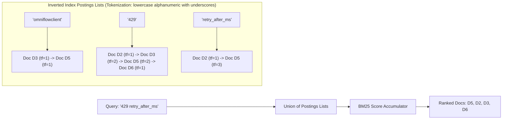
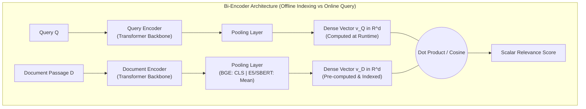
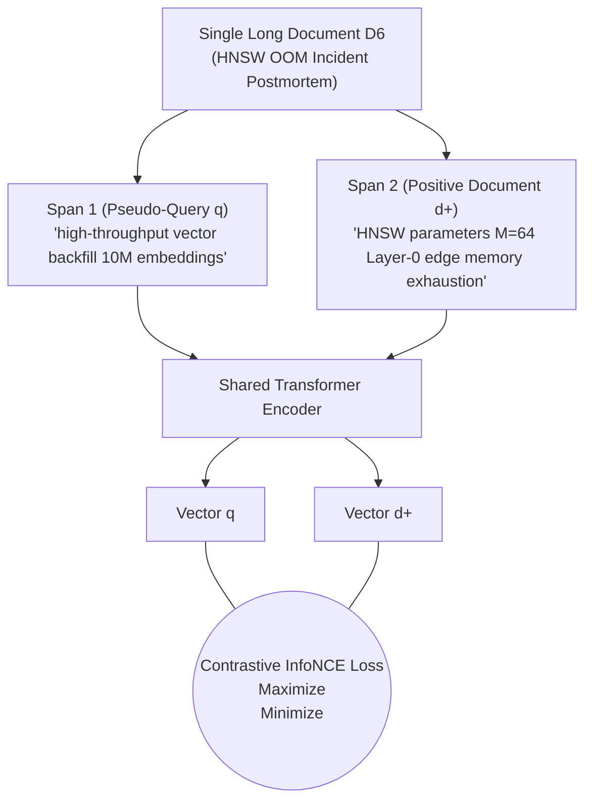
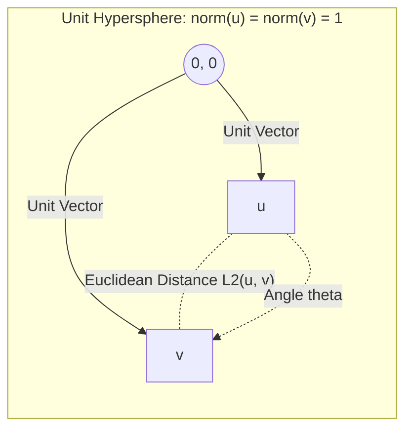
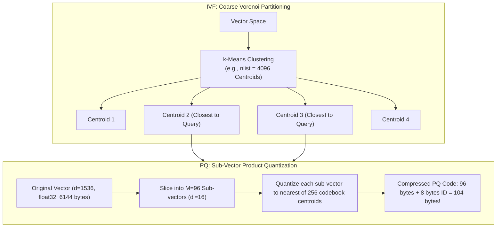
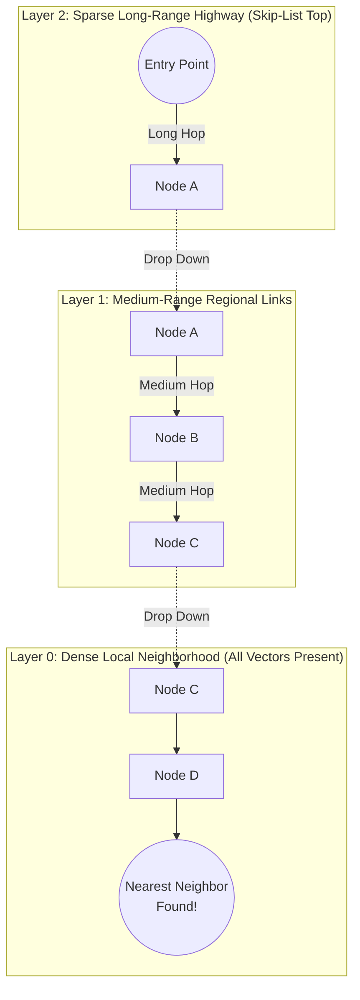

# Phase 2: Retrieval Primitives & Vector Search
## Sparse Lexical Indices, Dense Encoders, Metric Geometry, and ANN Algorithms

> **Core Philosophy**: Retrieval is an engineering compromise between semantic fidelity and computational tractability. An exact brute-force search over dense transformer representations is mathematically ideal but computationally intractable at scale. Every algorithm in this phase—from BM25's inverted index to HNSW's navigable small-world graphs—was invented to eliminate the $O(N \cdot d)$ linear scan without sacrificing retrieval recall.

---

## 1. Sparse Lexical Retrieval: The BM25 Engine

### Topic 1.1: Inverted Index & BM25 Mechanics

#### 1. The Problem
Consider Query $Q_1$: `"retry_after_ms max_backoff_seconds OmniFlowClient"`.
If we query a pure dense vector embedding model (such as a generic bi-encoder):
- Dense models project text into a continuous latent manifold where semantically adjacent concepts cluster together.
- Highly specific, rare tokens like `retry_after_ms`, `max_backoff_seconds`, and `OmniFlowClient` are fragmented by subword tokenizers (e.g., `retry_after_ms` $\to$ `retry`, `_after`, `_ms`; `OmniFlowClient` $\to$ `Omni`, `Flow`, `Client`, illustrative), and single-vector pooling dilutes them across smooth latent dimensions.
- The dense retriever returns generic documentation about HTTP client networking rather than the exact source code in Document $D_5$ or the exact client configuration in $D_3$.

Without an inverted index, searching for exact tokens requires scanning all documents character-by-character ($O(N \cdot L)$), which cannot meet sub-50ms search SLAs over millions of records.

#### 2. Intuition
Think of an inverted index as the index section at the back of a physical textbook: instead of reading all 1,000 pages to find where "retry_after_ms" appears, you turn to the letter "R", find the token, and read the exact list of page numbers where it occurs. 
BM25 is the scoring formula that decides which of those pages is the most relevant, balancing how many times the word appears against how long the page is and how common the word is across the whole book.



#### 3. Mechanics
1. **Tokenization & Normalization**: Text is lowercased and segmented into tokens (e.g., preserving alphanumeric strings and underscores `\b[a-z0-9_]+\b`). Stop words may optionally be filtered.
2. **Inverted Index Construction**: Build a dictionary mapping each unique vocabulary term $t$ to its **postings list**:
   $$\text{Postings}(t) = \big[ (d_1, \text{tf}_{t, d_1}), (d_2, \text{tf}_{t, d_2}), \dots \big]$$
3. **Candidate Selection**: When a query arrives, retrieve the postings lists for all query terms and compute the **union** of matching document IDs.
4. **BM25 Scoring**: Accumulate the BM25 contribution for each matching term across document candidates.
5. **Top-K Selection**: Extract the top-K highest scoring documents using a min-heap in $O(M \log K)$ time where $M$ is the number of candidate documents.

#### 4. Math: The Okapi BM25 Formula
Given a query $Q$ containing tokens $q_1, q_2, \dots, q_m$, the BM25 score of document $D$ is:

$$\text{Score}_{\text{BM25}}(D, Q) = \sum_{i=1}^m \text{IDF}(q_i) \cdot \frac{f(q_i, D) \cdot (k_1 + 1)}{f(q_i, D) + k_1 \cdot \left(1 - b + b \cdot \frac{|D|}{\text{avgdl}}\right)}$$

Where:
- $f(q_i, D)$: The **Term Frequency** ($\text{tf}$) of token $q_i$ in document $D$.
- $|D|$: The length of document $D$ in tokens.
- $\text{avgdl}$: The average document length across the entire corpus $\mathcal{D}$:
  $$\text{avgdl} = \frac{1}{N} \sum_{D' \in \mathcal{D}} |D'|$$
- $\text{IDF}(q_i)$: The **Inverse Document Frequency** of term $q_i$, measuring term rarity. Standard Lucene smoothed formulation:
  $$\text{IDF}_{\text{Lucene}}(q_i) = \ln \left( 1 + \frac{N - n(q_i) + 0.5}{n(q_i) + 0.5} \right)$$
  Where $N$ is total documents in the corpus, and $n(q_i)$ is the number of documents containing $q_i$.

> [!NOTE]
> **IDF Formulations (Lucene vs. `rank_bm25` / Robertson)**:
> In academic literature and the `rank_bm25` Python package, Robertson's unsmoothed IDF is used:
> $$\text{IDF}_{\text{Robertson}}(q_i) = \ln \left( \frac{N - n(q_i) + 0.5}{n(q_i) + 0.5} \right)$$
> If a term appears in more than half of the corpus ($n(q_i) > N/2$), Robertson's IDF becomes negative. To avoid penalizing documents that contain common words, `rank_bm25` floors negative IDF values to an $\epsilon$-floor ($\epsilon \times \text{avg-idf}$). In contrast, Lucene's formulation adds $+1$ inside the logarithm, ensuring $\text{IDF} \ge 0$ for all terms.

##### Why Each Hyperparameter Exists:
1. **$k_1$ (Term Frequency Saturation Parameter, typically $k_1 \in [1.2, 2.0]$)**:
   - In naive TF-IDF, term frequency scales linearly: mentioning a keyword 50 times makes a document 50 times more relevant than mentioning it once, making it vulnerable to keyword stuffing.
   - BM25 introduces an asymptotic upper bound. At $b=0$, the term frequency component is:
     $$\text{TF}_{\text{comp}}(f) = \frac{f \cdot (k_1 + 1)}{f + k_1}$$
     As $f \to \infty$, $\text{TF}_{\text{comp}}(f) \to k_1 + 1$.
   - A lower $k_1$ (e.g., $1.2$) saturates quickly (diminishing returns after 2–3 occurrences). A higher $k_1$ (e.g., $2.0$) allows repeated mentions to push scores higher.
2. **$b$ (Document Length Normalization Parameter, typically $b \in [0.75, 0.85]$)**:
   - A 5,000-word document naturally mentions a term more times than a 100-word document purely by virtue of verbosity.
   - The term $\frac{|D|}{\text{avgdl}}$ compares document length to the corpus average.
   - If $b = 1.0$: Full length normalization. Document length penalizes the score linearly.
   - If $b = 0.0$: Zero length normalization. Document length is completely ignored.
   - The factor $1 - b + b \cdot \frac{|D|}{\text{avgdl}}$ smoothly scales between unnormalized ($1.0$) and normalized ($\frac{|D|}{\text{avgdl}}$).

| Term Frequency ($f$) | TF Score ($k_1 = 1.2$, asymptotic ceiling $2.20$) | TF Score ($k_1 = 2.0$, asymptotic ceiling $3.00$) | Diminishing Return Trajectory |
| :--- | :--- | :--- | :--- |
| **1** | $1.00$ | $1.00$ | Linear baseline |
| **2** | $1.38$ ($+38\%$) | $1.50$ ($+50\%$) | Steep initial rise |
| **3** | $1.57$ ($+14\%$) | $1.80$ ($+20\%$) | Growth begins flattening |
| **5** | $1.77$ ($+13\%$) | $2.14$ ($+19\%$) | Pronounced diminishing returns |
| **10** | $1.96$ ($+11\%$) | $2.50$ ($+17\%$) | Heavy compression of repeats |
| **20** | $2.08$ ($+6\%$) | $2.73$ ($+9\%$) | Approaching asymptotic ceiling |
| **$f 	o \infty$** | $\mathbf{2.20}$ *(Saturation Limit)* | $\mathbf{3.00}$ *(Saturation Limit)* | Maximum bounded contribution |

```mermaid
flowchart LR
    RAW_F["Term Frequency (f)"] --> COMP{"Asymptotic TF Saturation<br>TF(f) = [f * (k1 + 1)] / [f + k1]"}
    COMP -->|"f = 1"| S1["Score = 1.00 (Single occurrence baseline)"]
    COMP -->|"f = 3"| S2["Score = 1.57 to 1.80 (Flattening curve)"]
    COMP -->|"f -> infinity"| S3["Bounded Ceiling: k1 + 1<br>(2.20 for k1=1.2, 3.00 for k1=2.0)"]
```*

#### 5. Worked Example (Hand-Calculated)
Let our corpus contain $N = 6$ documents ($D_1$ to $D_6$).
Let $\text{avgdl} = 150$ tokens *(illustrative)*.
We evaluate the single query term $q$ (`retry_after_ms`) on two documents:
- Document $A$ ($D_2$): $|D_A| = 100$ tokens *(illustrative)*, $f(q, D_A) = 1$.
- Document $B$ ($D_5$, source code): $|D_B| = 300$ tokens *(illustrative)*, $f(q, D_B) = 3$.

Suppose the term appears in $n(q) = 2$ documents ($D_2$ and $D_5$).
Set standard hyperparameters: $k_1 = 1.5$, $b = 0.75$.

**Step 1: Compute IDF (Lucene Smoothed)**:
$$\text{IDF}(q) = \ln \left( 1 + \frac{6 - 2 + 0.5}{2 + 0.5} \right) = \ln \left( 1 + \frac{4.5}{2.5} \right) = \ln(1 + 1.8) = \ln(2.8) \approx 1.0296$$

**Step 2: Compute Length Penalty Factor $K(D) = 1 - b + b \cdot \frac{|D|}{\text{avgdl}}$**:
- For Doc $A$ ($|D_A| = 100$):
  $$K(D_A) = 1 - 0.75 + 0.75 \cdot \left(\frac{100}{150}\right) = 0.25 + 0.75 \cdot 0.6667 = 0.25 + 0.50 = 0.75$$
- For Doc $B$ ($|D_B| = 300$):
  $$K(D_B) = 1 - 0.75 + 0.75 \cdot \left(\frac{300}{150}\right) = 0.25 + 0.75 \cdot 2.0 = 0.25 + 1.50 = 1.75$$

**Step 3: Compute TF Component $\frac{f \cdot (k_1 + 1)}{f + k_1 \cdot K(D)}$**:
- For Doc $A$ ($f = 1$):
  $$\text{TF}_{\text{comp}}(D_A) = \frac{1 \cdot (1.5 + 1)}{1 + 1.5 \cdot 0.75} = \frac{2.5}{1 + 1.125} = \frac{2.5}{2.125} \approx 1.1765$$
- For Doc $B$ ($f = 3$):
  $$\text{TF}_{\text{comp}}(D_B) = \frac{3 \cdot (1.5 + 1)}{3 + 1.5 \cdot 1.75} = \frac{7.5}{3 + 2.625} = \frac{7.5}{5.625} \approx 1.3333$$

**Step 4: Final BM25 Scores**:
- $\text{Score}(D_A) = 1.0296 \cdot 1.1765 \approx \mathbf{1.211}$
- $\text{Score}(D_B) = 1.0296 \cdot 1.3333 \approx \mathbf{1.373}$

Notice that despite Document $B$ having $3\times$ the term frequency of Document $A$ ($f=3$ vs. $f=1$), its final score is only $\approx 13\%$ higher: asymptotic term frequency saturation ($k_1$) compresses diminishing returns from repeat matches, while document length normalization ($b$) penalizes Document $B$ for being twice as long as the corpus average.

#### 6. Code Sketch
```python
import math
from collections import Counter

class SimpleBM25:
    """Minimal BM25 implementation with Lucene smoothed IDF."""
    def __init__(self, corpus: list[list[str]], k1: float = 1.5, b: float = 0.75):
        self.k1, self.b, self.N = k1, b, len(corpus)
        self.doc_lens = [len(doc) for doc in corpus]
        self.avgdl = sum(self.doc_lens) / self.N
        self.doc_freqs = Counter(term for doc in corpus for term in set(doc))
        self.corpus = [Counter(doc) for doc in corpus]

    def score(self, query: list[str]) -> list[float]:
        scores = [0.0] * self.N
        for term in query:
            n = self.doc_freqs.get(term, 0)
            if n == 0: continue
            idf = math.log(1.0 + (self.N - n + 0.5) / (n + 0.5))
            for i, doc in enumerate(self.corpus):
                f = doc.get(term, 0)
                if f > 0:
                    K = 1.0 - self.b + self.b * (self.doc_lens[i] / self.avgdl)
                    scores[i] += idf * (f * (self.k1 + 1.0)) / (f + self.k1 * K)
        return scores
```

#### 7. Failure Modes & Trade-offs
- **Vocabulary Mismatch ($Q_2$)**:
  Query $Q_2$: `"Why did our servers crash while building the search index for a big data import?"`
  Content words: `servers`, `crash`, `building`, `search`, `index`, `big`, `data`, `import`.
  Let us inspect which content words appear in each document:
  - Document $D_1$: contains `search` (tf=1), `index` (tf=1), and `data` (tf=1).
  - Document $D_5$: contains `import` (tf=4).
  - Document $D_6$ (the actual postmortem): contains **zero** of these content words ($D_6$ uses `workers`, `OOM killer terminations`, `construction`, `HNSW`, `backfill`).
  When BM25 scores this query across the corpus, Document $D_1$ achieves a high score of **5.25** (Lucene) / **4.43** (Robertson), while Document $D_6$ receives a score of **0.00** on content words!
  **BM25 ranks $D_1$ substantially above $D_6$, failing completely to retrieve the relevant incident report.**
- **No Syntactic / Word Order Understanding**: `"bank of the river"` and `"river of the bank"` produce identical BM25 scores.
- **Tuning Knobs**:
  - Setting $b$ too high ($b > 0.9$) aggressively penalizes long technical documents that are legitimately thorough.
  - Setting $k_1$ too low ($k_1 < 1.0$) causes the score to saturate after just 1 occurrence, acting almost like a binary boolean search.
- *Default starting point*: $k_1 = 1.2 \text{ to } 1.5$, $b = 0.75$ (illustrative).

#### 8. When to Use It
Always deploy as the primary baseline for exact alphanumeric identifiers, error codes, UUIDs, legal clause IDs, and customer support SKUs.

#### 9. Source
Robertson, Zaragoza, et al., *The Probabilistic Relevance Framework: BM25 and Beyond*, Foundations and Trends in Information Retrieval, 2009.

---

## 2. Dense Semantic Embeddings: Bi-Encoders

### Topic 2.1: Dual Encoders, Contrastive InfoNCE Loss, & Asymmetric Embeddings

#### 1. The Problem
BM25 fails on Query $Q_2$:
> `"Why did our servers crash while building the search index for a big data import?"`

Because BM25 relies on exact lexical intersection, it scored Document $D_1$ at $5.25$ (Lucene) / $4.43$ (Robertson) and ranked it above Document $D_6$ ($0.00$) simply because $D_1$ mentioned `search`, `index`, and `data`. 
We need a representation where synonyms and related concepts project to nearby vectors in a continuous geometric space, so that `"servers crash while building search index"` maps directly to `"worker OOM during HNSW construction"`.

#### 2. Intuition
Imagine mapping every idea to a location on a giant multi-dimensional semantic globe. "Search index construction" and "HNSW graph build" are located in the same neighborhood ("Vector Indexing City"), while "server crash" and "worker OOM termination" sit in "System Outage Suburb" right next door. A dense encoder maps both the question and the document to coordinates on this globe, allowing spatial proximity to reveal topical relevance.



#### 3. Mechanics
1. **Dual Encoder Architecture**: Two separate transformer encoders (or one shared encoder with different prefix instructions):
   - $\text{Encoder}_Q$: Projects queries to $d$-dimensional space $\mathbf{u} \in \mathbb{R}^d$.
   - $\text{Encoder}_D$: Projects passages to $d$-dimensional space $\mathbf{v} \in \mathbb{R}^d$.
2. **Pooling Mechanisms**: Transformers output a sequence of hidden vectors $(h_1, \dots, h_L)$.
   - **`[CLS]` Pooling** (used by BGE): Takes the hidden state of the initial classification token: $\mathbf{v} = h_{\text{[CLS]}}$.
   - **Mean Pooling** (used by E5, Sentence-BERT): Averages token states across the attention mask:
     $$\mathbf{v} = \frac{\sum_{i=1}^L m_i \cdot h_i}{\sum_{i=1}^L m_i}$$
     where $m_i \in \{0, 1\}$ is the attention mask.
3. **Contrastive Training**: The encoder is trained via **In-Batch Negatives** using the **InfoNCE loss**. For each positive query-passage pair $(q_i, p_i^+)$, all other passages $p_j^+$ in the mini-batch of size $B$ serve as negative distractors.
4. **Asymmetric Instructions**: Queries are typically short, imperative questions (e.g., 8 tokens), while passages are long declarative answers (e.g., 200 tokens). To prevent this distributional gap from skewing the latent space, modern models use asymmetric task prefixes:
   - Query prefix: `"Represent this sentence for searching relevant passages: "`
   - Passage prefix: `""` (or `"passage: "`).

#### 4. Math: Contrastive InfoNCE Loss
For a mini-batch of $B$ query-passage pairs $\{(q_i, d_i^+)\}_{i=1}^B$, the InfoNCE loss for query $i$ is:

$$\mathcal{L}_i = -\log \frac{\exp\left( \frac{\cos(\mathbf{q}_i, \mathbf{d}_i^+)}{\tau} \right)}{\exp\left( \frac{\cos(\mathbf{q}_i, \mathbf{d}_i^+)}{\tau} \right) + \sum_{\substack{j=1 \\ j \ne i}}^B \exp\left( \frac{\cos(\mathbf{q}_i, \mathbf{d}_j^+)}{\tau} \right) + \sum_{k=1}^K \exp\left( \frac{\cos(\mathbf{q}_i, \mathbf{d}_{i, k}^-)}{\tau} \right)}$$

Where:
- $\cos(\mathbf{u}, \mathbf{v}) = \frac{\mathbf{u} \cdot \mathbf{v}}{\|\mathbf{u}\|_2 \|\mathbf{v}\|_2}$: Cosine similarity.
- $\tau$: **Temperature parameter** (typically $\tau \in [0.01, 0.07]$, illustrative). Dividing by a small $\tau$ scales logits into a sharper range, heavily penalizing hard negatives.
- $\mathbf{d}_j^+$: **In-batch negatives** (the positive documents for the other $B-1$ queries in the batch).
- $\mathbf{d}_{i, k}^-$: **Hard negatives** (documents retrieved via BM25 that contain overlapping words with $q_i$ but do *not* answer the question).

#### 5. Worked Example: InfoNCE Loss Calculation
Let batch size $B = 2$, temperature $\tau = 0.1$.
Let query $\mathbf{q}_1$ have:
- Positive document $\mathbf{d}_1^+$ with similarity: $s_{1, 1} = \cos(\mathbf{q}_1, \mathbf{d}_1^+) = 0.85$
- In-batch negative document $\mathbf{d}_2^+$ with similarity: $s_{1, 2} = \cos(\mathbf{q}_1, \mathbf{d}_2^+) = 0.30$
- One hard negative $\mathbf{d}_{1, 1}^-$ with similarity: $s_{1, \text{neg}} = \cos(\mathbf{q}_1, \mathbf{d}_{1, 1}^-) = 0.65$

Scale by temperature $\tau = 0.1$:
- $\frac{s_{1, 1}}{\tau} = \frac{0.85}{0.1} = 8.5$
- $\frac{s_{1, 2}}{\tau} = \frac{0.30}{0.1} = 3.0$
- $\frac{s_{1, \text{neg}}}{\tau} = \frac{0.65}{0.1} = 6.5$

Compute exponentiated terms:
- $\exp(8.5) \approx 4914.77$
- $\exp(3.0) \approx 20.09$
- $\exp(6.5) \approx 665.14$

Sum of denominator:
$$\sum = 4914.77 + 20.09 + 665.14 \approx 5599.998$$

Compute softmax probability of the positive document:
$$P(\text{pos}) = \frac{4914.77}{5600.0} \approx 0.8776$$

Compute InfoNCE loss:
$$\mathcal{L}_1 = -\ln(0.8776) \approx \mathbf{0.1306}$$

Notice how the hard negative ($\exp(6.5) = 665.14$) accounted for over $96\%$ of the entire negative denominator mass ($665.14 / (665.14 + 20.09)$). This shows why **hard negative mining** is the single most critical factor in training discriminative dense encoders.

#### 6. Code Sketch
```python
from sentence_transformers import SentenceTransformer

# Load modern asymmetric bi-encoder (BGE uses [CLS] pooling internally)
model = SentenceTransformer("BAAI/bge-large-en-v1.5")

query = "Why did our servers crash while building the search index for a big data import?"
docs = [
    "OmniFlow buffers writes in WAL and flushes to Parquet.",
    "Incident 4092: Worker OOM During Large Batch Ingestion. HNSW M=64 raw vectors + Layer-0 edges exhausted 64 GB instances."
]

# BGE requires explicit instruction prefix for queries
instruction = "Represent this sentence for searching relevant passages: "
q_emb = model.encode(instruction + query, normalize_embeddings=True)
doc_embs = model.encode(docs, normalize_embeddings=True)

similarities = q_emb @ doc_embs.T  # Cosine similarities
# similarities[1] is significantly higher than similarities[0]
```

#### 7. Failure Modes & Trade-offs
- **The Information Bottleneck**: Compressing 512 tokens of complex prose into a single 768-dimensional float vector discards fine-grained lexical details and numerical qualifiers.
- **Domain Shift**: Bi-encoders trained on general QA degrade sharply when queried on proprietary code, legal contracts, or system logs without fine-tuning.
- **Compute Footprint**: Generating dense embeddings requires GPU inference; encoding millions of passages requires distributed batch processing.

#### 8. When to Use It
Use for broad semantic matching, conceptual questions, multilingual search, and synonym-heavy queries where exact lexical terms are unknown.

#### 9. Source
Karpukhin et al., *Dense Passage Retrieval for Open-Domain QA* (DPR), EMNLP 2020; Reimers & Gurevych, *Sentence-BERT: Sentence Embeddings using Siamese BERT-Networks*, EMNLP 2019.

---

### Topic 2.2: Contriever (Unsupervised Dense Retrieval via Random Cropping)

#### 1. The Problem
Supervised bi-encoders (such as DPR or supervised BGE) require tens of thousands of human-labeled query-passage pairs (e.g., MS-MARCO). When deploying RAG on a proprietary codebase, internal incident database ($D_6$), or specialized enterprise domain, **zero labeled query-passage pairs exist**. Fine-tuning supervised models on small datasets risks severe catastrophic forgetting, while off-the-shelf supervised models fail under severe domain shift.

#### 2. Intuition
How can a model learn to retrieve relevant documents without any human labels?
Borrow an intuition from computer vision (SimCLR): take an image, crop two overlapping patches from it, and train a neural network to recognize that both patches belong to the same image. 
Contriever applies **Independent Random Cropping** to text: sample two independent spans from the same document. Even if the two spans share few identical words, they share underlying topical context. By training the encoder to pull two spans from the same document together and push spans from different documents apart, the model learns semantic search with zero human annotations.



#### 3. Mechanics
1. **Data Augmentation via Random Cropping**:
   For each document in the unannotated corpus, randomly sample two spans $(s_1, s_2)$ with lengths between $k_{\min}$ and $k_{\max}$ tokens (e.g., 100–300 tokens).
2. **Word Deletion / Replacement**: Optionally apply token masking or word deletion with low probability (e.g., 5%) to prevent the encoder from relying on superficial n-gram overlap.
3. **Shared Encoder Pass**: Pass span 1 as pseudo-query $q$ and span 2 as positive passage $d^+$ through a shared transformer backbone (BERT/RoBERTa) with mean pooling.
4. **Momentum Queue (MoCo)**: Because contrastive learning requires thousands of negative examples, maintain a dynamic queue of negative embeddings $\mathcal{Q}$ updated via a momentum-averaged target encoder, decoupling batch size from negative count.
5. **Loss Backpropagation**: Optimize standard InfoNCE loss over the positive pair and negative queue.

#### 4. Math: Unsupervised Contrastive Objective
Given a sampled query crop $\mathbf{q}$, its paired positive document crop $\mathbf{k}^+$, and a set of negative passage vectors $\mathcal{N} = \{\mathbf{k}_1^-, \dots, \mathbf{k}_K^-\}$ from other documents:

$$\mathcal{L}_{\text{Contriever}} = -\log \frac{\exp\left( \frac{\mathbf{q} \cdot \mathbf{k}^+}{\tau} \right)}{\exp\left( \frac{\mathbf{q} \cdot \mathbf{k}^+}{\tau} \right) + \sum_{j=1}^K \exp\left( \frac{\mathbf{q} \cdot \mathbf{k}_j^-}{\tau} \right)}$$

Where:
- All vectors are unit $L_2$-normalized: $\|\mathbf{q}\|_2 = \|\mathbf{k}\|_2 = 1$.
- $\tau$: Temperature scaling factor.
- Negatives consist of in-batch negatives plus cached vectors from the momentum queue $\mathcal{Q}$.

#### 5. Worked Example (Hand-Calculated Unsupervised Step)
Let $\tau = 0.1$.
A query crop $q$ (sampled from $D_6$ Summary) has:
- True positive crop $k^+$ (sampled from $D_6$ Root Cause): $\mathbf{q} \cdot \mathbf{k}^+ = 0.80$
- Two negative crops from $D_1$ and $D_2$: $\mathbf{q} \cdot \mathbf{k}_1^- = 0.20$, $\mathbf{q} \cdot \mathbf{k}_2^- = 0.10$

Compute scaled exponentials:
- $\exp(0.80 / 0.1) = \exp(8.0) \approx 2980.96$
- $\exp(0.20 / 0.1) = \exp(2.0) \approx 7.39$
- $\exp(0.10 / 0.1) = \exp(1.0) \approx 2.72$

Compute loss:
$$\mathcal{L} = -\ln \left( \frac{2980.96}{2980.96 + 7.39 + 2.72} \right) = -\ln \left( \frac{2980.96}{2991.07} \right) = -\ln(0.9966) \approx \mathbf{0.0034}$$

#### 6. Code Sketch
```python
from transformers import AutoTokenizer, AutoModel
import torch

# Load pre-trained unsupervised Contriever
tokenizer = AutoTokenizer.from_pretrained("facebook/contriever")
model = AutoModel.from_pretrained("facebook/contriever")

sentences = [
    "Why did our servers crash while building the search index for a big data import?",
    "Incident 4092: Ingestion worker OOM during large HNSW batch backfill."
]

inputs = tokenizer(sentences, padding=True, truncation=True, return_tensors="pt")
with torch.no_grad():
    outputs = model(**inputs)
    # Contriever uses mean pooling across token states
    mask = inputs["attention_mask"].unsqueeze(-1)
    embeddings = (outputs.last_hidden_state * mask).sum(dim=1) / mask.sum(dim=1)
    embeddings = torch.nn.functional.normalize(embeddings, p=2, dim=1)

sim = (embeddings[0] @ embeddings[1]).item()
# sim captures high semantic similarity without needing supervised QA training data
```

#### 7. Failure Modes & Trade-offs
- **False Positive Assumption**: If a document covers multiple disjoint topics (e.g., a newsletter or meeting transcript), two random crops may discuss entirely unrelated subjects, forcing the encoder to correlate unrelated text.
- **Lack of Instruction Following**: Unlike instruction-tuned bi-encoders (e.g., BGE, E5), Contriever does not take task prompts, making it less controllable for specialized asymmetric tasks.

#### 8. When to Use It
Historically important proof that unsupervised contrastive pre-training works; in practice use `contriever-msmarco` or modern E5/BGE models, which use contrastive pre-training at scale before fine-tuning.

#### 9. Source
Izacard, Caron, Hosseini, Riedel, Bojanowski, Joulin, Grave, *Towards Unsupervised Dense Information Retrieval with Contrastive Learning*, Transactions on Machine Learning Research (TMLR), 2022.

---

## 3. Geometric Distance Metrics: Cosine vs. Dot Product vs. Euclidean ($L_2$)

### Topic 3.1: Metric Geometry, Equivalence Proofs, & MIPS Reduction

#### 1. The Problem
Vector databases allow users to configure their similarity metric: `Cosine`, `DotProduct`, or `Euclidean (L2)`. 
Engineers frequently configure `Euclidean` or `DotProduct` on unnormalized vectors, or perform costly square-root operations during online search loops. 

If unnormalized vectors are queried using Dot Product:
$$\text{DotProduct}(\mathbf{q}, \mathbf{d}) = \|\mathbf{q}\| \|\mathbf{d}\| \cos(\theta)$$
A long, rambling document that mentions hundreds of concepts will have a very large vector norm $\|\mathbf{d}\|$. Even if its angular alignment $\theta$ with query $\mathbf{q}$ is mediocre ($\cos \theta = 0.4$), its massive length can produce a higher dot product than a short, punchy document that is perfectly aligned ($\cos \theta = 0.95$, but small $\|\mathbf{d}\|$).

#### 2. Intuition
Imagine throwing arrows at a target:
- **Cosine Similarity** measures strictly the **direction (angle)** you are aiming, completely ignoring how hard the arrow was thrown.
- **Dot Product** multiplies the directional alignment by the force of the throw.
- **Euclidean Distance ($L_2$)** measures the literal physical distance between the tips of the two arrowheads in space.
When all arrows are scaled to have a length of exactly 1 meter (unit normalization), all three metrics become mathematically locked to one another.



#### 3. Mechanics & Equivalence Proof
Let $\mathbf{u}, \mathbf{v} \in \mathbb{R}^d$ be two vectors.

1. **Definitions**:
   - **Dot Product**:
     $$\langle \mathbf{u}, \mathbf{v} \rangle = \sum_{i=1}^d u_i v_i$$
   - **Cosine Similarity**:
     $$\cos(\mathbf{u}, \mathbf{v}) = \frac{\langle \mathbf{u}, \mathbf{v} \rangle}{\|\mathbf{u}\|_2 \|\mathbf{v}\|_2} = \frac{\sum u_i v_i}{\sqrt{\sum u_i^2} \sqrt{\sum v_i^2}}$$
   - **Squared Euclidean Distance ($L_2^2$)**:
     $$\|\mathbf{u} - \mathbf{v}\|_2^2 = \sum_{i=1}^d (u_i - v_i)^2$$

2. **The Equivalence Theorem**:
   If both vectors are normalized to unit length such that $\|\mathbf{u}\|_2 = 1$ and $\|\mathbf{v}\|_2 = 1$:
   
   Expand the squared Euclidean distance:
   $$\|\mathbf{u} - \mathbf{v}\|_2^2 = \sum_{i=1}^d (u_i^2 - 2u_i v_i + v_i^2) = \sum u_i^2 + \sum v_i^2 - 2 \sum u_i v_i$$
   Substitute $\|\mathbf{u}\|_2^2 = 1$ and $\|\mathbf{v}\|_2^2 = 1$:
   $$\|\mathbf{u} - \mathbf{v}\|_2^2 = 1 + 1 - 2 \langle \mathbf{u}, \mathbf{v} \rangle = 2 - 2 \langle \mathbf{u}, \mathbf{v} \rangle$$
   Therefore:
   $$\|\mathbf{u} - \mathbf{v}\|_2^2 = 2 \big( 1 - \cos(\mathbf{u}, \mathbf{v}) \big)$$

3. **Ranking Monotonicity**:
   Maximizing Cosine Similarity $\cos(\mathbf{u}, \mathbf{v})$ is **strictly equivalent** to:
   - Maximizing Dot Product $\langle \mathbf{u}, \mathbf{v} \rangle$.
   - Minimizing Squared Euclidean Distance $\|\mathbf{u} - \mathbf{v}\|_2^2$.

#### 4. The MIPS to $L_2$ Transformation (Bachrach et al., 2014)
When document vector norms are *not* normalized (Maximum Inner Product Search - MIPS), dot product is not monotonic with $L_2$.
However, MIPS can be converted into exact Euclidean $L_2$ distance search by appending a single dimension to vectors.

Let all document vectors $x \in \mathbb{R}^d$ have norms bounded by $M = \max_i \|x_i\|_2$.
Augment each document vector into $\mathbb{R}^{d+1}$:
$$x' = \left[ x, \, \sqrt{M^2 - \|x\|_2^2} \right]$$
Notice that for all documents, the augmented norm is constant:
$$\|x'\|_2^2 = \|x\|_2^2 + (M^2 - \|x\|_2^2) = M^2$$

Augment the query vector into $\mathbb{R}^{d+1}$ by appending a zero:
$$q' = [q, \, 0]$$

Compute the squared Euclidean distance between $q'$ and $x'$:
$$\|q' - x'\|_2^2 = \|q - x\|_2^2 + \left(0 - \sqrt{M^2 - \|x\|_2^2}\right)^2 = \|q\|_2^2 - 2 \langle q, x \rangle + \|x\|_2^2 + (M^2 - \|x\|_2^2) = \|q\|_2^2 + M^2 - 2 \langle q, x \rangle$$

Because $\|q\|_2^2 + M^2$ is constant across all candidate documents for query $q$:
$$\arg\min_x \|q' - x'\|_2^2 = \arg\max_x \langle q, x \rangle$$
Minimizing Euclidean distance in the augmented $(d+1)$-dimensional space is **strictly equivalent to solving MIPS** in the original $d$-dimensional space.

#### 5. Worked Example
Let $\mathbf{u} = [0.6, 0.8]$ and $\mathbf{v} = [0.8, 0.6]$.
Verify unit norm:
- $\|\mathbf{u}\|_2 = \sqrt{0.6^2 + 0.8^2} = \sqrt{0.36 + 0.64} = \sqrt{1.0} = 1.0$
- $\|\mathbf{v}\|_2 = \sqrt{0.8^2 + 0.6^2} = \sqrt{0.64 + 0.36} = \sqrt{1.0} = 1.0$

Compute metrics:
- Dot Product: $\langle \mathbf{u}, \mathbf{v} \rangle = (0.6 \cdot 0.8) + (0.8 \cdot 0.6) = 0.48 + 0.48 = \mathbf{0.96}$
- Cosine Similarity: $\frac{0.96}{1.0 \cdot 1.0} = \mathbf{0.96}$
- Squared Euclidean Distance:
  $$\|\mathbf{u} - \mathbf{v}\|_2^2 = (0.6 - 0.8)^2 + (0.8 - 0.6)^2 = (-0.2)^2 + (0.2)^2 = 0.04 + 0.04 = \mathbf{0.08}$$
- Verify formula:
  $$2 \big( 1 - \langle \mathbf{u}, \mathbf{v} \rangle \big) = 2 (1 - 0.96) = 2 (0.04) = \mathbf{0.08}$$
The equivalence holds identically.

#### 6. Code Sketch
```python
import numpy as np

def fast_batch_cosine_search(q: np.ndarray, doc_matrix: np.ndarray) -> np.ndarray:
    """Computes exact cosine similarity via SIMD dot-product on pre-normalized vectors."""
    # Offline: Ensure doc_matrix is L2-normalized: doc_matrix /= np.linalg.norm(doc_matrix, axis=1, keepdims=True)
    # Online: Normalize query once:
    q_norm = q / np.linalg.norm(q)
    # Pure matrix-vector multiplication (BLAS GEMV):
    scores = np.dot(doc_matrix, q_norm)
    return scores  # Exactly equal to cosine similarity
```

#### 7. Failure Modes & Trade-offs
- **Unnormalized Embeddings**: If vectors are not unit normalized, dot product favors long passages with large vector magnitudes over concise, highly relevant answers.
- **Dimensionality Expansion Overhead**: Appending a dimension for MIPS transforms adds storage and FLOP overhead ($d+1$).

#### 8. When to Use It
Always normalize vectors to unit $L_2$ norm at ingestion time and use **Dot Product (Inner Product)** in your vector index. It yields identical rankings to Cosine Similarity with zero online norm overhead.

#### 9. Source
Bachrach, Finkelstein, Gilad-Bachrach, Katzir, Koenigstein, Nice, Paquet, *Speeding up the Xbox recommender system using a Euclidean transformation for inner-product spaces*, ACM RecSys 2014; Johnson, Douze, Jégou, *Billion-scale similarity search with GPUs*, IEEE TBD 2019.

---

## 4. Approximate Nearest Neighbor (ANN) Indexing

An exact brute-force search (Flat Index) computes the distance between query vector $\mathbf{q}$ and all $N$ vectors in the corpus:
$$\text{FLOPs} \approx 2 \cdot N \cdot d$$
(since each dimension requires one multiplication and one addition).

For a production corpus of $N = 10,000,000$ chunks with dimension $d = 1536$ (e.g., OpenAI `text-embedding-3-large`):
$$\text{Per query} = 2 \times 10^7 \times 1536 \approx 3.072 \times 10^{10} \text{ FLOPs} \approx 30.72 \text{ GFLOPs}$$
The raw vector memory is:
$$10^7 \times 1536 \times 4 \text{ bytes} \approx 61.44 \text{ GB}$$
While $61.44\text{ GB}$ can fit in the memory of a single modern 80 GB GPU (such as an NVIDIA A100/H100 80GB), scanning 61.4 GB for an unbatched single query is strictly memory-bandwidth bound: even at 2 TB/s HBM bandwidth, scanning 61.4 GB takes $\approx 30\text{ ms}$ of pure memory transfer time. While batched queries can be amortized as dense matrix multiplication (GEMM), high-concurrency production systems require single-digit-to-tens-of-milliseconds budgets per query. **ANN algorithms trade a marginal loss in recall ($\approx 1\%\text{--}5\%$, illustrative) for a $100\times\text{--}1,000\times$ speedup and massive memory compression.**

---

### Topic 4.1: Inverted File with Product Quantization (IVF-PQ)

#### 1. The Problem
Storing 10M raw 1536-dimensional vectors of 32-bit floats requires:
$$\text{RAM}_{\text{raw}} = 10^7 \times 1536 \times 4 \text{ bytes} \approx 61.44 \text{ GB}$$
When combined with index overhead, hosting this collection in RAM requires expensive high-memory cloud instances. We need an indexing structure that both **prunes the search space** (avoiding exhaustive scans) and **compresses vector memory** by $50\times\text{--}60\times$.

#### 2. Intuition
- **IVF (Inverted File)**: Think of sorting documents into filing cabinets (Voronoi cells) based on central topics (centroids). When a query arrives, you only search inside the 3 or 4 closest filing cabinets (`nprobe`), ignoring the thousands of other cabinets.
- **PQ (Product Quantization)**: Think of vector compression like color quantization in a GIF image. Instead of describing every point with full 32-bit precision, you break a long vector into sub-vectors, assign each sub-vector to the nearest entry in an 8-bit codebook (256 centroids), and store just the 1-byte code ID.



#### 3. Mechanics
IVF-PQ operates in two intertwined phases:

1. **Coarse Partitioning (Inverted File - IVF)**:
   - Run $k$-means clustering across training vectors to produce $K_{\text{coarse}}$ centroids (referred to as `nlist`, e.g., 4096).
   - Each centroid defines a Voronoi cell.
   - Every vector $\mathbf{x}$ in the corpus is assigned to its nearest centroid $C_i$.
   - The vector is stored as a **residual**:
     $$\mathbf{r} = \mathbf{x} - C_i$$
2. **Product Quantization (PQ) on Residuals**:
   - Split the $d$-dimensional residual vector $\mathbf{r}$ into $M$ distinct sub-vectors of dimension $d^* = d / M$.
   - For each of the $M$ sub-vector subspaces, run $k$-means to learn a codebook of $K^* = 256$ centroids (stored as 1 byte: $2^8 = 256$).
   - Replace each sub-vector with the 1-byte integer index of its closest sub-centroid.
   - The inverted list posting stores the $M$-byte code plus the 8-byte vector ID (`uint64`), totaling $M + 8$ bytes per vector.
3. **Querying via Asymmetric Distance Computation (ADC)**:
   - When query $\mathbf{q}$ arrives, find the `nprobe` closest coarse centroids $C_i$.
   - For each probed coarse centroid $C_i$, compute residual query $\mathbf{q} - C_i$.
   - Construct a pre-computed distance lookup table of size $M \times 256$ containing the squared distances from the query sub-vectors to all 256 codebook centroids. (Distance tables are constructed per probed coarse list).
   - Calculating the distance to any indexed compressed vector requires only $M$ memory lookups and additions!

#### 4. Math & Compression Ratios
Given:
- Original dimension: $d$
- Original data type: `float32` (4 bytes per component)
- Number of PQ sub-vectors: $M$
- Inverted list entry: $M$ bytes PQ code + 8 bytes vector ID = $M + 8$ bytes

**Memory footprint calculation**:
- Uncompressed vectors:
  $$\text{RAM}_{\text{raw}} = N \cdot d \cdot 4 \text{ bytes}$$
- Inverted list posting storage:
  $$\text{RAM}_{\text{postings}} = N \cdot (M + 8) \text{ bytes}$$
- Index overhead (Coarse Centroids + Codebooks):
  $$\text{RAM}_{\text{overhead}} = (\text{nlist} \cdot d \cdot 4) + (M \cdot 256 \cdot d^* \cdot 4) \text{ bytes}$$
- Total IVF-PQ memory:
  $$\text{RAM}_{\text{IVF-PQ}} = \text{RAM}_{\text{postings}} + \text{RAM}_{\text{overhead}}$$

**Distance Approximation via ADC**:
Let $\mathbf{q}$ be the query and $\mathbf{x}$ be a quantized vector whose $M$ sub-vectors are mapped to codebook centroids $c_{1, i_1}, \dots, c_{M, i_M}$.
$$\|\mathbf{q} - \mathbf{x}\|_2^2 \approx \sum_{m=1}^M \|\mathbf{q}^m - c_{m, i_m}\|_2^2$$
Because all $\|\mathbf{q}^m - c_{m, j}\|_2^2$ are pre-computed in lookup table $\mathbf{T}[m][j]$, computing the distance requires zero multiplications:
$$\text{Dist}(\mathbf{q}, \mathbf{x}) \approx \sum_{m=1}^M \mathbf{T}[m][i_m]$$

#### 5. Worked Example (Hand-Calculated Memory Savings)
Let our corpus scale to $N = 10,000,000$ vectors with dimension $d = 1536$.
We configure IVF-PQ with `nlist = 4096`, sub-quantizers $M = 96$ (each sub-vector has dimension $d^* = 1536 / 96 = 16$).
Codebook size $K^* = 256$ centroids (1 byte per code). Each inverted list posting stores 96 bytes code + 8 bytes vector ID = 104 bytes.

1. **Raw Uncompressed Memory**:
   $$\text{RAM}_{\text{raw}} = 10^7 \times 1536 \times 4 \text{ bytes} = 61,440,000,000 \text{ bytes} \approx \mathbf{61.44 \text{ GB}}$$
2. **PQ-Compressed Inverted Lists**:
   $$\text{RAM}_{\text{postings}} = 10^7 \times (96 + 8) \text{ bytes} = 1,040,000,000 \text{ bytes} \approx \mathbf{1.04 \text{ GB}}$$
3. **Index Overhead (Codebooks + Centroids)**:
   - Coarse centroids: $4096 \times 1536 \times 4 \text{ bytes} \approx 25.17 \text{ MB}$
   - PQ codebooks: $96 \times 256 \times 16 \times 4 \text{ bytes} \approx 1.57 \text{ MB}$
   - Total overhead $\approx 26.74 \text{ MB} \approx 0.027 \text{ GB}$
4. **Total IVF-PQ Memory**:
   $$\text{RAM}_{\text{total}} \approx 1.04 \text{ GB} + 0.027 \text{ GB} \approx \mathbf{1.067 \text{ GB}}$$
5. **Effective Compression**:
   $$\text{Compression Factor} = \frac{61.44}{1.067} \approx \mathbf{57.6\times \text{ reduction in RAM!}}$$
A 61.4 GB vector collection now comfortably fits in just 1.07 GB of memory.

#### 6. Code Sketch
```python
import faiss
import numpy as np

d = 128                          # Vector dimension
nlist = 32                       # Number of Voronoi coarse cells
m = 16                           # Number of sub-vectors (8 dims per sub-vector, 1 byte code)
quantizer = faiss.IndexFlatL2(d) # Coarse quantizer
# 8 bits per sub-vector code = 256 centroids per sub-space
index = faiss.IndexIVFPQ(quantizer, d, nlist, m, 8)

# Generate dummy training and database vectors
np.random.seed(42)
data = np.random.random((10000, d)).astype(np.float32)
index.train(data)                # Trains coarse centroids and PQ codebooks
index.add(data)                  # Quantizes residuals and builds posting lists

index.nprobe = 4                 # Search the 4 closest Voronoi cells out of 32
query = np.random.random((1, d)).astype(np.float32)
distances, indices = index.search(query, k=5)
```

#### 7. Failure Modes & Trade-offs
- **Quantization Distortion Loss**: PQ projects vectors onto discrete codebook centroids. Fine angular differences between closely matching technical terms are blurred, hurting Top-1 recall.
- **Tuning Knobs**:
  - `nlist`: Number of coarse cells. Too low $\implies$ large posting lists (slow search); too high $\implies$ long training time and risk of empty cells. Heuristic: $\text{nlist} \approx 4 \sqrt{N}$ (illustrative).
  - `nprobe`: Number of cells visited during search. Low `nprobe` (e.g., 1) is fast but risks missing the true nearest neighbor if it falls just across a Voronoi boundary. High `nprobe` approaches brute-force latency.
  - $M$: Number of sub-vectors. Higher $M$ preserves higher recall but yields lower compression.

#### 8. When to Use It
The gold standard for massive vector scale ($N > 10,000,000$ vectors) where RAM budget is constrained and a small recall degradation ($2\%\text{--}5\%$, illustrative) is acceptable in exchange for a $\approx 58\times$ memory reduction.

#### 9. Source
Jégou, Douze, and Schmid, *Product Quantization for Nearest Neighbor Search*, IEEE TPAMI, 2011.

---

### Topic 4.2: Hierarchical Navigable Small World (HNSW)

#### 1. The Problem
While IVF-PQ solves the memory footprint problem, its recall is fundamentally bounded by quantization noise and rigid Voronoi cell boundaries. In latency-critical production applications (e.g., real-time agentic tool invocation), we need **high recall ($>98\%$, illustrative) with sub-5ms query times**.

On Document $D_6$ (Incident 4092), the engineering team learned the flip side of HNSW:
> *"During a high-throughput vector backfill of 10,000,000 embeddings... OmniFlow ingestion workers experienced Linux Out-Of-Memory (OOM) killer terminations on 64 GB RAM instances. Root Cause: Raw vectors (61.44 GB) plus Layer-0 edges (5.12 GB) totaled 66.56 GB, exceeding the 64 GB instance memory ceiling before accounting for upper-layer edges or process buffers. Compounding this, workers slowed down under allocation load, causing client timeouts; retries exhausted the gateway token bucket (returning 429), and subsequent retries initiated concurrent duplicate partial partition graphs in worker RAM."*

HNSW provides state-of-the-art query speed, but if its graph construction mechanics and memory overhead are misunderstood, production systems crash during heavy write workloads.

#### 2. Intuition
Think of a multi-layer transportation network:
- **Layer 2 (Express Airline Routes)**: Long-distance links connecting distant cities across the continent. With just 2 hops, you travel from New York to Los Angeles.
- **Layer 1 (State Highways)**: Medium-distance links connecting cities within the state.
- **Layer 0 (Local City Streets)**: Dense, short-distance links connecting individual buildings.

When searching for an address, you don't walk street-by-street from New York to LA. You take an express flight to LA (Layer 2), take a highway to the right suburb (Layer 1), and then navigate local streets to find the target building (Layer 0). This is a **Skip-List generalized to graphs**.



#### 3. Mechanics
1. **Probabilistic Layer Assignment**:
   When a new vector is inserted, an integer maximum layer $l$ is assigned randomly using an exponential decay distribution:
   $$l = \lfloor -\ln(\text{uniform}(0, 1)) \cdot m_L \rfloor$$
   Most nodes exist only at Layer 0. An exponentially smaller fraction reach Layer 1, Layer 2, etc. Layer assignment is fixed for the node's lifetime.
2. **Greedy Routing from the Top**:
   - Search begins at the designated global **Entry Point** at top layer $L_{\text{max}}$.
   - At current layer $l_c$, inspect all outgoing neighbors of the current node. Hop greedily to the neighbor closest to query $\mathbf{q}$.
   - When no neighbor is closer to $\mathbf{q}$ than the current node, we have reached a local minimum at this layer.
   - Drop down directly to the same node in layer $l_c - 1$.
3. **Layer 0 Beam Search**:
   - At Layer 0, the greedy search expands into a priority queue beam search governed by candidate queue size `efSearch`.
   - Maintain a dynamic candidate list of the closest `efSearch` nodes discovered so far.
   - Stop when the distance to the next candidate is greater than the distance to the furthest item in the current Top-K set.
4. **Graph Construction Edge Selection ($M$, $efConstruction$)**:
   - During node insertion, find the node's nearest neighbors using beam search with size `efConstruction`.
   - Connect the new node bidirectionally to its $M$ closest neighbors.
   - At Layer 0, each node can store up to $M_{\text{max}, 0} = 2M$ neighbors to improve local connectivity.
   - If a neighbor's degree exceeds its maximum, prune edges using a heuristic that favors **diverse directions** over redundant clustered neighbors.

#### 4. Math: Layer Distribution & Graph Memory Formula

**Layer Assignment Probability**:
The probability that a node reaches at least layer $l$ is:
$$P(\text{layer} \ge l) = \exp\left( -\frac{l}{m_L} \right)$$
To ensure that each higher layer has roughly $1/M$ the number of nodes of the layer below it (mirroring an optimal skip-list branching factor), the normalization scale $m_L$ is set to:
$$m_L = \frac{1}{\ln(M)}$$

**Expected Upper-Layer Edges per Node**:
At layer $l \ge 1$, a node that reaches layer $l$ has at most $M$ outgoing edges. Since the probability of reaching layer $l$ is $(1/M)^l$, the expected total number of upper-layer edges across all layers $l \ge 1$ for an arbitrary node is:
$$\mathbb{E}[\text{Upper Edges}] = \sum_{l=1}^\infty M \cdot \left(\frac{1}{M}\right)^l = M \cdot \frac{1/M}{1 - 1/M} = \frac{M}{M - 1} \approx 1 \text{ edge per node}$$
For $M=64$, $\frac{64}{63} \approx 1.016$ edges per node; for $M=16$, $\frac{16}{15} \approx 1.067$ edges per node.

**Total HNSW Memory Formula**:
Using 4-byte `uint32` neighbor IDs and 4-byte `float32` vector components:
$$\text{Memory}_{\text{HNSW}} \approx N \cdot \Big[ 4 \cdot d + 2M \cdot 4 + \text{small overhead} \Big] \text{ bytes}$$
Where:
- $4 \cdot d$: Raw vector storage (`float32`).
- $2M \cdot 4$: Layer 0 neighbor list ($2M$ edges $\times$ 4 bytes `uint32`).
- Small overhead: Upper-layer edges ($\approx \frac{M}{M-1} \cdot 4\text{ bytes} \approx 4\text{ bytes}$ per node) + vector ID/pointers ($\approx 8\text{ bytes}$ per node).

> [!IMPORTANT]
> **What Drives Memory vs. Build Time**:
> - **$M$ drives persistent index memory**: The graph memory footprint scales directly with $2M \times 4$ bytes per node.
> - **`efConstruction` drives build time and graph quality (recall)**: `efConstruction` is the beam search width during construction. It does *not* increase the final number of edges stored per node (which is strictly capped by $M$), but higher `efConstruction` requires more distance evaluations during insertion, increasing build time.

#### 5. Worked Example (Hand-Calculated Memory & Incident 4092 Replication)
Let us calculate the exact memory footprint that caused the OOM crash in Document $D_6$:
- Number of vectors: $N = 10,000,000$ ($10^7$)
- Embedding dimension: $d = 1536$
- Hyperparameters: $M = 64$, $efConstruction = 200$
- Worker RAM ceiling: **64 GB**

**Step 1: Calculate raw vector storage**:
$$\text{Raw Vectors} = 10^7 \times 1536 \times 4 \text{ bytes} = 61.44 \text{ GB}$$

**Step 2: Calculate Layer-0 graph connectivity overhead (uint32 = 4 bytes per neighbor ID)**:
At Layer 0, each node stores up to $2M = 128$ neighbor IDs:
$$\text{Edges}_{\text{L0}} = 10^7 \times 128 \times 4 \text{ bytes} = 5.12 \text{ GB}$$

**Step 3: Total Static Memory for Vectors + Layer-0 Edges**:
$$\text{Raw Vectors} + \text{Layer-0 Edges} = 61.44 \text{ GB} + 5.12 \text{ GB} = \mathbf{66.56 \text{ GB}}$$
This alone **exceeds the 64 GB worker memory limit**!

**Step 4: Upper-Layer Edges and Metadata**:
- Upper layer edges: $10^7 \times \frac{64}{63} \times 4 \text{ bytes} \approx 40.63 \text{ MB} \approx 0.04 \text{ GB}$
- Vector IDs / metadata: $10^7 \times 8 \text{ bytes} \approx 80 \text{ MB} \approx 0.08 \text{ GB}$
- Total static index memory: $61.44 + 5.12 + 0.04 + 0.08 = \mathbf{66.68 \text{ GB}}$.

**Step 5: The Ingestion Retry Storm Causal Chain**:
As ingestion workers slowed down under heavy allocation load, client requests timed out. Clients retried, rapidly exhausting the API gateway's token bucket which returned HTTP 429 (Too Many Requests) rate limits. Subsequent client retries created a thundering-herd condition where each retried batch initiated a new, duplicate partial partition graph in worker RAM before uncompacted graphs could be reclaimed, immediately triggering the Linux OOM killer.

**Remediation Analysis**:
1. Reducing $M$ from $64$ to $16$:
   - Layer 0 edges drop from $5.12 \text{ GB}$ to:
     $$10^7 \times 32 \times 4 \text{ bytes} = \mathbf{1.28 \text{ GB}}$$
   - Upper layer edges: $10^7 \times \frac{16}{15} \times 4 \approx 42.67 \text{ MB} \approx 0.04 \text{ GB}$
   - Total static index: $61.44 + 1.28 + 0.04 + 0.08 = \mathbf{62.84 \text{ GB}}$.
2. Notice that $M=16$ alone leaves $62.84 \text{ GB}$ on a 64 GB worker instance—leaving under $1.2 \text{ GB}$ of operating headroom for OS, runtime, and buffers! Therefore, $M=16$ alone is insufficient. The team resolved this by sharding the collection across workers (e.g., $2 \times 5\text{M}$ vectors $\approx 31 \text{ GB}$ each) and/or storing compressed vectors in the graph (HNSW+PQ/SQ or DiskANN-style on-disk graph), combined with gateway token-bucket rate limiting and exponential backoff to prevent duplicate partition allocations.

#### 6. Code Sketch
```python
import hnswlib
import numpy as np

dim = 128
num_elements = 10000

# Generating dummy data
data = np.random.random((num_elements, dim)).astype(np.float32)

# Initializing HNSW index with cosine distance
p = hnswlib.Index(space='cosine', dim=dim)

# M: Max outgoing edges per node (heuristic: 16 to 64)
# ef_construction: Depth of candidate search during construction (heuristic: 100 to 200)
p.init_index(max_elements=num_elements, ef_construction=100, M=16)

# Add vectors (construction phase)
p.add_items(data)

# efSearch: Depth of candidate queue during runtime search (heuristic: 50 to 100)
p.set_ef(50)

# Querying
query = np.random.random((1, dim)).astype(np.float32)
labels, distances = p.knn_query(query, k=5)
```

#### 7. Failure Modes & Trade-offs
- **High Memory Footprint**: Unlike IVF-PQ, standard HNSW stores all raw vectors in RAM plus graph pointer overhead ($2M \times 4$ bytes per node at Layer 0).
- **Slow Construction Time**: Inserting millions of vectors into an HNSW graph requires sequential graph traversals and edge reorganizations, making ingestion orders of magnitude slower than IVF-PQ.
- **The Filter Problem (Orphan Nodes)**: Performing boolean pre-filtering on an HNSW graph breaks graph navigation if matching nodes are sparse, stranding the search in disconnected subgraphs.

#### 8. When to Use It
The default choice for performance-critical production systems with $<5,000,000$ vectors per node where query latency ($<5\text{ms}$) and high recall ($>98\%$) are non-negotiable (illustrative).

#### 9. Source
Malkov and Yashunin, *Efficient and Robust Approximate Nearest Neighbor Search Using Hierarchical Navigable Small World Graphs*, IEEE TPAMI, 2018.

---

## 5. Comparison of Retrieval Primitives & Index Types

| Retrieval / Index Primitive | Query Latency (Typical range, hardware- & dataset-dependent) (illustrative) | Memory per $10^6$ Vectors ($d=1536$) | Recall @ 10 (Typical range) (illustrative) | Best Use-Case | Primary Failure Mode |
| :--- | :--- | :--- | :--- | :--- | :--- |
| **Sparse Inverted Index (BM25)** | $<10\text{ ms}$ | Negligible (disk-backed postings) | N/A (Lexical) | Exact keywords, code IDs, SKUs, error codes | Complete failure on vocabulary mismatch & synonyms |
| **Brute-Force Dense (Flat Index)** | $100\text{--}500\text{ ms}$ (CPU) / Batched GPU | $6.14 \text{ GB}$ (Pure vector storage) | $100\%$ (Exact) | Small collections ($N < 50\text{k}$), golden evaluation sets | $O(N)$ linear scaling collapses at scale |
| **IVF-PQ** | $5\text{--}15\text{ ms}$ | ~0.104 GB postings + ~27 MB fixed overhead (≈47× at 1M, ≈58× at 10M) | $85\%\text{--}92\%$ | Massive datasets ($N > 10\text{M}$), tight RAM budgets | Distance distortion from lossy quantization |
| **HNSW ($M=16$)** | $\mathbf{1\text{--}4 \text{ ms}}$ | $\mathbf{6.28 \text{ GB}}$ ($1.02\times$ raw size) | $\mathbf{98\%\text{--}99.5\%}$ | Real-time agentic loops, sub-5ms SLA applications | High RAM usage, slow graph building, worker OOMs |
| **Partitioning + Anisotropic Quantization (ScaNN)** | $2\text{--}6\text{ ms}$ | $1.2 \text{ GB}$ (Moderate compression) | $93\%\text{--}96\%$ | Production sweet spot for large enterprise corpora | Complex multi-stage hyperparameter tuning |

> [!NOTE]
> **Heuristics vs. Principles**:
> - **$M = 16$ and $efSearch = 64$** in HNSW are empirical starting points (illustrative). If your recall on a test dataset is below 95%, scale $efSearch$ to 128 or 256. Increasing $efSearch$ costs zero additional RAM—it only trades runtime CPU cycles.
> - **$k_1 = 1.2$ and $b = 0.75$** in BM25: These are commonly used TREC-era defaults. For code or concise API documentation where term matches should not saturate quickly and length penalties should be gentler, consider starting with $k_1 = 1.8$ and $b = 0.5$.

---

## 6. How This Connects to the Next Phase

In this phase, we established that neither sparse BM25 nor dense vector search is universally superior:
- **BM25** captures exact technical identifiers ($Q_1$) but fails completely on vocabulary mismatch ($Q_2$), scoring $D_1$ at $5.25$ and $D_6$ at $0.00$.
- **Dense bi-encoders** bridge semantic synonyms ($Q_2$) but miss exact code identifiers and rare keywords ($Q_1$).
- **Vector indices (HNSW / IVF-PQ)** return candidates in milliseconds, but single-vector embeddings inherently compress away fine-grained cross-token nuances.

In **Phase 3 (`03-hybrid-and-reranking.md`)**, we build the two-stage hybrid retrieval architecture that solves these limitations:
1. **Reciprocal Rank Fusion (RRF)**: How to mathematically combine sparse and dense rank lists without relying on fragile score normalizations.
2. **Precision Rerankers (Cross-Encoders)**: Replacing bi-encoder vector compression with full all-to-all cross-attention.
3. **Late-Interaction Models (ColBERT)**: The MaxSim operator that approaches cross-encoder precision with bi-encoder retrieval latency.

---

## 7. Phase 2 Interview Questions & Answers

#### Q1: Under what mathematical condition are Cosine Similarity, Dot Product, and Euclidean ($L_2$) Distance ranking-equivalent, and why do production systems prefer Dot Product?
> **Answer**: They are strictly monotonic and ranking-equivalent if and only if all vectors are **normalized to unit $L_2$ norm** ($\|\mathbf{u}\|_2 = 1$). Expanding the squared Euclidean distance yields $\|\mathbf{u} - \mathbf{v}\|_2^2 = \|\mathbf{u}\|_2^2 + \|\mathbf{v}\|_2^2 - 2\langle \mathbf{u}, \mathbf{v} \rangle = 2 - 2\cos(\mathbf{u}, \mathbf{v})$. Production systems prefer Dot Product because normalizing vectors offline allows computing similarities at runtime via a single hardware-accelerated Fused Multiply-Add (FMA) operation, eliminating the need to compute square roots or vector magnitudes during latency-critical online search.

#### Q2: What specific purpose do the hyperparameters $k_1$ and $b$ serve in the BM25 formula, and what happens if $b$ is set to 0?
> **Answer**: In BM25, $k_1$ governs **term frequency saturation**. As term frequency $f \to \infty$, the TF contribution asymptotes to $k_1 + 1$, preventing keyword stuffing from skewing scores. The parameter $b$ controls **document length normalization** by scaling the penalty ratio $|D| / \text{avgdl}$. If $b = 0$, length normalization is completely disabled; long documents that mention query terms multiple times purely due to their verbosity will systematically outrank short, focused documents. Setting $b = 1$ applies full, linear length penalization.

#### Q3: Why does HNSW graph search scale logarithmically ($O(\log N)$) rather than linearly ($O(N)$), and what is the role of the parameter $m_L$?
> **Answer**: HNSW generalizes the 1D Skip-List data structure to multi-layer graphs. The top layers contain sparse graphs with long-range links between distant nodes, allowing greedy routing to cover massive distances in vector space within a few hops. As the search drops down through progressively denser layers, the step sizes become finer until reaching Layer 0, yielding $O(\log N)$ search complexity. The parameter $m_L = 1 / \ln(M)$ acts as the layer assignment decay scale factor, ensuring that the probability of a node appearing at layer $l$ decays exponentially as $(1/M)^l$, maintaining a constant branching factor across the hierarchy.

#### Q4: How does Product Quantization (PQ) achieve a $\approx 58\times$ memory reduction on 1536-dimensional vectors, and how does Asymmetric Distance Computation (ADC) compute distances without decompressing the vectors?
> **Answer**: A 1536-dimensional float32 vector requires $1536 \times 4 = 6144$ bytes. PQ splits the vector into $M = 96$ sub-vectors of dimension $d^* = 16$. Each sub-vector is mapped to the nearest of 256 codebook centroids trained via $k$-means. Storing the 256-centroid ID requires 1 byte ($\log_2 256 = 8$ bits), producing a 96-byte code. Each inverted list entry stores the 96-byte code plus an 8-byte vector ID (`uint64`), totaling 104 bytes per vector ($6144 / 104 \approx 59.1\times$ inverted list compression, or $\approx 57.6\times$ including coarse centroid and codebook overhead). In ADC, the query vector is kept uncompressed. The distance from each query sub-vector to all 256 codebook centroids is pre-computed into an $M \times 256$ lookup table for each probed coarse centroid. Distances to any compressed vector are computed simply by summing $M$ pre-computed table values using the stored 1-byte indices, requiring zero floating-point multiplications.

#### Q5: In an HNSW index, why does increasing $efSearch$ improve retrieval recall without increasing the index's RAM footprint, and what parameter actually drives memory?
> **Answer**: $efSearch$ is purely an online query-time parameter governing the size of the dynamic priority queue (beam search width) used when traversing Layer 0. Because it does not modify the underlying graph structure or the number of bidirectional edges stored per node, increasing $efSearch$ consumes zero additional persistent RAM (it only increases runtime CPU cycles). The parameter that actually drives index memory is **$M$**, which determines the maximum node degree: at Layer 0, each node stores up to $2M$ neighbor IDs ($2M \times 4$ bytes using `uint32`), which directly determines the static graph size.
