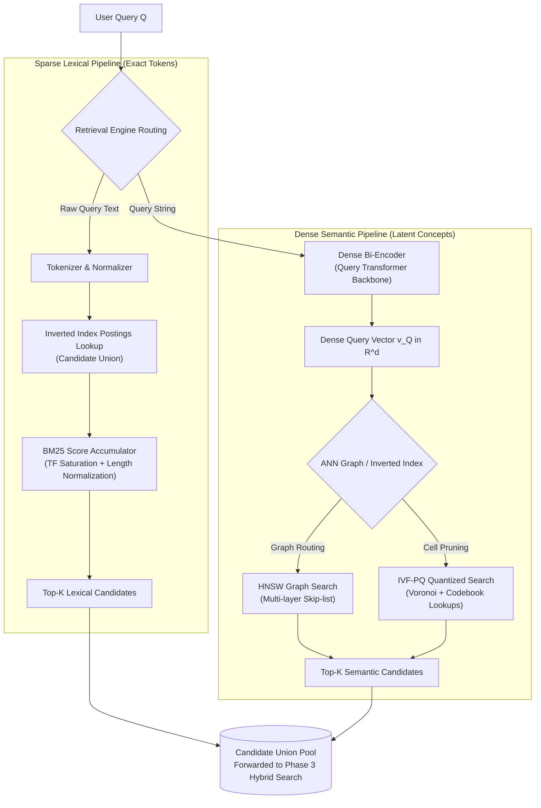
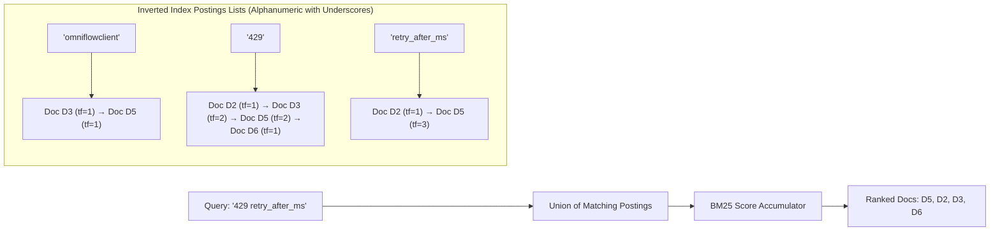
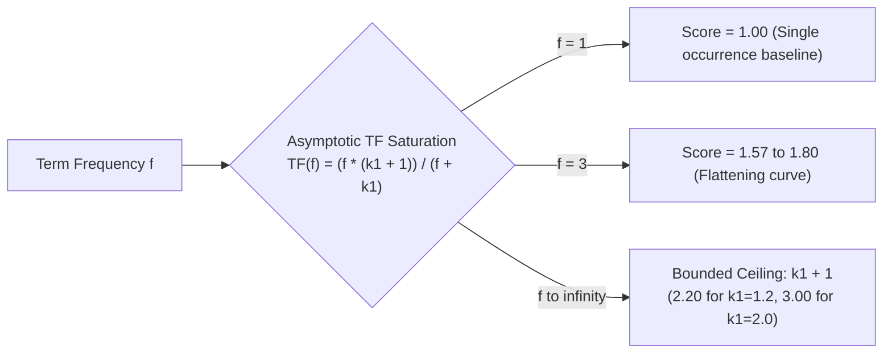
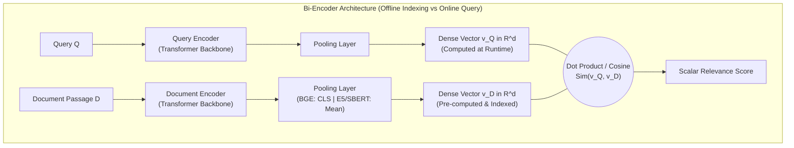
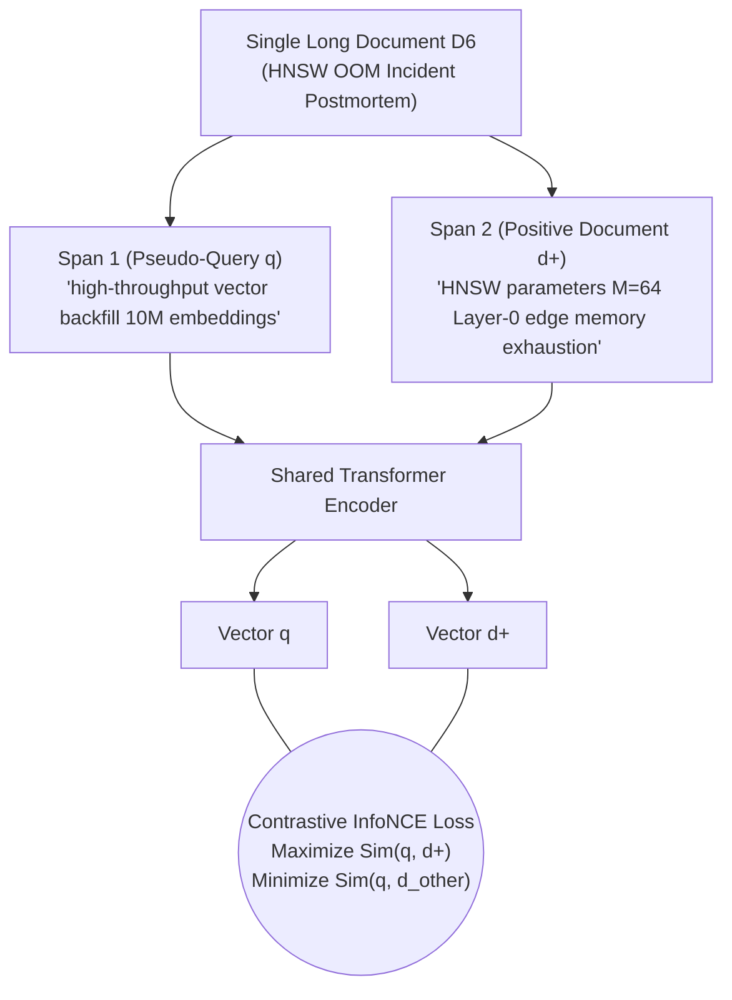
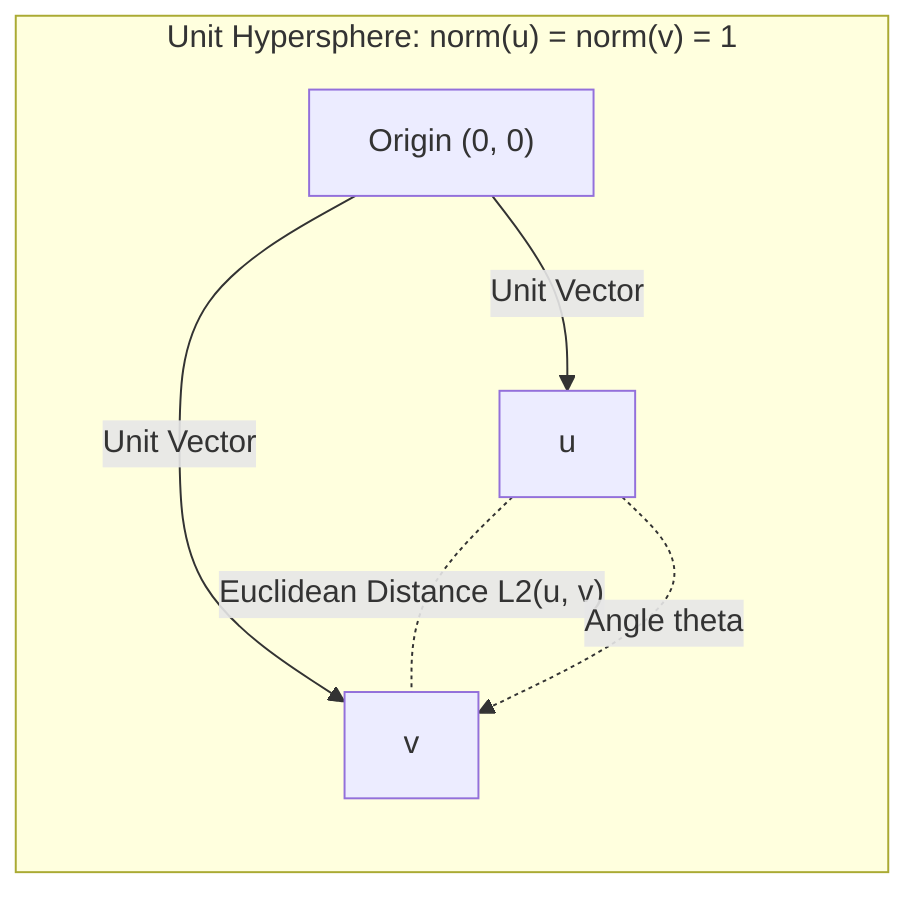
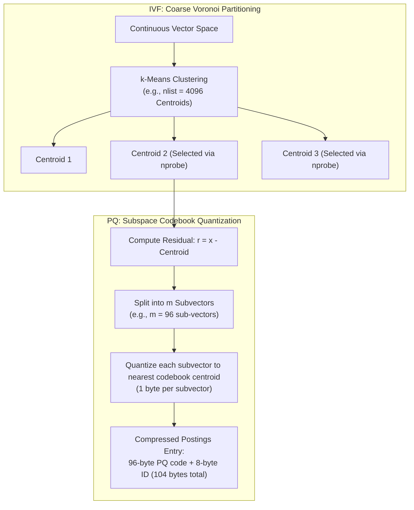
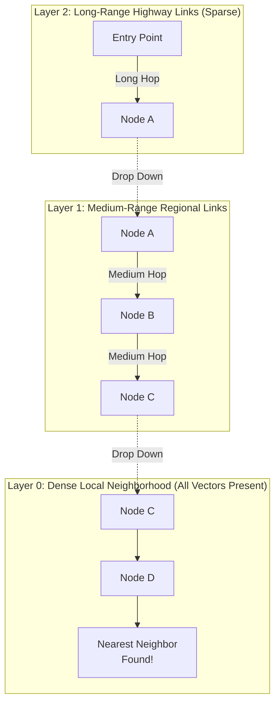

# Phase 2: Retrieval Primitives & Vector Search
## Sparse Lexical Indices, Dense Encoders, Metric Geometry, and ANN Algorithms

> **Core Philosophy**: Retrieval is an engineering compromise between semantic fidelity and computational tractability. An exact brute-force search over dense transformer representations is mathematically ideal but computationally intractable at scale. Every algorithm in this phase—from BM25's inverted index to HNSW's navigable small-world graphs—was invented to eliminate the $O(N \cdot d)$ linear scan without sacrificing retrieval recall.



---

## 1. Sparse Lexical Retrieval

### Topic 1.1: BM25 (Inverted Index, Term Frequency Saturation, and Length Normalization)

#### 1. The Problem
Consider Query $Q_1$: `"retry_after_ms max_backoff_seconds OmniFlowClient"`.
If we query a pure dense vector embedding model (such as a generic bi-encoder):
- Dense models project text into a continuous latent manifold where semantically adjacent concepts cluster together.
- Highly specific, rare tokens like `retry_after_ms`, `max_backoff_seconds`, and `OmniFlowClient` are fragmented by subword tokenizers (e.g., `retry_after_ms` $\to$ `retry`, `_after`, `_ms`; `OmniFlowClient` $\to$ `Omni`, `Flow`, `Client`, illustrative), and single-vector pooling dilutes them across smooth latent dimensions.
- The dense retriever returns generic documentation about HTTP client networking rather than the exact source code in Document $D_5$ or the exact client configuration in $D_3$.

Without an inverted index, searching for exact tokens requires scanning all documents character-by-character ($O(N \cdot L)$), which cannot meet sub-50ms search SLAs over millions of records.

#### 2. Intuition
Think of an inverted index as the index section at the back of a physical textbook: instead of reading all 1,000 pages to find where "retry_after_ms" appears, you turn to the letter "R", find the token, and read the exact list of page numbers where it occurs. 
BM25 is the scoring formula that decides which of those pages is the most relevant, balancing how many times the word appears against how long the page is and how common the word is across the whole book.



#### 3. How It Works
1. **Tokenization & Normalization**: Text is lowercased and segmented into tokens (e.g., preserving alphanumeric strings and underscores `\b[a-z0-9_]+\b`). Stop words may optionally be filtered.
2. **Inverted Index Construction**: Build a dictionary mapping each unique vocabulary term $t$ to its **postings list**:
   $$\text{Postings}(t) = \big[ (d_1, \text{tf}_{t, d_1}), (d_2, \text{tf}_{t, d_2}), \dots \big]$$
3. **Candidate Selection**: When a query arrives, retrieve the postings lists for all query terms and compute the **union** of matching document IDs.
4. **BM25 Scoring**: Accumulate the BM25 contribution for each matching term across document candidates.
5. **Top-K Selection**: Extract the top-K highest scoring documents using a min-heap in $O(M \log K)$ time where $M$ is the number of candidate documents.

> Implementation: see appendix-code.md §P2.1

```python
def bm25_search(query_tokens, index, k1=1.5, b=0.75, top_k=10):
    candidates = set.union(*[index.postings[t].keys() for t in query_tokens if t in index.postings])
    scores = {}
    for d in candidates:
        K = 1.0 - b + b * (index.doc_lens[d] / index.avgdl)
        scores[d] = sum(index.idf[t] * (index.tf(t, d) * (k1 + 1.0)) / (index.tf(t, d) + k1 * K) for t in query_tokens)
    return heapq.nlargest(top_k, scores.items(), key=lambda x: x[1])
```

#### 4. The Key Insight
BM25 succeeds where naive TF-IDF fails because of two foundational non-linear corrections:
1. **Term Frequency Saturation**: In naive TF-IDF, term frequency scales linearly: mentioning an error code 50 times makes a document 50 times more relevant than mentioning it once, rendering it vulnerable to keyword stuffing. BM25 imposes an asymptotic upper ceiling governed by $k_1$.
2. **Document Length Normalization**: A 5,000-word document mentions a keyword more times than a 100-word note simply due to verbosity. BM25 scales the effective term frequency penalty smoothly using document length relative to corpus average ($\text{avgdl}$), governed by parameter $b$.

> [!NOTE]
> **IDF Formulations (Lucene vs. `rank_bm25` / Robertson)**:
> In academic literature and the `rank_bm25` Python package, Robertson's unsmoothed IDF is used:
> $$\text{IDF}_{\text{Robertson}}(q_i) = \ln \left( \frac{N - n(q_i) + 0.5}{n(q_i) + 0.5} \right)$$
> If a term appears in more than half of the corpus ($n(q_i) > N/2$), Robertson's IDF becomes negative. To avoid penalizing documents that contain common words, `rank_bm25` floors negative IDF values to an $\epsilon$-floor ($\epsilon \times \text{avg-idf}$). In contrast, Lucene's formulation adds $+1$ inside the logarithm, ensuring $\text{IDF} \ge 0$ for all terms:
> $$\text{IDF}_{\text{Lucene}}(q_i) = \ln \left( 1 + \frac{N - n(q_i) + 0.5}{n(q_i) + 0.5} \right)$$

#### 5. Math
Given a query $Q$ containing tokens $q_1, q_2, \dots, q_m$, the BM25 score of document $D$ is:

$$\text{Score}_{\text{BM25}}(D, Q) = \sum_{i=1}^m \text{IDF}(q_i) \cdot \frac{f(q_i, D) \cdot (k_1 + 1)}{f(q_i, D) + k_1 \cdot \left(1 - b + b \cdot \frac{|D|}{\text{avgdl}}\right)}$$

Where:
- $f(q_i, D)$: The **Term Frequency** ($\text{tf}$) of token $q_i$ in document $D$.
- $|D|$: The length of document $D$ in tokens.
- $\text{avgdl}$: The average document length across the entire corpus $\mathcal{D}$:
  $$\text{avgdl} = \frac{1}{N} \sum_{D' \in \mathcal{D}} |D'|$$
- $\text{IDF}(q_i)$: The **Inverse Document Frequency** of term $q_i$, measuring term rarity. Standard Lucene smoothed formulation:
  $$\text{IDF}_{\text{Lucene}}(q_i) = \ln \left( 1 + \frac{N - n(q_i) + 0.5}{n(q_i) + 0.5} \right)$$
  Where $N$ is total documents in the corpus, and $n(q_i)$ is the number of documents containing $q_i$.

##### Term Frequency Saturation Dynamics ($b = 0$):
At $b=0$, the term frequency component reduces to:
$$\text{TF}_{\text{comp}}(f) = \frac{f \cdot (k_1 + 1)}{f + k_1}$$
As $f \to \infty$, $\text{TF}_{\text{comp}}(f) \to k_1 + 1$.

| Term Frequency ($f$) | TF Score ($k_1 = 1.2$, asymptotic ceiling $2.20$) | TF Score ($k_1 = 2.0$, asymptotic ceiling $3.00$) | Diminishing Return Trajectory |
| :--- | :--- | :--- | :--- |
| **1** | $1.00$ | $1.00$ | Linear baseline |
| **2** | $1.38$ ($+38\%$) | $1.50$ ($+50\%$) | Steep initial rise |
| **3** | $1.57$ ($+14\%$) | $1.80$ ($+20\%$) | Growth begins flattening |
| **5** | $1.77$ ($+13\%$) | $2.14$ ($+19\%$) | Pronounced diminishing returns |
| **10** | $1.96$ ($+11\%$) | $2.50$ ($+17\%$) | Heavy compression of repeats |
| **20** | $2.08$ ($+6\%$) | $2.73$ ($+9\%$) | Approaching asymptotic ceiling |
| **$f \to \infty$** | $\mathbf{2.20}$ *(Saturation Limit)* | $\mathbf{3.00}$ *(Saturation Limit)* | Maximum bounded contribution |



##### Worked Example (Hand-Calculated):
Let our corpus contain $N = 6$ documents ($D_1$ to $D_6$).
Let $\text{avgdl} = 150$ tokens *(illustrative)*.
We evaluate the single query term $q$ (`retry_after_ms`) on two documents:
- Document $A$ ($D_2$): $|D_A| = 100$ tokens *(illustrative)*, $f(q, D_A) = 1$.
- Document $B$ ($D_5$, source code): $|D_B| = 300$ tokens *(illustrative)*, $f(q, D_B) = 3$.

Suppose the term appears in $n(q) = 2$ documents ($D_2$ and $D_5$).
Set standard hyperparameters: $k_1 = 1.5$, $b = 0.75$.

**Step 1: Compute IDF (Lucene formulation)**:
$$\text{IDF}(q) = \ln \left( 1 + \frac{6 - 2 + 0.5}{2 + 0.5} \right) = \ln \left( 1 + \frac{4.5}{2.5} \right) = \ln(1 + 1.8) = \ln(2.8) \approx \mathbf{1.0296}$$

**Step 2: Compute Length Penalty Factor $K(D) = 1 - b + b \cdot \frac{|D|}{\text{avgdl}}$**:
- For Doc $A$: $K(D_A) = 1 - 0.75 + 0.75 \cdot \left(\frac{100}{150}\right) = 0.25 + 0.75 \cdot 0.6667 = 0.25 + 0.50 = \mathbf{0.75}$
- For Doc $B$: $K(D_B) = 1 - 0.75 + 0.75 \cdot \left(\frac{300}{150}\right) = 0.25 + 0.75 \cdot 2.0 = 0.25 + 1.50 = \mathbf{1.75}$

**Step 3: Compute Term Frequency Component $\frac{f \cdot (k_1 + 1)}{f + k_1 \cdot K(D)}$**:
- For Doc $A$ ($f = 1$):
  $$\text{TF}_{\text{comp}}(D_A) = \frac{1 \cdot (1.5 + 1)}{1 + 1.5 \cdot 0.75} = \frac{2.5}{1 + 1.125} = \frac{2.5}{2.125} \approx \mathbf{1.1765}$$
- For Doc $B$ ($f = 3$):
  $$\text{TF}_{\text{comp}}(D_B) = \frac{3 \cdot (1.5 + 1)}{3 + 1.5 \cdot 1.75} = \frac{7.5}{3 + 2.625} = \frac{7.5}{5.625} \approx \mathbf{1.3333}$$

**Step 4: Final BM25 Scores**:
- $\text{Score}(D_A) = 1.0296 \cdot 1.1765 \approx \mathbf{1.211}$
- $\text{Score}(D_B) = 1.0296 \cdot 1.3333 \approx \mathbf{1.373}$

**Architectural Takeaway**: Even though Doc $B$ mentions `retry_after_ms` **$3\times$ as many times** as Doc $A$, its final score is only **$\approx 13\%$ higher** ($1.373$ vs. $1.211$). The length penalty ($300$ vs. $100$ tokens) combined with term frequency saturation prevented the longer document from dominating purely through repetition.

##### Running Corpus Query Scores:
- **Query $Q_2$ (`"Why did our servers crash while building the search index for a big data import?"`):**
  - Content words in $Q_2$ are: `servers`, `crash`, `building`, `search`, `index`, `big`, `data`, `import`.
  - In $D_1$: `search` (1), `index` (1), `data` (1) appear $\implies$ Document $D_1$ achieves a high score of **5.25** (Lucene) / **4.43** (Robertson).
  - In $D_5$: `import` (4) appears.
  - In $D_6$: **zero** content words appear ($D_6$ uses `workers`, `OOM killer terminations`, `construction`, `HNSW`, `backfill`) $\implies$ Document $D_6$ receives a score of **0.00** on content words.
  - **BM25 ranks $D_1$ substantially above $D_6$, failing completely on semantic synonymy** and missing the incident postmortem!
- **Query $Q_1$ (`"retry_after_ms max_backoff_seconds OmniFlowClient"`):**
  - Sparse BM25 ranks:
    - **Rank 1**: Doc $D_3$ (SDK Manual: score **3.1077**, matches `OmniFlowClient` and `max_backoff_seconds`).
    - **Rank 2**: Doc $D_5$ (Client Code: score **2.7636**, matches `OmniFlowClient` and `retry_after_ms`).
    - **Rank 3**: Doc $D_2$ (Rate Limits Spec: score **1.0739**, matches `retry_after_ms`).
  - Documents $D_1, D_4, D_6$ score **0.00** and do not appear in the sparse list.

#### 6. Design Knobs & Trade-offs
- **$k_1$ Tuning ($1.2\text{--}2.0$)**:
  - *Lower $k_1$ (1.2)*: Rapid saturation. Best for short keyword queries and documentation search where mentioning a term once is sufficient evidence of relevance.
  - *Higher $k_1$ (2.0)*: Slower saturation. Best for long-form passages and verbose technical queries where repeated term occurrences provide genuine cumulative confidence.
- **$b$ Tuning ($0.75\text{--}0.85$)**:
  - *Higher $b$ (0.85)*: Aggressive length normalization. Heavily penalizes long, rambling documents; essential when corpus contains mixed document lengths (e.g., tweets vs. 50-page PDFs).
  - *Lower $b$ (0.50)*: Weak length normalization. Recommended when document length correlates positively with relevance (e.g., comprehensive API specifications vs. stub docs).

#### 7. At Scale
- **LSM-Tree Index Structure & Segment Merging**:
  - Lucene (underpinning Elasticsearch and OpenSearch) writes immutable inverted index segments to disk. As new documents are ingested, small segments accumulate. Background merge threads periodically consolidate them into larger segments, removing tombstones and re-sorting postings lists to maintain sequential I/O.
- **Postings List Compression (PForDelta / Elias-Fano)**:
  - Raw 32-bit doc IDs are never stored uncompressed. Postings lists store delta-encoded doc IDs ($d_i - d_{i-1}$) compressed via SIMD-accelerated PForDelta (Patched Frame-of-Reference) or Elias-Fano quasi-succinct encoding, reducing index memory by $4\text{--}6\times$ *(illustrative)*.
- **Block-Max WAND (Weak AND) Dynamic Pruning**:
  - Instead of computing full BM25 scores for all documents in the candidate union, Block-Max WAND organizes postings into fixed-size blocks (e.g., 64 or 128 doc IDs) and stores the maximum possible score contribution ($\text{score}_{\text{max}}$) for each block. Postings blocks whose upper bound cannot beat the current top-K threshold are skipped without decompression, accelerating query throughput by $5\text{--}10\times$ *(illustrative)*.

#### 8. Failure Modes in Production & How to Detect Them
- **Symptom 1: Vocabulary Mismatch & Synonym Blindness**:
  - *Manifestation*: Query $Q_2$ (`"Why did our servers crash while building the search index for a big data import?"`) returns zero relevant results because Document $D_6$ uses the terms `"workers"`, `"OOM killer terminations"`, `"construction"`, and `"HNSW"`.
  - *Detection Metric*: High rate of zero-hit queries (`0_hit_rate > 5%`) in search telemetry.
  - *Production Fix*: Deploy hybrid search combining BM25 with a dense bi-encoder and Reciprocal Rank Fusion (Phase 3).
- **Symptom 2: Rare Identifier Fragmentation**:
  - *Manifestation*: A user searches for `retry_after_ms`, but standard whitespace/punctuation tokenizers strip the underscores, splitting it into `retry`, `after`, and `ms`, flooding the candidate pool with generic documents containing the common word `after`.
  - *Detection Log*: Unusually large candidate posting unions for technical queries.
  - *Production Fix*: Enforce code-aware regex tokenization (`\b[a-zA-Z0-9_]+\b`) that preserves snake_case and camelCase identifiers.

#### 9. Improvement Ladder
- **Rung 1 (Baseline)**: Raw TF-IDF with linear term weighting and no length normalization. Highly vulnerable to keyword stuffing and verbosity bias.
- **Rung 2 (Better)**: Okapi BM25 with Lucene smoothed IDF and tuned $k_1=1.5, b=0.75$. Robust across variable-length technical corpora.
- **Rung 3 (Best)**: Learned Sparse Representations (SPLADE / BM25 with pseudo-relevance feedback). Neural networks expand query and passage terms into an inverted index vocabulary, bridging vocabulary mismatch while retaining the sub-10ms performance of inverted indices.

#### 10. Alternatives & When to Choose
- **BM25 vs. Dense Bi-Encoders**: Choose BM25 for exact keyword queries, code identifiers, UUIDs, model numbers, and legal citations. Choose Dense Bi-Encoders for natural language questions, synonyms, and cross-lingual retrieval.
- **BM25 vs. SPLADE**: Choose BM25 when zero GPU inference is available at ingestion and search latency must remain strictly $< 10\text{ ms}$. Choose SPLADE when lexical precision is required but vocabulary mismatch must be bridged natively in sparse space.

#### 11. Interview Talking Track
- **60-Second Answer**:
  > "BM25 is the gold-standard sparse lexical retrieval algorithm. It builds an inverted index mapping tokens to postings lists, allowing candidate retrieval in sub-linear time. BM25 improves on classical TF-IDF through two mechanisms: term frequency saturation, which bounds the contribution of repeated terms to an asymptotic ceiling governed by $k_1$, and document length normalization, which penalizes verbose documents governed by $b$. In our production pipeline, BM25 is irreplaceable for exact token matches like error codes and API identifiers that dense embeddings dilute, which is why we pair it with dense retrieval in a hybrid ensemble."
- **5-Minute Deep-Dive Outline**:
  - *Why Pure Dense Fails on Lexical Queries*: Subword fragmentation of identifiers ($Q_1$ `retry_after_ms` severed into subwords) and embedding pooling dilution.
  - *The BM25 Mathematical Mechanics*: Step-by-step walkthrough of IDF smoothing (Lucene vs. Robertson negative IDF fix) and the length normalization penalty factor $K(D)$.
  - *The Saturation Curve*: Proving mathematically why a document mentioning a term $3\times$ as often only gains a $13\%$ score advantage under $k_1=1.5, b=0.75$.
  - *Production Scaling*: Block-Max WAND dynamic pruning, PForDelta postings compression, and LSM-tree immutable segment merging in Lucene.
- **Likely Follow-up Q&A**:
  1. *Q: Why can Robertson's classical IDF become negative, and how does Lucene fix it?*  
     > A: Robertson's formula evaluates $\ln((N - n + 0.5) / (n + 0.5))$. When a term appears in more than half the corpus ($n > N/2$), the fraction is $< 1.0$, producing a negative logarithm that penalizes documents for containing common words. Lucene adds $+1.0$ inside the logarithm, ensuring the argument is always $\ge 1.0$ and IDF remains non-negative.
  2. *Q: How does Block-Max WAND achieve 5x faster search (illustrative) without dropping recall?*  
     > A: It precomputes the maximum score contribution of each block of postings. During query execution, it skips entire blocks whose upper-bound score cannot beat the current $K$-th best score in the priority queue.
  3. *Q: What is the primary operational trade-off of lowering $k_1$ from 2.0 to 1.2?*  
     > A: Lowering $k_1$ causes term frequency to saturate faster, meaning 2 or 3 mentions reach near-maximum score. This helps short, factual queries but degrades performance on long-form, multi-topic articles where term density genuinely signals relevance.
- **Debugging Scenario**:
  > *Problem*: "After upgrading our documentation search, queries for exact Python method names like `OmniFlowClient.connect()` are returning generic user guides instead of API references. How do you fix this?"  
  > *Diagnosis*: The ingestion tokenizer stripped punctuation, splitting `OmniFlowClient.connect()` into `omniflowclient` and `connect`. Because `connect` is a common word, its IDF was low, and the query was dominated by generic client guides.  
  > *Resolution*: Update the analyzer token filter to preserve punctuation-delimited identifiers (`[\w\.]+`) as unified tokens, or index code blocks using a specialized code-aware analyzer.

#### 12. Source
Robertson & Zaragoza, *The Probabilistic Relevance Framework: BM25 and Beyond*, Foundations and Trends in Information Retrieval 2009; Robertson et al., *Okapi at TREC-3*, NIST Special Publication 1994.

---

## 2. Dense Semantic Retrieval

### Topic 2.1: Dense Bi-Encoders & Contrastive Training (InfoNCE)

#### 1. The Problem
While BM25 excels at exact keyword matching, it is completely blind to semantic meaning, synonyms, and conceptual paraphrase. 

Consider Query $Q_2$: `"Why did our servers crash while building the search index for a big data import?"`.
- Document $D_6$ (the postmortem report) contains the answer: it details how HNSW index structures in memory exhausted instance RAM during ingestion.
- However, the content words in $Q_2$ are: `servers`, `crash`, `building`, `search`, `index`, `big`, `data`, `import`. In $D_1$, `search`, `index`, and `data` appear; in $D_5$, `import` appears; but in $D_6$, **zero** content words appear (it uses terms like `"workers"`, `"OOM killer terminations"`, `"construction"`, and `"HNSW"`).
- Consequently, as verified in Section 1.1, BM25 gives $D_6$ a score of **0.00** on content words, completely failing to retrieve the incident report!

A system relying solely on lexical matching cannot bridge the vocabulary gap between how users ask questions and how authors write documentation.

#### 2. Intuition
Imagine mapping every document and query to a coordinate point on a multi-dimensional globe. Documents about memory crashes, RAM limits, and OOM kills are located in the same geographic neighborhood. When a user asks about memory allocation, the search engine simply looks around that neighborhood on the globe, finding relevant documents even if they share zero vocabulary words with the query.



#### 3. How It Works
1. **Asymmetric Query/Document Encoding & Prefixes**:
   - Modern bi-encoders process queries and documents through dual transformer encoders (either shared weights or separate towers).
   - **Prefix Requirements (E5 vs. BGE v1.5)**:
     - **E5 Models** (`intfloat/e5-large-v2`): Strictly require asymmetric prefixes: `"passage: "` prepended to document chunks during ingestion and `"query: "` prepended to user queries at runtime. Omitting either prefix causes severe geometric misalignment.
     - **BGE v1.5 Models** (`BAAI/bge-large-en-v1.5`): Use an asymmetric task instruction on queries:
       $$Q_{\text{input}} = \text{"Represent this sentence for searching relevant passages: "} + Q$$
       Passages are embedded directly without instruction prefixes. For BGE v1.5, this instruction is recommended for specialized or domain-specific search, but optional (omitting it yields only minor degradation on general benchmarks).
2. **Pooling Mechanisms**:
   - **`[CLS]` Pooling** (BAAI/BGE): Takes the hidden state of the first special token $\mathbf{h}_{\text{[CLS]}}$.
   - **Mean Pooling** (E5, Sentence-Transformers): Computes the element-wise average across all contextualized token vectors $\frac{1}{L} \sum_{i=1}^L \mathbf{h}_i \cdot \text{mask}_i$.
3. **L2 Normalization**: The pooled representation is normalized to unit length:
   $$\mathbf{v} = \frac{\mathbf{h}}{\|\mathbf{h}\|_2}$$
4. **Offline Document Indexing**: All corpus passages are embedded offline and loaded into an Approximate Nearest Neighbor (ANN) vector index.
5. **Runtime Retrieval**: The user query is embedded once on a GPU ($< 10\text{ ms}$), followed by Maximum Inner Product Search (MIPS) against the indexed vectors.

> Implementation: see appendix-code.md §P2.2

```python
def bi_encoder_search(query, doc_embeddings, model, top_k=10):
    prefix = "Represent this sentence for searching relevant passages: "
    q_vec = model.encode(prefix + query, normalize_embeddings=True)
    # Cosine similarity via matrix-vector multiplication (BLAS GEMV)
    similarities = doc_embeddings @ q_vec
    top_indices = np.argpartition(similarities, -top_k)[-top_k:]
    return sorted([(idx, similarities[idx]) for idx in top_indices], key=lambda x: x[1], reverse=True)
```

#### 4. The Key Insight
The foundational architectural trade-off of the bi-encoder is **decoupled representation**: queries and documents are processed independently through separate forward passes, never attending to each other directly via cross-attention. 

This enables $O(1)$ query-time search: millions of documents are encoded once offline. At runtime, only the query is embedded, and retrieval reduces to hardware-accelerated vector inner products. The cost of this decoupling is **representation bottlenecking**: the complex semantic nuance of an entire passage must be compressed into a single fixed-dimensional vector ($d = 768$ or $1024$), inevitably losing fine-grained lexical details.

#### 5. Math: InfoNCE Loss and Contrastive Optimization
Bi-encoders are trained using the **InfoNCE** (Information Noise-Contrastive Estimation) loss. Given a batch containing query $q$, a positive document $d^+$, and $K$ negative documents $\{d_1^-, d_2^-, \dots, d_K^-\}$, the loss is:

$$\mathcal{L}_{\text{InfoNCE}} = -\ln \frac{\exp\left(\frac{\langle \mathbf{q}, \mathbf{d}^+ \rangle}{\tau}\right)}{\exp\left(\frac{\langle \mathbf{q}, \mathbf{d}^+ \rangle}{\tau}\right) + \sum_{j=1}^K \exp\left(\frac{\langle \mathbf{q}, \mathbf{d}_j^- \rangle}{\tau}\right)}$$

Where:
- $\langle \mathbf{q}, \mathbf{d} \rangle$: Cosine similarity between normalized vectors ($\mathbf{q}^\top \mathbf{d}$).
- $\tau$: Temperature hyperparameter (typically $\tau \in [0.01, 0.1]$), which scales logits before softmax.

##### Worked Example (Hand-Calculated):
Let temperature $\tau = 0.1$.
A query vector $\mathbf{q}$ is compared against:
- Positive Document $d^+$: $\langle \mathbf{q}, \mathbf{d}^+ \rangle = 0.85$
- Easy Negative Document $d_{\text{easy}}^-$: $\langle \mathbf{q}, \mathbf{d}_{\text{easy}}^- \rangle = 0.30$
- Hard Negative Document $d_{\text{hard}}^-$: $\langle \mathbf{q}, \mathbf{d}_{\text{hard}}^- \rangle = 0.65$

**Step 1: Compute scaled logits ($s / \tau$)**:
- Positive: $0.85 / 0.1 = 8.5$
- Easy Negative: $0.30 / 0.1 = 3.0$
- Hard Negative: $0.65 / 0.1 = 6.5$

**Step 2: Exponentiate logits**:
- $\exp(8.5) \approx \mathbf{4914.77}$
- $\exp(3.0) \approx \mathbf{20.09}$
- $\exp(6.5) \approx \mathbf{665.14}$

**Step 3: Compute Softmax Denominator**:
$$\sum = 4914.77 + 20.09 + 665.14 = \mathbf{5599.998} \approx 5600.0$$

**Step 4: Compute Probability of Positive Document**:
$$P(\text{positive}) = \frac{4914.77}{5600.0} \approx \mathbf{0.8776}$$

**Step 5: Compute Final InfoNCE Loss**:
$$\mathcal{L}_{\text{InfoNCE}} = -\ln(0.8776) \approx \mathbf{0.1306}$$

**Architectural Takeaway**: Notice that the hard negative ($\exp(6.5) = 665.14$) contributed **over $97\%$ of the entire negative denominator mass** ($665.14 / (665.14 + 20.09) \approx 0.9707$). Easy random negatives provide virtually zero gradient signal during training; model discriminative power is driven almost entirely by **hard negative mining**.

#### 6. Design Knobs & Trade-offs
- **Temperature $\tau$ ($0.01\text{--}0.1$)**:
  - Lower $\tau$ (e.g., $0.02$) creates an extremely peaked softmax distribution, penalizing high-scoring negative documents aggressively. However, if the dataset contains false negatives (unlabeled relevant documents), low $\tau$ causes gradient explosion and unstable training.
  - Higher $\tau$ (e.g., $0.1$) produces smoother gradients, stabilizing training on noisy web datasets.
- **Pooling Strategy**:
  - `[CLS]` Pooling: Retains specific contextual signals captured by the classification token.
  - Mean Pooling: Averages out token hidden states, producing smoother vectors that generalize better across variable-length documents.
- **Query Instruction & Prefix Selection**:
  - E5 models strictly require `"query: "` on queries and `"passage: "` on passages; omitting them breaks representation alignment and causes severe retrieval degradation.
  - For BGE v1.5, query instruction prefixes are recommended for specialized technical retrieval but optional (omitting them typically causes only a modest $\approx 2\%\text{--}5\%$ drop on general benchmarks, illustrative).

#### 7. At Scale
- **In-Batch Negatives with Distributed AllGather**:
  - In a cluster of $N$ GPUs, each GPU computes forward passes for a micro-batch of $B$ query-passage pairs. Using PyTorch `torch.distributed.all_gather`, worker GPUs exchange passage representations across the network. Each query on GPU $i$ is contrasted against the $N \times B - 1$ other passages across all GPUs without re-running forward passes, scaling effective batch size to thousands of negatives at zero additional FLOP cost.
- **Vector Memory Footprint ($100\text{M}$ Chunks, $d=1024$)**:
  - `float32` ($4\text{ B/dim}$): $100\text{M} \times 1024 \times 4\text{ B} = \mathbf{409.6\text{ GB}}$ raw vectors *(illustrative)*.
  - `float16` ($2\text{ B/dim}$): $100\text{M} \times 1024 \times 2\text{ B} = \mathbf{204.8\text{ GB}}$ raw vectors *(illustrative)*.
  - Storing raw unquantized vectors in RAM for hundreds of millions of chunks requires multi-node clustering or vector quantization.

#### 8. Failure Modes in Production & How to Detect Them
- **Symptom 1: Severe Degradation on Technical Identifiers**:
  - *Manifestation*: Searching for `retry_after_ms` returns generic API retry descriptions instead of the actual client code in $D_5$.
  - *Detection Metric*: Recall@10 drops below $40\%$ *(illustrative)* on queries containing underscores, camelCase, or numerical parameters.
  - *Production Fix*: Deploy hybrid search combining BM25 and dense bi-encoders (Phase 3).
- **Symptom 2: The Hubness Problem**:
  - *Manifestation*: A small subset of document vectors ("hubs") appear in the nearest-neighbor results of hundreds of completely unrelated queries.
  - *Detection Metric*: Compute neighbor frequency distribution across a query validation set; alert if any document ID appears in $> 5\%$ *(illustrative)* of top-10 candidate sets.
  - *Production Fix*: Apply Local Scaling or Cosine Centering to normalize vector neighbor density.

#### 9. Improvement Ladder
- **Rung 1 (Baseline)**: Off-the-shelf frozen BERT/RoBERTa with mean pooling. Poor retrieval performance due to sentence representation collapse (anisotropy).
- **Rung 2 (Better)**: Supervised bi-encoder fine-tuned with InfoNCE on MS MARCO using random in-batch negatives (DPR).
- **Rung 3 (Best)**: Multi-stage trained bi-encoder with mined hard negatives (BM25 + Cross-Encoder mining) and asymmetric instruction tuning (BAAI/bge-large-en-v1.5, E5-mistral).

#### 10. Alternatives & When to Choose
- **Bi-Encoder vs. Cross-Encoder**: Bi-encoders process query and document separately ($O(1)$ search latency via pre-computed vectors). Cross-encoders concatenate query and document into full transformer cross-attention ($O(N)$ inference latency). Use bi-encoders for first-stage candidate retrieval; use cross-encoders for top-50 re-ranking.
- **Bi-Encoder vs. ColBERT**: Bi-encoders pool text into a single vector; ColBERT preserves multi-vector token embeddings with late interaction. Choose Bi-Encoders when RAM and storage are constrained; choose ColBERT when query latency budget permits multi-vector index lookups.

#### 11. Interview Talking Track
- **60-Second Answer**:
  > "Dense bi-encoders map queries and documents into a shared continuous embedding space using dual transformer towers. By decoupling query encoding from document encoding, passages can be embedded once offline and indexed in an approximate nearest neighbor graph, reducing runtime retrieval to a single query forward pass and fast vector inner products. Bi-encoders are trained using InfoNCE contrastive loss with hard negative mining, pulling semantically matching pairs together while pushing negatives apart. They bridge the vocabulary gap where lexical BM25 fails, but they suffer from representation dilution on exact technical identifiers."
- **5-Minute Deep-Dive Outline**:
  - *The Decoupling Trade-off*: Why bi-encoders achieve sub-10ms latency over millions of passages while cross-encoders cannot.
  - *The InfoNCE Mechanics*: Softmax normalization over similarity logits scaled by temperature $\tau$; mathematical proof that hard negatives dominate gradient updates.
  - *Pooling & Normalization Nuances*: Why BGE uses `[CLS]` pooling while E5/SBERT use mean pooling, and why unit normalization is mandatory for geometric equivalence.
  - *Production Scaling*: Distributed AllGather in-batch negatives during training, and memory footprint calculations at $100\text{M}$ vectors.
- **Likely Follow-up Q&A**:
  1. *Q: Why do bi-encoders fail on exact keyword queries like error codes?*  
     > A: Tokenizers fragment rare identifiers into multiple subwords, and the pooling layer averages their contextualized representations across hundreds of tokens. In contrast, common words dominate the vector's primary dimensions, washing out the rare token's distinct signal.
  2. *Q: What happens if temperature $\tau$ is set too low during training?*  
     > A: A tiny $\tau$ concentrates probability mass on the single closest negative, magnifying its gradient. If that negative is actually a false negative (an unannotated relevant document), the model receives destructive gradient updates that degrade general representation quality.
  3. *Q: How do asymmetric instruction prefixes improve retrieval accuracy?*  
     > A: Queries are short questions or keyword fragments, whereas documents are detailed explanatory paragraphs. Prepending an instruction prompts the transformer to project short user intent into the semantic space of comprehensive answers.
- **Debugging Scenario**:
  > *Problem*: "Our vector search accuracy dropped by 18% after migrating to an intfloat/e5-large-v2 embedding pipeline, despite high offline benchmark scores. What went wrong?"  
  > *Diagnosis*: Check query and document formatting. E5 strictly requires asymmetric prefixes: `"passage: "` prepended to document chunks during ingestion and `"query: "` prepended to runtime queries. If the application service passes raw text without `"query: "`, the bi-encoder projects queries into the passage manifold rather than the query intent space, causing asymmetric alignment collapse. (Note: For BGE v1.5 models, query instructions are recommended but optional, typically causing only a modest 2%–5% drop if omitted).  
  > *Resolution*: Update the embedding client wrapper to enforce the mandatory `"query: "` and `"passage: "` prefixes.

#### 12. Source
Karpukhin et al., *Dense Passage Retrieval for Open-Domain Question Answering* (DPR), EMNLP 2020; Oord et al., *Representation Learning with Contrastive Predictive Coding* (InfoNCE), arXiv 2018; Xiao et al., *C-Pack: Packaged Resources To Advance General Chinese Embedding*, arXiv 2023.

---

### Topic 2.2: Unsupervised Dense Retrieval with Contriever

#### 1. The Problem
Training high-quality dense retrievers like DPR requires hundreds of thousands of supervised query-passage pairs (e.g., MS MARCO, Natural Questions). In proprietary enterprise domains (internal code repositories, clinical trial dossiers, proprietary hardware schematics), zero human-annotated training pairs exist. 

If an engineering team attempts to use a standard pre-trained language model (such as base BERT or RoBERTa) without contrastive adaptation, the representations suffer from severe **anisotropy** (all vectors occupy a narrow cone in latent space), causing cosine similarities between completely unrelated texts to exceed $0.90$ *(illustrative)*.

#### 2. Intuition
How can a model learn that two pieces of text are semantically related without a human teacher? By exploiting the natural structure of documents: two different paragraphs from the same technical report are almost certainly discussing the same topic. Contriever creates synthetic "queries" and "answers" by chopping out random overlapping chunks from raw documents, forcing the model to recognize that two pieces of the same document belong together.



#### 3. How It Works
1. **Independent Random Cropping**: Given an unlabeled document, sample two independent, partially overlapping text spans of length $100\text{--}300$ tokens:
   - Span 1 serves as the pseudo-query $q$.
   - Span 2 serves as the positive document $d^+$.
2. **Token Deletion & Masking**: Apply data augmentation to prevent the model from cheating via simple word matching:
   - Randomly delete $10\%\text{--}20\%$ of tokens *(illustrative)* from both spans.
   - Randomly replace tokens with mask tokens.
3. **MoCo / In-Batch Contrastive Training**: The two augmented spans are passed through a shared transformer encoder with mean pooling. The model is optimized using InfoNCE loss against all other spans in the batch.
4. **Zero-Shot Domain Deployment**: The resulting model serves as a domain-adapted dense retriever without requiring any human labels.

> Implementation: see appendix-code.md §P2.3

```python
def contriever_embed(texts, model, tokenizer):
    inputs = tokenizer(texts, padding=True, truncation=True, return_tensors="pt")
    with torch.no_grad():
        outputs = model(**inputs)
        mask = inputs["attention_mask"].unsqueeze(-1)
        # Mean pooling across token representations
        embeddings = (outputs.last_hidden_state * mask).sum(dim=1) / mask.sum(dim=1)
        return torch.nn.functional.normalize(embeddings, p=2, dim=1)
```

#### 4. The Key Insight
Unsupervised contrastive learning works because **intra-document proximity is a reliable proxy for semantic relevance**. Documents possess internal topical coherence. By forcing the encoder to map two randomly cropped, corrupted spans from the same document together while repelling spans from other documents, the model naturally learns invariance to phrasing, sentence reordering, and surface lexical variation.

> [!NOTE]
> **Historic Relevance vs. Production Practice**:
> Contriever established a historically important proof that dense retrievers can be trained entirely without supervised QA pairs. In modern production systems, unsupervised pretraining is typically used as a domain-adaptation foundation, followed by fine-tuning with MS MARCO or deploying pre-adapted models like `contriever-msmarco`, `BAAI/bge-large-en-v1.5`, or `intfloat/e5-large-v2`.

#### 5. Math
Contriever is trained using InfoNCE loss with a momentum encoder or large in-batch memory bank. For positive pair $(q, d^+)$ and negative passages $\{d_1^-, d_2^-, \dots, d_K^-\}$:

$$\mathcal{L} = -\ln \frac{\exp\left(\frac{\langle \mathbf{q}, \mathbf{d}^+ \rangle}{\tau}\right)}{\exp\left(\frac{\langle \mathbf{q}, \mathbf{d}^+ \rangle}{\tau}\right) + \sum_{j=1}^K \exp\left(\frac{\langle \mathbf{q}, \mathbf{d}_j^- \rangle}{\tau}\right)}$$

##### Worked Example (Hand-Calculated):
Let $\tau = 0.1$.
- Positive pair similarity (two spans from $D_6$): $\langle \mathbf{q}, \mathbf{d}^+ \rangle = 0.80$ *(illustrative)*.
- Negative 1 (span from $D_1$): $\langle \mathbf{q}, \mathbf{d}_1^- \rangle = 0.20$ *(illustrative)*.
- Negative 2 (span from $D_4$): $\langle \mathbf{q}, \mathbf{d}_2^- \rangle = 0.10$ *(illustrative)*.

**Step 1: Compute scaled logits ($s / \tau$)**:
- Positive: $0.80 / 0.1 = 8.0 \implies \exp(8.0) \approx \mathbf{2980.96}$
- Negative 1: $0.20 / 0.1 = 2.0 \implies \exp(2.0) \approx \mathbf{7.39}$
- Negative 2: $0.10 / 0.1 = 1.0 \implies \exp(1.0) \approx \mathbf{2.72}$

**Step 2: Compute Loss**:
$$\mathcal{L} = -\ln \left( \frac{2980.96}{2980.96 + 7.39 + 2.72} \right) = -\ln \left( \frac{2980.96}{2991.07} \right) = -\ln(0.9966) \approx \mathbf{0.0034}$$

#### 6. Design Knobs & Trade-offs
- **Cropping Overlap Ratio ($0\%\text{--}50\%$)**:
  - Zero Overlap: Spans share zero common text. Forces the model to learn pure topical association, but can create noisy pairs if the document transitions between topics.
  - Partial Overlap ($20\%\text{--}50\%$): Spans share common anchor tokens. Stabilizes convergence but risks the model learning trivial string-matching heuristics.
- **Token Deletion Probability ($10\%\text{--}20\%$)**:
  - Higher deletion rates prevent the model from overfitting to n-gram surface patterns, encouraging deeper semantic abstraction.

#### 7. At Scale
- Pretraining Contriever requires processing massive corpora (e.g., Wikipedia and CC-Net, totaling billions of passages).
- In enterprise pipelines, domain adaptation requires only $50{,}000\text{--}200{,}000$ raw corporate documents run over $8\times$ NVIDIA A10G GPUs for 12–24 hours *(illustrative)* to adapt an off-the-shelf base encoder to internal jargon before deploying.

#### 8. Failure Modes in Production & How to Detect Them
- **Symptom 1: Boilerplate Clustering**:
  - *Manifestation*: Random crops frequently capture repetitive legal disclaimers, license headers, or navigation sidebars. The model learns to cluster documents based on identical corporate boilerplate rather than domain concepts.
  - *Detection Metric*: High cosine similarity between completely unrelated documents that share the same copyright notice.
  - *Production Fix*: Run boilerplate removal and HTML header/footer stripping before unsupervised crop generation.

#### 9. Improvement Ladder
- **Rung 1 (Baseline)**: Inverse Cloze Task (ICT). Predicts whether a masked sentence belongs to a given context paragraph.
- **Rung 2 (Better)**: Contriever (Independent Random Cropping + Token Deletion). Learns document-level semantic consistency.
- **Rung 3 (Best)**: Contriever pretraining followed by synthetic QA generation via LLMs (e.g., generating questions from passages with Gemini/GPT-4) and supervised InfoNCE fine-tuning.

#### 10. Alternatives & When to Choose
- **Contriever vs. BM25**: When zero training data exists, BM25 requires zero training time and zero GPUs. Choose Contriever over BM25 if the domain has high vocabulary variation, synonym density, and semantic abstraction.
- **Contriever vs. BGE/E5**: If your domain is standard English or general technical documentation, off-the-shelf BGE or E5 will substantially outperform base unsupervised Contriever because they have been fine-tuned on millions of high-quality supervised retrieval pairs.

#### 11. Interview Talking Track
- **60-Second Answer**:
  > "Contriever is an unsupervised dense retrieval model designed for scenarios where zero labeled query-passage pairs exist. It trains a bi-encoder using contrastive learning applied to data-augmented spans from raw text. By sampling two independent random crops from the same document and applying token deletions, it creates synthetic positive pairs, forcing the transformer to map topically coherent passages together. While modern production systems typically favor supervised models like BGE or E5, Contriever's random-crop contrastive framework remains the foundational paradigm for unsupervised domain adaptation on proprietary enterprise text."
- **5-Minute Deep-Dive Outline**:
  - *The Label Scarcity Problem*: Why supervised retrieval datasets cannot easily be obtained in specialized corporate or clinical domains.
  - *Data Augmentation Pipeline*: Independent random cropping, span length distributions, and token deletion to eliminate surface memorization.
  - *The Loss Dynamics*: Proving how InfoNCE on random crops forces the embedding space to expand and eliminates representation anisotropy.
  - *When to Use in Production*: As an initial unsupervised pretraining phase before fine-tuning with synthetically generated QA pairs.
- **Likely Follow-up Q&A**:
  1. *Q: How does Contriever prevent the encoder from simply memorizing exact overlapping n-grams?*  
     > A: Through token deletion (masking $10\%\text{--}20\%$ of tokens) and by sampling spans with low or zero overlap, forcing the model to rely on global topical context rather than lexical identity.
  2. *Q: Why does base BERT fail as a dense retriever without contrastive training?*  
     > A: Raw BERT embeddings suffer from representation anisotropy: vectors are concentrated in a narrow cone with high average cosine similarity, yielding poor discriminative ranking. Contrastive learning uniformly distributes representations across the unit hypersphere.
- **Debugging Scenario**:
  > *Problem*: "After domain-adapting Contriever on our internal legal wiki, the model ranks irrelevant documents at the top of every query."  
  > *Diagnosis*: Check the corpus preprocessing. Legal documents often contain identical 200-word confidentiality disclaimers at the bottom of every page. Random cropping sampled these disclaimers as positive pairs, teaching the model that any two documents sharing the disclaimer are semantically identical.  
  > *Resolution*: Filter out static recurring headers, footers, and copyright blocks before generating contrastive spans.

#### 12. Source
Izacard et al., *Unsupervised Dense Information Retrieval with Contrastive Learning* (Contriever), TMLR 2022.

---

## 3. Metric Geometry & Vector Distance

### Topic 3.1: Vector Distance Metrics & Geometric Equivalence

#### 1. The Problem
Vector search engines require selecting a distance metric (Cosine Similarity, Dot Product, Euclidean Distance, or Manhattan Distance). 
- Inexperienced teams often treat these metrics as arbitrary hyperparameters.
- A common production mistake is configuring a vector index for Euclidean distance ($L_2$) while feeding raw unnormalized vectors generated by an embedding model trained with Cosine Similarity, causing dramatic ranking degradation.
- Conversely, computing full trigonometric cosine distance at runtime requires calculating vector norms dynamically, wasting millions of CPU/GPU FLOPs during high-throughput search.

#### 2. Intuition
Imagine two arrows pointing from the center of a sphere out to its surface.
- **Cosine similarity** measures the angle between the two arrows, ignoring their length.
- **Euclidean distance** measures the straight-line distance between the tips of the two arrows through three-dimensional space.
- **Dot product** combines both the angle and the lengths of both arrows.
When all arrows are scaled to have a length of exactly 1 meter (unit normalization), the straight-line distance between their tips is mathematically tied directly to the angle between them.



#### 3. How It Works
1. **Inner Product (Dot Product)**:
   $$\langle \mathbf{u}, \mathbf{v} \rangle = \mathbf{u}^\top \mathbf{v} = \sum_{i=1}^d u_i v_i$$
2. **Cosine Similarity**:
   $$\cos(\mathbf{u}, \mathbf{v}) = \frac{\mathbf{u}^\top \mathbf{v}}{\|\mathbf{u}\|_2 \|\mathbf{v}\|_2} = \frac{\sum_{i=1}^d u_i v_i}{\sqrt{\sum_{i=1}^d u_i^2} \sqrt{\sum_{i=1}^d v_i^2}}$$
3. **Squared Euclidean ($L_2^2$) Distance**:
   $$\|\mathbf{u} - \mathbf{v}\|_2^2 = \sum_{i=1}^d (u_i - v_i)^2 = \|\mathbf{u}\|_2^2 + \|\mathbf{v}\|_2^2 - 2 \mathbf{u}^\top \mathbf{v}$$
4. **Offline Normalization**: In production, all document vectors are unit-normalized upon ingestion:
   $$\mathbf{v}_{\text{norm}} = \frac{\mathbf{v}}{\|\mathbf{v}\|_2} \implies \|\mathbf{v}_{\text{norm}}\|_2 = 1.0$$
5. **Runtime Dot Product**: With normalized vectors, runtime cosine search simplifies to a pure matrix-vector dot product (BLAS GEMV).

> Implementation: see appendix-code.md §P2.4

```python
def fast_batch_cosine_search(query_vec, doc_matrix):
    # doc_matrix is pre-normalized offline: np.linalg.norm(doc_matrix, axis=1) == 1.0
    q_norm = query_vec / np.linalg.norm(query_vec)
    # Hardware-accelerated SIMD dot product (BLAS GEMV)
    return np.dot(doc_matrix, q_norm)
```

#### 4. The Key Insight: The Geometric Equivalence Theorem
On the unit hypersphere where $\|\mathbf{u}\|_2 = 1$ and $\|\mathbf{v}\|_2 = 1$:

$$\|\mathbf{u} - \mathbf{v}\|_2^2 = \|\mathbf{u}\|_2^2 + \|\mathbf{v}\|_2^2 - 2 \langle \mathbf{u}, \mathbf{v} \rangle = 1 + 1 - 2 \cos(\mathbf{u}, \mathbf{v}) = 2 - 2 \cos(\mathbf{u}, \mathbf{v})$$

Rearranging terms:
$$\langle \mathbf{u}, \mathbf{v} \rangle = 1 - \frac{1}{2} \|\mathbf{u} - \mathbf{v}\|_2^2$$

**The Architectural Takeaway**: Maximizing Cosine Similarity, maximizing Dot Product, and minimizing Euclidean Distance are **strictly monotonically equivalent operations** on normalized vectors. Sorting a collection of unit vectors by Dot Product produces the exact same top-K ranking as sorting by Euclidean Distance or Cosine Similarity, but executes up to $3\times$ faster *(illustrative)* because it avoids square roots, divisions, and runtime norm calculations.

#### 5. Math: MIPS to Euclidean L2 Transformation
In recommender systems and certain multi-modal embedding architectures, vector norms represent item popularity or entity confidence and cannot simply be normalized away. To search these unnormalized vectors using standard Euclidean nearest neighbor indices, we use **norm augmentation (Bachrach et al., 2014; Neyshabur & Srebro, 2015)**.

Given unnormalized database vectors $\mathbf{x} \in \mathbb{R}^d$ bounded by maximum norm $\phi = \max_i \|\mathbf{x}_i\|_2$:
1. **Augment Database Vectors to $d+1$ Dimensions**:
   $$\mathbf{x}' = \left[ \mathbf{x}, \; \sqrt{\phi^2 - \|\mathbf{x}\|_2^2} \right] \in \mathbb{R}^{d+1}$$
   Notice that the squared norm of every augmented database vector is constant:
   $$\|\mathbf{x}'\|_2^2 = \|\mathbf{x}\|_2^2 + \left( \phi^2 - \|\mathbf{x}\|_2^2 \right) = \phi^2$$
2. **Augment Query Vector to $d+1$ Dimensions**:
   $$\mathbf{q}' = [\mathbf{q}, \; 0] \in \mathbb{R}^{d+1}$$
3. **Equivalence Proof**:
   $$\|\mathbf{q}' - \mathbf{x}'\|_2^2 = \|\mathbf{q}'\|_2^2 + \|\mathbf{x}'\|_2^2 - 2 \langle \mathbf{q}', \mathbf{x}' \rangle = \|\mathbf{q}\|_2^2 + \phi^2 - 2 \langle \mathbf{q}, \mathbf{x} \rangle$$
   Because $\|\mathbf{q}\|_2^2$ and $\phi^2$ are constant across all candidate documents, minimizing Euclidean distance $\|\mathbf{q}' - \mathbf{x}'\|_2^2$ is **strictly identical to maximizing the unnormalized inner product $\langle \mathbf{q}, \mathbf{x} \rangle$**.

#### 6. Design Knobs & Trade-offs
- **Pre-Normalization vs. Runtime Metric**:
  - *Pre-normalized Dot Product*: Fastest possible search speed. Eliminates runtime division and square root operations. Recommended for all standard text embedding models (BGE, E5, OpenAI).
  - *Unnormalized MIPS*: Preserves vector magnitude as an intentional signal (e.g., word frequency or item popularity in collaborative filtering). Requires norm augmentation or native MIPS index support.

#### 7. At Scale
- **SIMD AVX-512 & ARM NEON Acceleration**:
  - Dot product between 1024-dimensional float32 vectors compiles into Fused Multiply-Add (FMA) instructions (`_mm512_fmadd_ps`). An AVX-512 register holds 16 float32 values; a complete dot product executes in 64 clock cycles, enabling millions of vector comparisons per second per CPU core.
- **Memory Alignment**:
  - Vector buffers must be aligned to 64-byte boundaries (`posix_memalign`) to ensure vector loads map directly to hardware cache lines without split-load penalties.

#### 8. Failure Modes in Production & How to Detect Them
- **Symptom 1: Feeding Unnormalized Vectors into an $L_2$ Index**:
  - *Manifestation*: The vector database returns short, uninformative passages near the origin rather than semantically relevant documents.
  - *Detection Metric*: Sudden drop in Context Recall@K on an $L_2$-configured index.
  - *Production Fix*: Verify unit normalization in the ingestion pipeline (`assert np.allclose(np.linalg.norm(vec), 1.0, atol=1e-3)`).

#### 9. Improvement Ladder
- **Rung 1 (Baseline)**: Unnormalized vectors computed with runtime cosine distance (computing norms dynamically on every query). High CPU overhead.
- **Rung 2 (Better)**: Offline unit normalization stored in float32, searched via SIMD dot product (BLAS GEMV).
- **Rung 3 (Best)**: Unit-normalized vectors quantized to `int8` (scalar quantization) searched via AVX-512 VNNI instructions (`_mm512_dpbusd_epi32`), achieving $4\times$ memory reduction and $3\times$ higher throughput *(illustrative)*.

#### 10. Alternatives & When to Choose
- **Cosine / Dot Product vs. Euclidean ($L_2$)**: Use unit-normalized Dot Product for all text embeddings. Use Euclidean distance for spatial, physical, or sensor data where absolute coordinate distance matters.
- **Manhattan ($L_1$)**: Robust against extreme dimensional outliers, but rarely used for text embeddings because transformer latent spaces are dense and continuous.

#### 11. Interview Talking Track
- **60-Second Answer**:
  > "In text retrieval, we almost exclusively use unit-normalized dot product. Mathematically, on the unit hypersphere, Euclidean distance, Cosine similarity, and Dot product are strictly monotonically equivalent: $\|u - v\|^2 = 2 - 2 \langle u, v \rangle$. By normalizing document vectors offline during ingestion, we transform expensive trigonometric cosine calculations into pure BLAS dot products at runtime. For unnormalized vectors where magnitude encodes meaning, we use norm augmentation (Bachrach et al., 2014; Neyshabur & Srebro, 2015) to reduce Maximum Inner Product Search to Euclidean distance by appending a compensating dimension."
- **5-Minute Deep-Dive Outline**:
  - *The Monotonic Equivalence Proof*: Algebraic derivation showing why ranking order is preserved across Cosine, Dot, and $L_2$.
  - *Runtime Performance Mechanics*: How unit normalization replaces norms and square roots with single FMA instructions on CPU/GPU.
  - *MIPS Reduction*: How appending $\sqrt{\phi^2 - \|x\|^2}$ to documents and $0$ to queries maps inner product search into standard Euclidean space.
- **Likely Follow-up Q&A**:
  1. *Q: If Cosine and Dot product are equivalent on normalized vectors, why does index creation offer both?*  
     > A: Some data sources (like image embeddings or collaborative filtering vectors) have meaningful non-unit norms. Offering explicit Cosine instructs the engine to normalize internally; offering Dot product assumes the engineer handled normalization offline for maximum throughput.
  2. *Q: How does SIMD hardware accelerate normalized dot product search?*  
     > A: Using 512-bit registers, AVX-512 computes 16 parallel multiplications and accumulations in a single instruction cycle, completing a 1024-dimensional dot product in 64 cycles.
- **Debugging Scenario**:
  > *Problem*: "Our retrieval engine switched to an open-source vector database, and search results are completely scrambled even though we uploaded the same embeddings."  
  > *Diagnosis*: Check the database index metric configuration. The previous database defaulted to Cosine similarity (normalizing under the hood), whereas the new engine defaulted to Euclidean $L_2$ distance without automatic normalization.  
  > *Resolution*: Either configure the new index to use Inner Product (`metric_type='IP'`) and ensure vectors are normalized, or switch the metric configuration to Cosine.

#### 12. Source
Bachrach et al., *Speeding up the Xbox recommender system using a Euclidean transformation for inner-product spaces*, ACM RecSys 2014; Neyshabur & Srebro, *On Symmetric and Asymmetric LSHs for Inner Product Search*, ICML 2015.

---

## 4. Approximate Nearest Neighbor (ANN) Indexing

### Topic 4.1: Inverted File with Product Quantization (IVF-PQ)

#### 1. The Problem
A brute-force exact vector search compares the query vector against every indexed passage in the corpus ($O(N \cdot d)$ floating-point operations). 
- At $10\text{M}$ vectors with dimension $d = 1536$ in `float32`, storing raw vectors requires **$61.44\text{ GB}$ of RAM** ($10\text{M} \times 1536 \times 4\text{ B}$).
- Computing exact distances across 10 million vectors takes **$100\text{--}250\text{ ms}$ per query** on a multi-core CPU server, failing sub-50ms production SLAs.
- At $100\text{M}$ or $1\text{B}$ vectors, hosting uncompressed vectors in RAM becomes economically prohibitive.

#### 2. Intuition
Think of finding a lost friend in a massive country:
1. **IVF (Inverted File)**: Instead of searching every home in the country, you identify the 3 closest major metropolitan regions (Voronoi coarse centroids) and search only inside those neighborhoods.
2. **PQ (Product Quantization)**: Instead of memorizing your friend's exact full-body GPS coordinate down to the millimeter, you describe their location using a short sequence of landmark codes (e.g., "Block 4, Floor 2, Desk 7").



#### 3. How It Works
1. **Coarse Partitioning (Inverted File - IVF)**:
   - Run $k$-means clustering on a representative sample of vectors to generate $n_{\text{list}}$ coarse centroids (e.g., $n_{\text{list}} = 4096$).
   - Assign each vector in the corpus to its nearest centroid, creating an inverted list for each coarse cluster.
2. **Residual Vector Computation**:
   - To minimize quantization distortion, compute the displacement vector (residual) between vector $\mathbf{x}$ and its assigned centroid $\mathbf{c}_i$:
     $$\mathbf{r} = \mathbf{x} - \mathbf{c}_i$$
3. **Product Quantization (PQ)**:
   - Split the $d$-dimensional residual vector $\mathbf{r}$ into $m$ low-dimensional subvectors $\mathbf{r} = [\mathbf{u}_1, \mathbf{u}_2, \dots, \mathbf{u}_m]$, each having dimension $d^* = d / m$.
   - For each subspace $j \in \{1, \dots, m\}$, run $k$-means clustering to learn a codebook of $k^* = 256$ centroids (which fits into exactly 1 byte: $2^8 = 256$).
   - Replace each subvector $\mathbf{u}_j$ with the 1-byte integer ID of its nearest codebook centroid.
   - The original $d$-dimensional float32 vector ($d \times 4\text{ bytes}$) is compressed into a compact **$m$-byte string**.
4. **Runtime Querying: Asymmetric Distance Computation (ADC)**:
   - Identify the $n_{\text{probe}}$ coarse centroids closest to the query $\mathbf{q}$.
   - **Crucial Optimization**: The query $\mathbf{q}$ is **not quantized**. Compute the distance from each query subvector to all 256 codebook centroids in advance, constructing an $m \times 256$ distance lookup table.
   - For each candidate vector in the probed lists, calculate distance by summing $m$ precomputed values from the lookup table in $O(m)$ operations, avoiding all high-dimensional floating-point math.

> Implementation: see appendix-code.md §P2.5

```python
def ivf_pq_search(query, index, nprobe=8, top_k=10):
    coarse_cells = index.quantizer.search(query, k=nprobe)
    lut = index.compute_distance_lookup_table(query)  # shape (m, 256)
    candidates = [
        (doc_id, sum(lut[i, b] for i, b in enumerate(pq_code)))
        for c in coarse_cells for doc_id, pq_code in index.inverted_lists[c]
    ]
    return heapq.nsmallest(top_k, candidates, key=lambda x: x[1])
```

#### 4. The Key Insight: Asymmetric Distance Computation (ADC)
In Asymmetric Distance Computation, only the database vectors are quantized into discrete codebook indices; the query vector remains in continuous `float32` space. 

By keeping the query unquantized, ADC eliminates half of the total quantization noise compared to Symmetric Distance Computation (SDC, where both query and database vectors are quantized). Furthermore, because all possible subspace distances are precomputed once into an $m \times 256$ lookup table, computing distance reduces to $m$ table lookups and integer additions per candidate, allowing a single CPU core to evaluate tens of millions of vector distances per second.

#### 5. Math: Memory and Storage Footprint Calculation
Consider our running corpus at enterprise scale:
- Corpus size: $N = 10{,}000{,}000$ vectors ($10\text{M}$).
- Dimensionality: $d = 1536$ (e.g., standard dense embeddings).
- Uncompressed raw footprint (`float32`):
  $$\text{Raw Memory} = 10{,}000{,}000 \times 1536 \times 4\text{ B} = \mathbf{61.44\text{ GB}}$$

Apply IVF-PQ with parameters:
- Coarse centroids: $n_{\text{list}} = 4096$.
- Number of subvectors: $m = 96$ ($d^* = 1536 / 96 = 16$ dimensions per subspace).
- Codebook size: $k^* = 256$ ($8\text{ bits} = 1\text{ byte}$ per subvector code).
- Document ID: 64-bit unsigned integer ($8\text{ bytes}$).
*(Note: metadata storage is decoupled and managed separately in payload stores, keeping the search index strictly vector-compact).*

**Postings List Entry Size**:
$$\text{Size per Entry} = 96\text{ bytes (PQ code)} + 8\text{ bytes (Doc ID)} = \mathbf{104\text{ bytes}}$$

**Total Postings Memory for $10\text{M}$ Vectors**:
$$\text{Postings Memory} = 10{,}000{,}000 \times 104\text{ B} = 1{,}040{,}000{,}000\text{ B} = \mathbf{1.04\text{ GB}}$$

**Fixed Overhead**:
- Coarse Centroids: $4096 \times 1536 \times 4\text{ B} \approx 25.17\text{ MB} = 0.025\text{ GB}$.
- Subspace Codebooks: $96 \times 256 \times 16 \times 4\text{ B} \approx 1.57\text{ MB} = 0.0016\text{ GB}$.
- Voronoi Postings Headers: $\approx 0.0004\text{ GB}$.
- Total Fixed Overhead: $\approx \mathbf{0.027\text{ GB}}$.

**Total Index Memory**:
$$\text{Total Memory} = 1.04\text{ GB} + 0.027\text{ GB} \approx \mathbf{1.067\text{ GB}}$$

**Effective Compression Ratio**:
$$\text{Compression Factor} = \frac{61.44\text{ GB}}{1.067\text{ GB}} \approx \mathbf{57.6\times \text{ reduction in RAM!}}$$

At $1\text{M}$ vectors, including the same fixed overhead:
$$\text{Total Memory (1M)} \approx 0.104\text{ GB} + 0.027\text{ GB} = 0.131\text{ GB} \implies \frac{6.144}{0.131} \approx \mathbf{47\times \text{ reduction}}$$

#### 6. Design Knobs & Trade-offs
- **$n_{\text{probe}}$ (Number of Voronoi cells searched at query time)**:
  - *Low $n_{\text{probe}}$ (e.g., 1–4)*: Ultra-fast query latency ($< 2\text{ ms}$); risks missing the true nearest neighbor if it falls just across the boundary of an unselected Voronoi cell (Recall@10 drops to $70\%\text{--}80\%$ *(illustrative)*).
  - *High $n_{\text{probe}}$ (e.g., 32–64)*: Approaches exhaustive search recall ($> 95\%$); increases query latency linearly.
- **$m$ (Number of subvectors)**:
  - Increasing $m$ (e.g., from 64 to 128) doubles the PQ code size and lookup operations, but cuts quantization error in half.

#### 7. At Scale
- **GPU-Accelerated IVF-PQ (Faiss-GPU)**:
  - Voronoi coarse selection and distance lookup table computations map directly to GPU matrix cores. A single NVIDIA A10G GPU running Faiss-GPU evaluates over $50{,}000\text{ queries/sec}$ *(illustrative)* across 10 million vectors.
- **Codebook Training Sample Sizing**:
  - Training stable PQ codebooks requires at least $256 \times k^* \approx 65{,}536$ diverse vectors per subspace. Training on too few vectors creates degenerate centroids and severe distortion.

#### 8. Failure Modes in Production & How to Detect Them
- **Symptom 1: Voronoi Boundary Misalignment**:
  - *Manifestation*: A highly relevant document is not returned because it lies near the perimeter of a Voronoi cluster that was not selected by $n_{\text{probe}}$.
  - *Detection Metric*: Significant recall drop when querying out-of-distribution domain terms.
  - *Production Fix*: Increase $n_{\text{probe}}$ dynamically for long or ambiguous queries, or re-cluster coarse centroids with larger $n_{\text{list}}$.
- **Symptom 2: Distance Distortion Reversals**:
  - *Manifestation*: Top-1 retrieved candidate has higher true Euclidean distance than Top-5 candidates due to quantization noise.
  - *Detection Metric*: Low rank correlation (Spearman's $\rho < 0.85$ *(illustrative)*) between quantized distance and exact float32 distance on a validation sample.
  - *Production Fix*: Deploy a two-stage retrieval pipeline: retrieve the top-100 candidates via IVF-PQ, then re-rank them using uncompressed float32 vectors fetched from NVMe SSD.

#### 9. Improvement Ladder
- **Rung 1 (Baseline)**: Flat $L_2$ linear scan. Perfect recall ($100\%$), but scales linearly $O(N \cdot d)$ and consumes massive RAM ($61.44\text{ GB}$ per 10M vectors).
- **Rung 2 (Better)**: IVF-Flat. Partitions space into Voronoi cells without vector quantization. Fast search, but provides zero RAM compression.
- **Rung 3 (Best)**: IVF-PQ with Asymmetric Distance Computation and top-100 exact re-ranking. Delivers $57.6\times$ RAM compression with $> 95\%$ Recall@10.

#### 10. Alternatives & When to Choose
- **IVF-PQ vs. HNSW**: Choose IVF-PQ when RAM budget is strictly limited and data scale exceeds tens of millions of vectors. Choose HNSW when query latency and recall ($> 98\%$) are the top priorities and sufficient RAM is available.
- **IVF-PQ vs. ScaNN**: ScaNN introduces Anisotropic Vector Quantization, penalizing orthogonal quantization error more than parallel error to optimize Maximum Inner Product Search. Choose ScaNN for MIPS on unnormalized embeddings.

#### 11. Interview Talking Track
- **60-Second Answer**:
  > "IVF-PQ combines coarse geometric clustering with subspace product quantization to solve the memory and compute bottleneck of large-scale vector search. The Inverted File partitions vector space into Voronoi cells, pruning the search space to only $n_{\text{probe}}$ clusters. Product Quantization then decomposes the residual vectors into $m$ low-dimensional subspaces, quantizing each to a 1-byte codebook centroid. For 10 million 1536-dimensional vectors, this compresses index memory from $61.44\text{ GB}$ down to just $1.067\text{ GB}$—a $57.6\times$ reduction. Using Asymmetric Distance Computation, the query remains in full float32 space, evaluating candidates in $O(m)$ table lookups."
- **5-Minute Deep-Dive Outline**:
  - *The Exact Search Bottleneck*: Calculating the $61.44\text{ GB}$ memory footprint and CPU FLOP cost for $10\text{M}$ vectors.
  - *The Two-Stage Pipeline*: Step-by-step walkthrough of Voronoi coarse partitioning and subspace residual decomposition.
  - *Asymmetric Distance Computation*: Why keeping the query unquantized halves distortion and enables SIMD precomputed lookup tables.
  - *Production Trade-offs*: Tuning $n_{\text{probe}}$ vs. latency, and why top-100 uncompressed re-ranking is standard practice.
- **Likely Follow-up Q&A**:
  1. *Q: Why do we quantize the residual vector rather than the raw vector?*  
     > A: The coarse centroid already captures the macro-location of the vector. The residual vector has significantly smaller magnitude and variance, allowing the PQ codebook to represent fine-grained variance with much lower quantization error.
  2. *Q: What is the primary difference between ADC and SDC?*  
     > A: In Symmetric Distance Computation (SDC), both query and database vectors are quantized, compounding quantization error. In Asymmetric Distance Computation (ADC), the query is unquantized, which significantly improves recall with negligible latency difference.
- **Debugging Scenario**:
  > *Problem*: "Our IVF-PQ index exhibits an unacceptable drop in Recall@10 (from 92% to 68%) following a major ingestion backfill. How do you resolve this?"  
  > *Diagnosis*: The coarse $k$-means centroids were trained on the initial corpus. The newly ingested documents shifted the data distribution, causing severe cluster imbalance where certain Voronoi cells became massive and under-probed.  
  > *Resolution*: Re-train the coarse quantizer ($n_{\text{list}}$ centroids) and PQ codebooks on a fresh stratified sample across both old and new data distributions.

#### 12. Source
Jégou et al., *Product Quantization for Nearest Neighbor Search*, IEEE TPAMI 2011; Johnson et al., *Billion-scale similarity search with GPUs* (Faiss), IEEE Transactions on Big Data 2019.

---

### Topic 4.2: Hierarchical Navigable Small World (HNSW) Graphs

#### 1. The Problem: The Document $D_6$ Postmortem
Consider the exact incident documented in Document $D_6$ (`Incident 4092 Postmortem`):
- An engineering team initiated a large-scale backfill of **$10\text{M}$ vectors** ($d = 1536$, `float32`) onto **64 GB RAM worker instances**.
- The team configured HNSW with aggressive hyperparameters: $M = 64$ and $efConstruction = 200$.
- **The Catastrophic OOM Calculation**:
  - Raw vector data alone consumed:
    $$\text{Vector RAM} = 10{,}000{,}000 \times 1536 \times 4\text{ B} = \mathbf{61.44\text{ GB}}$$
  - In HNSW, Layer 0 stores up to $2M$ bidirectional edge connections per node.
  - With $M = 64$, each Layer-0 node stores up to $2 \times 64 = 128$ neighbor links.
  - Storing neighbor IDs as 32-bit unsigned integers (`uint32`, $4\text{ bytes}$ each) requires:
    $$\text{Layer-0 Edge RAM per Node} = 128 \times 4\text{ B} = \mathbf{512\text{ bytes}}$$
  - Across $10\text{M}$ nodes, Layer-0 graph edges alone required:
    $$\text{Layer-0 Total Edge RAM} = 10{,}000{,}000 \times 512\text{ B} = \mathbf{5.12\text{ GB}}$$
  - The static index structures totaled:
    $$\text{Total Base Memory} = 61.44\text{ GB} + 5.12\text{ GB} = \mathbf{66.56\text{ GB}} > 64\text{ GB physical RAM!}$$
- Before upper-layer edges, construction buffers (`efConstruction`), or OS system processes could allocate memory, the Linux kernel OOM killer terminated the worker process with signal 9!

> [!WARNING]
> **Why Lowering $M=16$ Alone Was Insufficient**:
> If the team simply reduces $M$ to $16$:
> - Layer-0 edges: $2 \times 16 \times 4\text{ B} = 128\text{ bytes/node} \implies 1.28\text{ GB}$.
> - Upper-layer edges ($\approx 0.04\text{ GB}$) + IDs ($\approx 0.08\text{ GB}$) $\approx 0.12\text{ GB}$.
> - Total static index memory: $61.44 + 1.28 + 0.12 = \mathbf{62.84\text{ GB}}$.
> On a 64 GB host, $62.84\text{ GB}$ leaves only **$1.16\text{ GB}$ of operating headroom**, leaving zero tolerance for OS caching, dynamic query buffers, or multi-tenant worker threads. The real production fix requires **distributed sharding** or **quantizing vectors inside the graph** (e.g., scalar int8 quantization reducing raw vectors to $15.36\text{ GB}$).

#### 2. Intuition
Think of a multi-layer transportation network:
- **Layer 2 (Express Air Routes)**: A sparse set of long-range highway links connecting distant continents. You make massive geographical hops with very few checks.
- **Layer 1 (Regional Highways)**: Connects cities within the selected state.
- **Layer 0 (Local City Streets)**: The full, dense graph containing every single building. You navigate street-by-street to arrive at the exact doorstep.



#### 3. How It Works
1. **Probabilistic Multi-Layer Assignment**:
   - Every inserted vector is assigned a maximum layer $l$ using an exponential decay distribution:
     $$l = \lfloor -\ln(\text{uniform}(0, 1)) \cdot m_L \rfloor \quad \text{where } m_L = \frac{1}{\ln(M)}$$
   - Most nodes exist only at Layer 0. An exponentially decreasing fraction reach Layer 1, Layer 2, etc. Layer assignment is immutable once set.
2. **Top-Down Greedy Routing (Layers $L_{\text{max}} \to 1$)**:
   - Begin at the global entry point on the highest layer.
   - Greedily hop to the neighbor closest to query vector $\mathbf{q}$. When no neighbor is closer than the current node, drop down to the corresponding node on the next layer down.
3. **Layer 0 Beam Search ($efSearch$)**:
   - At Layer 0, expand the search into a priority-queue beam search maintaining candidate pool size $efSearch$.
   - Iterate through neighbors until all candidates in the beam are evaluated, returning the top-K nearest neighbors.
4. **Graph Construction Edge Selection ($M$, $efConstruction$)**:
   - During node insertion, find the node's nearest neighbors using beam search with size $efConstruction$.
   - Connect the new node to its $M$ best neighbors using the **HNSW Heuristic Selection Rule**, which prefers neighbors that are diverse (providing alternative angular coverage) over neighbors that cluster tightly together.

> Implementation: see appendix-code.md §P2.6

```python
def hnsw_search(query, index, ef_search=50, top_k=10):
    curr_node = index.entry_point
    # Top-down greedy routing through upper skip-layers
    for layer in reversed(range(1, index.max_layer + 1)):
        curr_node = index.greedy_search_layer(query, curr_node, layer)
    # Layer 0 beam search with priority queue
    candidates = index.beam_search_layer0(query, curr_node, ef=ef_search)
    return heapq.nsmallest(top_k, candidates, key=lambda x: x[1])
```

#### 4. The Key Insight
HNSW solves the curse of dimensionality in graph search by generalizing the **1D Skip-List to multi-dimensional geometric spaces**. 

Crucially, **$M$ drives memory footprint**, whereas **$efConstruction$ drives index build time and graph quality**. The query beam size $efSearch$ is completely decoupled from index construction: an engineering team can build the index once and dynamically adjust $efSearch$ at runtime, trading query latency for retrieval recall on a per-query basis without rebuilding the graph.

#### 5. Math
- **Level Multiplier**:
  $$m_L = \frac{1}{\ln(M)}$$
- **Probability of Reaching Layer $l$**:
  $$P(\text{level} \ge l) = \exp\left(-\frac{l}{m_L}\right) = M^{-l}$$
- **Upper-Layer Node Summation**:
  The total number of node occurrences across all upper layers ($l \ge 1$) forms a convergent geometric series:
  $$\sum_{l=1}^\infty N \cdot M^{-l} = N \sum_{l=1}^\infty \left(\frac{1}{M}\right)^l = N \left( \frac{\frac{1}{M}}{1 - \frac{1}{M}} \right) = \frac{N}{M - 1}$$
  For $M = 16$, $\frac{N}{15} \approx 0.067N$. Only $\approx 6.7\%$ of total nodes exist in upper layers, confirming that **Layer 0 dominates $> 93\%$ of total graph memory**.

#### 6. Design Knobs & Trade-offs
- **$M$ (Max outgoing edges per node, typically $16\text{--}64$)**:
  - *Higher $M$ (64)*: Exceptional recall ($> 99\%$) on highly clustered, complex data; expands memory footprint dramatically ($5.12\text{ GB}$ per 10M vectors for Layer-0 edges).
  - *Lower $M$ (16)*: Minimal graph memory ($1.28\text{ GB}$ per 10M vectors); slightly lower recall on high-dimensional data.
- **$efConstruction$ (Construction beam size, typically $100\text{--}400$)**:
  - Higher values produce better graph connectivity and higher recall, but linearly increase index build time. Does not affect runtime query latency or memory footprint.
- **$efSearch$ (Query beam size, typically $32\text{--}200$)**:
  - Low ($efSearch = 32$): Sub-2ms query latency; Recall@10 $\approx 92\%$ *(illustrative)*.
  - High ($efSearch = 200$): 5–10ms latency; Recall@10 $> 99\%$ *(illustrative)*.

#### 7. At Scale
- **Concurrent Ingestion & Neighborhood Locking**:
  - HNSW construction is parallelized across CPU threads. Because inserting a node modifies the edge lists of its nearest neighbors, worker threads must acquire fine-grained reader-writer locks on local graph neighborhoods. At high thread counts ($> 32$ cores), lock contention on central hub nodes becomes the primary ingestion throughput bottleneck.
- **Sharded Architecture for 10M+ Collections**:
  - To prevent OOM crashes on instances like $D_6$, collections exceeding $5\text{M}$ vectors should be sharded across multiple nodes (e.g., 4 shards of $2.5\text{M}$ vectors each). A coordinator node queries shards in parallel and merges top-K candidate lists via min-heap.

#### 8. Failure Modes in Production & How to Detect Them
- **Symptom 1: Deletion-Induced Graph Disconnection (Tombstone Creep)**:
  - *Manifestation*: Performing soft-deletes in HNSW leaves tombstoned nodes. If central bridge nodes are marked deleted, subsequent searches cannot navigate across graph clusters, causing Recall@10 to degrade over time.
  - *Detection Metric*: Gradual drop in Recall@K on regression query sets as document churn increases.
  - *Production Fix*: Run periodic background graph consolidation or rebuild indexes from scratch once tombstoned records exceed $15\%\text{--}20\%$ *(illustrative)* of the index.
- **Symptom 2: Build-Time Memory Spikes from $efConstruction$**:
  - *Manifestation*: A worker instance with sufficient memory for the final graph crashes during index creation.
  - *Detection Log*: Memory spikes during batch insertion phases.
  - *Production Fix*: Account for construction priority-queue allocations: dynamic candidate sets during $efConstruction$ add $10\%\text{--}25\%$ *(illustrative)* transient RAM overhead above static index size.

#### 9. Improvement Ladder
- **Rung 1 (Baseline)**: NSW (Navigable Small World, single flat graph). Prone to getting trapped in local minima; search time scales as $O(N^{\alpha})$ where $\alpha > 0$.
- **Rung 2 (Better)**: HNSW with float32 vectors. Logarithmic search scaling $O(\log N)$ with $> 98\%$ recall.
- **Rung 3 (Best)**: HNSW with Scalar Quantization (HNSW-SQ8) or Product Quantization (HNSW-PQ) + DiskANN. Stores compressed vectors in the graph, cutting RAM by $4\times$ while preserving sub-5ms latency.

#### 10. Alternatives & When to Choose
- **HNSW vs. IVF-PQ**: Choose HNSW when you need $> 98\%$ recall, sub-5ms query latency, and have sufficient RAM. Choose IVF-PQ when RAM budget is limited and collections exceed tens of millions of vectors.
- **HNSW vs. DiskANN**: Choose HNSW when entire collections fit comfortably in RAM. Choose DiskANN when scaling to hundreds of millions of vectors per single node using fast NVMe SSD storage.

#### 11. Interview Talking Track
- **60-Second Answer**:
  > "HNSW is the industry standard for high-accuracy approximate nearest neighbor search. It generalises the 1D skip-list to multi-dimensional graphs, constructing a multi-layer hierarchy where top layers contain long-range highway links for fast routing, and Layer 0 contains a dense graph for precise local navigation. In Document $D_6$, our team learned that Layer 0 stores $2M$ bidirectional edges per node. At $M=64$ across 10 million vectors, Layer-0 edges alone consumed $5.12\text{ GB}$, which, when added to $61.44\text{ GB}$ of raw vectors, triggered a 66.56 GB Linux OOM termination on 64 GB instances. Tuning $M$ controls memory, while $efSearch$ controls the runtime recall-latency trade-off."
- **5-Minute Deep-Dive Outline**:
  - *The Document $D_6$ Incident Math*: Walking through the exact $66.56\text{ GB}$ calculation and why reducing $M=16$ still left insufficient headroom ($62.84\text{ GB}$).
  - *Skip-List Analogy*: How probabilistic level assignment creates logarithmic $O(\log N)$ routing.
  - *The Three Critical Parameters*: Explaining the distinct roles of $M$ (memory), $efConstruction$ (build time), and $efSearch$ (runtime accuracy).
  - *Production Hardening*: Neighborhood locking during ingestion, soft-delete tombstone consolidation, and sharding strategies.
- **Likely Follow-up Q&A**:
  1. *Q: Why does Layer 0 store $2M$ edges per node while upper layers store only $M$?*  
     > A: Layer 0 contains the entire dataset and requires higher local clustering density to guarantee high recall during beam search. Upper layers serve only as directional coarse guides, where $M$ edges are sufficient to maintain small-world navigability.
  2. *Q: How do you dynamically adjust recall without re-indexing?*  
     > A: Adjust the runtime parameter $efSearch$. Increasing $efSearch$ expands the candidate priority queue during Layer-0 traversal, boosting recall from $92\%$ to $99\%$ at the cost of a few additional milliseconds.
  3. *Q: Why does deleting vectors in HNSW degrade index performance?*  
     > A: Most implementations use soft-deletes (tombstones) because removing a node requires finding new replacement edges for all its neighbors. Accumulated tombstones break navigation paths, forcing queries to route around dead zones.
- **Debugging Scenario**:
  > *Problem*: "Our vector search latency increased from 3ms to 45ms over six months, but total document count only grew by 15%."  
  > *Diagnosis*: Check update and deletion logs. If the application frequently updates documents by deleting and re-inserting, the HNSW graph has accumulated thousands of tombstones, breaking routing paths and forcing $efSearch$ to explore deeper subgraphs.  
  > *Resolution*: Trigger an offline index rebuild or run an index vacuum compaction to re-link edges and purge tombstoned vectors.

#### 12. Source
Malkov & Yashunin, *Efficient and robust approximate nearest neighbor search using Hierarchical Navigable Small World graphs*, IEEE TPAMI 2020.

---

## 5. Comparative Trade-Off Matrix

*(All figures in this comparative trade-off matrix are illustrative for $d=1024, N=10\text{M}, M=16$)*

| Indexing & Retrieval Algorithm | Query Latency (p95) | RAM per 10M Vectors ($d=1024$) | Recall@10 | Build Throughput | Primary Strength | Critical Production Vulnerability |
| :--- | :--- | :--- | :--- | :--- | :--- | :--- |
| **BM25 (Sparse Lexical)** | **$2\text{--}8\text{ ms}$** | **$1\text{--}3\text{ GB}$** *(inverted index)* | High for keywords ($85\%\text{--}95\%$) | Very Fast ($> 50\text{k docs/s}$) | Exact token matches, error codes, UUIDs | Complete failure on synonyms and conceptual queries |
| **Dense Bi-Encoder (Flat L2)** | $150\text{--}300\text{ ms}$ | $40.96\text{ GB}$ *(fp32)* / $20.48\text{ GB}$ *(fp16)* | **$100\%$** *(exact)* | Zero build time | Perfect baseline recall | $O(N \cdot d)$ linear scan; completely unscalable |
| **IVF-PQ (Inverted File + PQ)** | $5\text{--}15\text{ ms}$ | **$0.72\text{--}1.07\text{ GB}$** *(57.6x compression)* | Moderate ($85\%\text{--}92\%$) | Moderate ($k\text{-means training}$) | Massive RAM compression; scales to billions | Quantization distortion on fine-grained rankings |
| **HNSW (fp32 uncompressed)** | **$1\text{--}5\text{ ms}$** | **$\approx 42.4\text{ GB}$** *(vectors + graph)* | **$> 98\%$** | Slow ($2\text{--}5\text{k vecs/s/core}$) | Industry-leading recall and sub-5ms latency | Massive RAM consumption; OOM risk ($D_6$) |
| **HNSW-SQ8 (int8 quantized)** | **$2\text{--}6\text{ ms}$** | **$\approx 11.6\text{ GB}$** *(vectors + graph)* | High ($95\%\text{--}97\%$) | Slow | Balanced RAM footprint and high recall | Requires AVX-512 VNNI CPU support for peak speed |
| **DiskANN (SSD-based Vamana)** | $8\text{--}18\text{ ms}$ | **$4\text{--}6\text{ GB}$ RAM** *(full index on NVMe)* | High ($95\%\text{--}98\%$) | Moderate | Scales to $100\text{M}+$ vectors on a single workstation | Dependent on high IOPS NVMe SSD hardware |

---

## 6. Production Engineering & Search Infrastructure at Scale

### 6.1 Multi-Tier Vector Memory Footprint Table ($d=1024$, Illustrative)
To engineer retrieval infrastructure without experiencing OOM incidents like Document $D_6$, system designers must calculate exact RAM footprints across vector data types and scales.

The following table computes exact memory footprints for **$100\text{M}$** and **$1\text{B}$** vectors ($d = 1024$, assuming 8-byte uint64 doc IDs and HNSW $M=16$ graph overhead adding $\approx 132\text{ bytes/vector}$ [$128\text{ B Layer-0} + \approx 4\text{ B upper}$]) *(computed, illustrative)*:

| Scale ($N$) | Representation Format | Raw Vector Bytes/Vec | Raw Vector Footprint | + Doc ID (8 B/vec) | + HNSW Graph ($M=16$, 132 B/vec) |
| :--- | :--- | :--- | :--- | :--- | :--- |
| **100M** | **`float32`** ($4\text{ B/dim}$) | $4096\text{ B}$ | **$409.60\text{ GB}$** | $410.40\text{ GB}$ | $423.60\text{ GB}$ |
| **100M** | **`float16` / `bfloat16`** ($2\text{ B/dim}$) | $2048\text{ B}$ | **$204.80\text{ GB}$** | $205.60\text{ GB}$ | $218.80\text{ GB}$ |
| **100M** | **`int8` (SQ8 Scalar Quantization)** | $1024\text{ B}$ | **$102.40\text{ GB}$** | $103.20\text{ GB}$ | $116.40\text{ GB}$ |
| **100M** | **`PQ64` ($m=64$, 1 B code)** | $64\text{ B}$ | **$6.40\text{ GB}$** | $7.20\text{ GB}$ | $20.40\text{ GB}$ |
| **100M** | **`Binary` ($1\text{ bit/dim}$)** | $128\text{ B}$ | **$12.80\text{ GB}$** | $13.60\text{ GB}$ | $26.80\text{ GB}$ |
| **1B** | **`float32`** ($4\text{ B/dim}$) | $4096\text{ B}$ | **$4096.00\text{ GB}$** ($4.10\text{ TB}$) | $4104.00\text{ GB}$ | $4236.00\text{ GB}$ |
| **1B** | **`float16` / `bfloat16`** ($2\text{ B/dim}$) | $2048\text{ B}$ | **$2048.00\text{ GB}$** ($2.05\text{ TB}$) | $2056.00\text{ GB}$ | $2188.00\text{ GB}$ |
| **1B** | **`int8` (SQ8 Scalar Quantization)** | $1024\text{ B}$ | **$1024.00\text{ GB}$** ($1.02\text{ TB}$) | $1032.00\text{ GB}$ | $1164.00\text{ GB}$ |
| **1B** | **`PQ64` ($m=64$, 1 B code)** | $64\text{ B}$ | **$64.00\text{ GB}$** | $72.00\text{ GB}$ | $204.00\text{ GB}$ |
| **1B** | **`Binary` ($1\text{ bit/dim}$)** | $128\text{ B}$ | **$128.00\text{ GB}$** | $136.00\text{ GB}$ | $268.00\text{ GB}$ |

### 6.2 Sharding Architecture: Shard-by-Document vs. Shard-by-Tenant
When dataset size exceeds a single node's physical memory, vector collections must be sharded:
1. **Shard-by-Document (Horizontal Partitioning)**:
   - Vectors are randomly or hash-distributed across $S$ shards using `hash(doc_id) % S`.
   - *Query Path*: The query must fan out to **all $S$ shards**. Each shard returns its top-K candidates, and the coordinator node merges them via min-heap.
   - *Pros*: Uniform load distribution; prevents hot-spotting.
   - *Cons*: High network fan-out; query latency is bounded by the slowest tail shard (straggler problem).
2. **Shard-by-Tenant (Multi-Tenant Isolation)**:
   - All vectors for a given `tenant_id` are co-located within dedicated tenant indices or assigned partitions.
   - *Query Path*: Queries route directly to the single shard hosting the specific tenant, requiring zero cross-shard fan-out.
   - *Pros*: Extreme query efficiency ($O(1)$ routing); absolute data isolation.
   - *Cons*: Severe hot-spotting if a single enterprise tenant generates $80\%$ of system QPS; resource fragmentation across thousands of small tenants.

### 6.3 Read Scaling: Read Replicas and Index Replication
To scale query throughput (QPS) without mutating vector indices:
- Ingestion pipelines write to an active **Primary Shard**.
- Read traffic is distributed across multiple **Read Replicas** behind an L4/L7 load balancer.
- **Blue-Green Index Swapping**: Because building HNSW or IVF indices in-place consumes massive CPU and causes query latency spikes, production clusters build updated indices offline on a staging node and atomically swap index pointers using read-copy-update (RCU) mechanisms.

### 6.4 Graph Lifecycle: Soft Deletes, Tombstones, and Vacuum Rebuilding
In mutable vector indices (e.g., updating user documents):
- Directly deleting a node in an HNSW graph requires re-wiring all its neighbor connections, which is computationally expensive and locks large subgraphs.
- Production systems flag records with **tombstone markers**, skipping them during the Layer-0 beam search.
- **Tombstone Degradation**: As tombstones accumulate, they form "routing dead zones" that degrade graph connectivity and inflate query latency.
- **Vacuum Compaction**: When tombstoned records exceed $15\%\text{--}20\%$ *(illustrative)*, trigger an asynchronous background rebuild that iterates through live vectors, constructs a fresh graph, and atomically hot-swaps it.

### 6.5 DiskANN: NVMe SSD-Based Indexing at Scale
For collections between $100\text{M}$ and $1\text{B}$ vectors, in-memory HNSW is cost-prohibitive. **DiskANN** (Subramanya et al., NeurIPS 2019) eliminates the RAM bottleneck by storing the graph on fast solid-state drives:
- **Compressed Vectors in RAM**: A compressed 1-byte PQ representation of all vectors resides in RAM to guide initial routing.
- **Vamana Graph on NVMe SSD**: The full uncompressed graph and full-precision vectors are stored on PCIe NVMe SSDs.
- **Single I/O Traversal**: Using asynchronous I/O, DiskANN fetches local neighbor lists from SSD in 1 to 2 I/O operations per hop.
- *Performance*: Delivers $> 95\%$ Recall@10 with $10\text{--}15\text{ ms}$ p95 latency while reducing DRAM requirements by **$> 85\%$ *(illustrative)***.

### 6.6 Sparse Scaling: Lucene Segments, PForDelta, and Tiered Merging
At scale, BM25 inverted indices are engineered around immutable LSM-tree architectures:
- Incoming documents are buffered in memory and flushed to disk as immutable segments.
- Postings lists store delta-encoded document IDs compressed using **PForDelta** (Patched Frame of Reference), which packs blocks of 128 integers into bit-aligned words using SIMD instructions.
- **Tiered Merge Policy**: Background threads merge segments of similar sizes, reclaiming deleted document space and maintaining sequential disk read patterns.

### 6.7 Matryoshka Representation Learning (MRL) Truncation
Modern embedding models (e.g., `text-embedding-3-large` with native $d=3072$, `text-embedding-3-small` with $d=1536$, `nomic-embed-text`) are trained with **Matryoshka Representation Learning** (Kusupati et al., NeurIPS 2022).
- The loss function trains the model such that nested prefix dimensions (e.g., the first $d' = 256$ or $512$ dimensions out of $3072$) form valid, highly discriminative representation vectors on their own.
- **Two-Stage MRL Retrieval**:
  1. *Stage 1*: Perform fast ANN search using truncated 256-dimensional vectors ($12\times$ memory reduction and $\approx 6\times$ faster distance calculation vs. 3072-d; or $6\times$ memory reduction vs. 1536-d) to retrieve top-200 candidates.
  2. *Stage 2*: Re-rank the top-200 candidates using the full-dimension vectors (3072-d or 1536-d) fetched from disk or payload storage.
- *Trade-off*: Recovers $> 99\%$ of the full-dimension recall *(illustrative, benchmark-dependent)* while drastically cutting in-memory index sizing.

### 6.8 Measuring ANN Recall@K Against Exact Ground Truth
Never evaluate ANN performance solely on index build logs. Production clusters must measure retrieval fidelity using continuous ground-truth evaluation:
1. **Sample Construction**: Sample $10{,}000$ representative user queries from production traffic logs.
2. **Brute-Force Ground Truth**: Compute exact top-K nearest neighbors using an unquantized linear scan (Flat L2 / Dot Product in float32) across the entire corpus.
3. **Recall@K Metric**:
   $$\text{ANN Recall@K} = \frac{|\mathcal{R}_{\text{ANN}} \cap \mathcal{R}_{\text{Exact}}|}{K}$$
4. **Automated Alerting**: Monitor ANN Recall@10 across varying cluster loads; trigger automated hyperparameter re-tuning ($efSearch$ or $n_{\text{probe}}$) if Recall@10 drops below $95\%$.

---

## 7. How This Connects to the Next Phase

In Phase 2, we established the two foundational engines of retrieval:
1. **Sparse Lexical Retrieval (BM25)**: Unbeatable for exact keyword matches, error codes, and unique identifiers, but blind to semantic synonyms.
2. **Dense Semantic Retrieval (Bi-Encoders + HNSW / IVF-PQ)**: Unbeatable for conceptual paraphrase and semantic closeness, but susceptible to keyword dilution and catastrophic memory bottlenecks at scale.

Neither retrieval primitive alone is sufficient for a production enterprise RAG system.

In **Phase 3 (`03-hybrid-and-reranking.md`)**, we explore how to fuse these two complementary paradigms:
- **Hybrid Retrieval & Reciprocal Rank Fusion (RRF)**: How to combine sparse and dense rank lists without score calibration.
- **Cross-Encoder Reranking**: Why full transformer cross-attention over the top-50 candidates dramatically outperforms bi-encoders, approaching human-level relevance judgment.

---

## 8. Phase 2 Comprehensive Interview Master Questions

#### Q1: Why does BM25 saturate term frequency contributions asymptotically while naive TF-IDF scales linearly, and what failure mode does this prevent?
> **Answer**: Naive TF-IDF multiplies raw term frequency directly by IDF ($\text{tf} \cdot \text{idf}$). If a spammy or verbose document repeats a query keyword 50 times, its score increases by $50\times$, allowing it to dominate the top results purely through repetition. BM25 replaces linear scaling with an asymptotic saturation curve:
> $$\text{TF}_{\text{comp}}(f) = \frac{f \cdot (k_1 + 1)}{f + k_1 \cdot K(D)}$$
> As term frequency $f \to \infty$, this term approaches an upper ceiling bounded by $k_1 + 1$ (e.g., $2.5$ for $k_1 = 1.5$). A document mentioning a term 20 times achieves almost no advantage over a document mentioning it 5 times, completely preventing keyword stuffing and verbosity bias.

#### Q2: In contrastive InfoNCE training, why is hard negative mining exponentially more influential on gradient updates than random in-batch negatives?
> **Answer**: InfoNCE loss uses a softmax over similarity logits scaled by temperature: $\mathcal{L} = -\ln(e^{s^+ / \tau} / \sum e^{s_j / \tau})$. Because the exponential function $\exp(s / \tau)$ scales super-linearly, a hard negative with high similarity (e.g., $s_{\text{hard}} = 0.65$ at $\tau = 0.1 \implies \exp(6.5) \approx 665$) produces a denominator mass orders of magnitude larger than a random negative (e.g., $s_{\text{rand}} = 0.30 \implies \exp(3.0) \approx 20$). In our worked example, a single hard negative accounted for over $97\%$ of the entire negative denominator mass. Consequently, the backpropagated gradient is driven almost entirely by the hard negative, forcing the model to resolve fine-grained semantic boundaries.

#### Q3: Mathematically prove why dot product and Euclidean distance produce identical ranking orders on unit-normalized vectors.
> **Answer**: Let $\mathbf{u}$ and $\mathbf{v}$ be unit-normalized vectors such that $\|\mathbf{u}\|_2 = 1$ and $\|\mathbf{v}\|_2 = 1$. The squared Euclidean distance expands as:
> $$\|\mathbf{u} - \mathbf{v}\|_2^2 = \|\mathbf{u}\|_2^2 + \|\mathbf{v}\|_2^2 - 2 \langle \mathbf{u}, \mathbf{v} \rangle = 1 + 1 - 2 \langle \mathbf{u}, \mathbf{v} \rangle = 2 - 2 \langle \mathbf{u}, \mathbf{v} \rangle$$
> Rearranging yields:
> $$\langle \mathbf{u}, \mathbf{v} \rangle = 1 - \frac{1}{2} \|\mathbf{u} - \mathbf{v}\|_2^2$$
> Because this is a strictly monotonically decreasing linear transformation, any pair of documents where $\langle \mathbf{u}, \mathbf{v}_A \rangle > \langle \mathbf{u}, \mathbf{v}_B \rangle$ will strictly satisfy $\|\mathbf{u} - \mathbf{v}_A\|_2^2 < \|\mathbf{u} - \mathbf{v}_B\|_2^2$. Thus, sorting by descending dot product produces the exact same top-K ranking as sorting by ascending Euclidean distance.

#### Q4: In the Document $D_6$ incident, why did reducing HNSW $M$ from 64 to 16 fail to provide sufficient headroom on a 64 GB instance?
> **Answer**: At 10 million vectors with $d=1536$ in `float32`, the raw uncompressed vectors alone consume $10\text{M} \times 1536 \times 4\text{ B} = \mathbf{61.44\text{ GB}}$. While reducing $M$ from 64 to 16 shrank Layer-0 edge memory from $5.12\text{ GB}$ to $1.28\text{ GB}$ (and upper layers to $0.12\text{ GB}$), the resulting static index footprint still totaled $61.44 + 1.28 + 0.12 = \mathbf{62.84\text{ GB}}$. On a 64 GB instance, this leaves only $1.16\text{ GB}$ of operating headroom, leaving zero margin for operating system kernel buffers, dynamic $efConstruction$ priority queues, or query execution buffers. The correct remediation requires sharding the collection across multiple nodes or quantizing the vectors inside the graph (e.g., int8 scalar quantization reducing vector RAM to $15.36\text{ GB}$).

#### Q5: How does Asymmetric Distance Computation (ADC) in IVF-PQ maintain lower distance distortion than Symmetric Distance Computation (SDC)?
> **Answer**: In Symmetric Distance Computation (SDC), both the query vector and database vectors are quantized into discrete codebook centroids. The computed distance is between two approximations: $d(\hat{\mathbf{q}}, \hat{\mathbf{x}})$, compounding quantization error from both vectors. In Asymmetric Distance Computation (ADC), the query $\mathbf{q}$ is left unquantized in full `float32` precision, and distance is computed directly between the exact query and the quantized database vector: $d(\mathbf{q}, \hat{\mathbf{x}})$. This halves the source of quantization distortion. Because ADC precomputes distances from each query subvector to all codebook centroids into an $m \times 256$ lookup table, it evaluates candidates via table lookups in $O(m)$ operations, matching the computational speed of SDC while delivering substantially higher retrieval recall.

#### Q6: When scaling a vector database to 1 billion vectors, why is DiskANN preferred over purely in-memory HNSW, and what hardware trade-off does it make?
> **Answer**: In-memory HNSW requires storing all vectors and graph edges in DRAM. At 1 billion 1024-dimensional vectors, uncompressed `float32` vectors require over $4.2\text{ TB}$ of RAM, costing tens of thousands of dollars per month in enterprise cloud infrastructure. DiskANN resolves this by storing the uncompressed Vamana graph and raw vectors on high-IOPS PCIe NVMe SSDs, keeping only compressed 1-byte PQ vectors in RAM for coarse routing. Using asynchronous I/O, DiskANN traverses graph hops by reading small $4\text{ KB}$ sectors directly from SSD. This trades a modest increase in query latency ($8\text{--}18\text{ ms}$ vs. $2\text{--}5\text{ ms}$) for an **$> 85\%$ reduction in DRAM costs *(illustrative)***, allowing a single commodity workstation to host a billion-vector search engine.
