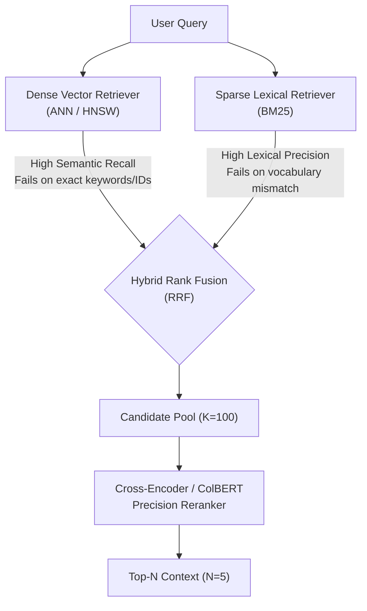
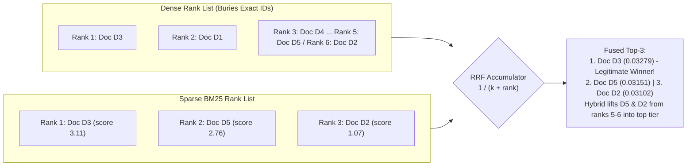
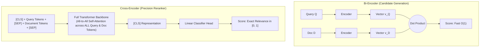

# Phase 3: Hybrid Search & Re-ranking
## Score Normalization, Reciprocal Rank Fusion, Cross-Encoders, and ColBERT Late Interaction

> **Core Philosophy**: Single-stage retrieval forces an impossible trade-off: you must choose between the blazingly fast candidate generation of bi-encoders/BM25 and the deep, nuanced language comprehension of full cross-attention. Modern production RAG resolves this by decoupling retrieval into two distinct stages: a high-recall, low-latency **Candidate Generation Stage** ($K=50\text{--}100$) followed by a high-precision **Reranking Stage** ($N=5\text{--}10$).

---

## 1. The Need for Hybrid Search

### Topic 1.1: The Sparse-Dense Failure Symmetry

#### 1. The Problem
Recall the two failure modes identified in Phase 2 on our running corpus:
1. **Dense Retrieval Fails on Exact Identifiers ($Q_1$)**:
   - Query: `"retry_after_ms max_backoff_seconds OmniFlowClient"`
   - The dense bi-encoder returns generic networking passages because unique tokens like `retry_after_ms`, `max_backoff_seconds`, and `OmniFlowClient` are fragmented by subword tokenization and smoothed across dense embedding space. It misses Document $D_5$ (the actual client source code) and Document $D_2$ (the specific HTTP 429 JSON response payload).
2. **Sparse BM25 Fails on Conceptual Synonyms ($Q_2$)**:
   - Query: `"Why did our servers crash while building the search index for a big data import?"`
   - BM25 assigns Document $D_6$ a score of **0.00** on content words because $D_6$ uses terms like `"workers"`, `"Linux Out-Of-Memory (OOM) killer terminations"`, `"HNSW"`, and `"vector backfill"`, while assigning Document $D_1$ a high score of **5.25** (Lucene) / **4.43** (Robertson) simply because $D_1$ mentions `search`, `index`, and `data`.

Relying solely on dense search or solely on sparse search guarantees that an entire class of user queries will fail.



#### 2. Intuition
Think of a police investigation:
- **BM25** is fingerprint analysis: if you have an exact match on a unique serial number or fingerprint (keyword), it identifies the suspect instantly. But if the suspect wore gloves (synonyms/rephrasing), it finds nothing.
- **Dense Embeddings** are eyewitness profiling: "The suspect was tall, wore a dark jacket, and looked agitated" (semantic concepts). It finds people matching that general vibe, but it might grab 10 innocent people who look similar.
- **Hybrid Search** combines both: gather suspects who match the description *and* anyone with matching fingerprints, then bring them into interrogation for a thorough background check (Reranking).

---

### Topic 1.2: Score Normalization and Why It Fails

#### 1. The Problem
To combine dense and sparse results, the naive impulse is to compute a weighted sum of their scores:
$$\text{Score}_{\text{hybrid}}(d) = \alpha \cdot S_{\text{dense}}(d) + (1 - \alpha) \cdot S_{\text{sparse}}(d)$$
This requires normalizing both scores to a common scale (e.g., $[0, 1]$). However, **score normalization across distinct retrieval paradigms is notoriously brittle and causes catastrophic ranking inversions in production.**

#### 2. Mechanics & The Flaws of Normalization Techniques
Let us examine the two standard normalization approaches:

1. **Min-Max Normalization**:
   $$S_{\text{norm}}(d) = \frac{S(d) - S_{\min}}{S_{\max} - S_{\min}}$$
   - *Why it breaks*: It is extremely sensitive to outlier scores. If BM25 retrieves one document with an extreme score of $42.0$ (due to repeated rare keywords) while the rest sit between $2.0$ and $4.0$, min-max squashes all other relevant documents to near zero:
     $$\frac{4.0 - 2.0}{42.0 - 2.0} = \frac{2.0}{40.0} = 0.05$$
   - Furthermore, score scales vary wildly across queries: a short query produces small BM25 scores ($S \in [1, 5]$), while a long query produces large BM25 scores ($S \in [10, 35]$). Fixed weights $\alpha$ cannot adapt to query-level distribution shifts.
2. **Z-Score Normalization**:
   $$S_{\text{z}}(d) = \frac{S(d) - \mu}{\sigma}$$
   - *Why it breaks*: Assumes scores are normally distributed. In top-K retrieval, we only observe the extreme tail of the score distribution (the top 50 out of 10 million documents), which follows a power-law (Pareto) or Gumbel distribution, not a Gaussian. Calculating sample mean $\mu$ and standard deviation $\sigma$ on only the top-K candidates produces erratic, unstable values.

#### 3. Worked Example: Min-Max Normalization Inversion
Consider two documents evaluated on Query $Q_1$:
- Doc $A$ ($D_5$, Python code): High BM25 ($S_{\text{sparse}} = 18.0$), Moderate Dense ($S_{\text{dense}} = 0.72$).
- Doc $B$ (Generic web article): Low BM25 ($S_{\text{sparse}} = 2.0$), High Dense ($S_{\text{dense}} = 0.88$).

Suppose the candidate pool contains an outlier document $C$ with $S_{\text{sparse}} = 38.0$ and $S_{\min} = 1.0$.
Dense range: $S_{\min} = 0.60, S_{\max} = 0.90$.
Let $\alpha = 0.5$.

**Normalize Sparse Scores**:
- Doc $A$: $\frac{18.0 - 1.0}{38.0 - 1.0} = \frac{17.0}{37.0} = \mathbf{0.459}$
- Doc $B$: $\frac{2.0 - 1.0}{37.0} = \frac{1.0}{37.0} = \mathbf{0.027}$

**Normalize Dense Scores**:
- Doc $A$: $\frac{0.72 - 0.60}{0.90 - 0.60} = \frac{0.12}{0.30} = \mathbf{0.400}$
- Doc $B$: $\frac{0.88 - 0.60}{0.30} = \frac{0.28}{0.30} = \mathbf{0.933}$

**Compute Naive Hybrid Scores**:
- $\text{Score}(A) = 0.5(0.459) + 0.5(0.400) = 0.2295 + 0.2000 = \mathbf{0.4295}$
- $\text{Score}(B) = 0.5(0.027) + 0.5(0.933) = 0.0135 + 0.4665 = \mathbf{0.4800}$

**The Failure**: Document $B$ (generic article) is ranked *ahead* of Document $A$ ($D_5$, the actual source code) solely because the outlier Document $C$ compressed Document $A$'s sparse score!

---

### Topic 1.3: Reciprocal Rank Fusion (RRF)

#### 1. The Problem
To combine heterogeneous retrievers safely, we need a fusion method that is **invariant to raw score magnitudes, immune to outliers, and parameter-free across varying query types**.

#### 2. Intuition
Instead of comparing apples to oranges (BM25 points vs. Cosine angles), throw the points away and look only at the **finish line positions** (ranks). 
If a runner finishes 1st in the 100m sprint and 2nd in the long jump, they are clearly an elite athlete, regardless of whether the sprint was timed in seconds and the jump was measured in meters.



#### 3. Mechanics
1. Retrieve Top-$M$ documents using Sparse BM25, ordered by score: $\mathcal{R}_{\text{sparse}}$.
2. Retrieve Top-$M$ documents using Dense Vector Search, ordered by similarity: $\mathcal{R}_{\text{dense}}$.
3. Assign each document an integer rank $r(d) \in \{1, 2, \dots, M\}$ in each list.
4. For every document $d$ appearing in either list, compute its Reciprocal Rank Fusion score:
   $$\text{RRF}(d) = \sum_{m \in \{\text{dense}, \text{sparse}\}} \frac{1}{k + r_m(d)}$$
   If document $d$ is missing from a list, its rank in that list is treated as $\infty$ (contribution $= 0$).
5. Sort all candidates descending by their RRF score.

#### 4. Math: The RRF Formula and the Role of $k \approx 60$
Given a set of ranking systems $\mathcal{M}$ and a document $d \in \mathcal{D}$:

$$\text{RRF\_Score}(d) = \sum_{m \in \mathcal{M}} \frac{1}{k + r_m(d)}$$

Where:
- $r_m(d) \in \{1, 2, 3, \dots\}$: The 1-based rank position of document $d$ in system $m$.
- $k$: The **smoothing constant** (typically $k = 60$).

##### Why $k = 60$ Matters:
- Without $k$ (i.e., if $k = 0$), the formula becomes standard Reciprocal Rank: $1 / r(d)$.
  - Rank 1 gets $1/1 = 1.0$.
  - Rank 2 gets $1/2 = 0.5$.
  - Rank 3 gets $1/3 = 0.333$.
  A document that ranks 1st in one retriever gets a score of $1.0$. A document that ranks 2nd in *both* retrievers gets $0.5 + 0.5 = 1.0$. A document ranking 1st in one system completely dominates a document that is consistently strong across all systems.
- When $k = 60$:
  - Rank 1 gets $\frac{1}{60 + 1} = \frac{1}{61} \approx 0.01639$.
  - Rank 2 gets $\frac{1}{60 + 2} = \frac{1}{62} \approx 0.01613$.
  - Rank 10 gets $\frac{1}{60 + 10} = \frac{1}{70} \approx 0.01429$.
  - Rank 100 gets $\frac{1}{60 + 100} = \frac{1}{160} \approx 0.00625$.
- The smoothing constant $k$ dampens the penalty between adjacent top ranks, ensuring that a document appearing at Rank 3 in *both* systems ($\frac{1}{63} + \frac{1}{63} \approx 0.0317$) comfortably beats a document that was lucky to hit Rank 1 in only one system but missed the other entirely ($\frac{1}{61} + 0 \approx 0.0164$).

#### 5. Worked Example (Hand-Calculated RRF on Running Example $Q_1$)
We evaluate Query $Q_1$ (`"retry_after_ms max_backoff_seconds OmniFlowClient"`) across our documents:
- **Dense Retriever Ranks (illustrative)**:
  - Rank 1: Doc $D_3$ (OmniFlow Python SDK Manual: client lifecycle and backoff configuration)
  - Rank 2: Doc $D_1$ (OmniFlow Storage Tier Architecture)
  - Rank 3: Doc $D_4$ (ColBERT Late Interaction Research Excerpt)
  - Rank 4: Doc $D_6$ (Incident 4092 Postmortem)
  - Rank 5: Doc $D_5$ (Python Client Source Code: `OmniFlowClient` class)
  - Rank 6: Doc $D_2$ (Rate Limits & Quota Policies: HTTP 429 JSON payload with `retry_after_ms`)
  *(Notice how dense retrieval buries $D_5$ and $D_2$ at ranks 5 and 6 because subword tokenization fragments and dilutes exact code identifiers).*
- **Sparse BM25 Retriever Ranks**:
  - Rank 1: Doc $D_3$ (SDK Manual: score $3.1077$, matches `OmniFlowClient` and `max_backoff_seconds`)
  - Rank 2: Doc $D_5$ (Client Code: score $2.7636$, matches `OmniFlowClient` and `retry_after_ms`)
  - Rank 3: Doc $D_2$ (Rate Limit Spec: score $1.0739$, matches `retry_after_ms`)
  *(Note: Documents $D_1, D_4, D_6$ receive a BM25 score of $0.0000$ and do not appear in the sparse list).*

Let smoothing constant $k = 60$.

Compute RRF scores:
- **Document $D_3$**:
  $$r_{\text{dense}} = 1, \quad r_{\text{sparse}} = 1$$
  $$\text{RRF}(D_3) = \frac{1}{60 + 1} + \frac{1}{60 + 1} = \frac{1}{61} + \frac{1}{61} = 0.016393 + 0.016393 = \mathbf{0.032787}$$
- **Document $D_5$**:
  $$r_{\text{dense}} = 5, \quad r_{\text{sparse}} = 2$$
  $$\text{RRF}(D_5) = \frac{1}{60 + 5} + \frac{1}{60 + 2} = \frac{1}{65} + \frac{1}{62} = 0.015385 + 0.016129 = \mathbf{0.031514}$$
- **Document $D_2$**:
  $$r_{\text{dense}} = 6, \quad r_{\text{sparse}} = 3$$
  $$\text{RRF}(D_2) = \frac{1}{60 + 6} + \frac{1}{60 + 3} = \frac{1}{66} + \frac{1}{63} = 0.015152 + 0.015873 = \mathbf{0.031025}$$
- **Document $D_1$**:
  $$r_{\text{dense}} = 2, \quad r_{\text{sparse}} = \infty$$
  $$\text{RRF}(D_1) = \frac{1}{60 + 2} + 0 = \frac{1}{62} = \mathbf{0.016129}$$
- **Document $D_4$**:
  $$r_{\text{dense}} = 3, \quad r_{\text{sparse}} = \infty$$
  $$\text{RRF}(D_4) = \frac{1}{60 + 3} + 0 = \frac{1}{63} = \mathbf{0.015873}$$
- **Document $D_6$**:
  $$r_{\text{dense}} = 4, \quad r_{\text{sparse}} = \infty$$
  $$\text{RRF}(D_6) = \frac{1}{60 + 4} + 0 = \frac{1}{64} = \mathbf{0.015625}$$

**Final Ranked Order**:
1. **$D_3$ ($\mathbf{0.03279}$)** $\implies$ Wins both retrievers!
2. **$D_5$ ($0.03151$)**
3. **$D_2$ ($0.03102$)**
4. **$D_1$ ($0.01613$)**
5. **$D_4$ ($0.01587$)**
6. **$D_6$ ($0.01562$)**

Notice the power of hybrid fusion: in pure dense retrieval, subword token fragmentation buries both $D_5$ (source code) and $D_2$ (API response specs) down at ranks 5 and 6. Combining dense retrieval with lexical BM25 lifts both $D_5$ and $D_2$ cleanly into the top 3 candidate pool. Furthermore, Document $D_3$ legitimately secures the top overall position ($0.03279$, leading $D_5$ by $4.04\%$ and $D_2$ by $5.68\%$): it earned Rank 1 in both retrievers because it is the only document in the corpus that explicitly defines the user's queried parameter `max_backoff_seconds`. The three relevant documents form a dominant top cluster, with $D_2$ ($0.03102$) leading the highest single-system straggler ($D_1$ at $0.01613$) by $92.35\%$.

#### 6. Code Sketch
```python
from collections import defaultdict
from typing import List, Dict

def reciprocal_rank_fusion(ranked_lists: List[List[str]], k: int = 60) -> Dict[str, float]:
    """Combines multiple ranked lists of document IDs using RRF."""
    rrf_scores = defaultdict(float)
    for ranked_list in ranked_lists:
        for rank, doc_id in enumerate(ranked_list, start=1):
            rrf_scores[doc_id] += 1.0 / (k + rank)
    return dict(sorted(rrf_scores.items(), key=lambda x: x[1], reverse=True))

# Example usage with our running query Q1
dense_ranks = ["D3", "D1", "D4", "D6", "D5", "D2"]  # Dense embeds bury D5 and D2
sparse_ranks = ["D3", "D5", "D2"]                  # BM25 matches exact identifiers
fused_results = reciprocal_rank_fusion([dense_ranks, sparse_ranks], k=60)
# Output: {'D3': 0.03279, 'D5': 0.03151, 'D2': 0.03102, 'D1': 0.01613, 'D4': 0.01587, 'D6': 0.01562}
```

#### 7. Failure Modes & Trade-offs
- **Disregards Confidence Margins**: If BM25 is 99.9% confident that Document $A$ is the only relevant document (e.g., matching a 32-character UUID) and all other documents are garbage, RRF treats Rank 1 and Rank 2 with almost equal weight ($\frac{1}{61}$ vs $\frac{1}{62}$), giving equal vote to weak candidates from the dense list.
- **Tuning $k$**:
  - Small $k$ ($k \in [1, 10]$): Favors top-1 outliers aggressively.
  - Large $k$ ($k \in [100, 200]$): Flattened scoring; documents appearing in multiple lists dominate, even if their ranks are mediocre.
- *Default starting point*: $k = 60$. Driven by empirical Cormack et al. benchmark studies on TREC.

#### 8. When to Use It
Always deploy RRF as the standard baseline fusion mechanism for multi-modal, hybrid dense+sparse retrieval pipelines.

#### 9. Source
Cormack, Clarke, and Büttcher, *Reciprocal Rank Fusion Outperforms Condorcet and Individual Rank Learning Methods*, SIGIR 2009.

---

## 2. Precision Reranking: Cross-Encoders

### Topic 2.1: Bi-Encoders vs. Cross-Encoders

#### 1. The Problem
While hybrid search + RRF retrieves a solid candidate pool of $K=100$ documents, the ranking within that pool is still fundamentally limited by the **Bi-Encoder Information Bottleneck**:
- A bi-encoder must condense the entire semantic meaning of a document into a single static vector **before seeing the query**.
- It cannot compute token-level interactions. For example, it cannot determine whether the word `"not"` modifies `"retry"` or `"timeout"` in a complex instruction.

Feeding all 100 candidates into the generator LLM causes context bloat, high API costs, and degraded synthesis quality ("Lost in the Middle"). We need an accurate model to rerank the top 100 down to the top 5.

#### 2. Intuition
- **Bi-Encoder (Speed)**: Two people read a question and a document in separate soundproof rooms, write down a one-paragraph summary of each, and pass the summaries to a judge who compares them. Fast, but subtle nuances are lost.
- **Cross-Encoder (Accuracy)**: A single expert sits down with the question and the document side-by-side, reading them word-for-word simultaneously, with their eyes darting back and forth between the question's criteria and the document's claims (full cross-attention). Deeply accurate, but far too slow to run on millions of documents.



#### 3. Mechanics & Complexity Analysis
1. **Input Representation**:
   Concatenate query $Q$ and candidate document $D$ into a single token sequence:
   $$\mathbf{X} = \big[ \text{[CLS]}, \, q_1, \dots, q_m, \, \text{[SEP]}, \, d_1, \dots, d_n, \, \text{[SEP]} \big]$$
2. **All-to-All Cross-Attention**:
   Every token at layer $l$ attends to every token from both the query and the document:
   $$\text{Attention}(Q, K, V) = \text{softmax}\left( \frac{\mathbf{Q} \mathbf{K}^T}{\sqrt{d_k}} \right) \mathbf{V}$$
   The attention weight between query token $q_i$ and document token $d_j$ is computed at every layer of the network.
3. **Classification Head**:
   The contextualized representation of the `[CLS]` token from the final transformer layer is fed into a single-layer feed-forward network to produce a scalar relevance score:
   $$\text{Score}(Q, D) = \sigma(W \cdot h_{\text{[CLS]}} + b)$$

#### 4. Math: Computational Complexity and Cost Analysis
Let:
- $N$: Number of documents in the corpus (e.g., $10^7$)
- $K$: Number of candidates passed to stage 2 (e.g., $100$)
- $L_Q$: Query token length (e.g., 20)
- $L_D$: Document token length (e.g., 256)
- $d$: Hidden dimension (e.g., 768)

| Architecture | Offline Indexing Cost | Online Query Complexity | Latency for $N=10^7$ (illustrative) | Memory per Document |
| :--- | :--- | :--- | :--- | :--- |
| **Bi-Encoder** | $O(N \cdot L_D^2)$ (One-time) | $O(L_Q^2) + O(\log N \cdot d)$ via ANN | $\mathbf{\approx 5\text{ ms}}$ (illustrative) | 768 floats ($3\text{ KB}$, illustrative) |
| **Cross-Encoder** | None (Impossible to pre-compute) | $O(N \cdot (L_Q + L_D)^2)$ | $\mathbf{\approx 10\text{ hours}}$ (Intractable, illustrative) | Zero vectors |
| **Two-Stage Pipeline** | $O(N \cdot L_D^2)$ (Bi-Encoder) | Stage 1: $O(\log N \cdot d)$ (Retrieve 100)<br>Stage 2: $O(K \cdot (L_Q + L_D)^2)$ (Rerank 100) | $\mathbf{\approx 50\text{--}150\text{ ms}}$ on GPU (illustrative; seconds on CPU) | 768 floats (illustrative) |

*Why Cross-Encoders cannot be used as stage 1*: Because the query and document tokens are combined in the input sequence, document representations cannot be pre-computed offline. You would have to execute the full transformer forward pass $10,000,000$ times for every single user query!

#### 5. Code Sketch
```python
from sentence_transformers import CrossEncoder

# Load specialized cross-encoder reranker
reranker = CrossEncoder("BAAI/bge-reranker-large")

query = "retry_after_ms max_backoff_seconds OmniFlowClient"
candidates = [
    "OmniFlow buffers writes in WAL and flushes to Parquet.",
    "OmniFlowClient encapsulates retries on 429 with backoff_factor and jitter.",
    "Incident 4092: Linux Out-Of-Memory during batch backfill."
]

# Pair query with each retrieved candidate
pairs = [[query, doc] for doc in candidates]
scores = reranker.predict(pairs)

# Rank candidates descending by cross-encoder score
ranked_candidates = sorted(zip(candidates, scores), key=lambda x: x[1], reverse=True)
# ranked_candidates[0] is the exact OmniFlowClient code passage with score > 0.95
```

#### 6. Failure Modes & Trade-offs
- **Latency Budget Consumption**: Evaluating 100 candidate pairs through a 24-layer cross-encoder takes $\approx 50\text{--}150\text{ ms}$ on GPU (illustrative), but takes several seconds on CPU. To respect interactive latency budgets without dedicated GPU acceleration, candidate pool size must be pruned to $K \le 30\text{--}50$.
- **Length Truncation**: If $L_Q + L_D > 512$, the tail of the document is silently truncated by the model's sequence length limit.
- **Reranker Blindness**: If the Stage 1 retriever fails to include the correct document in the Top-100 candidate pool, the reranker can never rescue it (Recall@100 is an absolute upper bound).

#### 7. When to Use It
Standard in production two-stage RAG systems serving user-facing questions. Place it directly after hybrid retrieval to rerank 50–100 candidates down to the top 5 before prompt packing.

#### 8. Source
Nogueira and Cho, *Passage Re-ranking with BERT*, arXiv:1901.04085, 2019.

---

### Topic 2.2: Reranker Selection: Hosted (Cohere Rerank) vs. Self-Hosted (BGE-Reranker) & LLM Listwise Reranking

#### 1. Hosted API vs. Self-Hosted Rerankers
When implementing Stage 2 reranking in production, engineering teams face a primary architectural decision: hosted proprietary endpoints (e.g., Cohere Rerank 3 / 3.5) vs. self-hosted open-source cross-encoders (e.g., BAAI `bge-reranker-large`, `bge-reranker-v2-m3`):

| Evaluation Dimension | Hosted API (e.g., Cohere Rerank 3.5) | Self-Hosted Open-Source (e.g., BGE-Reranker-Large / v2-m3) |
| :--- | :--- | :--- |
| **Data Privacy & Residency** | Passages and queries leave your VPC over public HTTPS. Inadmissible for strict HIPAA, PCI-DSS, or air-gapped sovereign environments without bespoke enterprise private-link contracts. | Full data residency: model executes directly inside your secure VPC, on-prem cluster, or Kubernetes pod; zero external data leakage. |
| **Per-Call Cost & Scaling** | Metered SaaS pricing per search unit / query (e.g., $\approx \$1.00\text{--}\$2.00$ per 1,000 reranked requests, illustrative). At high request volumes ($10\text{M}$ queries/month), cloud API bills can exceed $\$10,000\text{--}\$20,000/\text{month}$ (illustrative). | Fixed hardware infrastructure costs: runs on standard GPU instances (e.g., 1–2 NVIDIA L4 or A10G instances at fixed monthly instance pricing), making marginal per-query costs negligible at scale. |
| **Network Latency Overhead** | Incurs public WAN round-trip latency ($\approx 50\text{--}150\text{ ms}$ WAN transit + queue time, illustrative) in addition to model inference time. | Sub-millisecond internal network latency ($<2\text{ ms}$ RPC transit within the same cluster or VPC). Total rerank time is purely local compute. |
| **Context Length & Multilingual** | Supports large 4,096-token passage contexts and 100+ languages with zero fine-tuning required out of the box. | BGE-Reranker-Large defaults to 512 tokens; `bge-reranker-v2-m3` supports multilingual up to 8,192 tokens, but requires configuring custom inference runtimes (e.g., vLLM or TEI) and autoscaling. |

#### 2. Note on LLM Listwise Reranking (e.g., RankGPT)
An emerging alternative to pointwise cross-encoders is **LLM Listwise Reranking** (such as RankGPT; Sun et al., 2023). Rather than evaluating candidate pairs $(Q, D_i)$ independently, a general-purpose instruction-tuned LLM (e.g., GPT-4o, Claude 3.5 Sonnet, or LLaMA-3-70B) receives a prompt containing the user query and a numbered list of all candidate passages simultaneously, and is instructed to generate the ranked permutation directly (e.g., `[4] > [1] > [3] > [2]`).
- **Advantages**: The LLM observes the entire candidate set in a single attention context, allowing it to evaluate mutual redundancy, relative coverage, and cross-document reasoning that isolated pointwise models miss.
- **Trade-offs**: Listwise LLM reranking incurs heavy prompt token consumption ($O(K \cdot L_D)$ tokens per query), high dollar costs, and substantial generation latency ($500\text{--}2,000\text{ ms}$, illustrative). Furthermore, LLMs suffer from severe **position bias** (disproportionately favoring passages placed at the beginning or end of the prompt) and risk output format parsing failures. Consequently, listwise LLM reranking is primarily applied as a sliding-window reranker over small candidate sets ($K \le 20$) or as an offline teacher benchmark rather than a first-line production SLA filter.

---

## 3. Late Interaction: ColBERT

### Topic 3.1: Token-Level MaxSim Operator

#### 1. The Problem
We are trapped between two extremes:
- **Bi-encoders**: Ultra-fast ($O(1)$ dot product via ANN), but lose semantic accuracy due to single-vector compression.
- **Cross-encoders**: Exhaustive token-level all-to-all attention, but computationally heavy ($O(K \cdot L^2)$) and impossible to pre-index offline.

Is there an architecture that allows **offline pre-computation and indexing of documents**, yet retains **token-level fine-grained interactions** at query time?

#### 2. Intuition
Instead of compressing an entire document into a single vector (Bi-encoder), compress each *word/token* into its own contextualized vector. 
At query time, every word in the user's question looks across all words in the document, finds its single closest matching soulmate (the **Max**), and sums up those match scores (the **Sim**). 
This is **Late Interaction**: token representations are computed independently upfront, and cross-token interaction is deferred to the very last millisecond via a fast vector operation.

```mermaid
flowchart TD
    subgraph QUERY_TOKENS ["Query Tokens (q_i)"]
        Q1["'429'"]
        Q2["'backoff'"]
    end
    
    subgraph DOC_TOKENS ["Document Tokens (d_j)"]
        D1["'rate'"]
        D2["'429'"]
        D3["'retry'"]
    end

    Q1 -->|Max Dot Product| D2
    Q2 -->|Max Dot Product| D3
    
    D2 -. Score = 0.94 .-> SUM(("Sum MaxSim<br/>0.94 + 0.82 = 1.76"))
    D3 -. Score = 0.82 .-> SUM
```

#### 3. Mechanics
1. **Offline Document Token Indexing**:
   - Pass document $D$ through a transformer encoder.
   - Extract the $L_D$ contextualized token embeddings: $\mathbf{E}_d \in \mathbb{R}^{L_D \times d}$ (typically projected down to $d=128$).
   - Normalize every token vector to unit length.
   - Index all document token vectors in a multi-vector inverted centroid index (using PLAID or residual vector quantization).
2. **Online Query Encoding & Query Augmentation**:
   - Pass query $Q$ through the query encoder. ColBERT prepends a special `[Q]` marker token and pads the sequence up to a fixed length (e.g., 32 tokens) with `[MASK]` tokens.
   - This query augmentation (or query expansion) allows the query tokens to gather broader context and hypothesize missing related terms via self-attention before late interaction.
   - Extract $L_Q$ unit-normalized token embeddings: $\mathbf{E}_q \in \mathbb{R}^{L_Q \times d}$.
3. **The MaxSim Operator**:
   - For each query token vector $\mathbf{E}_{q, i}$, compute its dot product with all document token vectors $\mathbf{E}_{d, j}$.
   - Take the maximum similarity for that query token:
     $$\max_{j \in \{1, \dots, L_D\}} (\mathbf{E}_{q, i} \cdot \mathbf{E}_{d, j})$$
   - Sum these maxima across all query tokens $i \in \{1, \dots, L_Q\}$.

#### 4. Math: The MaxSim Formula
$$\text{Score}_{\text{ColBERT}}(Q, D) = \sum_{i=1}^{|Q|} \max_{j=1}^{|D|} \big( \mathbf{E}_{q, i} \cdot \mathbf{E}_{d, j}^T \big)$$

Where:
- $\mathbf{E}_{q, i} \in \mathbb{R}^d$: The unit-normalized embedding of the $i$-th query token.
- $\mathbf{E}_{d, j} \in \mathbb{R}^d$: The unit-normalized embedding of the $j$-th document token.
- $\cdot$: Vector dot product (equivalent to cosine similarity).

##### Why this is computationally efficient:
Computing the cross-attention matrix in a Cross-Encoder requires evaluating 12–24 transformer layers of attention projections. 
In ColBERT, the interaction matrix $\mathbf{M} = \mathbf{E}_q \mathbf{E}_d^T \in \mathbb{R}^{|Q| \times |D|}$ is a **single matrix multiplication between low-dimensional vectors** ($d=128$). For $|Q| = 16$ and $|D| = 128$, this involves only $16 \times 128 \times 128 \approx 262,144$ operations (illustrative), which modern SIMD hardware executes in $<10$ microseconds (illustrative)!

#### 5. Worked Example (Hand-Calculated MaxSim Interaction Matrix)
Let query $Q$ have 2 tokens: $q_1 = \text{"429"}$, $q_2 = \text{"backoff"}$.
Let document $D$ have 3 tokens: $d_1 = \text{"rate"}$, $d_2 = \text{"429"}$, $d_3 = \text{"retry"}$.

Suppose their pairwise token dot products produce the following similarity matrix $\mathbf{S} \in \mathbb{R}^{2 \times 3}$:

$$\mathbf{S} = \begin{pmatrix}
\mathbf{E}_{q_1} \cdot \mathbf{E}_{d_1} & \mathbf{E}_{q_1} \cdot \mathbf{E}_{d_2} & \mathbf{E}_{q_1} \cdot \mathbf{E}_{d_3} \\
\mathbf{E}_{q_2} \cdot \mathbf{E}_{d_1} & \mathbf{E}_{q_2} \cdot \mathbf{E}_{d_2} & \mathbf{E}_{q_2} \cdot \mathbf{E}_{d_3}
\end{pmatrix} = \begin{pmatrix}
0.35 & \mathbf{0.94} & 0.42 \\
0.28 & 0.31 & \mathbf{0.82}
\end{pmatrix}$$

**Step 1: Compute Max for Query Token $q_1$ ("429")**:
$$\max \{0.35, \, \mathbf{0.94}, \, 0.42\} = \mathbf{0.94} \quad (\text{matched with } d_2 = \text{"429"})$$

**Step 2: Compute Max for Query Token $q_2$ ("backoff")**:
$$\max \{0.28, \, 0.31, \, \mathbf{0.82}\} = \mathbf{0.82} \quad (\text{matched with } d_3 = \text{"retry"})$$

**Step 3: Accumulate MaxSim Sum**:
$$\text{Score}_{\text{ColBERT}}(Q, D) = 0.94 + 0.82 = \mathbf{1.76}$$

Notice how $q_1$ snapped to the exact numerical code (`"429"` $\to$ `"429"`), while $q_2$ successfully performed semantic matching across synonyms (`"backoff"` $\to$ `"retry"`). This approaches the precision of cross-encoders with the indexing capabilities of vector search!

#### 6. Code Sketch
```python
import torch

def colbert_maxsim(q_tokens: torch.Tensor, d_tokens: torch.Tensor) -> float:
    """Computes late-interaction MaxSim score between token matrices.
    q_tokens: (L_q, d) - unit normalized
    d_tokens: (L_d, d) - unit normalized
    """
    # 1. Compute pairwise token-level similarity matrix: (L_q, L_d)
    sim_matrix = torch.matmul(q_tokens, d_tokens.T)
    # 2. Find maximum matching score for each query token: (L_q,)
    max_sim_per_query_token, _ = torch.max(sim_matrix, dim=1)
    # 3. Sum across all query tokens: scalar
    return torch.sum(max_sim_per_query_token).item()

# Example token matrices (dim=128)
q = torch.nn.functional.normalize(torch.randn(8, 128), p=2, dim=1)
d = torch.nn.functional.normalize(torch.randn(120, 128), p=2, dim=1)
score = colbert_maxsim(q, d)
```

#### 7. Failure Modes & Trade-offs
- **Index Storage Footprint**: Because ColBERT persists an embedding for *every single token* in a passage, uncompressed ColBERT incurs roughly $40\times$ the storage overhead of a single-vector bi-encoder (for typical 256-token passages at $d=128$ compared to a 768-dimensional document embedding, illustrative). In production, this expansion is mitigated by **ColBERTv2 / PLAID**, which quantizes token vectors to 2 bits via residual centroid clustering, reducing the storage overhead to $3\times\text{--}6\times$ (illustrative).
- **Document Length Skew**: Long documents containing hundreds of tokens offer more opportunities for random query tokens to find accidental high-similarity matches. Document length normalization or query token weighting is often required.
- **Complex Infrastructure**: Requires custom search backends (e.g., PLAID engine) rather than standard off-the-shelf vector databases.

#### 8. When to Use It
The ideal choice when you need near Cross-Encoder accuracy directly at Stage 1 retrieval, or when your SLA budget allows $<25\text{ms}$ latency and you can afford multi-vector storage.

#### 9. Source
Khattab and Zaharia, *ColBERT: Efficient and Effective Passage Search via Contextualized Late Interaction over BERT*, SIGIR 2020; Santhanam et al., *ColBERTv2: Effective and Efficient Retrieval via Lightweight Late Interaction*, NAACL 2022.

---

## 4. Comparison of Hybrid & Reranking Paradigms

| Paradigm | Query Latency (illustrative) | Storage Overhead | Lexical Exact Match | Semantic Generalization | Pareto Position |
| :--- | :--- | :--- | :--- | :--- | :--- |
| **Pure Dense (Bi-Encoder)** | $<5\text{ ms}$ | $1\times$ ($1$ vector / doc) | Poor | Excellent | High Speed / Low Exact Precision |
| **Pure Sparse (BM25)** | $<10\text{ ms}$ | Minimal (Postings lists) | Exact | Non-existent | High Exact Precision / Low Semantic Recall |
| **Hybrid (RRF Fusion)** | $10\text{--}15\text{ ms}$ | $1.1\times$ (Vectors + Postings) | Very Good | Very Good | The Production Baseline |
| **Two-Stage (Hybrid + Cross-Encoder)** | $50\text{--}150\text{ ms}$ (GPU) | $1.1\times$ | Highest | Highest | Maximum Quality / Moderate Compute Cost |
| **Late Interaction (ColBERTv2 / PLAID)** | $15\text{--}25\text{ ms}$ | $3\times\text{--}6\times$ (Multi-vector, illustrative) | Excellent | Near-Cross-Encoder | Quality-Speed Sweet Spot (High RAM) |

> [!NOTE]
> **Heuristics vs. Principles**:
> - **$K=100$ candidate pool for reranking**: This is an empirical balance. Reranking fewer than 30 documents starves the cross-encoder of relevant material; reranking more than 150 documents yields diminishing returns on Recall@5 while driving inference latency past 100ms.
> - **Top-$N=5$ documents passed to LLM**: Governed by the synthesis model's attention capacity and cost budget. If your downstream LLM exhibits strong long-context reasoning without distraction, $N=10$ is acceptable.

---

## 5. How This Connects to the Next Phase

With Hybrid Search (RRF) and Precision Reranking (Cross-Encoder / ColBERT), our retrieval pipeline is now equipped to find relevant documents even when vocabulary mismatches or rare keywords exist.

However, all of these techniques share one fundamental assumption: **they assume the user's initial query is well-formed, complete, and search-ready.**

In the real world, user queries are messy:
- Users write underspecified questions with ambiguous pronouns (*"How does it work?"*).
- Users express conceptual questions that cannot match document phrasing directly.
- Complex queries like $Q_3$ (*"How do enterprise quota tier upgrades interact with client retry configuration to resolve ingestion batch failures?"*) require **multi-hop synthesis across multiple distinct documents** ($D_2$, $D_3$, $D_6$).

In **Phase 4 (`04-query-transformations.md`)**, we explore the query transformation techniques that fix these upstream input problems:
- **Query Rewriting & Intent Expansion**: Disambiguating references before retrieval.
- **Hypothetical Document Embeddings (HyDE)**: Generating hypothetical answers to cross the query-document semantic gap.
- **Sub-Question Decomposition**: Breaking multi-hop queries into executable directed dependency graphs.
- **Step-Back Prompting**: Abstraction-based retrieval of high-level foundational principles.

---

## 6. Phase 3 Interview Questions & Answers

#### Q1: Why is rank-based fusion (like RRF) practically superior to score-based fusion (like Min-Max or Z-score normalization) in production hybrid search pipelines?
> **Answer**: Score-based fusion is highly sensitive to outlier values and non-Gaussian score distributions. A single document with an extreme BM25 score (from repeated rare keywords) compresses all other candidate scores toward zero under min-max scaling, causing ranking inversions. Furthermore, BM25 and dense cosine distributions vary widely across different query types (short vs. long queries). Reciprocal Rank Fusion (RRF) relies strictly on ordinal rank positions, completely eliminating scale disparities, making it immune to outliers, and removing the need for manual hyperparameter recalibration across diverse queries.

#### Q2: What is the computational complexity difference between a Bi-Encoder and a Cross-Encoder, and why can't a Cross-Encoder be used for first-stage retrieval over 10 million documents?
> **Answer**: A Bi-Encoder encodes queries and documents independently, allowing all document embeddings to be pre-computed offline and indexed in an ANN structure. At query time, it only needs to encode the query ($O(L_Q^2)$) and perform an $O(\log N \cdot d)$ vector search. In contrast, a Cross-Encoder concatenates the query and document into a single sequence, running full all-to-all cross-attention across all layers with complexity $O((L_Q + L_D)^2)$ per pair. Because the representation depends jointly on both texts, document representations cannot be pre-computed. Evaluating 10 million documents would require 10 million forward transformer passes per query, which is computationally intractable for real-time search.

#### Q3: In the Reciprocal Rank Fusion formula $\text{RRF}(d) = \sum \frac{1}{k + r(d)}$, what specific failure mode occurs if $k$ is set to 0, and why is $k \approx 60$ the industry standard?
> **Answer**: If $k = 0$, the formula becomes the raw reciprocal rank $1 / r(d)$. In this regime, the top rank receives an overwhelming score of $1.0$, while rank 2 receives $0.5$. Consequently, a document that ranks 1st in one retriever gets a score of $1.0$, which instantly ties a document that achieved rank 2 across *both* retrievers ($0.5 + 0.5 = 1.0$), allowing single-retriever outliers to dominate. Setting $k \approx 60$ flattens the curve across top positions ($\frac{1}{61} \approx 0.0164$ vs. $\frac{1}{62} \approx 0.0161$), ensuring that documents that consistently appear near the top across multiple retrievers outscore single-retriever outliers.

#### Q4: How does ColBERT's late-interaction MaxSim operator achieve token-level matching without incurring the full quadratic inference cost of a Cross-Encoder?
> **Answer**: ColBERT independently pre-computes and indexes contextualized token vectors for every document offline. At query time, it encodes only the query tokens. Instead of evaluating multiple layers of cross-attention across concatenated tokens, it computes the cross-token similarity matrix via a single matrix multiplication between low-dimensional token embeddings ($d=128$). The MaxSim operator then simply finds the maximum dot product for each query token across all document tokens and sums them: $\sum_{i} \max_{j} (\mathbf{E}_{q, i} \cdot \mathbf{E}_{d, j}^T)$. This executes in microseconds via SIMD instructions while retaining fine-grained token-to-token semantic alignments.

#### Q5: If a two-stage retrieval pipeline (Hybrid Search $\to$ Cross-Encoder Reranker) exhibits poor end-to-end recall, how do you diagnose whether the failure is in Stage 1 or Stage 2?
> **Answer**: Compute **Recall@K at Stage 1** (the candidate pool size, e.g., $K=100$) and **Recall@N at Stage 2** (the final reranked set, e.g., $N=5$) against an annotated evaluation set. If Recall@100 is low, the gold document never made it into the candidate pool; tuning the reranker is futile, and you must debug the Stage 1 ingestion, BM25 indexing, dense bi-encoder, or RRF fusion. If Recall@100 is high (e.g., $>95\%$) but Recall@5 drops sharply, Stage 1 succeeded, and the failure is localized to Stage 2: the cross-encoder is truncating document length, suffering from domain shift, or scoring irrelevant text features.

