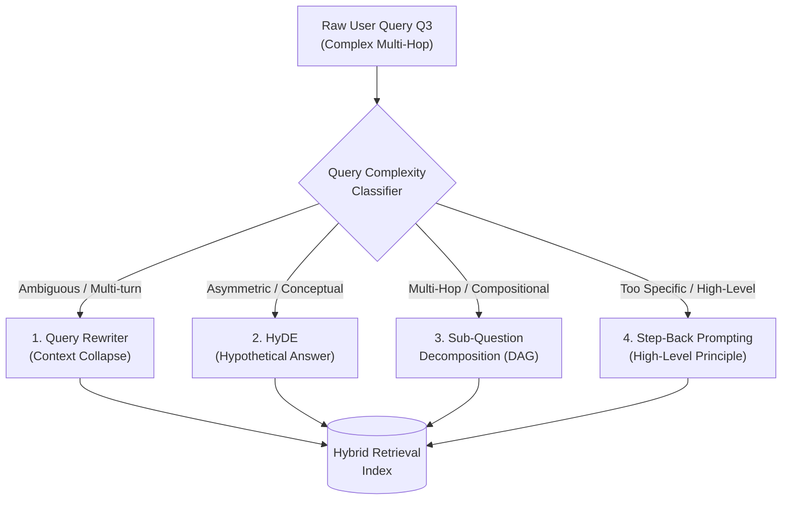
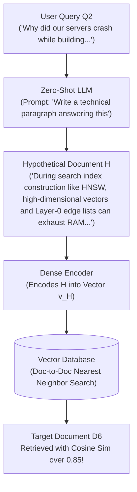
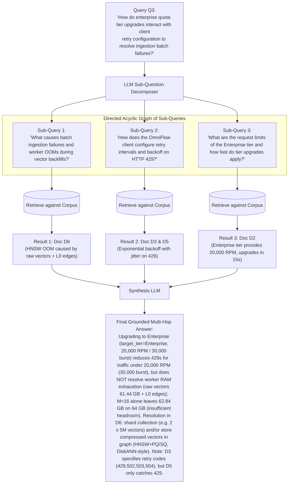
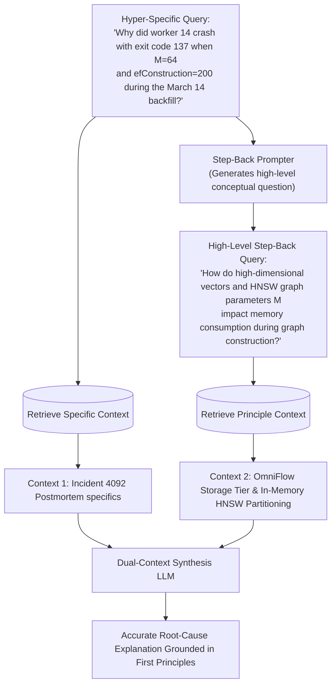

# Phase 4: Query Transformations
## Query Rewriting, HyDE, Sub-Question Decomposition, and Step-Back Prompting

> **Core Philosophy**: The greatest point of fragility in any RAG system is not the vector database or the reranker—it is the raw user prompt. Users rarely formulate optimal, self-contained search queries. They ask questions filled with conversational pronouns, ambiguous terms, or multi-faceted questions that require synthesizing several disconnected concepts. Query transformation treats the incoming prompt as an unoptimized seed, reshaping it before it ever touches an index.

---

## 1. The Need for Query Transformation

### Topic 1.1: The Asymmetric Query-Document Gap & Multi-Hop Blindness

#### 1. The Problem
Consider our three running queries:
- **Conversational Context Loss**: A user chatting with a support bot asks: *"What is the backoff factor?"* followed by *"How many times does it retry?"*. The second query contains zero mentions of `OmniFlowClient` or `Python SDK`. If routed to retrieval as-is, it retrieves generic TCP retry documentation.
- **The Query-Document Modality Gap**: Queries are typically short, speculative questions (e.g., 5–10 tokens). Documents are detailed, declarative assertions (e.g., 200 tokens). Dense bi-encoders struggle when mapping a brief, question-phrased vector into the same geometric neighborhood as a long, fact-dense passage.
- **Multi-Hop Blindness ($Q_3$)**:
  > Query $Q_3$: *"How do enterprise quota tier upgrades interact with client retry configuration to resolve ingestion batch failures?"*
  
  If we embed this entire sentence into a single vector, the resulting embedding averages together three distinct concepts:
  1. Administrative tier upgrades (Document $D_2$)
  2. Client-side retry parameters and backoff math (Documents $D_3$ and $D_5$)
  3. Worker OOM crashes caused by retry storms during batch ingestion (Document $D_6$)

Because no single document in the corpus contains all three topics at once, single-vector retrieval scores all three documents moderately, but none of them decisively. The retriever returns noisy, generic passages, causing the LLM to hallucinate the relationship between tiers, retries, and crashes.



---

## 2. Query Rewriting & Contextual Expansion

### Topic 2.1: Disambiguation and Intent Expansion

#### 1. The Problem
In multi-turn chat applications, queries like:
- Turn 1: *"Can you explain the OmniFlow rate limiting architecture?"*
- Turn 2: *"What status code does it return when it throttles?"*
- Turn 3: *"How does the Python client handle that error?"*

By Turn 3, the user's literal query is `"How does the Python client handle that error?"`. Without query rewriting:
- The retriever has no access to Turn 1 or Turn 2.
- The word `"that error"` has no antecedent.
- The retriever returns generic Python `try...except` handling passages rather than the specific `OmniFlowClient` HTTP 429 backoff loop in Document $D_5$.

#### 2. Intuition
Think of an executive assistant sitting between you and a company archive. If you say, "Find me that contract we talked about yesterday," the assistant doesn't shout "contract we talked about yesterday" into the archive. They translate your request into: "Retrieve the Master Service Agreement with Acme Corp executed on March 14."

#### 3. Mechanics
1. **Pass the conversational history** $H = (u_1, a_1, u_2, a_2, \dots, u_{t-1}, a_{t-1})$ along with the latest user query $u_t$ to a fast, low-latency LLM (e.g., Gemini Flash or Claude Haiku).
2. **Execute Rewriting Prompt**: Instruct the model to resolve all coreferences (pronouns like "it", "they", "that"), expand domain-specific acronyms, and output a **standalone, self-contained search query**.
3. **Keyword Expansion (Synonym Injection)**: Optionally instruct the rewriter to append 2–3 domain-specific search keywords to enrich sparse BM25 matching.
4. Pass the rewritten query to the downstream retrieval pipeline.

#### 4. The Transformation Trace
- **Input History**:
  - User: *"What happens when OmniFlow hits a rate limit?"*
  - Assistant: *"The gateway rejects the request with HTTP status code 429 (Too Many Requests) and returns a JSON payload with retry_after_ms."*
  - User: *"How does the client retry it?"*
- **Rewriting Prompt Output**:
  $$\text{Query}_{\text{rewritten}} = \text{"OmniFlow Python SDK client HTTP 429 rate limit exponential backoff retry logic"}$$
- **Result on Running Corpus**: This transformed query directly activates Document $D_3$ and $D_5$, whereas the raw query `"How does the client retry it?"` failed completely.

#### 5. Code Sketch
```python
def rewrite_query(history: list[dict], current_query: str, llm_client) -> str:
    """Collapses conversational history into a standalone retrieval query."""
    system_prompt = (
        "Given the chat history and the latest user question, formulate a "
        "standalone search query that can be understood without the history. "
        "Resolve all pronouns and incorporate relevant technical entities. "
        "Do NOT answer the question; output ONLY the rewritten query."
    )
    formatted_history = "\n".join([f"{msg['role']}: {msg['content']}" for msg in history[-4:]])
    prompt = f"Chat History:\n{formatted_history}\n\nLatest Question: {current_query}\nStandalone Query:"
    
    response = llm_client.generate(system=system_prompt, prompt=prompt, temperature=0.0)
    return response.strip()
```

#### 6. Failure Modes & Trade-offs
- **Latency Addition**: Every query transformation step introduces an extra LLM call, adding 150–400ms before retrieval even begins.
- **Over-Specification**: The rewriter may invent details or over-constrain the query with terms that do not appear in the corpus, accidentally filtering out relevant documents.

#### 7. When to Use It
Mandatory for all conversational / multi-turn RAG interfaces.

#### 8. Source
Ma et al., *Query Rewriting for Retrieval-Augmented Large Language Models*, EMNLP 2023.

---

## 3. Hypothetical Document Embeddings (HyDE)

### Topic 3.1: Zero-Shot Document Generation & Embedding Space Alignment

#### 1. The Problem
Consider conceptual Query $Q_2$:
> `"Why did our servers crash while building the search index for a big data import?"`

Dense bi-encoders are trained to match queries with passages, but they still suffer from the **Asymmetric Information Gap**:
- Queries express ignorance, uncertainty, and brief high-level concepts.
- Document passages express authoritative explanations, technical jargon, and formulas.

In vector space, Query $Q_2$ lies in the "curious question" cluster, while Document $D_6$ lies in the "incident postmortem / graph memory systems" cluster. If the embedding model was not explicitly fine-tuned on this exact domain, the cosine distance between the question and the answer remains high.

#### 2. Intuition
If you want to find an expert who wrote a paper on a topic, imagine what their paper's abstract probably looks like. Even if your imagined abstract contains a few minor factual errors, it is written in the **style, tone, vocabulary, and syntactic structure of a technical paper**. 
By searching with the *hypothetical answer* rather than the question, you search document-to-document instead of query-to-document.



#### 3. Mechanics
1. **Pass the user query $Q$ to an instruction-tuned LLM** with a zero-shot prompt:
   > *"Write a short, highly technical paragraph answering the following question. Do not worry about absolute factual truth; focus on realistic terminology, technical concepts, and style."*
2. **Generate Hypothetical Document $\tilde{D}$** (typically 50–100 words).
3. **Pass $\tilde{D}$ to the Dense Passage Encoder**:
   $$\mathbf{v}_{\text{hyde}} = \text{Encoder}_D(\tilde{D})$$
   Notice that we use the **passage encoder**, not the query encoder, because $\tilde{D}$ is formatted as a passage!
   - *Query Averaging & Multi-Sampling*: In the original method (Gao et al., 2022), HyDE samples multiple hypothetical documents ($N_{\text{samp}} \approx 4\text{--}8$, illustrative) and averages their embeddings together with the query embedding to construct a robust centroid vector.
   - *Asymmetric Encoders*: When using asymmetric or instruction-tuned encoders (such as BGE or E5), encode the hypothetical document through the passage encoder without the query instruction prefix (or with the passage prefix `passage: `), ensuring it is embedded in target passage space.
4. Query the vector index using $\mathbf{v}_{\text{hyde}}$ via standard ANN search.

#### 4. Math: Vector Projection Mechanics (Geometric Subspace Intuition)
*(Geometric Subspace Intuition)*: Let $\mathcal{S}_Q \subset \mathbb{R}^d$ be the subspace of user questions, and $\mathcal{S}_D \subset \mathbb{R}^d$ be the subspace of corpus documents.
In an imperfectly aligned bi-encoder:
$$\text{dist}(\mathcal{S}_Q, \mathcal{S}_D) = \delta > 0$$

When encoding query $Q \in \mathcal{S}_Q$, the true gold document $D^* \in \mathcal{S}_D$ may have lower cosine similarity than irrelevant documents that happen to share superficial question-like syntactic structures:
$$\cos\big(\mathbf{v}_Q, \, \mathbf{v}_{D^*}\big) < \cos\big(\mathbf{v}_Q, \, \mathbf{v}_{\text{distractor}}\big)$$

HyDE acts as a non-linear mapping function $f_{\text{LLM}}: \mathcal{S}_Q \to \mathcal{S}_D$.
The generated document $\tilde{D} = f_{\text{LLM}}(Q)$ lands squarely inside $\mathcal{S}_D$.
Even if $\tilde{D}$ contains hallucinated parameters (e.g., claiming $M=32$ instead of $M=64$), the vector $\mathbf{v}_{\tilde{D}}$ shares the semantic neighborhood of graph memory buffers, neighbor pointers, and memory allocations:
$$\cos\big(\mathbf{v}_{\tilde{D}}, \, \mathbf{v}_{D^*}\big) \gg \cos\big(\mathbf{v}_Q, \, \mathbf{v}_{D^*}\big)$$

#### 5. Worked Example (Trace on Query $Q_2$)
**User Query $Q_2$**:
> `"Why did our servers crash while building the search index for a big data import?"`

**LLM Generates Hypothetical Document $\tilde{D}$**:
> *"Building large-scale vector search indices, such as HNSW graphs, during high-throughput big data imports causes heavy memory pressure because workers must allocate high-dimensional vectors and maintain dense outgoing graph neighbor lists (e.g., M=64 Layer-0 edges). Under heavy batch ingest, raw vector memory and bidirectional graph edges can breach worker memory limits, triggering Linux Out-Of-Memory (OOM) killer terminations (exit code 137). Client-side retry storms triggered by upstream timeouts further compound memory exhaustion."*

**Vector Similarity Comparison**:
- Cosine similarity between raw query $Q_2$ and Document $D_6$:
  $$\cos(\mathbf{v}_{Q_2}, \mathbf{v}_{D_6}) = \mathbf{0.52} \quad \text{(illustrative)}$$
- Cosine similarity between hypothetical document $\tilde{D}$ and Document $D_6$:
  $$\cos(\mathbf{v}_{\tilde{D}}, \mathbf{v}_{D_6}) = \mathbf{0.86} \quad \text{(illustrative)}$$

In our 6-document corpus, Document $D_6$ jumps from Rank 5 to **Rank 1** in the vector index!

#### 6. Code Sketch
```python
import numpy as np

def hyde_retrieval(query: str, llm_client, encoder, vector_index, k: int = 5, n_samples: int = 4):
    """Executes Multi-Sample HyDE with Centroid Embedding Averaging."""
    hyde_prompt = f"Write a technical passage answering: {query}\nPassage:"
    
    # 1. Sample diverse hypothetical documents with non-zero temperature
    hypo_docs = [
        llm_client.generate(prompt=hyde_prompt, max_tokens=150, temperature=0.7)
        for _ in range(n_samples)
    ]
    
    # 2. Encode hypothetical documents in passage space, and query using query instruction prefix
    passage_vectors = encoder.encode(hypo_docs, normalize_embeddings=True)  # (n_samples, d)
    query_prefixed = f"Represent this sentence for searching relevant passages: {query}"
    query_vector = encoder.encode([query_prefixed], normalize_embeddings=True)  # (1, d)
    
    # 3. Compute centroid by averaging hypothetical passage vectors with query vector
    all_vectors = np.vstack([passage_vectors, query_vector])
    centroid = np.mean(all_vectors, axis=0, keepdims=True)
    centroid /= np.linalg.norm(centroid, axis=1, keepdims=True)  # re-normalize to unit length
    
    distances, indices = vector_index.search(centroid.astype(np.float32), k=k)
    return indices[0]
```

#### 7. Failure Modes & The "Catastrophic Drift" Hazard
- **Hallucinatory Semantic Drift**: If the user asks a question about an obscure, proprietary internal API (e.g., `"How do I configure OmniFlow's WAL flush threshold?"`), the LLM has zero pre-trained parametric knowledge about OmniFlow. It might hallucinate:
  > *"To configure WAL flush threshold in OmniFlow, open postgresql.conf and set wal_buffers = 16MB..."*
  The generated text is now pointing directly toward PostgreSQL! The vector $\mathbf{v}_{\tilde{D}}$ lands in the database management cluster, retrieving PostgreSQL documents and completely missing Document $D_1$.
- **Latency & Cost**: Adding an LLM inference step before retrieval introduces 300–800ms of latency and consumes LLM generation tokens.

#### 8. When to Use It
Use for broad conceptual, educational, or exploratory questions where the domain is covered by general knowledge, but **never use HyDE on proprietary internal codes, unique product names, or factual lookups where hallucination is lethal.**

#### 9. Source
Gao et al., *Precise Zero-Shot Dense Retrieval without Relevance Labels*, arXiv:2212.10496, 2022.

---

## 4. Sub-Question Decomposition (Multi-Hop RAG)

### Topic 4.1: Breaking Multi-Hop Queries into Directed Dependency DAGs

#### 1. The Problem
Consider Query $Q_3$:
> `"How do enterprise quota tier upgrades interact with client retry configuration to resolve ingestion batch failures?"`

This is a classic **Multi-Hop Query**. Answering it requires solving a chain of interdependent sub-problems:
1. What are the rate limits and upgrade mechanics for the Enterprise tier? (Found in Document $D_2$)
2. How does the client configure retries, status codes, and backoff when throttled? (Found in Documents $D_3$ and $D_5$)
3. Why do client retries cause batch ingestion failures in the first place? (Found in Document $D_6$: the "thundering herd" postmortem)

Single-step retrieval fails because no single document contains all three components. If the retriever returns the top 3 documents, it usually returns fragments of $D_2$ and misses $D_6$ entirely, leaving the generation model unable to synthesize the full chain of cause and effect.

#### 2. Intuition
Imagine a detective solving a complex fraud case. They don't walk into a library and ask for "the book that explains how the CEO used shell companies to bypass audit thresholds during the 2023 merger." 
They break the case into sub-investigations:
1. "Who owned the shell companies in 2023?"
2. "What were the audit approval thresholds?"
3. "Who signed off on the transactions?"
Each question produces an intermediate fact that enables answering the next question.



#### 3. Mechanics
1. **Decomposition Prompt**: An LLM decomposes the multi-hop query into a set of atomic sub-queries $\{q_1, q_2, \dots, q_k\}$.
2. **Dependency Resolution**:
   - **Parallel Sub-Queries**: Sub-queries that are independent of each other (as in our $Q_3$ example) execute concurrently across the retrieval engine.
   - **Sequential (Chained) Sub-Queries**: When sub-query $q_2$ depends on the answer to $q_1$ (e.g., $q_1$: *"What is the founder's company?"* $\to$ $q_2$: *"Where was that company founded?"*), the system executes $q_1$, synthesizes an intermediate answer $a_1$, and substitutes $a_1$ into $q_2$.
3. **Targeted Retrieval**: Each sub-query searches the index independently, retrieving its own focused Top-K context.
4. **Context Aggregation & Grounded Multi-Hop Synthesis**: The union of all retrieved contexts is concatenated with structured headings and passed to the final generator LLM.

##### Faithfully Grounded Synthesis vs. Unfaithful Hallucination
When synthesizing across the three retrieved contexts ($D_2, D_3/D_5, D_6$), an LLM must reconcile system dependencies without making unfounded causal leaps:

> **Faithfully Grounded Multi-Hop Synthesis**:
> 1. **Gateway Throttling Mitigation**: Upgrading to Enterprise tier via `POST /api/v1/tenant/upgrade?target_tier=Enterprise` (effective globally within 15 seconds) expands API gateway token-bucket allowances to 20,000 RPM (bursting up to 30,000 RPM) and 1 GB/sec payload bandwidth. This **reduces 429s for traffic under 20,000 RPM (30,000 burst)**, but does not eliminate them if ingestion traffic surges beyond those limits.
> 2. **Does NOT Resolve Worker Memory Exhaustion**: Crucially, an Enterprise tier upgrade **does not resolve the worker Out-Of-Memory crash** in $D_6$. In $D_6$, raw vectors ($61.44\text{ GB}$) combined with $M=64$ Layer-0 edges ($5.12\text{ GB}$) consumed $66.56\text{ GB}$, exceeding the 64 GB worker instance memory ceiling. Reducing $M$ to $16$ drops Layer-0 edge overhead to $1.28\text{ GB}$, but **$M=16$ alone leaves $62.84\text{ GB}$ on a 64 GB worker (insufficient headroom)** to accommodate active process buffers, OS overhead, and higher-layer edges. Higher ingress throughput (20,000 RPM) would actually intensify worker memory pressure and accelerate OOM crashes (inference, outside retrieved context).
> 3. **Faithfully Citing D6 Remediations**: The only valid architectural remediations stated in Document $D_6$'s Resolution are:
>    - Sharding the collection across workers (e.g., $2 \times 5\text{M}$ vectors $\approx 31\text{ GB}$ each).
>    - Evaluating compressed vectors in the graph (HNSW+PQ/SQ or DiskANN-style on-disk graph).
>    - Adding gateway token-bucket rate limiting and exponential backoff to prevent duplicate partition allocations.
>    *(Any additional unretrieved fixes, such as provisioning 128 GB VMs or rewriting ingestion in C++, are (outside retrieved context); strict production evaluation metrics like Ragas Faithfulness or TruLens Groundedness will flag unlabeled outside knowledge as unfaithful hallucinations).*
> 4. **Cross-Document Discrepancy Reconciliation**: Document $D_3$ states that client retries apply to `(429, 502, 503, 504)`, but the implementation in $D_5$ only catches status code `429`. During worker crashes, gateway 5xx errors will raise immediate unhandled exceptions in $D_5$ rather than backing off.

> [!WARNING]
> **Example of an Unfaithful / Flawed Synthesis (Reference Case for Phase 7 Evaluation)**:
> *"Upgrading to Enterprise expands the gateway token bucket to 20,000 RPM within 15 seconds, eliminating the 429 throttle events that trigger the client's exponential backoff loops and prevent the thundering-herd retry storms that crash HNSW workers."*
> - *Why this is unfaithful*: It falsely implies that the tier upgrade alone prevents worker crashes, ignoring that $D_6$ memory overflowed before retry storms even occurred, and failing to catch the $D_3$ vs. $D_5$ code discrepancy.

#### 4. Math: Probability of Retrieval Success Across Hops
Let a multi-hop query require information from $M$ distinct documents $\{D_1, \dots, D_M\}$.
Under standard single-stage retrieval retrieving $K$ documents:
The probability that all $M$ required documents appear in the Top-$K$ pool drops exponentially as the number of hops increases:
$$P(\text{All } M \text{ retrieved} \mid \text{Single Shot}) \approx \prod_{m=1}^M P(D_m \in \text{Top-}K)$$
If $P(D_m \in \text{Top-}K) = 0.70$ (illustrative) for each independent topic, for a 3-hop query ($M=3$):
$$P(\text{Success}) = 0.70^3 \approx \mathbf{0.343} \quad (34.3\% \text{ success rate, illustrative})$$

Under Sub-Question Decomposition:
Each sub-query $q_m$ targets document $D_m$ with focused semantic vectors. Let each sub-query retrieve $K' = 3$ documents with an independent success probability of $0.92$ (illustrative, assuming independence across distinct sub-queries):
$$P(\text{All } M \text{ retrieved} \mid \text{Decomposition}) = \prod_{m=1}^M P(D_m \in \text{Top-}K' \mid q_m) \approx 0.92^3 \approx \mathbf{0.779} \quad (77.9\% \text{ success rate, illustrative})$$
Decomposition more than **doubles** the end-to-end multi-hop retrieval recall.

#### 5. Code Sketch
```python
import json
import re
from typing import List

def decompose_query(complex_query: str, llm_client) -> List[str]:
    """Decomposes a complex multi-hop query into atomic sub-queries, robust to fenced JSON."""
    prompt = f"""Decompose the complex question into 2-4 standalone, atomic search queries.
Output ONLY a valid JSON list of strings.
Complex Question: {complex_query}
JSON Output:"""
    raw_response = llm_client.generate(prompt=prompt, temperature=0.0).strip()
    # Strip markdown code fences if present (e.g., ```json [...] ```)
    cleaned = re.sub(r"^```(?:json)?\s*|\s*```$", "", raw_response, flags=re.DOTALL).strip()
    return json.loads(cleaned)

def execute_multihop_retrieval(complex_query: str, llm_client, retriever):
    sub_queries = decompose_query(complex_query, llm_client)
    aggregated_docs = {}
    for sq in sub_queries:
        docs = retriever.search(sq, k=2)
        for doc in docs:
            aggregated_docs[doc.id] = doc  # Deduplicate across sub-queries
    return list(aggregated_docs.values())
```

#### 6. Failure Modes & Trade-offs
- **Fan-Out Query Amplification**: Decomposing 1 query into 4 sub-queries multiplies retrieval load on your vector database by $4\times$. Under high traffic, this can exhaust database read IOPS.
- **Over-Decomposition**: Simple, direct queries (e.g., *"What is the developer tier rate limit?"*) should not be decomposed; doing so generates redundant sub-queries that dilute context. An upfront query complexity classifier is required.

#### 7. When to Use It
Essential for complex analytical queries, cross-document comparisons, and root-cause postmortem investigations that span multiple systems.

#### 8. Source
Khot et al., *Decomposed Prompting: A Modular Approach for Solving Complex Tasks*, ICLR 2023; Perez et al., *Unsupervised Question Decomposition for Question Answering*, EMNLP 2020; Zhou et al., *Least-to-Most Prompting Enables Complex Reasoning in Large Language Models*, ICLR 2023; Press et al., *Measuring and Narrowing the Compositionality Gap in Language Models (Self-Ask)*, 2022.

---

## 5. Step-Back Prompting

### Topic 5.1: Abstraction-Based Principle Retrieval

#### 1. The Problem
Consider this highly specific troubleshooting query on Document $D_6$:
> *"Why did OmniFlow backfill worker 14 crash with exit code 137 when M was set to 64 and efConstruction was 200 during the March 14 backfill?"*

If we search directly with this hyper-specific query:
- The presence of noisy specifics (`worker 14`, `exit code 137`, `March 14`) distracts both BM25 and dense bi-encoders.
- The retriever matches random log files, worker deployment YAMLs, or calendar entries containing "March 14".
- It fails to retrieve the **foundational theoretical principles** of HNSW memory scaling and graph degree overhead that actually explain why the crash occurred.

#### 2. Intuition
When a physics student gets stuck on a complex problem about a car skidding on ice at 43.5 mph at a 12-degree banking angle, an expert teacher tells them: "Step back from the specific numbers for a moment. What are the governing physical laws here? Friction and centripetal force." 
By retrieving the **high-level governing principles first**, the model gains the conceptual framework needed to reason through the specific instance.



#### 3. Mechanics
1. **Step-Back Query Generation**: Prompt an LLM to take a "step back" and generate a broader, higher-level conceptual question that captures the underlying principles behind the user's specific problem.
2. **Dual Retrieval**:
   - Retrieve Context $\mathcal{C}_{\text{specific}}$ using the original user query.
   - Retrieve Context $\mathcal{C}_{\text{principle}}$ using the high-level step-back query.
3. **Unified Synthesis**: Combine both contexts into the LLM prompt:
   > *"You are given both the high-level system principles and the specific incident observations. Use the principles to reason through and explain the specific observations."*

#### 4. The Transformation Trace on Running Corpus
- **Original Specific Query**:
  > *"Why did OmniFlow backfill workers crash with exit code 137 when M was set to 64 and efConstruction was 200 during the 10M vector backfill?"*
- **Generated Step-Back Query**:
  > *"What theoretical memory scaling laws and structural factors govern memory consumption during large-scale HNSW vector index construction?"*
- **Step-Back Retrieval Surfaces**:
  - Document $D_1$: Provides storage-tier context (Hot Memory Tier maintains in-memory HNSW index structures per active partition, uncompressed partition flush threshold 4 GiB).
  - Document $D_6$: Provides the concrete incident postmortem and memory mathematics: raw vectors ($10^7 \times 1536 \times 4\text{ bytes} = 61.44\text{ GB}$) plus Layer-0 edges ($10^7 \times 128 \times 4\text{ bytes} = 5.12\text{ GB}$ using uint32 IDs) totaled $66.56\text{ GB}$, exceeding the 64 GB worker memory ceiling before process buffers, compounded by retry storms.
- **Synthesis Quality**: The LLM can now explain that exit code 137 indicates a process terminated by `SIGKILL` (commonly invoked by the Linux Out-Of-Memory killer when physical RAM is exhausted). It clarifies that while $efConstruction=200$ increased construction search time and candidate evaluations, it was parameter $M=64$ and raw vector storage (61.44 GB) that physically breached the 64 GB memory ceiling, compounded by retry storms.

#### 5. Code Sketch
```python
def generate_step_back_query(specific_query: str, llm_client) -> str:
    """Abstracts a hyper-specific question into its high-level governing concept."""
    prompt = f"""You are an expert at information retrieval. Take a step back from the specific
entities, error codes, and parameters in the question below, and generate a broader,
high-level question about the underlying principles or architecture.

Specific Question: {specific_query}
Step-Back Question:"""
    return llm_client.generate(prompt=prompt, temperature=0.0).strip()

def step_back_rag(specific_query: str, llm_client, retriever):
    step_back_query = generate_step_back_query(specific_query, llm_client)
    
    # Dual retrieval: specific facts + foundational principles
    specific_docs = retriever.search(specific_query, k=3)
    principle_docs = retriever.search(step_back_query, k=3)
    
    combined_docs = {d.id: d for d in (specific_docs + principle_docs)}.values()
    return list(combined_docs)
```

#### 6. Failure Modes & Trade-offs
- **Loss of Factual Grounding**: If the step-back query is *too* abstract (e.g., *"How do computers store data?"*), it retrieves useless high-level noise that crowds out the actual incident specifics.
- **Latency**: Requires two rounds of retrieval and an initial LLM generation step.

#### 7. When to Use It
Ideal for complex technical debugging, legal reasoning, financial analysis, and scientific QA where understanding abstract rules is required to interpret specific data.

#### 8. Source
Zheng et al. (Google DeepMind), *Take a Step Back: Evoking Reasoning via Abstraction in Large Language Models*, arXiv:2310.06117, 2023.

---

## 6. Comparison of Query Transformation Techniques

| Technique | Invocations per Query | Latency Overhead (illustrative) | Memory / Index Cost | Best Use-Case | Primary Failure Mode |
| :--- | :--- | :--- | :--- | :--- | :--- |
| **Query Rewriting** | 1 LLM Call | Low ($100\text{--}250\text{ ms}$) | None | Multi-turn chat, pronoun resolution | Over-constrains query; hallucinated search terms |
| **HyDE** | 1 LLM Call | Moderate ($250\text{--}600\text{ ms}$) | None | Broad conceptual questions, vocabulary mismatch | **Catastrophic Drift** on proprietary/unseen entities |
| **Sub-Question Decomposition** | 1 LLM Call + $M$ Retrieval Passes | High ($400\text{--}1200\text{ ms}$) | High ($M\times$ vector DB read IOPS) | Multi-hop queries, cross-document synthesis ($Q_3$) | Over-decomposition of simple factual questions |
| **Step-Back Prompting** | 1 LLM Call + 2 Retrieval Passes | Moderate ($300\text{--}700\text{ ms}$) | Moderate ($2\times$ vector DB queries) | Complex system debugging, policy & legal reasoning | Over-abstraction; retrieves overly broad principles |

> [!NOTE]
> **Heuristics vs. Principles**:
> - **Never apply HyDE indiscriminately**: HyDE should be guarded by an intent router. If a query contains code identifiers, UUIDs, or specific product SKU patterns, bypass HyDE and route directly to BM25/Hybrid search.
> - **Sub-Query Fan-Out Limit**: Cap decomposition at a maximum of **3 to 4 sub-queries**. Unconstrained decomposition prompts can generate 8–10 sub-queries, creating severe vector database bottlenecks and flooding the prompt with hundreds of redundant context tokens.

---

## 7. How This Connects to the Next Phase

Query transformations dramatically improve the quality and recall of the retrieved candidate pool. Whether dealing with conversational follow-ups, multi-hop reasoning ($Q_3$), or abstract principles, our retrieval pipeline now reliably brings back the right documents.

However, resolving multi-hop sub-queries or fetching principle documents introduces a new critical challenge: **Context Bloat and Attention Degradation.**

When we retrieve contexts across multiple sub-queries, we often assemble 10–20 passages totaling 4,000 to 12,000 tokens. 
- Transformer LLMs suffer from the **"Lost in the Middle"** phenomenon: facts placed in the middle of long contexts are frequently ignored by self-attention heads.
- Feeding uncompressed text wastes millions of prompt tokens and drives up inference costs.

In **Phase 5 (`05-context-refinement.md`)**, we explore how to optimize and refine retrieved context before passing it to the generator:
- **"Lost in the Middle" Mitigation**: Optimal document reordering (head-and-tail edge packing).
- **Extractive Token Pruning (LongLLMLingua)**: Information-theoretic perplexity filtering to compress context by $50\%\text{--}70\%$.
- **Iterative Synthesis Strategies**: When to use Context Stuffing vs. Map-Reduce vs. Refine vs. Accumulate.

---

## 8. Phase 4 Interview Questions & Answers

#### Q1: What is the underlying cause of "Catastrophic Semantic Drift" in Hypothetical Document Embeddings (HyDE), and how can production architectures protect against it?
> **Answer**: HyDE relies on an LLM to generate a hypothetical answer before retrieval. When a query concerns proprietary internal systems, new APIs, or rare alphanumeric entities that the LLM was never trained on, the LLM hallucinates an answer grounded in common public technologies (e.g., hallucinating PostgreSQL details for a proprietary OmniFlow WAL query). The resulting embedding vector lands in the completely wrong semantic manifold, retrieving irrelevant documents. Production systems protect against this by using an **intent classifier** to restrict HyDE strictly to general conceptual questions, while routing entity-specific, code-heavy, or factual queries directly to Hybrid BM25/dense search.

#### Q2: Why does single-stage retrieval mathematically fail on multi-hop queries like $Q_3$, and how does Sub-Question Decomposition overcome this limitation?
> **Answer**: Single-stage retrieval compresses the entire multi-hop question into a single vector, averaging disparate semantic topics together. If an answer requires $M$ distinct documents, the probability of retrieving all $M$ documents in the Top-$K$ pool decays multiplicatively: $P(\text{All}) \approx \prod_{i=1}^M P(D_i \in \text{Top-}K)$. If each document has a 70% chance of retrieval, a 3-hop query has only a $0.70^3 \approx 34\%$ success rate. Sub-question decomposition breaks the multi-hop query into $M$ focused, atomic sub-queries, each targeting its respective document with high individual precision ($>90\%$), lifting the compound probability of retrieving all required documents to $>75\%$.

#### Q3: What is the key operational difference between Query Rewriting and Step-Back Prompting?
> **Answer**: Query Rewriting focuses on **disambiguation and completeness** at the same level of abstraction: it resolves conversational pronouns ("it", "that"), incorporates prior chat history, and expands domain synonyms to make the query self-contained for search. Step-Back Prompting deliberately shifts to a **higher level of abstraction**: it strips away specific error codes, worker numbers, and incident dates to retrieve the foundational governing principles or architecture rules (e.g., how HNSW memory scales theoretically), providing the LLM with the theoretical framework required to reason about the specific incident.

#### Q4: When implementing Sub-Question Decomposition, when must sub-queries be executed sequentially versus in parallel?
> **Answer**: Sub-queries can be executed **in parallel** when they are orthogonal and conditionally independent—meaning none of the sub-queries require information discovered by the others (e.g., simultaneously querying tier rate limits and client retry configurations). Sub-queries must be executed **sequentially** (as a dependency DAG) when there is an information dependency: sub-query $q_{t+1}$ contains an unresolved variable whose value can only be extracted from the retrieved answer to sub-query $q_t$ (e.g., first asking "Which worker node suffered the incident?", then using the resulting node ID to search for that worker's specific configuration file).

#### Q5: How does query transformation impact the end-to-end latency budget of a production RAG system, and what techniques minimize this overhead?
> **Answer**: Query transformations introduce an upstream LLM generation step (adding 150–500ms, illustrative) and can multiply downstream retrieval passes ($M$ sub-queries $\implies M\times$ vector DB lookups), potentially doubling total response time. To minimize overhead, production systems:
> 1. Use ultra-fast, small speculative LLMs (e.g., Gemini Flash, Claude Haiku) with aggressive token limits ($\le 50$ tokens, illustrative).
> 2. Execute sub-queries concurrently via asynchronous I/O (`asyncio.gather`).
> 3. Deploy a lightweight regex/heuristic router to bypass transformations entirely for straightforward, keyword-dense queries.

