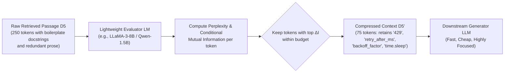
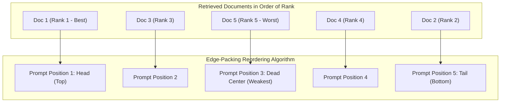

# Phase 5: Post-Retrieval Context Refinement
## Token Pruning, "Lost in the Middle" Reordering, and Synthesis Architectures

> **Core Philosophy**: More context does not mean better generation. Simply "stuffing" all retrieved passages into an LLM's prompt triggers self-attention degradation, elevates token costs, and introduces distractors that induce hallucinations. Context refinement treats retrieved passages as raw ore: before the generation model sees them, they must be pruned of non-informative tokens, reordered to exploit transformer attention geometry, and synthesized via the optimal execution topology.

---

## 1. Context Compression & Token Pruning

### Topic 1.1: Information-Theoretic Pruning with LongLLMLingua

#### 1. The Problem
When resolving multi-hop query $Q_3$, our pipeline retrieves candidate passages from Documents $D_2$, $D_3$, $D_5$, and $D_6$. 
Passing all 4 complete documents directly to the generator consumes $\approx 2,500\text{ tokens}$. 
Much of this text consists of boilerplate headers, formatting whitespace, polite docstring prose, and repeated structural syntax. 
In enterprise pipelines processing 10,000 queries per hour:
- $2,500\text{ tokens/prompt} \times 10,000\text{ calls} = 25,000,000\text{ tokens/hour}$.
- At standard API pricing, this generates massive recurring operational expenses.
- More dangerously, **irrelevant tokens act as attention distractors**. Standard self-attention allocates a non-zero probability mass to every single token in the context; superfluous tokens dilute the attention weights allocated to the critical parameters (`retry_after_ms`, `efConstruction=200`, `20,000 RPM`).

#### 2. Intuition
Imagine reading a 10-page legal contract with a yellow highlighter. You don't read every single "heretofore", "pursuant to", and "whereas". You cross out all the legal filler and highlight only the names, dates, dollar amounts, and obligations. 
LongLLMLingua acts as an automated, mathematically rigorous highlighter: it evaluates the **information density (perplexity)** of every token and drops the predictable, low-information words while preserving the critical technical facts.



#### 3. Mechanics
LongLLMLingua (Jiang et al., ACL 2024) introduces four structural mechanisms beyond basic perplexity scoring:
1. **Question-Aware Coarse Document Ranking**: The small evaluator model computes the perplexity of the question conditioned on each document ($\text{PPL}(Q \mid D_k)$) to evaluate how well each document explains or anticipates the query.
2. **Document Reordering**: Sorts documents by that coarse relevance score, placing the most relevant documents first (monotonic descending order; contrast this with the head/tail edge-packing heuristic in Topic 2.1).
3. **Dynamic Per-Document Compression Ratio**: Instead of assigning a static compression rate across all passages, dynamically allocates higher token budgets to high-relevance documents and aggressively compresses lower-relevance documents.
4. **Subsequence Recovery**: In downstream generation, the LLM receives compressed-prompt fragments; subsequence recovery restores original, uncompressed text spans in the LLM's final generated response from those fragments.

#### 4. Math: Perplexity & Token Information Content
Let a retrieved passage be a sequence of tokens $\mathbf{x} = (x_1, x_2, \dots, x_N)$.
Under the evaluator language model parameterized by $\theta$, the surprisal (information content) of token $x_i$ conditioned on previous tokens is:

$$I(x_i \mid x_{<i}) = -\log_2 P_\theta(x_i \mid x_1, \dots, x_{i-1})$$

The perplexity of the token sequence is the exponentiated cross-entropy:
$$\text{PPL}(\mathbf{x}) = \exp \left( -\frac{1}{N} \sum_{i=1}^N \ln P_\theta(x_i \mid x_{<i}) \right)$$

In **LongLLMLingua**, token retention is conditioned on the **Query $Q$**. We measure the **Conditional Mutual Information (CMI) / Information Gain** between token $x_i$ and query $Q$:

$$\Delta I(x_i) = \text{surprisal}(x_i \mid x_{<i}) - \text{surprisal}(x_i \mid Q, \, x_{<i}) = \log \frac{P_\theta(x_i \mid Q, \, x_{<i})}{P_\theta(x_i \mid x_{<i})}$$

Where:
- If token $x_i$ is completely irrelevant to question $Q$, conditioning on $Q$ does not change its likelihood: $\Delta I \approx 0 \implies$ **Prune token**.
- If token $x_i$ is essential to answering $Q$, conditioning on $Q$ dramatically increases its likelihood: $\Delta I \gg 0 \implies$ **Retain token**.

#### 5. Worked Example (Hand-Calculated Token Budget & Pruning)
Consider this 13-token snippet from Document $D_2$:
$$\mathbf{x} = \big[ \text{"The"}, \, \text{"gateway"}, \, \text{"rejects"}, \, \text{"the"}, \, \text{"request"}, \, \text{"with"}, \, \text{"HTTP"}, \, \text{"status"}, \, \text{"code"}, \, \text{"429"}, \, \text{"Too"}, \, \text{"Many"}, \, \text{"Requests"} \big]$$

Let our target compression ratio be $\gamma \approx 0.385 \implies$ Retain exactly $B = \lfloor 13 \times 0.385 \rfloor = 5$ tokens.
Let query $Q = \text{"What HTTP error code does the gateway return when throttled?"}$

The evaluator model evaluates unconditional surprisal $S(x_i \mid x_{<i}) = -\log P(x_i \mid x_{<i})$ versus query-conditioned surprisal $S(x_i \mid Q, x_{<i}) = -\log P(x_i \mid Q, x_{<i})$:
- `"The"`: $S(x \mid x_<) = 0.15, \; S(x \mid Q, x_<) = 0.12 \implies \Delta I = 0.03$ (illustrative)
- `"gateway"`: $S(x \mid x_<) = 3.20, \; S(x \mid Q, x_<) = 1.10 \implies \Delta I = 2.10$ (illustrative)
- `"rejects"`: $S(x \mid x_<) = 2.80, \; S(x \mid Q, x_<) = 2.10 \implies \Delta I = 0.70$ (illustrative)
- `"the"`: $S(x \mid x_<) = 0.10, \; S(x \mid Q, x_<) = 0.08 \implies \Delta I = 0.02$ (illustrative)
- `"request"`: $S(x \mid x_<) = 1.80, \; S(x \mid Q, x_<) = 1.30 \implies \Delta I = 0.50$ (illustrative)
- `"with"`: $S(x \mid x_<) = 0.25, \; S(x \mid Q, x_<) = 0.20 \implies \Delta I = 0.05$ (illustrative)
- `"HTTP"`: $S(x \mid x_<) = 3.90, \; S(x \mid Q, x_<) = 0.85 \implies \Delta I = 3.05$ (illustrative)
- `"status"`: $S(x \mid x_<) = 2.60, \; S(x \mid Q, x_<) = 1.20 \implies \Delta I = 1.40$ (illustrative)
- `"code"`: $S(x \mid x_<) = 2.40, \; S(x \mid Q, x_<) = 1.15 \implies \Delta I = 1.25$ (illustrative)
- `"429"`: $S(x \mid x_<) = 6.10, \; S(x \mid Q, x_<) = 1.40 \implies \Delta I = \mathbf{4.70}$ (illustrative, highest information gain)
- `"Too"`: $S(x \mid x_<) = 2.70, \; S(x \mid Q, x_<) = 2.20 \implies \Delta I = 0.50$ (illustrative)
- `"Many"`: $S(x \mid x_<) = 2.50, \; S(x \mid Q, x_<) = 2.10 \implies \Delta I = 0.40$ (illustrative)
- `"Requests"`: $S(x \mid x_<) = 2.90, \; S(x \mid Q, x_<) = 2.30 \implies \Delta I = 0.60$ (illustrative)

Ranking by $\Delta I$, the top 5 preserved tokens are:
1. `"429"` ($\Delta I = 4.70$)
2. `"HTTP"` ($\Delta I = 3.05$)
3. `"gateway"` ($\Delta I = 2.10$)
4. `"status"` ($\Delta I = 1.40$)
5. `"code"` ($\Delta I = 1.25$)

Reconstructing in original order:
$$\mathbf{x}_{\text{pruned}} = \big[ \text{"gateway"}, \, \text{"HTTP"}, \, \text{"status"}, \, \text{"code"}, \, \text{"429"} \big]$$
Token count reduced from 13 to 5 ($61.5\%$ reduction, illustrative). Common grammatical filler (`"The"`, `"the"`, `"with"`) was discarded, but the exact query-answering entities (`gateway HTTP status code 429`) remain completely intact.

#### 6. Code Sketch
```python
from llmlingua import PromptCompressor

# Initializes LongLLMLingua using a lightweight evaluator model
compressor = PromptCompressor(
    model_name="NousResearch/Llama-2-7b-hf",
    device_map="cuda"  # Recommend GPU for production latency; CPU execution is possible but adds latency
)

context = """The OmniFlow gateway rejects the request with HTTP status code 429 (Too Many Requests),
returning a JSON error payload containing: {"error": "rate_limited", "retry_after_ms": 350}."""
query = "What error payload is returned on rate limit?"

# Compress context using question-aware LongLLMLingua strategy
results = compressor.compress_prompt(
    context=[context],
    question=query,
    rate=0.40,  # Retain only 40% of tokens (illustrative)
    rank_method="longllmlingua",
    condition_in_question="after_condition"
)

compressed_context = results["compressed_prompt"]
# compressed_context retains 'gateway 429 {"error": "rate_limited", "retry_after_ms": 350}'
```

#### 7. Failure Modes & Trade-offs
- **Syntactic Disruption in Code ($D_5$)**: In Python code, indentation, colons, and variable syntax are syntactically load-bearing. Dropping `"def "` or `":"` can turn executable code into unreadable gibberish. **Never apply naive token pruning to raw code chunks without AST-aware protections.**
- **Sub-word Token Fragmentation**: If a tokenizer drops the second half of a BPE pair (e.g., dropping `Flow` from `OmniFlow`), it corrupts entity recognition.
- **Evaluator Latency**: Running an 8B model to score tokens adds 50–150ms of latency.

#### 8. When to Use It
Use when passing large volumes of unstructured prose ($>4,000$ tokens) to expensive frontier models (GPT-4o, Claude 3.5 Sonnet) to reduce API bills and eliminate attention noise.

#### 9. Source
Jiang et al., *LongLLMLingua: Accelerating and Enhancing LLMs in Long Context via Prompt Compression*, ACL 2024.

---

## 2. Context Reordering: Mitigating "Lost in the Middle"

### Topic 2.1: Attention Geometry & Edge-Packing

#### 1. The Problem
An engineer builds a RAG pipeline that retrieves the top 10 documents and concatenates them into the LLM prompt in order of retrieval rank:
```
[Document Rank 1]
[Document Rank 2]
[Document Rank 3]
...
[Document Rank 8]
[Document Rank 9]
[Document Rank 10]
```
Even with a large-context LLM, empirical evaluations reveal that **if the critical fact is located in Document 5, 6, or 7 of a 10-document context, the model frequently fails to answer the question or hallucinates.**

This is the **"Lost in the Middle"** phenomenon. In multi-document question answering benchmarks, LLM performance follows a characteristic U-shaped curve: accuracy is highest when the gold document is placed at the very beginning (primacy effect) or very end (recency effect) of the input prompt, and drops sharply when the relevant passage is placed in the interior. Notably, Liu et al. (2024) demonstrated that on multi-document QA tasks, placing relevant information in the middle of 20 documents caused performance for GPT-3.5-Turbo specifically to plummet below its closed-book baseline (answering without any retrieved documents at all). While this degradation was pronounced in earlier long-context architectures, the effect is reportedly weaker in newer frontier models; the reasons are not established.

#### 2. Intuition
Think of reading a 50-page briefing packet five minutes before a critical meeting. You vividly remember the Executive Summary on page 1 (primacy effect), and you clearly remember the Action Items on page 50 that you just read (recency effect). Everything between pages 15 and 35 blurs into a hazy fog. Transformers exhibit a similar positional bias.

#### 3. Mechanics & Attention Geometry
Why do transformers exhibit this U-shaped degradation? The leading architectural hypotheses include:
1. **Rotary Positional Embeddings (RoPE) & Distance Bias (Hypothesis)**: Modern transformers rely on relative positional encodings (such as RoPE or ALiBi) where relative token distances or long context scales decay attention weight. Coupled with the structural prominence of the initial system prompt and final query, attention distributions naturally concentrate mass at the sequence boundaries.
2. **Causal Attention Masking & Generation Proximity (Hypothesis)**: In auto-regressive decoders, every token can attend only to prior tokens. The prompt-final tokens are immediately adjacent to the generation trigger, while prompt-initial tokens act as universal attention sinks. Middle tokens lack both the sink property of the prompt header and the immediate causal proximity of the generation trigger.
3. **The Edge-Packing Heuristic (Community Practice / LangChain `LongContextReorder`)**:
   To maximize retrieval recall without additional model training, community practice (popularized by LangChain's `LongContextReorder`, inspired by Liu et al.'s findings) reorganizes the retrieved candidates before building the prompt. Instead of placing candidates in descending rank order ($1, 2, 3, 4, 5$), candidates are distributed alternately between the head and tail, deliberately burying the lowest-scoring documents in the middle dead zone.



#### 4. Math: The Alternating Edge-Packing Mapping
Let the candidate documents sorted descending by reranker score be $\mathbf{D} = (d_1, d_2, d_3, \dots, d_K)$, where $d_1$ is the highest scoring document and $d_K$ is the lowest scoring document.

We map $\mathbf{D}$ to an optimized prompt sequence $\mathbf{P} = (p_1, p_2, \dots, p_K)$ using the following alternating formulation:

Initialize two pointers: $\text{left} = 1$, $\text{right} = K$.
For step $i = 1$ to $K$:
$$\begin{cases} 
p_{\text{left}} = d_i, \quad \text{left} \leftarrow \text{left} + 1 & \text{if } i \text{ is odd} \\ 
p_{\text{right}} = d_i, \quad \text{right} \leftarrow \text{right} - 1 & \text{if } i \text{ is even} 
\end{cases}$$

Under this mapping:
- **Position 1 (Prompt Start)** receives $d_1$ (Rank 1).
- **Position $K$ (Prompt End)** receives $d_2$ (Rank 2).
- **Position 2** receives $d_3$ (Rank 3).
- **Position $K-1$** receives $d_4$ (Rank 4).
- The lowest-ranked documents ($d_{K-1}, d_K$) are forced into the interior center $\lfloor K/2 \rfloor$, where the attention degradation penalty impacts only low-confidence context.

#### 5. Worked Example (Hand-Calculated 5-Document Reordering)
Let our reranker return 5 documents for Query $Q_1$:
- $d_1$: Doc $D_5$ (Python source code - Score: $0.98$ (illustrative))
- $d_2$: Doc $D_2$ (Rate limit API specs - Score: $0.89$ (illustrative))
- $d_3$: Doc $D_3$ (Python SDK manual - Score: $0.81$ (illustrative))
- $d_4$: Doc $D_1$ (Architecture specs - Score: $0.45$ (illustrative))
- $d_5$: Doc $D_6$ (Incident postmortem - Score: $0.22$ (illustrative))

**Step-by-Step Assignment**:
1. $i = 1$ (odd): Assign $d_1$ ($D_5$) to `left` index $1$. ($\text{left} \to 2$)
2. $i = 2$ (even): Assign $d_2$ ($D_2$) to `right` index $5$. ($\text{right} \to 4$)
3. $i = 3$ (odd): Assign $d_3$ ($D_3$) to `left` index $2$. ($\text{left} \to 3$)
4. $i = 4$ (even): Assign $d_4$ ($D_1$) to `right` index $4$. ($\text{right} \to 3$)
5. $i = 5$ (odd): Assign $d_5$ ($D_6$) to `left` index $3$. ($\text{left} \to 4$)

**Final Prompt Layout**:
- Position 1 (Head - Primacy Zone): **$D_5$ (Rank 1)**
- Position 2 (Near Head): **$D_3$ (Rank 3)**
- Position 3 (Dead Center - Low Attention): **$D_6$ (Rank 5)**
- Position 4 (Near Tail): **$D_1$ (Rank 4)**
- Position 5 (Tail - Recency Zone): **$D_2$ (Rank 2)**

Both gold documents ($D_5$ and $D_2$) now occupy the peak attention regions of the prompt!

#### 6. Code Sketch
```python
from typing import List, Any

def reorder_lost_in_the_middle(documents: List[Any]) -> List[Any]:
    """Reorders documents so that top-ranked documents sit at the head and tail."""
    # Assumes documents are pre-sorted descending by relevance score
    reordered = [None] * len(documents)
    left, right = 0, len(documents) - 1
    
    for i, doc in enumerate(documents):
        if i % 2 == 0:
            reordered[left] = doc
            left += 1
        else:
            reordered[right] = doc
            right -= 1
            
    return reordered

# Example: [Rank 1, 2, 3, 4, 5] -> [Rank 1, Rank 3, Rank 5, Rank 4, Rank 2]
input_docs = ["Doc_Rank_1", "Doc_Rank_2", "Doc_Rank_3", "Doc_Rank_4", "Doc_Rank_5"]
output_order = reorder_lost_in_the_middle(input_docs)
```

#### 7. Failure Modes & Trade-offs
- **Zero Cost, Zero Latency**: Edge-packing is a pure $O(K)$ array re-indexing operation. It adds $0.00\text{ ms}$ of latency and $0\$$ in cost.
- **Limitation**: While it guarantees that the top 2 candidates escape the middle, if your query requires synthesizing 6 distinct documents equally, the middle documents will still suffer attention degradation. Reordering mitigates primacy/recency bias; it does not expand total attention capacity.

#### 8. When to Use It
**Cheap to try with zero latency overhead; always A/B test on your specific model.** Because it is a simple $O(K)$ array re-indexing operation, it carries no compute penalty, though empirical gains vary across model families and are noticeably attenuated in modern frontier architectures.

#### 9. Source
Liu et al., *Lost in the Middle: How Language Models Use Long Contexts*, Transactions of the Association for Computational Linguistics (TACL), 2024.  
*Note*: Edge-packing (e.g., LangChain's `LongContextReorder`) is an engineering heuristic developed by the open-source community in response to Liu et al.'s findings, not a method proposed in the original paper.

---

## 3. Context Stuffing vs. Iterative Synthesis Strategies

When the retrieved context exceeds the comfortable single-prompt capacity of the generation model, we must choose an architectural synthesis strategy:

```mermaid
flowchart TD
    subgraph STUFF ["1. Context Stuffing"]
        ALL["All Chunks (C1..Cn)"] --> PROMPT["Single Massive Prompt"] --> GEN1["LLM Generator"]
    end
    
    subgraph MAP_REDUCE ["2. Map-Reduce"]
        C1["Chunk 1"] --> LLM_M1["Map LLM"] --> A1["Summary 1"]
        C2["Chunk 2"] --> LLM_M2["Map LLM"] --> A2["Summary 2"]
        A1 --> REDUCE["Reduce LLM"]
        A2 --> REDUCE
        REDUCE --> FINAL_MR["Final Answer"]
    end
    
    subgraph REFINE ["3. Refine (Sequential Loop)"]
        CR1["Chunk 1"] --> LLM_R1["LLM"] --> ANS1["Draft Answer 1"]
        ANS1 --- CR2["Chunk 2"] --> LLM_R2["Refine LLM"] --> ANS2["Refined Answer 2"]
        ANS2 --- CR3["Chunk 3"] --> LLM_R3["Refine LLM"] --> FINAL_REF["Final Answer"]
    end

    subgraph ACCUMULATE ["4. Accumulate (Parallel Concat)"]
        AC1["Chunk 1"] --> LLM_A1["Extract LLM"] --> OUT1["Ans 1"]
        AC2["Chunk 2"] --> LLM_A2["Extract LLM"] --> OUT2["Ans 2"]
        OUT1 --> CONCAT["String Concat"]
        OUT2 --> CONCAT
        CONCAT --> FINAL_ACC["Concatenated Report"]
    end
```



### Topic 3.1: Architectural Topologies

#### 1. Context Stuffing (The Default)
- **Mechanics**: Concatenate all retrieved passages directly into a single prompt:
  $$\text{Prompt} = \big[ \text{System Instruction}, \, \mathcal{C}_1, \dots, \mathcal{C}_K, \, \text{User Question} \big]$$
- **Pros**: Only **1 single LLM call**. Lowest possible latency. All documents share one context window, so later tokens can attend to earlier documents and the model can connect premises across them for direct comparisons.
- **Cons**: Bounded by model context window. Prone to "Lost in the Middle" and attention distraction if $K > 10$.

#### 2. Map-Reduce
- **Mechanics**:
  - **Map Step**: Pass each retrieved document $\mathcal{C}_i$ individually to an LLM: *"Extract facts from this document relevant to question $Q$."* (Runs fully in parallel across $K$ threads).
  - **Reduce Step**: Concatenate all $K$ intermediate extractions into a single prompt: *"Synthesize these facts into a cohesive final answer."*
- **Pros**: Can scale to hundreds of documents ($K=100$) without overflowing context windows. Map calls execute concurrently.
- **Cons**: Requires $K + 1$ LLM invocations (high cost). **Completely destroys cross-document relational reasoning during the Map phase**; if Document $A$ contains a premise and Document $B$ contains the conclusion, neither Map worker recognizes the connection!

#### 3. Refine (Sequential Accumulator)
- **Mechanics**:
  - Feed $\mathcal{C}_1$ and $Q$ to the LLM to produce initial draft answer $\mathcal{A}_1$.
  - Feed $\mathcal{C}_2$, $Q$, and draft $\mathcal{A}_1$ to the LLM: *"Given this new context, refine and update the draft answer."*
  - Repeat iteratively until all $K$ documents are consumed.
- **Pros**: Preserves nuanced context across steps; enables deep sequential analysis.
- **Cons**: **Strictly sequential ($O(K)$ latency)**. Cannot be parallelized. A single bad intermediate step can derail all subsequent refinements. If $K=10$, latency spikes to $10\times$ single-call latency.

#### 4. Accumulate (Per-Chunk Answers Concatenated; LlamaIndex)
- **Mechanics**:
  - Run $K$ independent, concurrent LLM calls across all retrieved documents $\mathcal{C}_i$: *"Answer question $Q$ using only this document; return empty if not relevant."*
  - Concatenate all non-empty extractions directly into a final bulleted or multi-section report without executing a final Reduce synthesis call.
- **Pros**: Fully parallelized ($O(1)$ latency, $\approx 800\text{ ms}$ wall-clock time (illustrative)). Eliminates the token limit bottlenecks of a final Reduce prompt.
- **Cons**: Zero cross-document synthesis. Produces disjointed, redundant sections and is fundamentally incapable of multi-hop inference across split premises or resolving cross-document contradictions (e.g., $D_3$ vs. $D_5$ retry codes).

#### 5. Mathematical Cost & Latency Trade-Off Analysis
Let:
- $K = 10$ retrieved documents.
- Document token length: $L_D = 500$ tokens.
- Query token length: $L_Q = 50$ tokens.
- Running intermediate answer length: $L_A \approx 100\text{--}150$ tokens.
- Single LLM generation latency: $T_{\text{gen}} \approx 800\text{ ms}$ (illustrative).

| Synthesis Strategy | Total LLM Calls | Parallelizable? | Total Prompt Tokens Processed | End-to-End Latency (illustrative) | Cross-Document Synthesis Quality |
| :--- | :--- | :--- | :--- | :--- | :--- |
| **Context Stuffing** | $\mathbf{1}$ | Yes ($O(1)$) | $(10 \times 500) + 50 = \mathbf{5,050}$ | $\mathbf{\approx 800\text{ ms}}$ | **Highest** (All documents share one context window; later tokens attend to earlier documents) |
| **Map-Reduce** | $10 + 1 = \mathbf{11}$ | Map: Yes / Reduce: No | $10(500 + 50) + (10 \times 100) = \mathbf{6,500}$ | $\approx 800 + 800 = \mathbf{1,600\text{ ms}}$ | **Poor** (Fails multi-hop premises) |
| **Refine** | $\mathbf{10}$ | **No** (Strictly sequential) | $\sum_{i=1}^{10} (550 + 150i) = \mathbf{13,750}$ | $10 \times 800 = \mathbf{8,000\text{ ms}}$ | **Moderate** (Recency biased) |
| **Accumulate (LlamaIndex)** | $\mathbf{10}$ | **Yes** (Fully concurrent) | $10 \times (500 + 50) = \mathbf{5,500}$ | $\mathbf{\approx 800\text{ ms}}$ | **None** (Disjoint per-chunk fragments; no fusion) |

#### 6. Code Sketch
```python
def synthesize_context_stuffing(docs: list[str], query: str, llm_client) -> str:
    """Standard context stuffing with edge-packed reordering."""
    from .reordering import reorder_lost_in_the_middle
    
    reordered_docs = reorder_lost_in_the_middle(docs)
    context_blocks = "\n\n---\n\n".join([f"Document [{i+1}]:\n{d}" for i, d in enumerate(reordered_docs)])
    
    prompt = (
        f"You are a factual assistant. Answer the question using ONLY the provided documents.\n\n"
        f"CONTEXT:\n{context_blocks}\n\n"
        f"QUESTION: {query}\n\n"
        f"ANSWER:"
    )
    return llm_client.generate(prompt=prompt, temperature=0.0)
```

---

## 4. Comparison of Context Refinement Techniques

| Technique | Latency Impact (illustrative) | Dollar Cost Impact | Implementation Complexity | Primary Benefit | Primary Failure Mode |
| :--- | :--- | :--- | :--- | :--- | :--- |
| **Token Pruning (LongLLMLingua)** | $+50\text{--}150\text{ ms}$ (Local model) (illustrative) | Saves $40\%\text{--}60\%$ on LLM bills (illustrative heuristic) | Medium | Eliminates prompt bloat and distractor tokens | Accidental pruning of syntax/code variables |
| **Edge-Packing ("Lost in Middle")** | $\mathbf{0\text{ ms}}$ (Instant array re-index) | $\mathbf{\$0.00}$ | Trivial (5 lines) | Shields Top-2 candidates from attention dead zones | Does not expand total attention limits |
| **Context Stuffing** | Baseline ($1\times$) | Baseline ($1\times$) | Trivial | Shared context window connects premises across documents | Hard limit on maximum context window |
| **Map-Reduce Synthesis** | $2\times\text{--}3\times$ latency (illustrative) | High ($K+1$ LLM calls) | High | Unlimited document volume | Breaks multi-hop premise-conclusion links |
| **Refine Synthesis** | $K\times$ latency (Unacceptable for real-time, illustrative) | Extreme | High | Deep sequential fact evolution | Sequential bottlenecks; early-step drift |
| **Accumulate Synthesis** | $1\times$ latency (Parallelized, illustrative) | High ($K$ LLM calls) | Low | High-throughput isolated extraction | Zero cross-document reasoning or contradiction resolution |

> [!NOTE]
> **Heuristics vs. Principles**:
> - **The 8k-token threshold rule (illustrative heuristic)**: For total retrieved context under $8,000$ tokens, **Context Stuffing combined with Edge-Packing usually beats Map-Reduce and Refine** in both accuracy and cost on modern frontier LLMs.
> - Only transition to Map-Reduce or Accumulate when aggregating metrics across hundreds of distinct records (e.g., *"Summarize common themes across 150 customer survey responses"*).

---

## 5. How This Connects to the Next Phase

At this stage, our RAG pipeline is thoroughly optimized:
1. Documents are cleanly ingested and hierarchically contextualized (Phase 1).
2. Candidates are retrieved via hybrid sparse+dense indexing (Phase 2).
3. The Top-100 pool is fused via RRF and reranked via cross-encoders (Phase 3).
4. Queries are rewritten, expanded, or decomposed (Phase 4).
5. The retrieved passages are pruned, edge-packed, and stuffed into the prompt (Phase 5).

Yet, this entire pipeline remains **Passive and Deterministic**:
- It runs linearly: `User Query -> Retrieve -> Stuff -> Generate`.
- If the retrieved context is irrelevant, low-quality, or contradictory, the generator has no choice but to guess or hallucinate.
- If the query requires an external calculation or dynamic tool execution, a static retrieval pipeline cannot help.

In **Phase 6 (`06-advanced-agentic-rag.md`)**, we transition to **Autonomous, Dynamic, and Agentic RAG**:
- **Self-RAG**: Training/prompting the model with reflection tokens (`[Retrieve]`, `[IsRel]`, `[IsSup]`, `[IsUse]`) to decide *when* to retrieve and *when* to reject context.
- **Corrective RAG (CRAG)**: Confidence evaluation that triggers automated web search fallbacks when internal documents are insufficient.
- **GraphRAG**: Global corpus reasoning via Leiden community clustering on knowledge graphs.
- **Agentic Multi-Hop Loops**: State machines that dynamically navigate tools and retrieve iteratively until stopping criteria are satisfied.

---

## 6. Phase 5 Interview Questions & Answers

#### Q1: What are the leading hypotheses for the "Lost in the Middle" phenomenon in modern transformer models, and how does Edge-Packing address it?
> **Answer**: In multi-document question answering benchmarks, language models exhibit a pronounced U-shaped accuracy curve: answers are retrieved reliably from the start (primacy effect) or end (recency effect) of the context window, while performance severely degrades in the middle (often dropping below closed-book baselines in earlier architectures). The leading architectural hypotheses include:
> 1. **Relative Positional Encodings (RoPE) & Attention Bias (Hypothesis)**: Self-attention heads disproportionately allocate softmax mass to sequence boundaries (system instructions acting as attention sinks at the start, and generation triggers at the end).
> 2. **Causal Attention Masking (Hypothesis)**: In auto-regressive decoders, information accumulates along causal paths toward sequence ends, leaving middle tokens with neither sink properties nor generation proximity.
> 
> To mitigate this without retraining, community engineering practice (popularized by LangChain's `LongContextReorder`, inspired by Liu et al., 2024) employs **Edge-Packing**: reordering retrieved candidates alternating between the prompt's head and tail ($d_1 \to \text{Pos } 1$, $d_2 \to \text{Pos } K$, $d_3 \to \text{Pos } 2$, etc.). This reserves prime attention regions for the highest-confidence evidence while pushing distractors to the dead-center attention valley.

#### Q2: How does LongLLMLingua use Conditional Mutual Information (CMI) to prune tokens without losing critical technical entities?
> **Answer**: Standard perplexity pruning measures only token predictability given preceding context $P(x_i \mid x_{<i})$, which risks dropping words that are predictable in English prose but vital for answering the specific query. LongLLMLingua instead computes the Conditional Mutual Information between each token and the query: $\Delta I(x_i; Q) = \log [P(x_i \mid Q, x_{<i}) / P(x_i \mid x_{<i})]$. If conditioning on the query significantly increases a token's likelihood (such as a specific error code `429` or parameter `efConstruction`), the token receives a high score and is preserved. Tokens whose probabilities remain unchanged regardless of the query (such as conversational boilerplate) are pruned.

#### Q3: Why does the Map-Reduce synthesis strategy systematically fail on multi-hop reasoning tasks, and what strategy should be used instead?
> **Answer**: Map-Reduce isolates each document during the Map phase, asking an LLM to extract facts from that document alone. In a multi-hop query, no single document contains the complete fact; Document $A$ might contain a premise (e.g., an architectural configuration) while Document $B$ contains the consequence (e.g., an OOM postmortem). The Map worker evaluating Document $A$ discards the premise as irrelevant because it cannot see Document $B$. Context Stuffing (combined with Edge-Packing) should be used instead: because all documents share one context window, later tokens can attend to earlier documents and the model can connect premises across them to form grounded conclusions.

#### Q4: When applying token compression to a mixed corpus of technical prose and source code ($D_5$), what specific failure mode arises, and how must the pipeline be adapted?
> **Answer**: Code syntax is strictly load-bearing: whitespace, colons, variable assignments, and indentation cannot be treated as redundant language tokens. Information-theoretic compressors optimized on natural language prose will frequently drop punctuation, parentheses, or variable prefixes (`self.`) because their character-level surprisal is low, rendering Python code syntactically invalid. The ingestion pipeline must be adapted by using AST-aware syntax parsers that detect code blocks and either exempt them from token pruning entirely or restrict compression strictly to removing docstrings and comments.

#### Q5: Under what operational conditions does Context Stuffing become unviable, forcing an architecture to adopt hierarchical or Map-Reduce synthesis?
> **Answer**: Context Stuffing becomes unviable when:
> 1. The volume of retrieved evidence required to answer the query exceeds the physical maximum context window of the LLM (or exceeds the maximum token budget allocated by production cost SLAs).
> 2. The query is aggregative or corpus-wide rather than needle-in-a-haystack (e.g., *"Analyze trends across all 200 incident postmortems from Q3"*). In this regime, stuffing 200 documents causes severe attention dilution and context overflow, requiring Map-Reduce to parallelize metric extraction before final aggregation.

