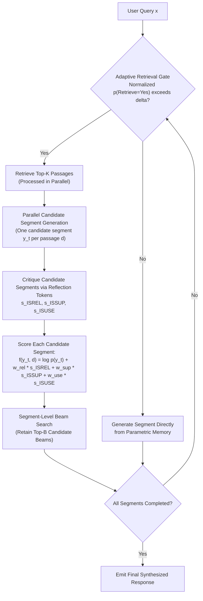
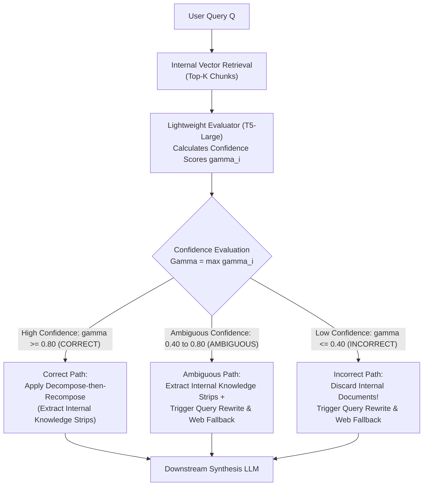
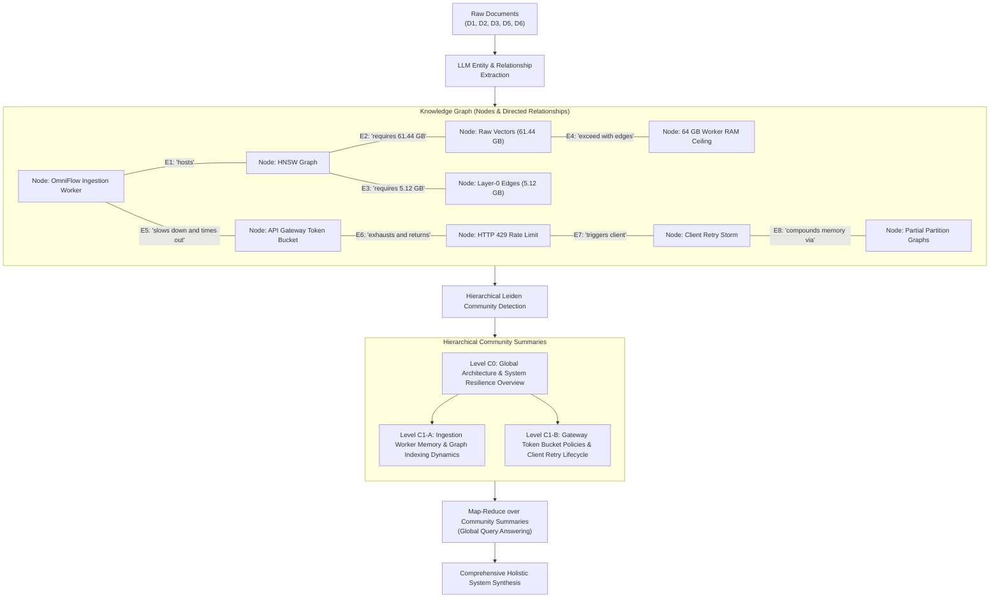
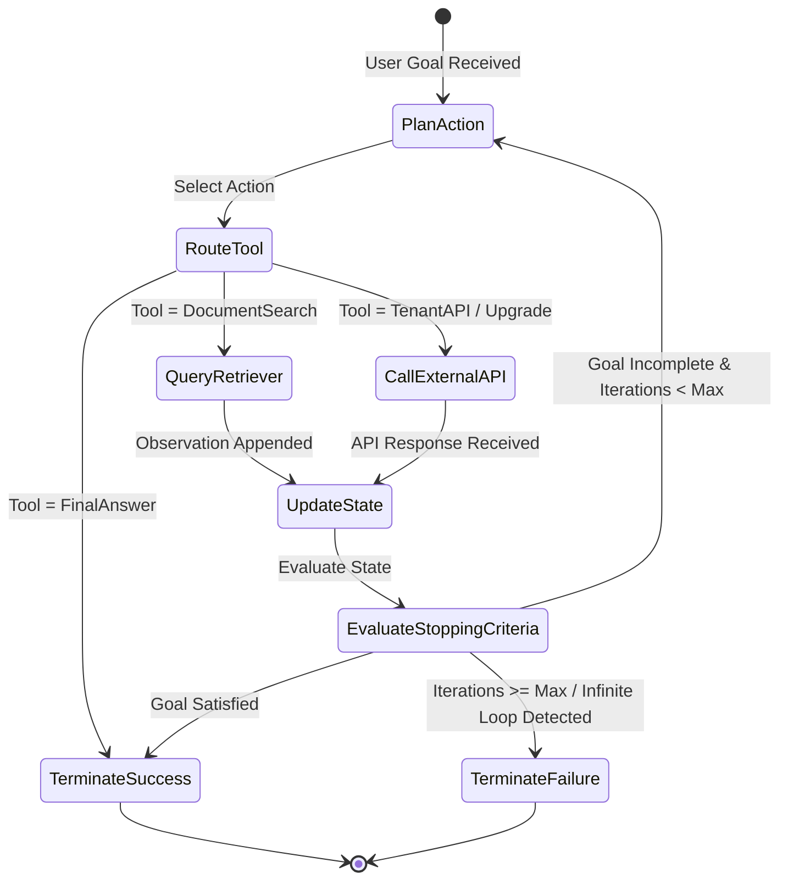

# Phase 6: Advanced, Dynamic & Agentic RAG
## Self-RAG, Corrective RAG (CRAG), GraphRAG, and Multi-Hop Agentic Loops

> **Core Philosophy**: Classical RAG is an open-loop system: once triggered, it blindly executes retrieval, injects passages, and generates an answer without self-inspection or error correction. Production systems require **closed-loop feedback**. An advanced RAG system must evaluate whether retrieval is even necessary, critique whether retrieved documents are relevant, fall back to external tools when internal corpora fail, and iterate dynamically until verified stopping criteria are met.

---

## 1. Self-RAG: Adaptive Retrieval & Reflection Tokens

### Topic 1.1: Fine-Grained Self-Reflection and Adaptive Retrieval

#### 1. The Problem
Standard RAG systems suffer from two symmetrical failure modes:
1. **Unnecessary Retrieval**: When asked a simple, factual question well within its pre-trained parametric knowledge (e.g., *"What is an exponential backoff algorithm?"*), the pipeline wastes latency and vector database compute retrieving redundant documents that add zero new information.
2. **Uncritical Hallucination**: When the retriever returns completely irrelevant or contradictory documents, a standard LLM does not pause; it synthesizes an ungrounded answer anyway, treating whatever text is in its prompt as ground truth.

We need an architecture where the model **critiques its own retrieval need, evaluates document relevance, checks factual support, and measures answer utility at segment-level granularity**.

#### 2. Intuition
Think of a student taking an open-book exam.
- A weak student retrieves notes for *every single question*, wasting half their exam time flipping through pages to verify that $2 + 2 = 4$.
- A reckless student never checks their notes at all and makes up plausible-sounding answers from memory.
- A top student knows *when* they are confident (answers from memory) and *when* they are uncertain (opens the book to the exact page), verifies whether the page actually answers their doubt, and checks their work before writing the final response.



#### 3. Mechanics: Training Pipeline & Reflection Tokens
Self-RAG avoids complex reinforcement learning reward models or policy optimization during generation. Instead, it uses a decoupled two-stage data-annotation and fine-tuning pipeline:
1. **Offline Critic Model**: A critic model is trained on curated reflection annotations generated via prompted evaluations (using GPT-4) across four criteria: retrieval necessity, relevance, factual support, and utility.
2. **Offline Corpus Annotation**: The trained critic annotates a training corpus offline, inserting special reflection tokens (`[Retrieve]`, `[IsRel]`, `[IsSup]`, `[IsUse]`) into the text alongside passages and ground-truth responses.
3. **Generator Training**: The generator model is trained on this annotated corpus using standard causal next-token cross-entropy loss. At inference time, the generator natively emits both standard response text and reflection tokens, allowing adaptive self-steering without separate external critic models.

The four reflection tokens operate as follows:
1. **`[Retrieve]`**: Decides adaptively at segment boundaries whether external retrieval is required.
   - Output domain: `{[Retrieve]=Yes, [Retrieve]=No, [Retrieve]=Continue}`.
   - Retrieval triggers if the normalized probability exceeds an inference threshold $\delta$:
     $$\frac{p(\text{[Retrieve]}=\text{Yes})}{\sum_{v \in \{\text{Yes}, \text{No}, \text{Continue}\}} p(\text{[Retrieve]}=v)} > \delta$$
2. **`[IsRel]` (Is Relevant)**: Evaluates whether retrieved passage $d$ is relevant to instruction/query $x$.
   - Output domain: `{[IsRel]=Relevant, [IsRel]=Irrelevant}`.
3. **`[IsSup]` (Is Supported)**: Evaluates whether candidate generated segment $y_t$ is factually supported by passage $d$.
   - Output domain: `{[IsSup]=FullySupported, [IsSup]=PartiallySupported, [IsSup]=NoSupport}`.
4. **`[IsUse]` (Is Useful)**: Scores the overall utility and helpfulness of segment $y_t$ on a scale of 1 to 5.
   - Output domain: `{[IsUse]=1, [IsUse]=2, [IsUse]=3, [IsUse]=4, [IsUse]=5}`.

#### 4. Math: Segment-Level Beam Search with Reflection Rewards
When retrieval is triggered, $K$ candidate passages are retrieved and processed in parallel. For each passage $d$, the generator produces a candidate text segment $y_t$.
Candidate segments across all $K$ passages are evaluated and ranked using the paper's segment scoring function:

$$f(y_t, d) = \log p(y_t \mid x, d, y_{\lt t}) + \sum_{G \in \lbrace \text{IsRel}, \text{IsSup}, \text{IsUse} \rbrace} w_G \cdot s_G$$

Where:
- $\log p(y_t \mid x, d, y_{\lt t}) = \frac{1}{|y_t|} \sum_{i=1}^{|y_t|} \log p(w_i \mid x, d, y_{\lt t}, w_{\lt i})$ is the sequence-length-normalized token log-likelihood.
- $s_{\text{ISREL}}$ is the normalized probability of passage relevance:
  $$s_{\text{ISREL}} = \frac{p(\text{[IsRel]}=\text{Relevant})}{\sum_{v \in \{\text{Relevant}, \text{Irrelevant}\}} p(\text{[IsRel]}=v)}$$
- $s_{\text{ISSUP}}$ rewards fully supported segments and grants partial credit to partially supported ones:
  $$s_{\text{ISSUP}} = \frac{p(\text{[IsSup]}=\text{FullySupported}) + 0.5 \cdot p(\text{[IsSup]}=\text{PartiallySupported})}{\sum_{v \in \{\text{FullySupported}, \text{PartiallySupported}, \text{NoSupport}\}} p(\text{[IsSup]}=v)}$$
- $s_{\text{ISUSE}}$ is the expected utility score computed via a weighted sum over ratings 1–5:
  $$s_{\text{ISUSE}} = \sum_{r=1}^5 w_r \cdot p(\text{[IsUse]}=r) \quad \text{with } w_r \in \{-1.0, -0.5, 0.0, 0.5, 1.0\}$$
- $w_{\text{rel}}, w_{\text{sup}}, w_{\text{use}}$ are tunable inference-time weights. Segment-level beam search maintains the top $B$ segment candidates across passages, pruning unsupported or irrelevant paths naturally during decoding.

#### 5. Worked Example (Trace on an Illustrative Technical Query)
**Illustrative Technical Query**: `"What HTTP status code and JSON payload does the OmniFlow gateway return when rate limited?"`

1. **Step 1: Check Retrieval Need**:
   $$p(\text{[Retrieve]}=\text{Yes}) = 0.94, \quad p(\text{[Retrieve]}=\text{No}) = 0.06 \quad \text{(illustrative)}$$
   With threshold $\delta = 0.50$, $0.94 > 0.50 \implies$ Adaptive retrieval triggers.
2. **Step 2: Parallel Passage Processing & Candidate Generation**:
   - **Candidate 1 (from Document $D_2$)**:
     $$s_{\text{ISREL}} = 0.98 \quad \text{(illustrative)}$$
     Draft segment $y_t$: *"The OmniFlow gateway rejects the request with HTTP status code 429 (Too Many Requests), returning a JSON payload with error: rate_limited and retry_after_ms."*
     Normalized token likelihood: $\log p(y_t \mid x, D_2) = -0.16$ (illustrative).
     Factual support: $p(\text{FullySupported}) = 0.95, \, p(\text{PartiallySupported}) = 0.04, \, p(\text{NoSupport}) = 0.01$ (illustrative):
     $$s_{\text{ISSUP}} = 0.95 + 0.5(0.04) = 0.97$$
     Utility: ratings distribution yields $s_{\text{ISUSE}} = 0.94$ (illustrative).
     With weights $w_{\text{rel}}=1.0, w_{\text{sup}}=1.0, w_{\text{use}}=0.5$:
     $$f(y_t, D_2) = -0.16 + 1.0(0.98) + 1.0(0.97) + 0.5(0.94) = \mathbf{2.26} \quad \text{(illustrative)}$$
   - **Candidate 2 (from Document $D_4$, Distractor)**:
     $$s_{\text{ISREL}} = 0.04, \quad s_{\text{ISSUP}} = 0.02, \quad f(y_t, D_4) = \mathbf{-1.82} \quad \text{(illustrative)}$$
3. **Step 3: Segment-Level Beam Search**:
   The segment generated from $D_2$ wins the top beam position ($2.26 \gg -1.82$). Distractor candidates receive negative score adjustments and drop out of the beam.

#### 6. Code Sketch (Prompting Simulation)
```python
from typing import Dict, Any

def self_rag_critique(query: str, doc_text: str, generated_answer: str, llm_client) -> Dict[str, Any]:
    """Simulates Self-RAG reflection tokens using structured output prompting."""
    prompt = f"""Evaluate the retrieval and generation critically:
Query: {query}
Retrieved Passage: {doc_text}
Generated Answer: {generated_answer}

Provide ratings:
1. IsRel (Is passage relevant? True/False)
2. IsSup (Is answer fully supported by passage? Fully/Partially/None)
3. IsUse (Utility score 1 to 5)
Output JSON:"""
    response = llm_client.generate_json(prompt=prompt)
    return response

# Example: If response['IsSup'] == 'None', discard answer and trigger fallback
```

#### 7. Failure Modes & Training vs. Prompting
- **Training Overhead**: True Self-RAG requires fine-tuning a foundation model on offline critic-annotated corpora so the generator emits reflection tokens natively during decoding.
- **Prompted Simulation Overhead**: Simulating Self-RAG via zero-shot prompting with off-the-shelf commercial LLMs requires 2–3 additional API calls per generated segment (illustrative), significantly increasing latency and token cost.
- **Degeneration**: If retrieval threshold $\delta$ is tuned too low, the model can enter an excessive retrieval loop on conversational transitions.

#### 8. When to Use It
Use in mission-critical applications (medical, financial, compliance) where fine-grained segment verification and factual grounding are mandatory.

#### 9. Source
Asai et al., *Self-RAG: Learning to Retrieve, Generate, and Critique through Self-Reflection*, ICLR 2024.

---

## 2. Corrective RAG (CRAG)

### Topic 2.1: Retrieval Confidence Evaluation & Web Search Fallbacks

#### 1. The Problem
What happens when a user asks a question about an external library or software dependency that was **never ingested into your private vector database**?
For example:
> *"What is the difference between Python's built-in `urllib.request` and the `requests` library connection pooling used in OmniFlowClient?"*

Our running corpus contains Document $D_5$ (which imports `requests`), but it contains **zero documents** comparing `requests` to `urllib.request`. 
In standard RAG:
- The vector retriever retrieves Document $D_5$ simply because it mentions `requests`.
- The generator receives an incomplete, semi-relevant passage.
- The generator hallucinates comparison details rather than admitting it lacks the documentation.

#### 2. Intuition
Think of a student who goes to their personal bookshelf to find a book on quantum mechanics. If their bookshelf only contains cookbooks and biology manuals:
- A foolish student reads a biology book and tries to guess quantum physics.
- A smart student looks at the shelf, realizes: "None of these books are relevant," closes the bookcase, and walks over to the public library (Web Search) or asks the teacher to rephrase the question.



#### 3. Mechanics
1. **Lightweight Evaluator Scoring**:
   A dedicated fine-tuned evaluator model (typically a fine-tuned T5-large) assesses each retrieved passage $d_i$ against query $Q$, outputting a confidence score $\gamma_i \in [0, 1]$.
2. **Three-Band Confidence Stratification**:
   Compute overall retrieval confidence $\Gamma = \max_i \gamma_i$:
   - **Correct Band ($\Gamma \ge \tau_{\text{upper}}$, e.g., $\ge 0.80$, illustrative)**:
     The internal retriever succeeded. To eliminate distractor sentences within the retrieved documents, the system applies **decompose-then-recompose** (segmenting documents into fine-grained knowledge strips, filtering low-scoring sentences, and recomposing the clean context) before generation.
   - **Incorrect Band ($\Gamma \le \tau_{\text{lower}}$, e.g., $\le 0.40$, illustrative)**:
     The internal retriever failed; all retrieved chunks are distractors. **Discard all internal documents**. Trigger query rewriting to formulate a search-friendly query and route to an external **Web Search API**.
   - **Ambiguous Band ($\tau_{\text{lower}} \lt \Gamma \lt \tau_{\text{upper}}$, illustrative)**:
     The internal documents are partially relevant but incomplete. Apply decompose-then-recompose to retain relevant internal knowledge strips and combine them with external web search results.
   *(Note: The thresholds $\tau_{\text{upper}}$ and $\tau_{\text{lower}}$ are illustrative heuristics; in the original paper, Yan et al. tune them empirically per task and evaluation benchmark).*

#### 4. Math: Confidence Scoring & The Fallback Trigger
Let retrieved candidate passages be $\mathcal{D} = \{d_1, d_2, \dots, d_K\}$.
The fine-tuned evaluator computes relevance confidence scores:
$$\gamma_i = P(\text{Relevant} \mid Q, d_i), \quad i \in \{1, \dots, K\}$$

With overall confidence $\Gamma = \max_i \gamma_i$, system routing $\mathcal{A}_{\text{CRAG}}$ is governed by:

$$\mathcal{A}_{\text{CRAG}} = \begin{cases}
\text{Internal Direct (Decompose-then-Recompose)} & \text{if } \Gamma \ge \tau_{\text{upper}} \\
\text{Hybrid (Internal Strips + Web Fallback)} & \text{if } \tau_{\text{lower}} < \Gamma < \tau_{\text{upper}} \\
\text{Web Fallback (Discard Internal + Rewrite Query)} & \text{if } \Gamma \le \tau_{\text{lower}}
\end{cases}$$

Where $\tau_{\text{upper}} = 0.80$ and $\tau_{\text{lower}} = 0.40$ (illustrative).

#### 5. Worked Examples on Corpus Scenarios

##### Scenario A: Query $Q_2$ on Our Corpus
- **Query $Q_2$**: `"Why did our servers crash while building the search index for a big data import?"`
- **Retrieval Result**: Sparse BM25 returns Document $D_1$ (scoring 5.25 on content words `search`, `index`, `data`), while $D_6$ scores 0.00.
- **T5 Evaluator Assessment**: The evaluator evaluates $D_1$'s text (which describes storage tiers, WAL buffering, and partition flush thresholds). Because $D_1$ does not explain server crashes, the evaluator assigns a low confidence:
  $$\gamma_1 = 0.18 \le \tau_{\text{lower}} \, (0.40) \quad \text{(illustrative)} \implies \mathbf{Incorrect}$$
- **Action**: The system **purges $D_1$ from the context**. Rather than hallucinating a crash cause from WAL flush rules, the system triggers query rewriting (`"vector index construction memory exhaustion crash postmortem"`). 
  *(Note on Architecture*: In the original CRAG paper by Yan et al., the Incorrect path routes strictly to public web search. However, because proprietary server postmortems like $D_6$ do not exist on the public internet, re-routing to internal dense vector retrieval or an internal diagnostic archive represents an essential enterprise adaptation of CRAG).*

##### Scenario B: Out-of-Corpus Query
- **Query**: `"What is the default TCP keepalive interval in Linux kernel 6.8?"`
- **Retrieval Result**: Best internal match is Incident $D_6$ (which mentions Linux OOM terminations).
- **T5 Evaluator Assessment**: Evaluator scores $D_6$ at $\gamma_1 = 0.22 \le \tau_{\text{lower}} \, (0.40)$ (illustrative), recognizing that internal documents discuss memory management rather than TCP network parameters.
- **Action**: $D_6$ is classified into the **Incorrect Band** and purged from context. The query is rewritten to `"Linux kernel 6.8 default TCP keepalive interval seconds"` and dispatched to the external Web Search API, synthesizing an accurate answer without polluting the prompt with irrelevant internal postmortems.

#### 6. Code Sketch
```python
from typing import Tuple, List

def decompose_and_recompose(docs: List[str], evaluator_model, query: str, tau_lower: float) -> List[str]:
    """Decomposes documents into sentence strips and filters out low-confidence sentences."""
    refined_strips = []
    for doc in docs:
        sentences = [s.strip() for s in doc.split(".") if s.strip()]
        for sent in sentences:
            if evaluator_model.predict(query, sent) >= tau_lower:
                refined_strips.append(sent)
    return refined_strips

def crag_pipeline(
    query: str, 
    retrieved_docs: List[str], 
    evaluator_model, 
    query_rewriter, 
    web_search_tool, 
    tau_upper: float = 0.80, 
    tau_lower: float = 0.40
) -> Tuple[str, List[str]]:
    """Executes Corrective RAG confidence evaluation, decompose-recompose, and fallback routing."""
    scores = [evaluator_model.predict(query, doc) for doc in retrieved_docs]
    gamma = max(scores) if scores else 0.0
    
    if gamma >= tau_upper:
        # Correct path: Decompose-then-recompose internal documents to extract relevant strips
        refined_strips = decompose_and_recompose(retrieved_docs, evaluator_model, query, tau_lower)
        return "INTERNAL_REFINED", refined_strips
    elif gamma <= tau_lower:
        # Incorrect path: Discard internal docs completely, rewrite query, trigger web fallback
        rewritten_query = query_rewriter.rewrite(query)
        web_results = web_search_tool.search(rewritten_query, num_results=3)
        return "WEB_ONLY", web_results
    else:
        # Ambiguous path: Combine refined internal strips with rewritten web search
        refined_strips = decompose_and_recompose(retrieved_docs, evaluator_model, query, tau_lower)
        rewritten_query = query_rewriter.rewrite(query)
        web_results = web_search_tool.search(rewritten_query, num_results=2)
        return "HYBRID", refined_strips + web_results
```

#### 7. Failure Modes & Trade-offs
- **Web Search Latency**: Triggering external search engines adds 400–1,500ms of network latency.
- **Privacy & Compliance**: Sending enterprise user queries to external public search APIs can violate SOC2, HIPAA, or GDPR compliance. Internal knowledge bases must configure fallback to an auxiliary internal archive rather than the open internet.

#### 8. When to Use It
Essential for customer-facing support bots and enterprise assistants where questions frequently touch on third-party integrations, external libraries, or current events.

#### 9. Source
Yan et al., *Corrective Retrieval Augmented Generation*, arXiv:2401.15884, 2024.

---

## 3. GraphRAG: Global Corpus Reasoning & Community Summaries

### Topic 3.1: Knowledge Graph Extraction & Hierarchical Leiden Clustering

#### 1. The Problem
Standard vector RAG excels at **Local Search** (needle-in-a-haystack queries where the answer is found in 1–2 specific chunks). 
However, standard RAG completely fails at **Global Search** (corpus-wide thematic queries).

Consider this macro-level architectural question across our corpus:
> *"What are the primary operational failure modes, performance bottlenecks, and architectural limitations of the OmniFlow distributed vector engine?"*

If we query a vector database:
- The vector search calculates similarity between the broad question and specific chunk vectors.
- It returns 3 arbitrary snippets: perhaps a piece of the WAL flush policy from $D_1$, a rate limit bullet from $D_2$, and a line from $D_6$.
- It **cannot provide a synthesized, panoramic overview of the entire system** because vector search cannot aggregate information that is distributed across hundreds of disconnected documents.

#### 2. Intuition
Imagine exploring a country:
- **Vector Search** is a GPS navigation unit: it gives you turn-by-turn directions to a specific street address (Local Search), but it cannot explain the cultural, economic, and political themes of the country.
- **GraphRAG** builds a political map: it identifies all major cities (Entities), maps the highways connecting them (Relationships), clusters cities into provinces and states (Communities), and writes an executive report for each province. To answer a broad question about the country, you read the state-level reports (Global Search).



#### 3. Mechanics & Global Search Algorithm
1. **Source Text Chunking**: Ingest documents into large chunks ($\approx 1024$ tokens).
2. **Entity & Relationship Extraction**:
   Prompt an LLM to extract all named entities and directed relationships with supporting claims:
   $$(E_1, \, R, \, E_2) \implies (\text{"Raw Vectors (61.44 GB) + Layer-0 Edges (5.12 GB)"}, \, \text{"exceeds"}, \, \text{"64 GB Worker RAM Ceiling"})$$
3. **Graph Construction**: Assemble entities into nodes and relationships into weighted edges.
4. **Hierarchical Community Detection (Leiden Algorithm)**:
   Partition the graph into densely connected clusters (communities) by maximizing modularity. Repeat hierarchically to create a tree of communities (e.g., Level C0 root, Level C1 broad clusters, Level C2 sub-clusters).
5. **Community Summarization**:
   For each community cluster at each hierarchy level, an LLM synthesizes an executive summary describing key themes, entities, and structural relationships.
6. **The Global Search Algorithm (Map-Reduce)**:
   When answering a corpus-wide query:
   - **Community Level Selection**: Select the appropriate hierarchy level (e.g., Level C0 for a bird's-eye architectural summary; Level C1 or C2 for detailed subsystem domain analysis).
   - **Map Phase**: Divide the community summaries into context-sized chunks. In parallel, prompt an LLM to generate an intermediate answer for each chunk, returning both an answer snippet and a helpfulness score from 0 to 100.
   - **Filter & Rank**: Discard intermediate answers with a score of 0. Sort the remaining intermediate answers in descending order of helpfulness.
   - **Context Packing**: Pack the highest-scoring intermediate answers into the context window until the prompt token budget is filled.
   - **Reduce Phase**: A final LLM synthesis call aggregates the packed intermediate answers into a coherent, comprehensive global response.

#### 4. Math: The Leiden Modularity Objective
The Leiden algorithm partitions graph vertices $V$ into non-overlapping communities $\mathcal{P} = \{C_1, C_2, \dots, C_k\}$ by maximizing Newman's **Modularity** $Q$:

$$\mathcal{H}(\mathcal{P}) = \frac{1}{2m} \sum_{i, j \in V} \left[ A_{i, j} - \frac{k_i k_j}{2m} \right] \delta(\sigma_i, \sigma_j)$$

Where:
- $A_{i, j}$: Adjacency matrix weight between entity $i$ and entity $j$.
- $k_i = \sum_j A_{i, j}$: Degree of entity $i$.
- $m = \frac{1}{2} \sum_{i, j} A_{i, j}$: Total edge weight across the graph.
- $\frac{k_i k_j}{2m}$: Expected number of edges between node $i$ and node $j$ under a random configuration model.
- $\sigma_i$: Assigned community partition ID of node $i$.
- $\delta(\sigma_i, \sigma_j) = 1$ if $\sigma_i = \sigma_j$, and $0$ otherwise.

*Why Leiden over Louvain*: The classic Louvain algorithm frequently produces **disconnected communities** (nodes assigned to the same community partition that share zero path connectivity). Leiden resolves this by introducing an explicit sub-community refinement step that guarantees all communities remain connected.

#### 5. Worked Example (Trace on Running Corpus)
From documents $D_1, D_2, D_3, D_5, D_6$, GraphRAG extracts:
- **Entities**: `OmniFlow Ingestion Worker`, `HNSW Graph`, `Raw Vectors (61.44 GB)`, `Layer-0 Edges (5.12 GB)`, `64 GB Worker RAM Ceiling`, `API Gateway Token Bucket`, `HTTP 429 Rate Limit`, `Client Retry Storm`, `Partial Partition Graphs`.
- **Extracted Relationships**:
  - `(Raw Vectors (61.44 GB) + Layer-0 Edges (5.12 GB)) --[exceeds]--> (64 GB Worker RAM Ceiling)`
  - `(OmniFlow Ingestion Worker) --[slows down under memory pressure]--> (Client Request Timeouts)`
  - `(API Gateway Token Bucket) --[exhausts under client retries]--> (HTTP 429 Rate Limit)`
  - `(HTTP 429 Rate Limit) --[triggers]--> (Client Retry Storm)`
  - `(Client Retry Storm) --[initiates duplicate allocations]--> (Partial Partition Graphs)`
  - `(Partial Partition Graphs) --[compounds memory exhaustion on]--> (OmniFlow Ingestion Worker)`
- **Leiden Communities**:
  - **Community 1 (Gateway & Quota)**: `API Gateway Token Bucket`, `HTTP 429 Rate Limit`, `Enterprise Tier`.
  - **Community 2 (Worker Memory & Indexing)**: `OmniFlow Ingestion Worker`, `HNSW Graph`, `Raw Vectors (61.44 GB)`, `Layer-0 Edges (5.12 GB)`, `64 GB Worker RAM Ceiling`, `Partial Partition Graphs`.
  - **Community 3 (SDK Client Resiliency)**: `OmniFlowClient`, `Exponential Backoff`, `Client Retry Storm`.
- **Global Synthesis**:
  When asked: *"Summarize OmniFlow's architectural risks and failure modes"*, GraphRAG maps over Community 1, 2, and 3 summaries. The global synthesis accurately identifies that the initial root cause was the raw vector payload ($61.44\text{ GB}$) and Layer-0 graph edges ($5.12\text{ GB}$) exceeding the physical 64 GB worker memory ceiling. Gateway rate limits and client retry storms compounded memory pressure by creating duplicate partial partition graphs, but were not the initial cause of the OOM crash.

> [!WARNING]
> **Cautionary Architectural Note**:
> Earlier ungrounded RAG syntheses erroneously claimed that gateway rate limits or client backoff delays directly caused worker OOMs (mirroring the unfaithful synthesis analyzed in Phase 4). When extraction is faithful to the source, community summaries preserve the true causal sequence: base memory sizing exceeded physical RAM first; retry storms compounded the failure second. However, because community summaries are themselves generated by an LLM, poorly prompted extraction stages can also hallucinate and misstate causality.

#### 6. Code Sketch
```python
import networkx as nx
from cdlib import algorithms

def build_and_cluster_graph(triplets: list[tuple[str, str, str]]):
    """Builds a knowledge graph and detects communities via the Leiden algorithm."""
    G = nx.Graph()
    for head, rel, tail in triplets:
        G.add_edge(head, tail, relation=rel)
        
    # Execute Leiden community detection via CDlib
    communities = algorithms.leiden(G)
    
    community_map = {}
    for cid, members in enumerate(communities.communities):
        for node in members:
            community_map[node] = cid
            
    return G, community_map

# Triplets extracted by LLM from D2, D5, D6
data = [
    ("Raw Vectors", "exceeds", "Worker RAM Ceiling"),
    ("Slow Worker", "causes", "Client Timeout"),
    ("Client Timeout", "triggers", "Gateway 429"),
    ("Gateway 429", "compounds", "Partial Partition Graphs")
]
graph, clusters = build_and_cluster_graph(data)
```

#### 7. Failure Modes & Trade-offs
- **High Ingestion Cost**: Graph extraction requires passing every chunk through an LLM to extract entities and relations. For large corpora, indexing costs can be $10\times\text{--}50\times$ higher than standard vector indexing (illustrative).
- **Entity Resolution Ambiguity**: Extracting `"OmniFlow"`, `"OmniFlow Engine"`, and `"the streaming vector database"` produces three separate graph nodes unless an entity resolution and deduplication stage is included.
- **Graph Sparsity**: If documents lack clear relational connective phrasing, the graph fragments into disconnected islands.

#### 8. When to Use It
A powerful architecture for enterprise knowledge repositories where users ask high-level synthesis questions (*"What are our company's top legal vulnerabilities in Europe?"*).

#### 9. Source
Edge et al. (Microsoft Research), *From Local to Global: A Graph RAG Approach to Query-Focused Summarization*, arXiv:2404.16130, 2024.

---

## 4. Agentic Multi-Hop RAG: State Machine Loops

### Topic 4.1: Autonomous Tool Calling, Dynamic State Machines, & Stopping Criteria

#### 1. The Problem
Consider complex production queries that require **dynamic tool execution, conditional branching, and non-linear backtracking**:
> *"Check if tenant 'AcmeCorp' is currently rate-limited on OmniFlow. If they are in the Developer tier, upgrade them to Production and verify that the 429 errors cease during the backfill."*

This cannot be solved by a static pipeline. It is not an information retrieval question; it is a **multi-turn agentic task** combining:
1. Tool call (API check tenant tier)
2. Conditional logic (If Developer $\to$ execute API upgrade)
3. Dynamic retrieval (Fetch client backoff configuration from documentation)
4. Telemetry verification (Inspect error log streams)

#### 2. Intuition
Think of an autonomous robot vacuum cleaner:
A dumb vacuum runs in a straight line until it hits a wall, turns 90 degrees, and repeats. 
An agentic vacuum has sensors: it maps the room, detects a dirty spot, circles back to scrub it twice, checks if the battery is low, docks to recharge, and resumes where it left off until the entire floor meets a cleanliness metric (stopping criterion).



#### 3. Mechanics: State Machines & Event-Driven Workflows
1. **State Management**:
   In LangGraph, state is maintained across execution turns where nodes return partial updates merged into state (via reducers):
   $$\mathcal{S} = \{\text{messages}, \, \text{retrieved-docs}, \, \text{scratchpad}, \, \text{iteration-count}, \, \text{status}\}$$
2. **The Reasoner Node (LLM Controller)**:
   The LLM inspects current state $\mathcal{S}$ and emits a **Tool Call** $a_t \in \mathcal{A}$ or a **Final Answer**.
3. **Tool Execution Node**:
   Executes the designated tool (e.g., `vector_search`, `api_tenant_upgrade`, `python_repl`) and appends the result to $\mathcal{S}$ as an `Observation`.
4. **Conditional Stopping Edge**:
   A deterministic function evaluates stopping conditions:
   - *Condition 1*: Has the goal been fully resolved? $\implies$ Route to `FinalAnswer`.
   - *Condition 2*: Did the retrieval return zero results? $\implies$ Route to `QueryRewrite` and retry.
   - *Condition 3*: Has iteration count reached maximum budget ($T \ge T_{\text{max}}$, e.g., $T_{\text{max}} = 5\text{--}8$, illustrative)? $\implies$ Force termination with error state.

##### Event-Driven Workflows (LlamaIndex Workflows Architecture)
Modern agent frameworks such as LlamaIndex Workflows implement this loop as an **event-driven step architecture**. Rather than passing a single dictionary through a static graph, independent step functions (decorated with `@step`) listen for and emit strongly-typed event objects: `StartEvent` and `StopEvent` are built-in primitives, while domain-specific events like `RetrieveEvent` and `SynthesizeEvent` (or `EvaluateEvent`) are user-defined. This event-driven topology enables asynchronous multi-branch fan-out, dynamic loopback, and streaming state transitions with type safety.

#### 4. Theoretical Formalization: The Agentic Convergence Objective
To analyze the exploration vs. cost trade-off formally, we can represent an agent executing actions $a_1, a_2, \dots, a_T$ producing observations $o_1, o_2, \dots, o_T$. At step $t$, state is $s_t = (x, a_1, o_1, \dots, a_{t-1}, o_{t-1})$.
The theoretical objective can be framed as reaching a terminal state $s^*$ that maximizes task reward $R(s^*)$ while penalizing operational costs:

$$\max_\pi \mathbb{E} \left[ R(s^*) - \lambda \sum_{t=1}^T \text{Cost}(a_t) \right] \quad \text{subject to } T \le T_{\text{max}}, \quad \sum_{t=1}^T \text{Latency}(a_t) \le L_{\text{max}}$$

Where:
- $\text{Cost}(a_t)$: Monetary token and API cost of action $a_t$.
- $\lambda$: Regularization penalty discouraging redundant search loops.
- $T_{\text{max}}$: Hard recursion limit (typically $T_{\text{max}} = 5\text{ to } 8$ iterations, illustrative) to prevent infinite loops.
- This objective represents an analytical idealization of stopping criteria rather than a literal runtime gradient loss.

#### 5. Worked Example: Step-by-Step ReAct Trace on Multi-Hop Query $Q_3$
**Query $Q_3$**: `"How do enterprise quota tier upgrades interact with client retry configuration to resolve ingestion batch failures?"`

An agentic controller executes the following step-by-step reasoning and action loop:

> **Thought 1**: The user query asks about enterprise quota tier upgrades, client retry configuration, and batch ingestion failure resolution. I should first search for enterprise quota limits and upgrade mechanics.
> **Action 1**: `search_docs(query="enterprise quota tier upgrade rate limits")`
> **Observation 1**: Retrieved Document $D_2$: Enterprise tier provides 20,000 RPM (bursting up to 30,000 RPM) and 1 GB/sec bandwidth. Upgrades are initiated via `POST /api/v1/tenant/upgrade?target_tier=Enterprise` and take effect within 15 seconds.
>
> **Thought 2**: Now I need to retrieve client retry configuration and backoff parameters to understand how client requests react when rate limits occur.
> **Action 2**: `search_docs(query="OmniFlowClient retry configuration retry_codes backoff_factor")`
> **Observation 2**: Retrieved Documents $D_3$ and $D_5$. Critical finding: Document $D_3$ states retry codes are `(429, 502, 503, 504)`, but source code $D_5$ only catches status code `429` with exponential backoff and jitter. This discrepancy means client retries will fail on gateway 5xx errors.
>
> **Thought 3**: Next, I must examine batch ingestion failures to determine if upgrading quota and configuring retries actually resolves the underlying worker crashes.
> **Action 3**: `search_docs(query="batch ingestion worker failure postmortem memory OOM")`
> **Observation 3**: Retrieved Document $D_6$: Ingestion workers crashed from OOM because raw vectors (61.44 GB) + Layer-0 edges (5.12 GB) totaled 66.56 GB, exceeding the 64 GB instance RAM ceiling. Reducing $M=16$ still leaves 62.84 GB (insufficient headroom). The stated resolution requires sharding the collection across workers (e.g., $2 \times 5\text{M}$ vectors $\approx 31\text{ GB}$) and/or storing compressed vectors (HNSW+PQ/SQ or DiskANN), while rate limits and exponential backoff prevent duplicate partition allocations.
>
> **Thought 4**: I now verify answer sufficiency. I have the upgrade specs ($D_2$), client retry logic and code inconsistency ($D_3, D_5$), and the failure postmortem ($D_6$). I can confirm that while an Enterprise upgrade reduces 429 rate limits for traffic under 20,000 RPM, it does not resolve the worker RAM exhaustion, which requires collection sharding or vector compression. All components are resolved.
> **Action 4**: `finish(synthesis=...)`

#### 6. Code Sketch (LangGraph Pattern)
```python
from typing import TypedDict, List
from langgraph.graph import StateGraph, END

class AgentState(TypedDict):
    query: str
    sub_queries: List[str]
    retrieved_docs: List[str]
    iterations: int
    is_complete: bool

def retrieve_node(state: AgentState):
    current_sq = state["sub_queries"][state["iterations"]]
    docs = [f"Result for {current_sq}"]
    return {
        "retrieved_docs": state["retrieved_docs"] + docs,
        "iterations": state["iterations"] + 1,
        "is_complete": (state["iterations"] + 1) >= len(state["sub_queries"])
    }

def should_continue(state: AgentState):
    # Hard iteration limit T_max = 5 to prevent circular thrashing
    if state["is_complete"] or state["iterations"] >= 5:
        return END
    return "retrieve"

workflow = StateGraph(AgentState)
workflow.add_node("retrieve", retrieve_node)
workflow.set_entry_point("retrieve")
workflow.add_conditional_edges("retrieve", should_continue, {"retrieve": "retrieve", END: END})
app = workflow.compile()
```

#### 7. Failure Modes & Trade-offs
- **Infinite Looping / Action Thrashing**: The agent gets confused by an ambiguous observation, repeatedly calling the same search tool with slight variations of the same query until hitting the recursion limit.
- **Latency Non-Determinism**: A single query might take 1.2 seconds if it finishes in 1 turn, or 18.5 seconds if it runs through 6 iterative reasoning loops. This unpredictable latency makes agentic loops challenging for synchronous UIs.
- **Compounding Error Drift**: If the agent misinterprets an observation at step 2, all subsequent sub-queries are formulated on false premises, guaranteeing an erroneous outcome.

#### 8. When to Use It
Use for multi-step diagnostic investigations, complex automated customer operations, and workflows that require interacting with external APIs alongside document search.

#### 9. Source
Yao et al., *ReAct: Synergizing Reasoning and Acting in Language Models*, ICLR 2023; *LangGraph Documentation*, LangChain Inc., 2024.

---

## 5. Comparison of Advanced & Agentic RAG Paradigms

| Paradigm | Control Topology | Latency Profile (illustrative) | Indexing Cost (illustrative) | Reasoning Scope | Best Use-Case |
| :--- | :--- | :--- | :--- | :--- | :--- |
| **Self-RAG** | Segment-Level Self-Critique | Fast to Moderate ($1\times\text{--}2\times$) | Standard | Segment-level faithfulness | Factual grounding & compliance |
| **CRAG** | Three-Band Confidence Routing | Fast ($1\times$) $\to$ Slow ($2\times$ if Web fallback) | Standard | Out-of-corpus fallback | Knowledge bases with missing external data |
| **GraphRAG** | Hierarchical Community Map-Reduce | Fast runtime ($1\times$) | **High** ($10\times\text{--}50\times$ LLM extraction) | **Global / Macro-Thematic** | Enterprise-wide thematic synthesis |
| **Agentic Loops (ReAct / LangGraph)** | Multi-Turn Stateful Loop | High & Variable ($2\times\text{--}10\times$) | Standard | Dynamic action & tool execution | Multi-step troubleshooting, API workflows |

> [!NOTE]
> **Heuristics vs. Principles**:
> - **Recursion Limit Cap**: Always hardcode $T_{\text{max}} \le 5\text{--}8$ (illustrative) in state machine loops to prevent circular action thrashing.
> - **CRAG Confidence Calibration**: The thresholds $\tau_{\text{upper}} = 0.80$ and $\tau_{\text{lower}} = 0.40$ are illustrative starting points. Calibrate them empirically against an annotated set of internal and out-of-domain questions to balance fallback precision with web search API costs.

---

## 6. How This Connects to the Next Phase

We have now designed the complete theoretical spectrum of RAG systems—from baseline lexical indices to autonomous agentic state machines.

However, once you deploy such a system to production, a critical question arises:
**"How do you know if it is actually working, and what breaks when real users hit it?"**

- How do you mathematically quantify if an answer is faithful to the context?
- What happens when a user applies a metadata filter that disconnects an HNSW graph?
- How do you implement semantic caching without returning stale or incorrect answers?
- What are the realistic millisecond latency budgets for every stage in the pipeline?

In **Phase 7 (`07-evaluation-production.md`)**, we explore the engineering realities of production deployment:
- **The RAG Triad & Frameworks**: Measuring Context Relevance, Groundedness (Faithfulness), and Answer Relevance via Ragas, TruLens, and ARES.
- **The Filtered HNSW Problem**: Why pre-filtering causes orphan nodes and how ACORN and hybrid indices solve it.
- **Semantic Caching & Drift**: GPTCache thresholding, vector index lifecycle, and rolling re-indexing.
- **Production Latency Budgeting**: Real-world millisecond breakdowns from input to stream generation.

---

## 7. Phase 6 Interview Questions & Answers

#### Q1: What specific failure mode in standard single-vector RAG motivated the creation of GraphRAG, and how do Leiden community summaries solve it?
> **Answer**: Standard vector RAG fails on **Global / Aggregative Queries** (e.g., *"What are the primary operational failure modes across the entire system?"*) because dense vector search is fundamentally designed for needle-in-a-haystack matching against granular chunks. Vector similarity cannot aggregate concepts scattered across hundreds of distinct documents. GraphRAG extracts entities and relationships into a knowledge graph, uses the Leiden algorithm to detect hierarchical communities (clusters of densely related entities), and pre-generates executive summaries for each community. Global queries are resolved via Map-Reduce directly over these pre-computed community summaries, providing panoramic corpus-wide synthesis without scanning raw leaf chunks.

#### Q2: In Self-RAG, what are the four special reflection tokens, and how do they prevent hallucinations during generation?
> **Answer**: Self-RAG introduces:
> 1. `[Retrieve]`: Decides adaptively whether external retrieval is necessary at segment boundaries.
> 2. `[IsRel]`: Evaluates whether the retrieved passage is relevant to the query.
> 3. `[IsSup]`: Evaluates whether the generated text segment is factually supported by the retrieved passage (faithfulness check).
> 4. `[IsUse]`: Scores the overall utility and helpfulness of the segment on a scale of 1 to 5.
> During segment-level beam search, candidate paths with high unsupported probabilities receive heavy score penalties, preventing unsupported or hallucinated statements from being emitted.

#### Q3: How does Corrective RAG (CRAG) handle queries whose answers lie entirely outside the indexed corporate corpus?
> **Answer**: CRAG deploys a fine-tuned T5-large retrieval evaluator that calculates a confidence score $\Gamma \in [0, 1]$ on the retrieved internal documents. If $\Gamma$ falls below a low-confidence threshold ($\tau_{\text{lower}} \le 0.40$, illustrative), CRAG classifies the retrieval as **Incorrect**. Instead of passing these irrelevant distractor documents to the LLM (which induces hallucinations), CRAG **discards the internal documents completely**, triggers an automated query rewrite to optimize the question for general search, and calls an external Web Search API to retrieve fresh, authoritative public context.

#### Q4: Why does the Leiden community detection algorithm produce structurally superior knowledge graph partitions compared to the classic Louvain algorithm in GraphRAG?
> **Answer**: While both algorithms maximize modularity, the classic Louvain algorithm suffers from a well-documented flaw: it frequently aggregates poorly connected or even disconnected subgraphs into the same community partition. The Leiden algorithm fixes this by introducing an explicit **sub-community refinement step** between the local moving phase and the community aggregation phase. Leiden guarantees that all nodes within any identified community partition remain connected, ensuring that community summaries reflect coherent, genuinely related semantic clusters.

#### Q5: What is "Action Thrashing" in agentic RAG workflows, and what engineering controls prevent it in production state machines?
> **Answer**: Action Thrashing occurs when an agent enters an infinite or repetitive loop: an ambiguous observation causes the agent to re-invoke the same retrieval or calculation tool repeatedly with slight cosmetic re-phrasings, never reaching a decisive stopping condition. Production state machines prevent this via three safeguards:
> 1. **Hard recursion ceilings** ($T_{\text{max}} \le 5\text{--}8$ maximum loop iterations, illustrative).
> 2. **Deterministic stopping condition evaluators** that check whether intermediate observations actually contain new information.
> 3. **Loop-detection heuristics** that hash state history and terminate the workflow if identical tool calls are executed consecutively.
