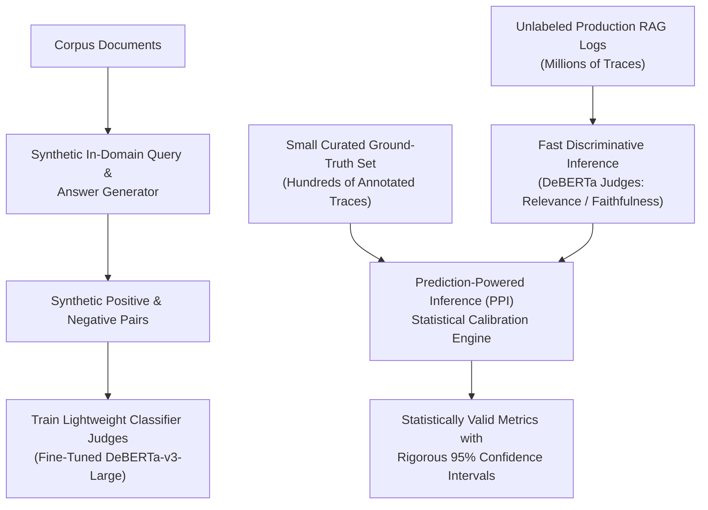
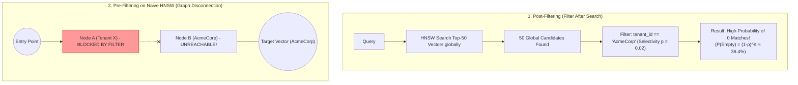
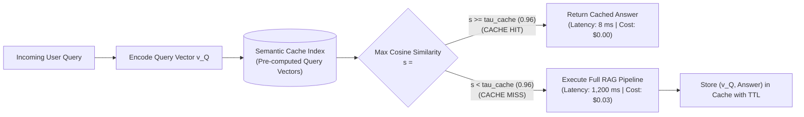

# Phase 7: Evaluation & Production Engineering
## The RAG Triad, LLM-as-a-Judge, Filtered HNSW Geometry, Caching, and Latency Budgets

> **Core Philosophy**: A RAG pipeline in a Jupyter notebook is a demo; a RAG pipeline in production is a distributed system with strict latency budgets, drifting data distributions, and failure modes across both hardware and statistics. You cannot improve what you cannot measure. Production engineering is the discipline of diagnosing whether a failure occurred in the retriever or the generator, preventing graph disconnection under metadata filtering, and maintaining sub-second SLAs.

---

## 1. Evaluation: The RAG Triad, Retrieval Metrics & Frameworks

### Topic 1.1: The RAG Triad Architecture & Core Formulations

#### 1. The Problem
When a user reports: *"The assistant gave an incorrect answer about the backoff retry delay!"*
Where did the system fail?
- Did the **retriever** fail to fetch Document $D_5$ (Retrieval Recall Failure)?
- Did the **retriever** fetch $D_5$, but buried it under 8 irrelevant distractors, causing the LLM to miss it (Context Relevance Failure)?
- Did the **generator** receive $D_5$ containing `sleep_time = (retry_after_ms / 1000.0) + (self.backoff_factor * (2 ** (attempt - 1)))`, but hallucinated that the backoff is linear instead of exponential (Faithfulness Failure)?
- Did the **generator** write an accurate explanation of rate limits, but forgot to answer the user's question about the backoff factor (Answer Relevance Failure)?

Without isolated component metrics, debugging a RAG pipeline is pure guesswork.

```mermaid
flowchart TD
    subgraph RAG_TRIAD ["The RAG Triad: Three Orthogonal Axes of Verification"]
        direction TB
        Q["User Query Q"]
        C["Retrieved Context C"]
        A["Generated Answer A"]
        
        Q ---|1. Context Relevance<br/>(Diagnoses Retriever)| C
        C ---|2. Groundedness / Faithfulness<br/>(Diagnoses Generator Hallucinations)| A
        Q ---|3. Answer Relevance<br/>(Diagnoses Generator Task Alignment)| A
    end
```

#### 2. Intuition
Think of a courtroom trial:
- **Context Relevance**: Did the detective bring relevant evidence to court, or did they dump boxes of irrelevant clutter on the judge's desk?
- **Groundedness (Faithfulness)**: Is the attorney's closing argument strictly supported by the evidence entered into the record, or are they inventing ungrounded claims?
- **Answer Relevance**: Did the attorney address the charges on the indictment, or did they deliver a speech about an unrelated topic?

#### 3. Mechanics & Metric Formulations

##### Metric 1: Context Relevance (Retriever Precision Diagnostic)
Measures the proportion of retrieved information in context $\mathcal{C}$ that is directly necessary to answer query $Q$.
- **Sentence-Level Ratio Formulation (Early Ragas)**:
  Early versions of Ragas parsed context $\mathcal{C}$ into individual sentences $\{s_1, \dots, s_{|\mathcal{C}|}\}$ using an LLM to identify the subset $\mathcal{S}_{\text{relevant}} \subseteq \mathcal{C}$ containing supporting facts:
  $$\text{Context Relevance}_{\text{sentence}} = \frac{|\mathcal{S}_{\text{relevant}}|}{|\mathcal{C}|}$$
- **Chunk-Level Continuous Scoring (TruLens)**:
  Rather than counting raw sentences, the TruLens architecture evaluates context relevance at the chunk level. An LLM judge inspects each retrieved chunk independently alongside query $Q$ and assigns a continuous relevance score from $0.0$ to $1.0$ based on a detailed prompt rubric. The overall score is the mean across all retrieved chunks:
  $$\text{Context Relevance}_{\text{TruLens}} = \frac{1}{K} \sum_{k=1}^K \text{Score}_{\text{LLM}}(Q, c_k)$$
- *Diagnostic Target*: If context relevance is low ($<0.40$), chunk size is excessively large, top-$K$ is too broad, or the reranking stage failed to prune distractors.

##### Metric 2: Groundedness / Faithfulness (Generator Hallucination Diagnostic)
Measures whether every factual claim in generated answer $\mathcal{A}$ can be mathematically deduced from context $\mathcal{C}$.
- **Claim Extraction**: An evaluator model decomposes generated answer $\mathcal{A}$ into atomic factual propositions $\{c_1, c_2, \dots, c_m\}$.
- **Verification**: For each claim $c_i$, the evaluator verifies whether $c_i$ is directly entailed by context $\mathcal{C}$ ($\text{entailed}(c_i, \mathcal{C}) \in \{0, 1\}$).
- **Formula**:
  $$\text{Faithfulness} = \frac{\sum_{i=1}^m \text{entailed}(c_i, \mathcal{C})}{m}$$
- *Diagnostic Target*: If this score is $<1.0$, the generator LLM is hallucinating from its pre-trained parametric weights rather than relying on the provided context.

##### Metric 3: Answer Relevance (Generator Alignment Diagnostic)
Measures whether generated answer $\mathcal{A}$ addresses the actual user query $Q$, regardless of whether the retrieved context was correct.
- **Reverse Query Generation**: An evaluator model inspects answer $\mathcal{A}$ and generates $n$ potential questions $\{\tilde{q}_1, \dots, \tilde{q}_n\}$ that $\mathcal{A}$ would successfully answer.
- **Embedding Alignment**: Compute the mean cosine similarity between true query $Q$ and generated questions $\tilde{q}_i$:
  $$\text{Answer Relevance} = \frac{1}{n} \sum_{i=1}^n \cos\big(\mathbf{v}_Q, \, \mathbf{v}_{\tilde{q}_i}\big)$$

##### Metric 4: Ragas Context Precision (Rank-Aware Retrieval Diagnostic)
Measures whether the retriever prioritized relevant chunks at the top of the retrieved ranking. For a single query, it is formulated as Average Precision at $K$ ($\text{AP}@K$) over binary relevance indicators (with Mean Average Precision, or $\text{MAP}@K$, representing the mean across an entire evaluation test set of queries):

$$\text{AP}@K = \frac{1}{\text{total relevant chunks}} \sum_{k=1}^K P@k \cdot r_k$$

Where:
- $r_k \in \{0, 1\}$ indicates whether the chunk at rank $k$ is relevant.
- $P@k = \frac{\sum_{j=1}^k r_j}{k}$ is precision at rank $k$.

*Worked Hand Calculation*:
Suppose $K = 3$ chunks are retrieved: $[c_1, c_2, c_3]$. The reference answer requires facts located in $c_1$ and $c_3$, meaning binary relevance is $[r_1=1, r_2=0, r_3=1]$ with total relevant $= 2$:
- Rank 1 ($c_1$): Relevant ($r_1=1$). $P@1 = 1/1 = 1.0$.
- Rank 2 ($c_2$): Irrelevant ($r_2=0$). $P@2 = 1/2 = 0.5$. Contributes $0.5 \times 0 = 0$.
- Rank 3 ($c_3$): Relevant ($r_3=1$). $P@3 = 2/3 \approx 0.667$.
$$\text{AP}@3 = \frac{1.0 \times 1 + 0.5 \times 0 + (2/3) \times 1}{2} = \frac{1.0 + 0.6667}{2} = \frac{1.6667}{2} \approx \mathbf{0.833} \quad (83.3\%)$$
If $c_3$ were ranked at position 2 instead of 3, $\text{AP}@3$ would reach $1.0$, demonstrating how this metric rewards optimal reranking.

##### Metric 5: Ragas Context Recall (Retrieval Completeness Diagnostic)
Measures the proportion of reference ground-truth claims that can be found within the retrieved context:

$$\text{Context Recall} = \frac{|\text{Reference Ground-Truth Claims Supported by Context } \mathcal{C}|}{|\text{All Reference Ground-Truth Claims}|}$$

*Worked Hand Calculation*:
Suppose a reference ground-truth answer contains 4 atomic claims: $G = \{g_1, g_2, g_3, g_4\}$.
The evaluator checks retrieved context $\mathcal{C}$ and finds that $g_1, g_2, g_3$ are entailed by $\mathcal{C}$, but $g_4$ is missing entirely.
$$\text{Context Recall} = \frac{3}{4} = \mathbf{0.75} \quad (75.0\%)$$

---

### Topic 1.2: Worked Examples of Triad & Faithfulness Evaluation

#### 1. Baseline Hand-Calculated Triad on an Illustrative Technical Query
**Illustrative Technical Query**: `"What is the default backoff factor and max retries in OmniFlowClient?"`

**Retrieved Context $\mathcal{C}$ (Document $D_5$, 5 sentences)**:
- $s_1$: `"class OmniFlowClient: ..."`
- $s_2$: `"def __init__(self, api_key: str, base_url: str, backoff_factor: float = 0.5, max_retries: int = 5):"`
- $s_3$: `"self.session = requests.Session()"`
- $s_4$: `"self.session.headers.update(...) "`
- $s_5$: `"def ingest_vectors(self, collection: str, payload: Dict[str, Any]):"`

**Generated Answer $\mathcal{A}$**:
> *"In OmniFlowClient, the default backoff_factor is 0.5 and max_retries is 5. It uses a token bucket with 20,000 RPM."*

1. **Context Relevance**:
   - Total sentences $|\mathcal{C}| = 5$.
   - Relevant sentence: only $s_2$ contains `backoff_factor` and `max_retries`.
   $$\text{Context Relevance} = \frac{1}{5} = \mathbf{0.20} \quad (20\%)$$
2. **Faithfulness**:
   - $c_1$: `"default backoff_factor is 0.5"` $\implies$ Supported by $s_2$ ($1$).
   - $c_2$: `"default max_retries is 5"` $\implies$ Supported by $s_2$ ($1$).
   - $c_3$: `"OmniFlowClient uses a token bucket with 20,000 RPM"` $\implies$ Not supported in context $D_5$ ($0$).
   $$\text{Faithfulness} = \frac{1 + 1 + 0}{3} = \frac{2}{3} \approx \mathbf{0.667} \quad (66.7\%)$$
3. **Answer Relevance**:
   - Reverse-generated question $\tilde{q}_1 = \text{"What are the retry and backoff defaults for OmniFlowClient?"}$.
   - Cosine similarity: $\cos(\mathbf{v}_Q, \mathbf{v}_{\tilde{q}_1}) = \mathbf{0.94}$.

#### 2. Grounded Faithfulness Evaluation on Phase 4 Multi-Hop Answers ($Q_3$)
In Phase 4, we examined two candidate syntheses for Query $Q_3$ (*"How do enterprise quota tier upgrades interact with client retry configuration to resolve ingestion batch failures?"*) given contexts $D_2, D_3, D_5, D_6$. We now evaluate both answers using Ragas Faithfulness:

##### Candidate 1: The Faithful Synthesis (Answer 1 from Phase 4)
Under strict Ragas, the evaluator LLM extracts every declarative factual claim from the generated answer, regardless of whether the prompt or model explicitly tagged it with an author disclaimer like `(inference, outside retrieved context)`. Default Ragas possesses no built-in knowledge of informal bracketed tags; excluding labeled inferences requires configuring a custom preprocessing or extraction filtering policy.

Decomposing the faithful synthesis yields 9 atomic claims:
1. $c_1$: *"Upgrading to Enterprise tier via POST /api/v1/tenant/upgrade?target_tier=Enterprise takes effect within 15 seconds."* $\implies$ Supported by $D_2$ ($\text{entailed} = 1$).
2. $c_2$: *"Enterprise tier expands token-bucket allowance to 20,000 RPM (30,000 burst) and 1 GB/sec payload bandwidth."* $\implies$ Supported by $D_2$ ($\text{entailed} = 1$).
3. $c_3$: *"The tier upgrade reduces 429s for traffic under 20,000 RPM (30,000 burst)."* $\implies$ Supported by $D_2$ ($\text{entailed} = 1$).
4. $c_4$: *"Raw vectors (61.44 GB) plus M=64 Layer-0 edges (5.12 GB) totaled 66.56 GB, exceeding the 64 GB worker memory ceiling in D6."* $\implies$ Supported by $D_6$ ($\text{entailed} = 1$).
5. $c_5$: *"Reducing M to 16 leaves 62.84 GB on a 64 GB worker, which provides insufficient headroom for OS overhead and active buffers."* $\implies$ Supported by $D_6$ ($\text{entailed} = 1$).
6. $c_6$: *"Valid D6 remediations include sharding across workers (e.g., 2 x 5M vectors) and storing compressed vectors in the graph (HNSW+PQ/SQ, DiskANN)."* $\implies$ Supported by $D_6$ ($\text{entailed} = 1$).
7. $c_7$: *"Document D3 states retry codes are (429, 502, 503, 504), but D5 only catches status code 429."* $\implies$ Supported by $D_3$ and $D_5$ ($\text{entailed} = 1$).
8. $c_8$: *"Gateway 5xx errors raise immediate unhandled exceptions in D5."* $\implies$ Supported by $D_5$ (in $D_5$, any status code other than 200 or 429 executes `response.raise_for_status()`) ($\text{entailed} = 1$).
9. $c_9$: *"Higher ingress throughput (20,000 RPM) would actually intensify worker memory pressure and accelerate OOM crashes."* $\implies$ **Unsupported by context!** While deductive and logically plausible, this claim is not stated anywhere in $D_1\text{--}D_6$. Strict Ragas extracts it and marks it ungrounded ($\text{entailed} = 0$).

Under **Strict Ragas**:
$$\text{Faithfulness}_{\text{strict}} = \frac{1 + 1 + 1 + 1 + 1 + 1 + 1 + 1 + 0}{9} = \frac{8}{9} \approx \mathbf{0.889} \quad (88.9\%)$$

*Custom Exclusion Policy (Optional Variant)*:
If the evaluation harness is explicitly augmented with a custom preprocessing regex that strips self-declared inference tags prior to proposition extraction, only the 8 retrieved factual claims remain:
$$\text{Faithfulness}_{\text{custom}} = \frac{8}{8} = \mathbf{1.00} \quad (100\%)$$
This illustrates why production teams must understand their evaluator's exact parsing mechanics: strict evaluators penalize ungrounded inferences even when the LLM conscientiously declares them.

##### Candidate 2: The Unfaithful Synthesis (Answer 2 from Phase 4)
Text: *"Upgrading to Enterprise expands the gateway token bucket to 20,000 RPM within 15 seconds, eliminating the 429 throttle events that trigger the client's exponential backoff loops and prevent the thundering-herd retry storms that crash HNSW workers."*

Decomposing this into 5 atomic claims:
1. $c_1$: *"Upgrading to Enterprise expands the gateway token bucket to 20,000 RPM within 15 seconds."* $\implies$ Supported by $D_2$ ($\text{entailed} = 1$).
2. $c_2$: *"The tier upgrade eliminates 429 throttle events."* $\implies$ **Unsupported!** Document $D_2$ defines a quota ceiling of 20,000 RPM; traffic exceeding this limit still receives 429 status codes ($\text{entailed} = 0$).
3. $c_3$: *"429 throttle events trigger client exponential backoff loops."* $\implies$ Supported by $D_3$ and $D_5$ ($\text{entailed} = 1$).
4. $c_4$: *"The upgrade prevents thundering-herd retry storms."* $\implies$ **Unsupported!** In Document $D_6$, the retry storm originated from ingestion workers slowing down under allocation load and client requests timing out, rather than gateway 429 rate limit emissions ($\text{entailed} = 0$).
5. $c_5$: *"Preventing retry storms prevents the HNSW workers from crashing."* $\implies$ **Contradicted by Context!** Document $D_6$ proves that worker memory was exhausted by raw vectors (61.44 GB) and Layer-0 edges (5.12 GB) exceeding 64 GB RAM before retry storms occurred ($\text{entailed} = 0$).
$$\text{Faithfulness}_{\text{Unfaithful}} = \frac{1 + 0 + 1 + 0 + 0}{5} = \frac{2}{5} = \mathbf{0.40} \quad (40\%)$$
*Diagnosis*: Hallucination caught. The unfaithful answer scores only $0.40$, surfacing that the generator confused correlation with causation and misidentified the true root cause of the crash.

---

### Topic 1.3: Advanced Evaluation Frameworks: ARES & Prediction-Powered Inference

While prompting proprietary LLMs (e.g., GPT-4o) for RAG Triad evaluation is popular, running full generative LLM evaluations across hundreds of thousands of production logs is economically and operationally prohibitive ($> \$0.05$ per evaluation, illustrative, accompanied by high latency and vendor model drift).

The **ARES (Automated RAG Evaluation System)** framework resolves this by establishing a principled, lightweight evaluation pipeline:



1. **Synthetic Query and Answer Generation**: Generates synthetic in-domain queries and answers across corpus passages using foundation models with prompt templates.
2. **Lightweight Fine-Tuned Classifier Judges**: Rather than querying expensive generative models at runtime, ARES fine-tunes compact, open-source discriminative classifiers (such as DeBERTa-v3-large) on positive and negative pairs across Context Relevance, Answer Faithfulness, and Answer Relevance. Classifier inference runs at a fraction of the cost and latency of generative models.
3. **Prediction-Powered Inference (PPI)**: To guarantee statistical validity despite classifier imperfections, ARES pairs model predictions over large unlabeled evaluation sets with a small set of human-annotated ground-truth labels (e.g., 200–300 verified traces). Using Prediction-Powered Inference, ARES computes unbiased performance estimates accompanied by rigorous, provable confidence intervals ($95\%$ CI), adjusting for any systematic model classification bias.

---

### Topic 1.4: Synthetic Test-Set Generation & LLM Judge Biases

#### 1. Synthetic Test-Set Generation
To evaluate RAG pipelines comprehensively before launching to production, engineering teams generate synthetic benchmark datasets using an **evolution-style synthesis** (popularized by Ragas and inspired by Evol-Instruct):
- **Base Query**: Sample a corpus chunk $D_i$ and generate a simple factual query.
- **Multi-Context Evolution**: Combine facts across two distinct chunks ($D_i, D_j$) to generate a multi-hop reasoning question.
- **Reasoning Evolution**: Rewrite a query so answering it requires comparative reasoning or logical deduction rather than direct lexical lookup.
- **Conditioning Evolution**: Inject metadata constraints, operational parameters, or conditional clauses into the query.

#### 2. Critical Production Risks
1. **Distribution Mismatch**: Synthetically generated questions tend to be grammatically pristine, clear, and logically explicit. In contrast, real enterprise user traffic is filled with abbreviations, keywords, incomplete thoughts, misspellings, and ambiguous intents. A pipeline scoring $95\%$ on synthetic test sets often suffers major degradations when exposed to real users.
2. **Generator-Evaluator Collusion**: If the same foundation model family (e.g., GPT-4o) generates both the synthetic evaluation dataset and the evaluation judgments, the judge rewards stylistic quirks, token preferences, and inductive biases native to itself, masking genuine performance issues.

#### 3. LLM-as-a-Judge Cognitive Biases (Zheng et al., 2023 / MT-Bench)
When utilizing LLM judges for RAG evaluation, three systematic biases must be mitigated:
1. **Position Bias**: Judges favor the first passage presented in multi-candidate comparisons.
   - *Mitigation*: Run evaluations twice with swapped candidate orders and average the scores.
2. **Verbosity Bias**: Judges systematically award higher faithfulness and quality scores to long, verbose answers over concise answers.
   - *Mitigation*: Prompt the judge to evaluate atomic sentence claims independently using a strict binary rubric (`[0, 1]`) rather than open-ended 1–5 likert scales.
3. **Self-Enhancement Bias**: An LLM judge gives higher scores to answers generated by its own model family (e.g., GPT-4o evaluating GPT-4o outputs).
   - *Mitigation*: Use cross-model evaluation (e.g., Claude judging Gemini models, or fine-tuned open-source judges like Prometheus-2).

#### 4. Source
Es et al., *RAGAS: Automated Evaluation of Retrieval Augmented Generation*, EACL 2024; TruLens Architecture, TruEra, 2023; Saad-Falcon et al., *ARES: An Automated Evaluation Framework for Retrieval-Augmented Generation Systems*, NAACL 2024; Zheng et al., *Judging LLM-as-a-Judge with MT-Bench and Chatbot Arena*, NeurIPS 2023.

---

## 2. Production Index Engineering: The Filtered HNSW Problem

### Topic 2.1: Pre-Filtering, Post-Filtering, and Graph Disconnection

#### 1. The Problem
Enterprise applications require **Metadata Filtering**:
> *"Retrieve documents discussing rate limits, but ONLY where `tenant_id == 'AcmeCorp'` and `tier == 'Enterprise'`."*

When combined with graph-based vector search (HNSW), naive filtering algorithms fail:
- **Post-Filtering** produces **empty or truncated results**.
- **Pre-Filtering on standard HNSW** causes **graph disconnection**, stranding the search in isolated subgraphs and destroying recall.



#### 2. Intuition
Imagine a national highway network:
- **Post-Filtering**: You fly to the 50 largest cities in the country, and only after landing do you check if any of them are in Vermont. If none are, you conclude Vermont does not exist.
- **Pre-Filtering on HNSW**: You place roadblocks on every road entering any state other than Vermont. But because the national highway network only enters Vermont through New York and Massachusetts, blocking those states leaves Vermont completely cut off from the entry point. The car cannot navigate to Vermont.

#### 3. Mechanics & Mathematical Failure Proof

##### Failure Mode 1: Post-Filtering Vacancy Probability
In Post-Filtering, the vector database executes standard HNSW search to find the Top-$K$ nearest neighbors globally, then discards candidates that do not match the metadata predicate.

Assuming candidate vectors are independently distributed with respect to the metadata filter, let the filter match a fraction $p$ of the total corpus (the **Filter Selectivity**, e.g., $p = 0.02$ for a tenant with $2\%$ of the data).
The probability that all $K$ retrieved vectors belong to *other* tenants (producing an empty result set) is:

$$P(\text{Empty Result}) = (1 - p)^K$$

If $K = 50$ and $p = 0.02$:
$$P(\text{Empty Result}) = (1 - 0.02)^{50} = 0.98^{50} \approx \mathbf{0.364} \quad (36.4\% \text{ chance of returning ZERO results!})$$
If $p = 0.01$ ($1\%$ selectivity) and $K = 50$:
$$P(\text{Empty Result}) = (1 - 0.01)^{50} \approx \mathbf{0.605} \quad (60.5\% \text{ chance of returning ZERO results!})$$
More than half of all queries fail completely, even though millions of valid matching vectors exist in the database.

##### Failure Mode 2: Pre-Filtering and Graph Disconnection
In naive Pre-Filtering, HNSW greedy routing is modified to evaluate only nodes matching the metadata predicate. If an edge connects two matching nodes through an unmatching intermediate node, that edge is barred.
In standard HNSW, Layer 0 has an average outgoing degree of $2M$ (while upper layers maintain degree $M$).
When non-matching nodes are blocked, the expected number of passing neighbors for a node at Layer 0 drops to:

$$M_{\text{filtered}} \approx p \cdot 2M$$

For $M = 16$, Layer 0 has $2M = 32$ outgoing edges. When selectivity $p = 0.02$:
$$M_{\text{filtered}} = 0.02 \times 32 = 0.64 \text{ edges per node}$$
Because $M_{\text{filtered}} < 1.0$, the graph connectivity collapses below the percolation threshold, shattering the index into disconnected components. Greedy routing terminates prematurely at local minima, driving retrieval recall down from $98\%$ to $<20\%$ (illustrative).

#### 4. The Engineering Solutions
Production vector databases deploy four primary architectures to resolve this:

1. **ACORN (Patel et al., 2024)**:
   ACORN modifies graph construction by building an index with $\gamma$-expanded neighbor degrees during offline indexing. At query time, ACORN traverses only predicate-passing nodes while utilizing multi-hop neighbor expansion to leap across non-matching clusters without getting trapped.
2. **Bridge-Node Traversal (Distinct Engine Capability)**:
   In this approach, filtered graph traversal allows non-matching nodes to act as **routing hops / bridges** across the graph to maintain global percolation, while strictly barring non-matching nodes from entering the final top-$K$ candidate result queue (implementations are engine-specific; check vendor docs).
3. **Payload / Inverted Postings Fallback (Exact Scan)**:
   If filter selectivity is extreme ($p < 0.01$, e.g., fewer than 10,000 matching vectors in the entire system), abandon the HNSW graph entirely. Retrieve matching vector IDs directly from an inverted index or relational bitmap and run a hardware-accelerated SIMD Flat Dot-Product scan over those matching vectors in $<2\text{ ms}$ (illustrative).
4. **Physical Tenant Partitioning**:
   For hard enterprise boundaries, never mix tenants in a shared HNSW graph; maintain physically separated index shards per tenant.

#### 5. Source
Patel et al., *ACORN: Performant and Accurate Approximate Nearest Neighbor Search with Predicate Filters*, arXiv:2403.04873, 2024.

---

## 3. Production Optimization: Semantic Caching & Vector Lifecycle

### Topic 3.1: Semantic Caching (GPTCache) & False-Hit Calibration

#### 1. The Problem
In production, user queries exhibit strong temporal clustering: during an outage, hundreds of users submit slight semantic variations of the exact same question:
- User 1: *"Why is OmniFlow returning 429 errors?"*
- User 2: *"What causes HTTP 429 on the gateway?"*
- User 3: *"OmniFlow gateway throttling 429 status code"*

If each request triggers the full RAG pipeline (query rewrite $\to$ hybrid search $\to$ rerank $\to$ LLM generation), the backend suffers severe compute bottlenecks, high API bills, and latency spikes. Traditional exact-string caching achieves almost zero hit rate due to cosmetic phrasing differences.

#### 2. Intuition
Instead of matching the literal string of characters, match the **meaning (vector)** of the question. 
When a query arrives, check if you have already answered a question located within a tiny radius in vector space. If yes, return the cached answer immediately in $<10\text{ ms}$.



#### 3. Mechanics & Threshold Calibration
1. **Cache Storage**: Store previous query vectors $\{\mathbf{q}_1, \dots, \mathbf{q}_N\}$ in a fast in-memory index, mapped to their verified synthesized answers.
2. **Lookup**: When query $\mathbf{q}_{\text{new}}$ arrives, find nearest cached query vector $\mathbf{q}^*$.
3. **Threshold Gate**:
   - If $\cos(\mathbf{q}_{\text{new}}, \mathbf{q}^*) \ge \tau_{\text{cache}}$, return cached answer.
   - Else, execute full RAG pipeline and insert $(\mathbf{q}_{\text{new}}, \mathcal{A})$ into the cache.

##### The False-Hit Disaster (Why $\tau_{\text{cache}} \ge 0.96$ Is a Necessary Heuristic):
Consider these two queries:
- Query $A$: *"How do I upgrade from Developer to Production tier?"*
- Query $B$: *"How do I downgrade from Production to Developer tier?"*

Because they share almost identical vocabulary, their cosine similarity under a bi-encoder is often **$0.91\text{ to }0.93$** (illustrative).
If your cache threshold is set to $\tau = 0.90$, Query $B$ will hit the cache for Query $A$ and return instructions on how to *upgrade*, causing a catastrophic operational error.
- **Rule**: In technical RAG systems, **$\tau_{\text{cache}}$ must be set strictly to $\ge 0.96\text{--}0.98$** (illustrative heuristic), and paired with entity/slot-matching guards.

##### Entity / Slot-Matching Guards (Document $D_2$ Example)
To prevent semantic false hits, production systems pair vector similarity with deterministic entity/slot-matching:
- Query 1: *"What is the payload bandwidth limit for Developer tier?"*
- Query 2: *"What is the payload bandwidth limit for Enterprise tier?"*
Both queries exhibit nearly identical vector embeddings. However, an entity guard extracts the metadata slot:
- Query 1 slot: `tier: Developer` (10 MB/sec payload bandwidth in $D_2$)
- Query 2 slot: `tier: Enterprise` (1 GB/sec payload bandwidth in $D_2$)
Because the extracted slots mismatch (`Developer != Enterprise`), the cache hit is rejected regardless of high cosine similarity, forcing a fresh retrieval pass.

##### Cache Invalidation on Source Document Updates
When source documentation is updated (e.g., Document $D_2$ quota tiers are modified), the cache must not serve stale answers. The ingestion pipeline tracks document lineage: each cached entry records the document IDs and hash versions used during synthesis. When $D_2$ is updated, all cache entries referencing $D_2$ are atomically purged.

---

### Topic 3.2: Embedding Drift & The Vector Index Lifecycle

#### 1. Data Drift vs. Model Drift
In production systems, drift occurs along two distinct vectors:
- **Data Drift**: The statistical distribution of incoming user queries or newly ingested documents changes over time (emerging technical terminology, product rebrands, seasonal query shifts). Mitigated via continuous evaluation, incremental indexing, and semantic cache TTL eviction.
- **Model Drift**: Upgrading the embedding model itself (e.g., from an older model to a newer architecture like `bge-large-en-v1.5` or `text-embedding-3`). 
  **Old vectors and new vectors cannot coexist in the same geometric space.** Even if vector dimensionality happens to match across model variants, the learned orthogonal axes and cluster topologies are mutually incompatible. Computing dot products between vectors from two different models produces mathematical noise.

#### 2. The Blue/Green Shadow Indexing Lifecycle
Updating an embedding model or rebuilding an index across tens of millions of documents cannot be performed in-place without taking search offline. Production systems enforce **Blue/Green Index Rotation**:

```mermaid
flowchart TD
    subgraph BLUE ["Active Blue Cluster (Serving Live Traffic)"]
        ROUTER{"API Gateway"} -->|Live Traffic (100%)| BLUE_INDEX[("Blue Vector Index<br/>(Model: v1.0 | HNSW)")]
    end

    subgraph GREEN ["Shadow Green Cluster (Re-indexing Offline)"]
        DATA_STREAM["Document Updates"] --> SHADOW_WORKER["Background Ingestion Workers<br/>(Model: v2.0)"]
        SHADOW_WORKER --> GREEN_INDEX[("Green Vector Index<br/>(Model: v2.0 | IVF-PQ / HNSW)")]
    end
    
    GREEN_INDEX -. Backfill Complete & Recall Verified .-> CUTOVER{"Atomic Route Switch<br/>Cut traffic to Green<br/>Decommission Blue"}
```

1. **Blue Index Active**: All production queries route to the Blue Index running embedding model $v_1$.
2. **Green Index Build**: A parallel offline pipeline embeds the entire corpus using model $v_2$, constructing the new vector index in shadow storage.
3. **Dual Ingestion**: Real-time document updates write to both Blue and Green indexes simultaneously.
4. **Verification**: Run the automated evaluation benchmark (Ragas / ARES) against the Green Index. Verify that Recall@10 on Green is equal to or greater than Blue.
5. **Atomic Cutover**: Reconfigure the API gateway pointer to route live traffic to Green. Blue is preserved as an instant rollback target before decommissioning.

#### 3. Source
Bang et al., *GPTCache: An Open-Source Semantic Cache for LLM Applications*, Zilliz, 2023.

---

## 4. Production Latency Budgeting

In production enterprise SLAs, end-to-end RAG response latency must typically remain under **1,500 ms (p95)**, with Time-to-First-Token (TTFT) under **800 ms** (illustrative). 

Here is the millisecond budget allocation across each pipeline stage:

| Pipeline Stage | Operation / Technology | Latency p50 (illustrative) | Latency p95 (illustrative) | Primary Latency Driver | Optimization Levers |
| :--- | :--- | :--- | :--- | :--- | :--- |
| **1. Gateway & Auth** | JWT verification, Rate limiting | $2\text{ ms}$ | $5\text{ ms}$ | Redis round-trip | In-memory token bucket |
| **2. Query Embedding** | Bi-encoder inference (`bge-large`) | $12\text{ ms}$ | $25\text{ ms}$ | GPU batch queuing | ONNX Runtime / TensorRT optimization |
| **3. Semantic Cache** | Vector lookup ($\tau \ge 0.96$) | $5\text{ ms}$ | $12\text{ ms}$ | Cache size & vector distance | SIMD Flat Dot-Product |
| **4. Query Rewrite** | Small LLM (Flash / Mini class) | $180\text{ ms}$ | $350\text{ ms}$ | LLM TTFT | Speculative decoding; skip for keyword queries |
| **5. Hybrid Retrieval** | BM25 + HNSW ANN ($K=100$) | $8\text{ ms}$ | $18\text{ ms}$ | Disk I/O & $efSearch$ | RAM-resident HNSW; parallel execution |
| **6. Rank Fusion (RRF)** | Reciprocal Rank Fusion | $1\text{ ms}$ | $2\text{ ms}$ | CPU bound | Pure Python dict accumulator |
| **7. Cross Reranker** | Cross-Encoder (`bge-reranker`) | $45\text{ ms}$ | $110\text{ ms}$ | $K \times (L_Q+L_D)^2$ FLOPs | Cap $K \le 50$; batch inference on GPU |
| **8. Refinement & Reorder** | LongLLMLingua + Edge-Packing | $15\text{ ms}$ | $40\text{ ms}$ | PPL scoring model | Edge-packing is 0ms; prune only large docs |
| **9. Generator TTFT** | Frontier LLM (Time to First Token) | $350\text{ ms}$ | $750\text{ ms}$ | LLM inference cluster load | Prompt caching; streaming responses |
| **Sum of stage latencies (not pipeline percentiles)** | Stage-by-stage arithmetic sum | $\mathbf{\approx 618\text{ ms}}$ | $\mathbf{\approx 1,312\text{ ms}}$ | Pessimistic stage sum | Measure pipeline directly in telemetry |

> [!IMPORTANT]
> **Percentile Non-Additivity in Production Pipelines**:
> In distributed systems, percentiles are **not additive**: summing stage p95s ($\sum \text{p95}$) is usually a pessimistic estimate but not a guaranteed bound (quantiles are not subadditive in the general case); likewise, the sum of stage p50s is not the pipeline p50. Production teams must measure end-to-end pipeline latencies directly in telemetry. Furthermore, a semantic cache hit skips query rewrite, retrieval, reranking, context refinement, and generation (stages 4 through 9 entirely), returning an answer in under $\approx 19\text{ ms}$ (p50) or $\approx 42\text{ ms}$ (p95) (illustrative).

---

## 5. Comparison of Production Engineering Strategies

| Strategy | Operational Cost | Latency Impact | Reliability Benefit | Primary Risk |
| :--- | :--- | :--- | :--- | :--- |
| **RAG Triad & ARES Evaluation** | Moderate (Evaluator LLM API calls) | Offline / Asynchronous | Isolates retrieval vs generation bugs | Evaluator model biases (position/verbosity) |
| **ACORN / Single-Stage Filtered HNSW** | Low | Low ($+2\text{--}5\text{ ms}$, illustrative) | Prevents empty results on multi-tenant queries | Increased index complexity |
| **Semantic Caching** | Very Low (In-memory index) | Massive Speedup (Saves $1,000\text{ ms}$) | Reduces upstream LLM token costs by $30\%\text{--}60\%$ (illustrative heuristic) | False-hit returns if $\tau_{\text{cache}} < 0.96$ |
| **Blue/Green Index Rotation** | High ($2\times$ storage during builds) | Zero live downtime | Zero-downtime embedding model migrations | Storage cost during massive backfills |

---

## 6. How This Connects to the Next Phase

You now understand the complete RAG engineering lifecycle:
- Ingestion and chunking geometry (Phase 1)
- Vector indexing and retrieval primitives (Phase 2)
- Hybrid search and precision reranking (Phase 3)
- Query understanding and multi-hop transformations (Phase 4)
- Context refinement and attention optimization (Phase 5)
- Dynamic, agentic, and graph architectures (Phase 6)
- Rigorous evaluation, filtering, caching, and production latency budgeting (Phase 7)

In the final master file, **`99-interview-cheatsheet.md`**, we synthesize this entire body of knowledge into:
1. **30-Second Elevator Pitch Explanations** for every major architectural choice.
2. **Top 5 Trick Questions & Counter-Intuitive Truths** per phase.
3. The **Master Production Decision Tree** to ace Senior/Staff ML Engineer interviews.

---

## 7. Phase 7 Interview Questions & Answers

#### Q1: If an end-to-end evaluation reveals that Faithfulness is 0.98 but Answer Relevance is 0.42, what specific defect exists in the RAG pipeline?
> **Answer**: High Faithfulness ($0.98$) combined with low Answer Relevance ($0.42$) indicates that the **generator LLM is strictly truthful to the context, but is failing to answer the user's actual question**. This typically occurs when:
> 1. The **retriever** returned passages that do not contain the answer, and the model faithfully (and unhelpfully) synthesized what was there or stated "I don't know".
> 2. The prompt instructions are overly defensive, causing the model to output evasive disclaimers.
> 3. The query transformation step drifted the query away from the user's original intent. The fix is to debug Stage 1 retrieval recall and inspect the system prompt's instruction constraints.

#### Q2: Why does boolean pre-filtering on a standard HNSW index cause severe retrieval recall collapse, and how does Single-Stage Filtered Search (ACORN) prevent it?
> **Answer**: Standard HNSW relies on small-world graph connectivity across all nodes. When pre-filtering restricts traversal strictly to nodes satisfying a selective metadata predicate (e.g., matching $2\%$ of data), valid nodes are separated by blocked nodes. This shatters the graph into disconnected subgraphs whose average node degree drops below the percolation threshold ($M_{\text{filtered}} < 1$). Greedy routing becomes stranded at local minima, collapsing recall. Single-Stage Filtered Search (ACORN) solves this by utilizing an expanded neighbor degree graph built offline and performing multi-hop neighbor expansion at query time across predicate-passing nodes, while other modern vector engines allow non-matching nodes to act as routing bridges without entering the final result set.

#### Q3: In semantic caching (e.g., GPTCache), why is a cosine similarity threshold of $\tau = 0.90$ considered dangerous in production enterprise RAG systems?
> **Answer**: In natural language, semantically opposite queries frequently share almost identical vocabulary and syntax (e.g., *"How do I upgrade from Developer to Production?"* versus *"How do I downgrade from Production to Developer?"*). Because bi-encoders produce smooth latent spaces, these queries often have cosine similarities between $0.90$ and $0.93$ (illustrative). Setting $\tau = 0.90$ triggers a **false cache hit**, returning an upgrade procedure to a user trying to downgrade. In enterprise technical systems, semantic cache thresholds must be strictly tuned to $\ge 0.96\text{--}0.98$ (illustrative heuristic), and paired with deterministic entity and slot-matching guards.

#### Q4: Why can't you migrate an existing vector database to a newly released embedding model by simply re-embedding incoming queries with the new model?
> **Answer**: Embedding spaces from different models (or even different versions of the same model) are geometrically incompatible. Each model projects text into an idiosyncratic high-dimensional coordinate system with unique orthogonal axes and cluster topologies. Calculating the dot product or cosine distance between a vector produced by Model A and a vector produced by Model B yields meaningless mathematical noise. A migration requires **Blue/Green re-indexing**: re-embedding the entire historical document corpus with the new model into a separate index before switching query traffic over.

#### Q5: How do you mathematically guarantee that post-filtering will not return an empty result set when querying a specific tenant's data in a shared vector index?
> **Answer**: You cannot guarantee it under pure post-filtering without making $K$ approach the entire database size. The probability of an empty result set under post-filtering is:
> $$P(\text{Empty}) = (1 - p)^K$$
> (assuming independence), where $p$ is the tenant's data proportion and $K$ is the number of retrieved vectors. If a tenant represents $1\%$ of the data ($p = 0.01$) and $K = 50$, there is a $(1 - 0.01)^{50} \approx 60.5\%$ probability of returning zero results. To guarantee non-empty results, you must use **single-stage filtered ANN (e.g., ACORN or bridge-node routing)**, **inverted postings exact scans**, or **physically isolated index namespaces** per tenant.
