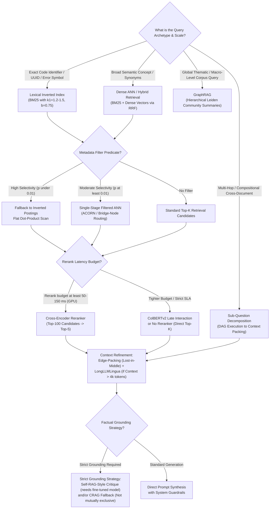

# Master Interview Cheatsheet: Retrieval-Augmented Generation (RAG)
## 30-Second Elevator Pitches, Top 5 Trick Questions per Phase, and Master Decision Trees

> **Target Audience**: Senior / Staff ML Engineers, Research Scientists, and Applied AI Architects preparing for system design and advanced ML technical interviews.
>
> **Core Tenet**: In an interview, reciting definitions signals junior ability; explaining *what breaks without a technique*, *the exact mathematical failure modes*, and *the production engineering trade-offs* signals staff-level maturity.

---

## 1. 30-Second Architectural "Elevator Pitches" (Phases 01–07)

When an interviewer asks: *"Explain [Concept] and why we use it"* — deliver these battle-tested, high-signal explanations:

### Phase 1: Ingestion & Chunking Geometry
- **Late Chunking**:
  > *"Standard chunking splits text prior to encoding, preventing tokens from attending to context across chunk boundaries and breaking pronoun resolution. Late Chunking feeds the full document into a long-context transformer first. Global bidirectional self-attention conditions all token representations across the entire document. We then mean-pool token representations over designated chunk boundaries, embedding global document context into localized chunk vectors with zero additional query-time latency."*
- **Hierarchical AST Code Chunking**:
  > *"Naive token splitters fracture code across arbitrary character boundaries, cleaving class methods from docstrings and splitting control blocks. Abstract Syntax Tree (AST) chunking parses source code into its true grammar tree, preserving syntactic integrity, function scopes, and class definitions as unified semantic nodes."*

### Phase 2: Retrieval Primitives & Indexing
- **BM25 Term Frequency Saturation & Length Normalization**:
  > *"Raw TF-IDF scales linearly with term frequency, making it vulnerable to repetitive keyword stuffing. BM25 introduces an asymptotic saturation parameter ($k_1 \approx 1.2\text{--}1.5$) that caps the contribution of repeated terms, while parameter $b \approx 0.75$ penalizes verbose documents to prevent long files from dominating short, precise passages."*
- **HNSW Graph Small-World Routing**:
  > *"Exhaustive kNN search scales as $O(N \cdot d)$, which is computationally intractable for millions of vectors. HNSW constructs a hierarchical multi-layer geometric graph: upper layers have long-range skip edges for logarithmic greedy routing, while the dense base layer (Layer 0) performs fine-grained local neighbor searches, achieving $O(\log N)$ search latency with high recall."*
- **Inverted File with Product Quantization (IVF-PQ)**:
  > *"When raw float32 vectors exceed RAM capacity, IVF-PQ solves memory limits through two stages: IVF clusters the vector space into Voronoi cells to prune non-relevant partitions, and Product Quantization breaks each high-dimensional vector into $M$ sub-vectors, quantizing each to a 1-byte centroid index. This compresses memory footprint by tens of times (≈58× in the 10M example from Phase 2) and enables fast Asymmetric Distance Computation via pre-computed lookup tables."*

### Phase 3: Hybrid Search & Precision Reranking
- **Reciprocal Rank Fusion (RRF)**:
  > *"Score-based fusion (such as min-max normalization) fails across disparate retrievers because BM25 and dense cosine distributions are non-stationary and query-dependent; a single outlier score can cause catastrophic ranking inversions. RRF operates purely on ordinal rank positions: $\text{RRF}(d) = \sum \frac{1}{k + r(d)}$. The smoothing constant $k \approx 60$ dampens single-engine outliers and rewards cross-retriever consensus."*
- **Bi-Encoder vs. Cross-Encoder (Two-Stage Retrieval)**:
  > *"A bi-encoder embeds queries and documents into isolated single vectors, enabling sub-20ms ANN search over massive corpora, but it loses cross-token interactions. A cross-encoder performs quadratic all-to-all attention across concatenated query-document tokens, capturing deep semantic nuances but incurring $O(K \cdot L^2)$ computational complexity. We combine them in a two-stage pipeline: bi-encoders retrieve 100 high-recall candidates, and a cross-encoder reranks them down to the top 5."*
- **ColBERT (Token-Level Late Interaction)**:
  > *"ColBERT sits on the Pareto frontier between bi-encoders and cross-encoders. Instead of collapsing an entire document into a single vector, it retains independent contextualized vectors for every token. At query time, it computes token-level MaxSim: each query token finds its single highest dot-product match across document tokens, and these maxima are summed. This approaches cross-encoder precision at vector database search speeds."*

### Phase 4: Query Transformations & Decomposition
- **Hypothetical Document Embeddings (HyDE)**:
  > *"Queries and documents occupy distinct semantic subspaces: queries are brief and tentative, while documents are detailed and authoritative. HyDE uses an instruction-tuned LLM to generate a hypothetical answer to the query, and embeds that hypothetical text using the passage encoder. This converts query-to-document search into document-to-document matching, though it must be guarded against hallucination on unseen proprietary entities."*
- **Sub-Question Decomposition**:
  > *"Single-shot retrieval fails on compositional multi-hop queries because no single chunk contains all required answers. Sub-question decomposition breaks a complex query into atomic, focused sub-queries that execute across the retrieval engine independently, aggregating their respective contexts for unified multi-hop synthesis."*

### Phase 5: Context Refinement & Attention Optimization
- **"Lost in the Middle" & Edge-Packing**:
  > *"While hypothesized to stem from Rotary Positional Embeddings (RoPE) and causal attention dynamics that favor prompt edges, empirical studies observe that attention drops in the interior of long context windows, though the effect is reportedly weaker in newer frontier models. Edge-Packing mitigates potential degradation by ordering candidate documents so that highest-ranked chunks alternate between the head and tail, deliberately placing lower-ranked chunks into the center attention valley. Because reordering is computationally cheap (0ms array re-indexing), it is easy to apply but should be empirically A/B tested on target models."*
- **LongLLMLingua Token Pruning**:
  > *"Extractive sentence summarization retains redundant connective words within sentences. LongLLMLingua prunes prompts at the token level using Query-Conditioned Conditional Mutual Information: tokens whose perplexity does not improve when conditioned on the query are removed, stripping prompt bloat while preserving numbers, identifiers, and critical entities."*

### Phase 6: Advanced & Agentic Architectures
- **Self-RAG (Closed-Loop Reflection)**:
  > *"Standard RAG is open-loop: it retrieves blindly and generates without verification. Self-RAG trains a language model to emit special reflection tokens: `[Retrieve]` to decide adaptively if external knowledge is required, `[IsRel]` to evaluate passage relevance, `[IsSup]` to penalize unsupported statements during segment-level beam search, and `[IsUse]` to rate overall utility. This enforces factual grounding natively during decoding."*
- **Corrective RAG (CRAG)**:
  > *"When an indexed corpus lacks documentation for a query, standard RAG retrieves low-similarity distractors and hallucinates. CRAG evaluates retrieval confidence using a fine-tuned evaluator model. If confidence falls below a rejection threshold, CRAG discards the internal context, rewrites the query, and triggers an external web search fallback, protecting the system from distractor-induced hallucinations."*
- **GraphRAG (Hierarchical Leiden Community Summaries)**:
  > *"Vector similarity search excels at local needle-in-a-haystack lookups but fails on global, corpus-wide thematic queries. GraphRAG extracts entities and relationships into a knowledge graph, clusters them into hierarchical communities using the Leiden algorithm, and pre-generates executive summaries for each community. Global queries are resolved via Map-Reduce directly over these community summaries."*

### Phase 7: Evaluation & Production Engineering
- **The RAG Triad & ARES Framework**:
  > *"Production quality requires component-level isolation across Context Relevance (retriever diagnostic), Groundedness/Faithfulness (generator hallucination diagnostic), and Answer Relevance (task alignment diagnostic). Frameworks like ARES accelerate this by combining synthetic in-domain test data, lightweight fine-tuned classifier judges, and Prediction-Powered Inference (PPI) to deliver statistically valid metrics with provable 95% confidence intervals at low inference cost."*
- **Filtered HNSW (ACORN & Bridge-Node Routing)**:
  > *"Naive pre-filtering on an HNSW graph shatters graph connectivity when metadata predicates are selective, trapping search in local minima. Production engines resolve this using single-stage filtered search algorithms like ACORN, which builds an offline graph with $\gamma$-expanded neighbor lists and traverses predicate-passing nodes only at query time, or via separate engine-specific bridge-node traversal techniques that navigate through non-matching nodes as routing hops without returning them in the final candidate queue."*
- **Semantic Caching & Blue/Green Re-Indexing**:
  > *"Exact string caching fails on natural language variability. Semantic caching stores past query vectors and returns cached answers when cosine similarity exceeds a tight heuristic threshold ($\tau \ge 0.96$), paired with entity slot guards. When updating embedding models, old and new vector spaces are geometrically incompatible, requiring offline Blue/Green shadow index rotation to achieve zero-downtime cutover."*

---

## 2. The Master RAG Decision Tree

---

## 3. Top 5 Trick Questions & Counter-Intuitive Truths per Phase

### Phase 1: Ingestion & Document Processing

#### Q1.1: Why does a 50% chunk overlap ratio not merely increase index size by 50%, but effectively double it?
> **Answer**: Chunk overlap creates compounding token duplication. The redundancy ratio is given by:
> $$\rho = \frac{S}{S - O}$$
> For chunk size $S = 512$ and overlap $O = 256$, $\rho = \frac{512}{256} = 2.0$. The total number of indexed tokens across all chunks is $\approx 2\times$ the original document token count. This doubles embedding compute costs, doubles vector database storage requirements, and floods the retrieval pool with redundant near-duplicate chunks. Overlap should generally be capped at $10\%\text{--}15\%$.

#### Q1.2: Why does Late Chunking exhibit quadratic computational scaling during ingestion compared to standard chunking?
> **Answer**: Standard chunking splits text prior to encoding, feeding independent chunks of length $S \approx 512$ into a transformer, which incurs an attention complexity of $C \times O(S^2)$. Late Chunking feeds the entire document of length $N$ (e.g., $N = 8192$) through a long-context transformer before boundary pooling. Because transformer self-attention scales quadratically with sequence length ($O(N^2)$), encoding an 8192-token document in a single forward pass requires significantly more GPU memory and FLOPs during ingestion than encoding 16 separate 512-token chunks.

#### Q1.3: How does semantic chunking via embedding distance thresholding fail on highly technical or tabular documents?
> **Answer**: Semantic chunking calculates the cosine distance between consecutive sentence embeddings and splits when distance exceeds a threshold ($\tau = \mu_d + k \sigma_d$). In technical documentation containing code blocks, configuration parameters, or tables, sentence embeddings fluctuate wildly because syntax changes drastically across consecutive lines. This causes semantic chunkers to over-fragment technical passages into tiny 1-line fragments, destroying conversational continuity and separating table headers from data rows.

#### Q1.4: Why does naive character or token chunking break retrieval on code files, and how does AST parsing resolve it?
> **Answer**: Naive chunking slices text based on arbitrary character or token counts, frequently cutting through the middle of a function, separating a function declaration from its docstring, or leaving orphan closing braces. AST (Abstract Syntax Tree) splitters parse source code into a syntactic tree, ensuring that chunks correspond to valid functional blocks (e.g., full class declarations, complete functions, or decorators) with their parent scope metadata preserved in chunk headers.

#### Q1.5: Why does increasing chunk size from 256 tokens to 2048 tokens often degrade dense retrieval recall on specific factual questions?
> **Answer**: Dense bi-encoders condense token outputs via pooling (mean for E5/SBERT, CLS for BGE) to produce a single fixed-dimensional vector ($d = 768$ or $1024$). When a passage grows from 256 to 2048 tokens, specific factual assertions and rare alphanumeric tokens occupy a progressively smaller fraction of the token sequence. Pooling dilutes their representation across thousands of unrelated words, reducing the cosine similarity between the chunk vector and a specific factual query.

---

### Phase 2: Retrieval Primitives (BM25, Dense & Index Geometry)

#### Q2.1: In HNSW vector indexes, what parameter drives memory consumption, and why is it not `efConstruction`?
> **Answer**: In HNSW, persistent memory consumption is driven almost entirely by the graph edge degree $M$ and vector dimensionality $d$, **not by `efConstruction`**:
> - $efConstruction$ controls the size of the dynamic candidate priority queue evaluated *during index build time*. It dictates build-time CPU utilization and construction duration, but the candidate queue is deallocated once construction completes.
> - In persistent storage, Layer 0 stores up to $2M$ outgoing neighbor pointers per vector node (using 4-byte uint32 identifiers), while upper layers store up to $M$ pointers. For $M = 64$ and 10 million vectors, Layer-0 edges consume $10\text{M} \times 128 \times 4\text{ B} = 5.12\text{ GB}$ of RAM, which remains permanently allocated alongside the raw vectors ($61.44\text{ GB}$). Setting $M=16$ drops Layer-0 edge RAM to $1.28\text{ GB}$, proving that $M$ dictates graph memory footprint.

#### Q2.2: Why are Dot Product, Cosine Similarity, and Squared Euclidean Distance ranking-equivalent for unit-normalized vectors, and why do production engines prefer Dot Product?
> **Answer**: If vectors are normalized to unit $L_2$ norm ($\|\mathbf{u}\|_2 = \|\mathbf{v}\|_2 = 1$), their relationships are strictly monotonic:
> $$\|\mathbf{u} - \mathbf{v}\|_2^2 = \|\mathbf{u}\|_2^2 + \|\mathbf{v}\|_2^2 - 2 \langle \mathbf{u}, \mathbf{v} \rangle = 2 - 2 \cos(\mathbf{u}, \mathbf{v})$$
> Maximizing cosine similarity is mathematically identical to maximizing dot product and minimizing Euclidean distance. Production vector engines normalize vectors once during ingestion and compute **Dot Product** at query time because modern CPUs and GPUs execute Dot Products using hardware-accelerated Fused Multiply-Add (FMA) instructions, avoiding the square-root and division operations required for on-the-fly cosine normalization.

#### Q2.3: Why does BM25 outperform raw TF-IDF on keyword matching, and what specific role does parameter $k_1$ play?
> **Answer**: In classical TF-IDF, term weight grows linearly with term frequency: a document containing a keyword 20 times receives 20 times the weight of a document containing it once, leaving it vulnerable to keyword stuffing. BM25 introduces term frequency saturation governed by parameter $k_1 \approx 1.2\text{--}1.5$:
> $$\lim_{\text{tf} \to \infty} \frac{\text{tf} \cdot (k_1 + 1)}{\text{tf} + k_1 \cdot \dots} = k_1 + 1$$
> Term frequency contribution is asymptotically bounded. Once a term appears 3–5 times, additional occurrences yield diminishing marginal score increases.

#### Q2.4: In Product Quantization (PQ), what is the difference between Asymmetric Distance Computation (ADC) and Symmetric Distance Computation (SDC)?
> **Answer**: 
> - In **SDC**, both the query vector and the database vectors are quantized to centroid codes. Distance is calculated between centroids via pre-computed centroid-to-centroid distance tables. This incurs double quantization distortion: $\tilde{d}(\mathbf{q}, \mathbf{x}) \approx \|\hat{\mathbf{q}} - \hat{\mathbf{x}}\|$.
> - In **ADC**, the query vector $\mathbf{q}$ is **kept unquantized** in full precision float32. The database vectors $\mathbf{x}$ are quantized to centroid indices. The system computes distance between unquantized query sub-vectors and candidate codebook centroids: $\tilde{d}(\mathbf{q}, \mathbf{x}) = \|\mathbf{q} - \hat{\mathbf{x}}\|$.
> ADC eliminates query quantization error, achieving significantly higher retrieval recall than SDC with zero additional memory overhead.

#### Q2.5: Why do dense bi-encoders fail on identifier-heavy queries like `"retry_after_ms max_backoff_seconds OmniFlowClient"`?
> **Answer**: Two complementary failure modes occur:
> 1. **Subword Fragmentation**: Rare code identifiers and configuration parameters do not exist in the tokenizer's vocabulary. They are fragmented into multiple subword tokens (e.g., `retry`, `_after`, `_ms`; `Omni`, `Flow`, `Client`).
> 2. **Information Bottleneck & Pooling Dilution**: A bi-encoder must condense the entire token sequence into a single 768- or 1536-dimensional vector. The specific signal from fragmented identifier tokens is diluted across the smooth latent dimensions of more frequent words. Lexical inverted indexes (BM25) preserve exact token identities, retrieving the exact identifier match without dilution.

---

### Phase 3: Hybrid Search & Precision Reranking

#### Q3.1: Why can't Reciprocal Rank Fusion (RRF) serve as your final ranking stage in production without a cross-encoder?
> **Answer**: RRF relies entirely on ordinal ranks and discards raw score distributions:
> $$\text{RRF}(d) = \sum_{m} \frac{1}{k + r_m(d)}$$
> With the standard smoothing constant $k = 60$, the score differential between consecutive ranks is extremely small: Rank 1 receives $\frac{1}{61} \approx 0.01639$, while Rank 2 receives $\frac{1}{62} \approx 0.01613$—a margin of under $1.6\%$. Because the curve is flat, small perturbations or rank noise across retrievers cause near-ties among the top candidates. RRF is designed to assemble a robust, high-recall consensus candidate pool (e.g., Top-50 or Top-100); a **Cross-Encoder reranker** must follow to evaluate deep, token-level cross-attention and separate near-tied candidates with high semantic precision.

#### Q3.2: Why does score-based min-max normalization fail when merging BM25 and dense retrieval scores?
> **Answer**: Min-max normalization ($S_{\text{norm}} = \frac{S - S_{\min}}{S_{\max} - S_{\min}}$) assumes stable, comparable score distributions. In practice:
> 1. BM25 scores are unbounded $[0, \infty)$ and the BM25 score scale is query-dependent (term count, IDF), varying heavily with query length and keyword rarity. A single document with an extreme score of $35.0$ due to repeated keywords compresses all other valid documents into a narrow range near zero.
> 2. Dense cosine scores are bounded $[-1, 1]$ and typically cluster tightly in a narrow band (e.g., $0.65\text{--}0.85$).
> Merging these normalized scores creates catastrophic ranking inversions driven by single-engine outliers. RRF bypasses score calibration entirely by operating on ordinal ranks.

#### Q3.3: Walk through the ColBERT MaxSim operator. Why is it computationally feasible at vector database speeds?
> **Answer**: Cross-encoders concatenate query $Q$ and document $D$, computing all-to-all quadratic attention across 12–24 transformer layers ($O((L_Q + L_D)^2)$), which cannot be pre-computed offline.
> ColBERT pre-encodes document tokens independently into low-dimensional contextualized vectors ($d = 128$) and indexes them offline. At query time, the query is encoded into token vectors $\mathbf{E}_Q$. The relevance score is computed via the **MaxSim** operator:
> $$\text{Score}(Q, D) = \sum_{i \in Q} \max_{j \in D} \left( \mathbf{E}_{q, i} \cdot \mathbf{E}_{d, j}^T \right)$$
> For each query token, the system finds its single maximum dot-product match across document tokens, and sums these maxima. Because this reduces to simple dot products over pre-computed vectors, it executes via SIMD matrix instructions in milliseconds without running transformer layers at retrieval time.

#### Q3.4: Why does setting the RRF parameter to $k = 0$ break cross-retriever consensus?
> **Answer**: If $k = 0$, RRF degenerates to pure reciprocal rank ($1 / r$). Rank 1 receives $1.0$, Rank 2 receives $0.5$, and Rank 3 receives $0.333$. Consider:
> - Document $A$ ranks #1 in BM25 but is absent from dense retrieval: $\text{Score} = 1.0 + 0 = 1.0$.
> - Document $B$ ranks #2 in BM25 and #2 in dense retrieval: $\text{Score} = 0.5 + 0.5 = 1.0$.
> A document that achieved strong consensus across both retrieval systems ties with a document that appeared in only one retriever due to a single keyword match. Setting $k = 60$ smooths the distribution ($\frac{1}{61} \approx 0.0164$ vs $\frac{1}{62} \approx 0.0161$), allowing consensus across retrievers to decisively overcome single-engine outliers.

#### Q3.5: In ColBERT query encoding, why are queries padded with `[MASK]` tokens?
> **Answer**: In ColBERT, query sequences are prepended with a special `[Q]` marker and padded with `[MASK]` tokens up to a fixed length (e.g., 32 tokens). During transformer encoding, bidirectional self-attention allows these `[MASK]` tokens to attend to the query terms and contextualize their representations. This performs **latent query expansion**: the mask tokens emerge as contextualized vectors representing related semantic concepts, synonyms, and soft constraints, which participate directly in the downstream MaxSim calculation.

---

### Phase 4: Query Transformations & Decomposition

#### Q4.1: What is Catastrophic Semantic Drift in HyDE, and when does it occur?
> **Answer**: HyDE generates a hypothetical document using an instruction-tuned LLM and embeds that hypothetical text using a passage encoder. Catastrophic Semantic Drift occurs when the query involves **unseen internal APIs, proprietary domain entities, or novel configuration flags** not present in the LLM's pre-training data. When prompted, the LLM hallucinates details based on common public libraries. Embedding this hallucinated text projects the query vector into the wrong semantic cluster, actively retrieving irrelevant distractors. HyDE must be restricted to general conceptual queries and bypassed when exact identifiers are detected.

#### Q4.2: Why does Map-Reduce context aggregation fail on multi-hop reasoning queries compared to Context Stuffing?
> **Answer**: In a multi-hop query, required premises are distributed across distinct documents: Document $A$ provides a precondition, and Document $B$ provides the consequence. In a Map-Reduce architecture, the Map phase evaluates each retrieved document in isolation. A Map worker reading Document $A$ discards it as incomplete or irrelevant because it cannot see Document $B$. Context Stuffing (concatenating all retrieved candidate passages into a single prompt) exposes all documents simultaneously to causal self-attention over one shared context window, allowing the model to bridge relationships across documents.

#### Q4.3: What is Step-Back Prompting, and what specific retrieval failure does it address?
> **Answer**: Detailed queries often contain specific constraints and technical noise that lead to retrieval failure when the indexed documentation only discusses underlying concepts at a higher level. Step-Back Prompting uses an LLM to abstract the specific query into a broader, high-level conceptual question (e.g., abstracting *"Why did OmniFlow drop packets during 10k burst?"* into *"What are the token-bucket rate limiting and packet queue policies of OmniFlow?"*). Retrieving against both the step-back query and the original query provides both foundational principles and specific details.

#### Q4.4: How does Sub-Question Decomposition handle sequential versus parallel sub-query execution?
> **Answer**: 
> - **Parallel Execution**: Used when sub-queries are independent and can be executed concurrently against the retrieval engine (e.g., retrieving rate limits from $D_2$ while retrieving client code from $D_5$).
> - **Sequential (Chained) Execution**: Used when sub-query $q_2$ depends on the factual output of sub-query $q_1$ (e.g., $q_1$: *"What algorithm causes OOMs in Incident 4092?"* $\to$ retrieves $D_6$ identifying HNSW $\to$ $q_2$: *"What are the Layer-0 edge memory formulas for HNSW?"*). Sequential execution requires intermediate synthesis before formulating subsequent retrieval steps.

#### Q4.5: What is Fan-Out Query Amplification in decomposition pipelines, and how do you mitigate it?
> **Answer**: If every user query is automatically decomposed into 4 sub-queries, retrieval read traffic on the vector database increases by $4\times$. Under high concurrent traffic, this amplifies database read IOPS, GPU embedding load, and network latency. Mitigation requires an **Upfront Complexity Classifier**: direct factual lookups bypass decomposition entirely, while only multi-hop and comparative queries route to the decomposition DAG.

---

### Phase 5: Context Refinement & Attention Optimization

#### Q5.1: Explain the "Lost in the Middle" phenomenon in transformer attention. Is it an immutable law across all modern LLMs?
> **Answer**: The "Lost in the Middle" phenomenon describes how language models often retrieve facts placed at the extreme beginning (primacy) or end (recency) of a long context window with higher fidelity than facts located in the interior center. Rotary Positional Embeddings (RoPE) and causal attention masking are prominent theoretical hypotheses for this positional bias, but it is not an immutable law: recent empirical benchmarks indicate the effect is reportedly weaker in newer frontier models trained with synthetic needle-retrieval curricula and improved length extrapolation. Techniques like Edge-Packing provide a zero-cost heuristic defense by placing top candidates at the head and tail, but production teams should empirically A/B test reordering against their specific target model and task.

#### Q5.2: How does Edge-Packing reorder candidate documents, and what is its operational cost?
> **Answer**: Edge-Packing takes ranked candidate documents $[d_1, d_2, d_3, d_4, \dots]$ and sorts them so that the highest-ranked documents are positioned at the extreme boundaries of the prompt:
> - Position 1 (Prompt Head): Document $d_1$ (Rank 1)
> - Position $K$ (Prompt Tail): Document $d_2$ (Rank 2)
> - Position 2: Document $d_3$ (Rank 3)
> - Position $K-1$: Document $d_4$ (Rank 4)
> Lowest-ranked candidates are pushed into the dead-center attention valley. Because Edge-Packing is a simple array re-indexing operation in Python, its operational latency cost is **$0\text{ ms}$**.

#### Q5.3: How does LongLLMLingua differ from classic extractive sentence summarization?
> **Answer**: Extractive sentence summarization operates at the granularity of complete sentences, retaining all filler and low-information grammatical words within those sentences. LongLLMLingua operates at the fine-grained **token level** using Query-Conditioned Conditional Mutual Information:
> $$\Delta I(x_i; Q) = \log \frac{P(x_i \mid Q, x_{\lt i})}{P(x_i \mid x_{\lt i})}$$
> Using a small evaluator model, it prunes tokens whose conditional likelihood does not increase given the user query. This strips conversational boilerplate and syntax while strictly preserving rare identifiers, numbers, and technical terms.

#### Q5.4: What is Subsequence Recovery in LongLLMLingua prompt compression, and why is it necessary?
> **Answer**: When prompts are heavily compressed at the token level, the downstream generator LLM receives fragmented sentences and truncated entity names. Consequently, the LLM may output responses containing incomplete phrases or partial keywords. Subsequence Recovery is a post-processing alignment stage: it maps the generated answer tokens back to the uncompressed source documents, identifying the original text spans and replacing compressed fragments in the LLM's output with their full, uncorrupted phrases (e.g., restoring exact function names, URLs, or full entity titles).

#### Q5.5: Why does reranking alone not eliminate the need for context refinement when dealing with large document chunks?
> **Answer**: Cross-encoder rerankers rank entire chunks against the query, but they do not alter chunk contents. If top-ranked chunks are large ($\approx 1024$ tokens each) and contain extensive boilerplate or tangent sections, the generator LLM's context window is flooded with thousands of irrelevant tokens. Context refinement (compression and sentence filtering) strips internal chunk noise, maximizing the signal-to-noise ratio in the generator's active attention window.

---

### Phase 6: Advanced, Dynamic & Agentic RAG

#### Q6.1: Does Self-RAG use Reinforcement Learning from Human Feedback (RLHF) to learn reflection tokens?
> **Answer**: **No, Self-RAG does not use RLHF or reward models.** Self-RAG uses a decoupled two-stage supervised data pipeline:
> 1. An offline **Critic model** is trained on curated reflection annotations generated via prompted evaluations (using GPT-4) across retrieval necessity, relevance, factual support, and utility.
> 2. The Critic annotates a training corpus offline, inserting special reflection tokens (`[Retrieve]`, `[IsRel]`, `[IsSup]`, `[IsUse]`) into the text alongside passages and target responses.
> 3. The **Generator model** is fine-tuned on this annotated corpus using standard causal next-token cross-entropy loss. At inference time, the generator emits reflection tokens natively during standard decoding, avoiding complex RLHF policy optimization.

#### Q6.2: What is "Action Thrashing" in agentic state machine loops, and how do you prevent it?
> **Answer**: Action Thrashing occurs when an autonomous agent enters an infinite loop: receiving an ambiguous or unhelpful tool observation, it re-executes the same retrieval tool repeatedly with slight cosmetic re-phrasings without making forward progress. Production state machines prevent this via three engineering controls:
> 1. **Hard recursion ceilings** ($T_{\text{max}} \le 5\text{--}8$ maximum loop iterations, illustrative).
> 2. **Deterministic stopping condition evaluators** that inspect whether incoming observations contain genuinely new information.
> 3. **State history hashing** that detects semantic loops and forces termination or fallback.

#### Q6.3: Why does Corrective RAG (CRAG) discard internal documents completely on low-confidence retrieval rather than passing them to the generator?
> **Answer**: When internal documents score below a low-confidence threshold ($\tau_{\text{lower}} \le 0.40$, illustrative), passing them to the generator LLM induces **distractor-driven hallucinations**: standard LLMs struggle to ignore text provided in their context prompt, often weaving irrelevant passages into an answer. Discarding internal documents completely eliminates the distractor source, and routing the rewritten query to external web search ensures the model receives clean, authoritative context. For internal enterprise knowledge bases where information is strictly proprietary, the fallback must route to an internal secondary search archive or dense retriever rather than the public web, which cannot resolve private enterprise facts.

#### Q6.4: Why does the Leiden community detection algorithm produce structurally superior knowledge graph partitions compared to Louvain in GraphRAG?
> **Answer**: Both algorithms maximize modularity, but the classic Louvain algorithm has a well-documented flaw: it frequently aggregates poorly connected or disconnected subgraphs into the same community partition. The Leiden algorithm fixes this by introducing an explicit **sub-community refinement step** between the local moving phase and the community aggregation phase. Leiden guarantees that all nodes assigned to any community partition remain connected, ensuring that community summaries reflect coherent semantic clusters.

#### Q6.5: How do LlamaIndex Workflows differ structurally from LangGraph state machines?
> **Answer**: 
> - **LangGraph** models workflows as a centralized state graph where nodes accept a shared state dictionary and return partial updates merged into state via reducers.
> - **LlamaIndex Workflows** utilizes an **event-driven architecture**: steps are independent decorated functions that consume and emit strongly typed event objects. `StartEvent` and `StopEvent` are built-in primitives, while domain events (such as `RetrieveEvent` or `SynthesizeEvent`) are user-defined. This enables dynamic event-driven fan-out, asynchronous multi-branch execution, and streaming transitions using typed event classes (checked at runtime).

---

### Phase 7: Evaluation, Index Engineering & Production SLAs

#### Q7.1: Why are stage p95 latencies not additive in distributed RAG pipelines?
> **Answer**: In distributed systems, **quantiles are not subadditive**:
> $$\sum \text{p95} \ne \text{Pipeline p95}$$
> Individual pipeline stages rarely hit their 95th percentile latency simultaneously on the same request. Summing stage p95 values produces a pessimistic estimate, not an exact or guaranteed upper bound. Furthermore, architectural optimizations alter the execution path: for example, a semantic cache hit bypasses embedding, retrieval, reranking, and generation entirely, dropping latency from $>1,000\text{ ms}$ to $<15\text{ ms}$ (illustrative). Production teams must measure end-to-end pipeline p95 latency directly using distributed tracing.

#### Q7.2: Does adding a label like `(inference, outside retrieved context)` protect an answer from being penalized by strict Ragas Faithfulness?
> **Answer**: **No.** Under strict Ragas, the evaluator LLM extracts every declarative factual claim from the generated answer, regardless of whether the prompt or model explicitly tagged it with an author disclaimer like `(inference, outside retrieved context)`. Default Ragas possesses no built-in parsing for informal bracketed tags; it evaluates whether each extracted proposition is entailed by the retrieved context. Because the outside inference is unmentioned in the context, it receives an entailment score of $0$, docking the overall faithfulness score (e.g., dropping an answer from $8/8 = 1.0$ to $8/9 \approx 0.889$). Excluding labeled inferences requires configuring a custom regex preprocessing filter before proposition extraction.

#### Q7.3: In multi-tenant vector search, why does metadata post-filtering often return zero results, and how does the formula $(1 - p)^K$ prove this?
> **Answer**: In post-filtering, the database executes global HNSW search to find the Top-$K$ nearest neighbors globally, and then filters out candidates that fail the metadata predicate. Assuming candidates are independently distributed with respect to the filter, if tenant selectivity is $p$ (e.g., $p = 0.01$ for a tenant with $1\%$ of data), the probability that all $K$ retrieved vectors belong to *other* tenants is:
> $$P(\text{Empty Result}) = (1 - p)^K$$
> For $K = 50$ and $p = 0.01$:
> $$P(\text{Empty}) = (1 - 0.01)^{50} = 0.99^{50} \approx \mathbf{0.605} \quad (60.5\% \text{ chance of returning ZERO results!})$$
> More than half of all queries return empty result sets even when millions of matching tenant vectors exist. Production systems resolve this via **single-stage filtered search (ACORN / bridge-node routing)** or falling back to inverted index flat scans.

#### Q7.4: In semantic caching (e.g., GPTCache), why is a cosine similarity threshold of $\tau = 0.90$ dangerous, and what engineering guard must accompany it?
> **Answer**: In natural language, semantically opposite queries frequently share almost identical vocabulary and syntax (e.g., *"How do I upgrade from Developer to Production?"* versus *"How do I downgrade from Production to Developer?"*). Because bi-encoders produce smooth latent spaces, these queries often have cosine similarities of $0.91\text{ to }0.93$ (illustrative). Setting $\tau = 0.90$ triggers a **false cache hit**, returning an upgrade procedure to a user attempting to downgrade.
> Mitigation requires two controls:
> 1. Setting $\tau_{\text{cache}} \ge 0.96\text{--}0.98$ (illustrative heuristic).
> 2. Enforcing deterministic **entity and slot-matching guards** that extract query slots (e.g., `action: upgrade` vs `action: downgrade`) and reject cache hits when slots mismatch.

#### Q7.5: Why can't you migrate an existing vector database to a newly released embedding model by simply re-embedding incoming queries with the new model?
> **Answer**: Embedding spaces from different models (or even different versions of the same model) are geometrically incompatible. Each model projects text into an idiosyncratic high-dimensional coordinate system with unique orthogonal axes and cluster topologies. Computing the dot product or cosine distance between a vector produced by Model A and a vector produced by Model B yields meaningless mathematical noise. A migration requires **Blue/Green re-indexing**: re-embedding the entire historical document corpus with the new model into a separate index before switching query traffic over.
